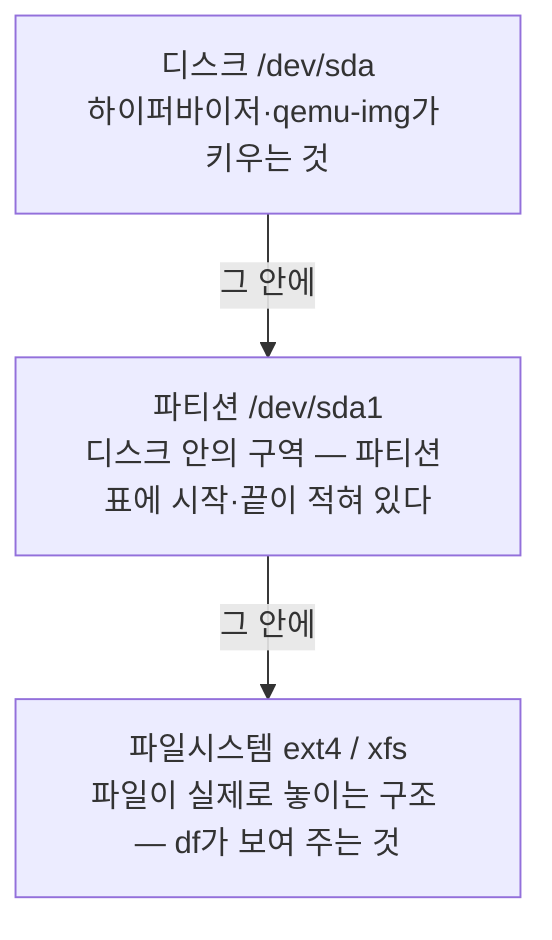
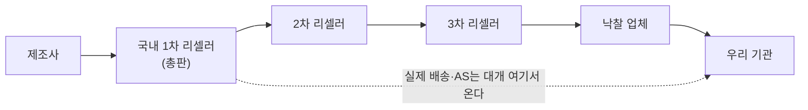

# Part 1. 이미지 — 서버를 "만들어 두고" 쓴다

> 담당 랩 [실습①](labs/lab-01.md)·[실습②](labs/lab-02.md). 랩에서 손으로 만든 뒤, 여기서 **왜 그렇게 하는지**를 본다.

이 파트를 관통하는 생애주기는 한 줄입니다.


각 절은 이 고리의 한 칸을 설명합니다. 마지막 두 절(1.8·1.9)은 "이미지 바깥"의 재현성과 운반을 다룹니다.

## 1.1 왜 ISO를 안 까는가 — 골든 이미지와 선언형 운영

**멘탈모델:** 서버는 *설치하는 것*이 아니라 *만들어 둔 파일을 붓는 것*이다.

ISO로 설치하면 마법사에서 누른 선택(파티션·패키지·계정)이 사람의 손과 기억에 남습니다. 같은 서버를 두 번 만들면 두 번 다르고, 왜 다른지 기록도 없습니다. 반대로 **골든 이미지**는 "이 상태가 정답"이라는 결과물 자체가 파일 하나입니다. 바꾸고 싶으면 파일을 고치고, 다시 만들고 싶으면 파일을 붓습니다.

여기서 운영 방식이 바뀝니다. 절차(명령형: "이걸 깔고 저걸 눌러라")가 아니라 **원하는 상태(선언형)** 를 정의하고, 그 상태를 반복해서 찍어냅니다. [실습①](labs/lab-01.md)의 `virt-customize` 한 덩어리가 곧 그 선언입니다. 스크립트는 git에 두고, 비밀(비번)만 밖에 둡니다.

이점은 속도보다 **감사 가능성**입니다. "이 서버에 무엇이 들어 있나"가 사람의 기억이 아니라 파일과 스크립트에 있으면, 사고가 났을 때 되돌릴 기준점이 있습니다. 복구([1.5](#15-배포의-세-길과-복구--pve-clone--v2p--clonezilla))가 분 단위로 가능한 것도 같은 이유입니다.

더 깊이: [cloud-init 문서](https://cloudinit.readthedocs.io/) (첫 부팅 때 선언을 적용하는 표준 방식), [Ubuntu cloud images](https://cloud-images.ubuntu.com/).

## 1.2 클라우드 이미지 해부 — qcow2/raw, OVA/OVF, thin vs thick

**멘탈모델:** 디스크 이미지는 "포장 방식이 다른 디스크 한 장"이다. 내용이 같아도 포장이 다르면 크기·속도·기능이 다르다.

현장에서 마주치는 형식은 넷입니다.

- **raw:** 디스크 바이트 그대로. 가장 단순하고 빠르며, `dd`로 물리 디스크에 바로 쓸 수 있습니다. 대신 *용량 전체*를 차지합니다(thick).
- **qcow2:** QEMU의 형식. 쓴 만큼만 커지는 **thin**이고 스냅샷·압축·백업체인을 지원합니다. 클라우드 이미지가 이 형식으로 배포되는 이유입니다.
- **VMDK / VHD(X) / VDI:** 각각 VMware, Hyper-V, VirtualBox의 형식. 서로 `qemu-img convert`로 오갑니다.
- **OVA/OVF:** 디스크 *하나*가 아니라 "VM 정의서(OVF, XML) + 디스크들"을 묶은 포장입니다. 정의서에는 vCPU 개수, 메모리 크기, 가상 NIC(MAC 주소 포함) 같은 **구성 정보**가 들어 있습니다. OVA는 그걸 tar로 묶은 것. 하이퍼바이저 사이를 옮길 때 쓰고, 안의 디스크는 VMDK인 경우가 많습니다. 정의서의 MAC 주소까지 그대로 옮겨 오므로, 같은 OVA로 VM 두 대를 띄우면 MAC이 겹칠 수 있습니다([§1.4](#14-정체성-리셋--virt-sysprep-machine-id-ssh-hostkey-selinux-autorelabel)와 같은 문제).

thin이 항상 이득은 아닙니다. 쓰기 때마다 공간을 늘리므로 단편화·성능 비용이 있고, 호스트 저장소를 *초과 약정(over-provisioning)* 하면 어느 날 갑자기 꽉 차서 VM 전체가 멈춥니다. 반대로 thick은 예측 가능하지만 낭비입니다. 배포용 골든 이미지는 thin(작아서 옮기기 쉬움), 운영 디스크는 용량 계획과 함께 고르는 것이 보통입니다.

```bash
# 형식, 가상 크기 vs 실제 크기
qemu-img info ⟨image.img⟩
# 형식 변환 (V2P의 핵심 명령이기도 하다)
qemu-img convert -O raw ⟨in.qcow2⟩ ⟨out.raw⟩
```

`info`의 *virtual size*(게스트가 보는 크기)와 *disk size*(파일이 실제 차지하는 크기)가 다르면 thin입니다.

**압축 qcow2.** 배포용 이미지를 더 작게 만들려면 변환할 때 `-c`를 붙입니다. 형식은 그대로 qcow2이고(따로 "qcow2c"라는 형식이 있는 것은 아닙니다), 블록이 압축되어 저장될 뿐입니다. 읽을 때 압축을 푸느라 조금 느리고, 게스트가 새로 쓰는 블록은 압축되지 않으므로 **보관·배포용**에 맞습니다.

```bash
# 압축된 qcow2로 변환
qemu-img convert -c -O qcow2 ⟨in.qcow2⟩ ⟨out-compressed.qcow2⟩
```

| 용도 | 형식(확장자) | 풀이 | 주로 쓰는 곳 |
| --- | --- | --- | --- |
| 가상 디스크 | `.vdi` | Virtual Disk Image | VirtualBox |
| 〃 | `.vhd`, `.vhdx` | Virtual Hard Disk | Hyper-V |
| 〃 | `.vmdk` | Virtual Machine Disk | VMware |
| 〃 | `.qcow2` | QEMU Copy-On-Write v2 (`-c`로 압축 가능) | QEMU/KVM, Proxmox, 클라우드 이미지 |
| 〃 | `.raw`, `.img` | 디스크에 쓰이는 비트열 그대로 | 어디서나, `dd` |
| 가상 컴퓨터 (디스크 + 구성 정보) | `.ovf` + 디스크 | Open Virtualization Format | 하이퍼바이저 간 이동 |
| 〃 | `.ova` | 위를 tar 하나로 묶은 것 | 〃 |

**이 책의 실습 디스크는 qcow2(thin)입니다.** 이유는 셋입니다. 받은 클라우드 이미지가 이미 qcow2라 변환이 필요 없고, 쓴 만큼만 차지해 VM 여러 대를 띄워도 저장소가 버티며, 무엇보다 **복제가 빠릅니다.** qcow2는 다른 qcow2를 **백킹 파일**(backing file)로 삼아, 원본은 읽기만 하고 바뀐 블록만 자기 파일에 쓰는 *링크드 클론*을 만들 수 있습니다. 실습처럼 같은 이미지로 VM을 여러 번 만들고 버리는 데 딱 맞습니다.

```bash
# 원본(골든)은 그대로 두고, 그 위에 VM마다 얇은 층을 하나씩
qemu-img create -f qcow2 -b ⟨golden.qcow2⟩ -F qcow2 ⟨vm1.qcow2⟩
qemu-img info ⟨vm1.qcow2⟩
```

1 GiB를 채운 4 GiB 원본으로 시험한 결과입니다(qemu-img 8.2).

```text
링크드 클론 3개 만들기   각 0.00초
원본 통째 복사(cp)        0.44초 → 1.1G
vm1 (10 MB 쓴 뒤)         11M    backing file: base.qcow2
vm2 (아무것도 안 씀)      196K
```

PVE의 *Linked Clone*(템플릿에서 복제할 때 기본값)도 같은 원리입니다. 대신 **원본을 지우거나 고치면 그 위의 클론이 모두 망가지므로**, 원본은 템플릿으로 굳혀 두고 손대지 않습니다. 오래 쓸 VM은 *Full Clone*이나 `qemu-img convert`로 백킹 파일을 떼어 냅니다.

**형식과 파일시스템은 다른 층입니다.** qcow2·raw는 디스크를 담는 **포장**이고, 그 안의 루트 파티션이 쓰는 **파일시스템**(ext4·XFS)은 따로입니다. 아래 표의 "루트 FS"가 후자입니다.

가상 디스크끼리, 가상 컴퓨터 포장끼리는 서로 변환할 수 있습니다. 확장자가 형식을 보장하지는 않으니(우분투의 `.img`는 실제로 qcow2) 항상 `qemu-img info`로 확인합니다.

**thin은 discard와 한 쌍입니다.** thin 디스크는 "쓴 만큼" 커지지만, 저절로 줄어들지는 않습니다. 게스트에서 파일을 지우면 파일시스템은 그 블록을 빈칸으로 표시할 뿐, 아래 저장소에는 아무 말도 하지 않습니다. 그러면 지운 데이터가 저장소에 계속 남아 공간을 차지하고, 클론과 백업이 그 죽은 블록까지 복사합니다. 초과 약정한 thin 풀이 "아무도 안 쓰는 데이터"로 꽉 차는 사고도 여기서 납니다.

해결책은 게스트가 **TRIM**("이 블록 이제 안 씀")을 보내고, 그 신호가 끝까지 내려가게 하는 것입니다. 게스트 파일시스템 → 가상 디스크 컨트롤러(VirtIO SCSI의 UNMAP) → QEMU → 저장소(LVM-thin의 블록 반납, qcow2·ZFS의 구멍 뚫기) 순서입니다. 이 사슬이 이어지려면 하이퍼바이저에서 VM 디스크의 **discard 옵션**을 켜야 합니다(Proxmox는 디스크의 *Discard*, 게스트가 SSD로 인식해 TRIM을 보내도록 *SSD emulation*도 함께). 그다음 게스트에서 TRIM을 보냅니다. 방법은 두 가지입니다. 주기적으로 한꺼번에 보내는 `fstrim.timer`(권장. Ubuntu·Debian은 기본으로 켜져 있지만 배포판마다 다르니 `systemctl status fstrim.timer`로 확인)와, 지울 때마다 보내는 마운트 옵션 `discard`(즉시 반영되지만 삭제가 잦으면 느려짐)입니다. 그러면 비어 있는 블록은 저장소에서 진짜로 사라지고, 백업할 때는 0으로 읽혀 압축·중복제거에서 거의 공짜가 됩니다. **thin을 쓰는 이유인 "빠른 백업·복원"이 discard까지 켜야 완성되는** 셈입니다. [실습②ⓑ](labs/lab-02.md)에서 클론 전에 이걸 확인합니다.

이미지 파일에도 같은 일이 있습니다. 골든 이미지를 패치하면서 지운 패키지 캐시가 이미지 안에 남아 크기를 불립니다. 이때는 오프라인 도구 `virt-sparsify --in-place ⟨image.qcow2⟩`가 빈 블록을 찾아 이미지를 다시 얇게 만듭니다. 1.3의 libguestfs 도구 모음에 들어 있습니다.

### 디스크를 키울 때 — 디스크·파티션·파일시스템은 세 겹

클라우드 이미지는 일부러 작게 옵니다(우분투 3.5 GiB, Rocky 10 GiB). 그래서 쓰다 보면 반드시 키우게 되는데, 이때 **겹이 셋**이라는 걸 알아야 합니다.



바깥 겹을 키워도 안쪽 겹은 그대로입니다. 20 GiB로 키운 디스크 안에서 파티션은 여전히 3 GiB이고, 파일시스템도 3 GiB만 씁니다. `lsblk`는 디스크가 커진 걸 보여 주는데 `df -h`는 그대로인 게 이 때문입니다. 그래서 키우기는 항상 **바깥에서 안으로 세 단계**입니다.

| 겹 | 명령 | 비고 |
| --- | --- | --- |
| 디스크 | 이미지 파일: `qemu-img resize ⟨image.img⟩ 20G` (꺼진 상태) · PVE: 디스크 *Resize* 또는 `qm disk resize ⟨vmid⟩ scsi0 +10G` | PVE는 **VM이 켜진 채로** 된다 |
| 파티션 | `sudo growpart /dev/⟨sda⟩ ⟨1⟩` | 디스크와 **파티션 번호**를 띄어 쓴다 |
| 파일시스템 | ext4: `sudo resize2fs /dev/⟨sda1⟩` · XFS: `sudo xfs_growfs /` | XFS는 장치가 아니라 **마운트 지점**을 준다 |

**파티션 번호 ≠ 디스크 안의 위치.** 번호는 파티션 표의 칸 번호일 뿐, 디스크의 앞뒤 순서가 아닙니다. 실제로 배포판 이미지들을 열어 보면 이렇습니다(2026-11 기준 `current`·`latest` 이미지).

| 이미지 | 디스크 앞 → 뒤 순서 | 루트 | 루트 FS |
| --- | --- | --- | --- |
| Ubuntu 26.04 | p13(`/boot`) → p14(BIOS) → p15(EFI) → **p1** | p1 | ext4 |
| Ubuntu 24.04 | p14(BIOS) → p15(EFI) → p16(`/boot`) → **p1** | p1 | ext4 |
| Debian 13 | p14(BIOS) → p15(EFI) → **p1** | p1 | ext4 |
| Rocky 9 · 10 | p1(BIOS) → p2(EFI) → p3(`/boot`) → **p4** | p4 | XFS |

우분투·데비안은 루트가 1번인데 디스크 **맨 뒤**에 있고, Rocky는 4번이 맨 뒤입니다. 같은 우분투도 26.04에서는 `/boot`(1 GiB)가 13번이 되어 디스크 **맨 앞**으로 옮겨 갔습니다. 공통점은 **루트가 맨 뒤**라는 것 — 파티션은 뒤쪽 빈 공간으로만 늘릴 수 있으니, 이미지를 만드는 쪽에서 키울 수 있게 일부러 그렇게 배치한 겁니다. 반대로 루트 뒤에 다른 파티션(스왑 등)이 있으면 `growpart`가 늘릴 자리가 없습니다. 그러니 번호를 외우지 말고 매번 `lsblk -f`로 **어느 게 루트이고 FS가 무엇인지** 보고 나서 명령을 칩니다.

**자동으로 커지기도 합니다.** 클라우드 이미지의 cloud-init은 **부팅할 때마다** 루트 파티션과 파일시스템을 디스크 끝까지 키웁니다(`growpart`·`resizefs` 모듈). 그래서 PVE에서 디스크를 키우고 재부팅하거나, 작은 이미지를 큰 디스크에 부으면(V2P) 아무것도 안 해도 커져 있습니다. 단, **cloud-init이 실제로 돌 때만**입니다. 설정을 건네줄 데이터소스(PVE의 *Cloud-Init* 드라이브, NoCloud 시드 등)를 하나도 못 찾으면 cloud-init은 스스로 꺼질 수 있습니다(`cloud-init status`로 확인). 그럴 때와 재부팅할 수 없을 때는 위의 세 단계를 손으로 합니다. 비슷한 장치로 `/etc/fstab`의 마운트 옵션 `x-systemd.growfs`가 있는데, 이건 마운트할 때 **파일시스템만** 키웁니다. 파티션은 그 전에 커져 있어야 합니다.

⚠️ **줄이기는 다른 이야기입니다.** XFS는 줄일 수 없고, ext4는 마운트를 풀어야만 줄일 수 있으며, 순서도 안에서 바깥으로 거꾸로입니다. 줄일 일이 생기면 "새로 작은 디스크를 만들어 옮긴다"가 보통 더 안전합니다. 그리고 LVM을 쓰는 서버라면 파티션과 파일시스템 사이에 겹이 하나 더 있습니다(`pvresize` → `lvextend -r`).

더 깊이: [QEMU qcow2 스펙](https://www.qemu.org/docs/master/interop/qcow2.html), [qemu-img 매뉴얼](https://www.qemu.org/docs/master/tools/qemu-img.html), [DMTF OVF 표준](https://www.dmtf.org/standards/ovf).

## 1.3 끄고 고치기 — libguestfs와 오프라인이 안전한 이유

**멘탈모델:** 이미지는 *켜야만 보는 블랙박스가 아니다.* 파일시스템이 들어 있는 파일일 뿐이고, 꺼진 채로 열어 읽고 고칠 수 있다.

[libguestfs](https://libguestfs.org/) 도구 모음은 이미지를 작은 임시 VM(어플라이언스)으로 열어 그 안의 파일시스템을 대신 만져 줍니다. 읽기용은 이렇습니다.

```bash
# OS 종류·버전·설치 앱
virt-inspector -a ⟨image.img⟩ | head -40
# 디렉터리 목록
virt-ls  -a ⟨image.img⟩ /etc
# 파일 한 개 뽑기
virt-cat -a ⟨image.img⟩ /etc/os-release
```

쓰기용은 `virt-customize`(계정·패키지·파일·첫 부팅 명령)입니다. 디스크를 *진짜 폴더처럼* 마운트하고 싶으면 `qemu-nbd`로 이미지를 블록 장치(`/dev/nbd0`)로 노출한 뒤 `mount`합니다. 두 방식은 용도가 다릅니다. libguestfs는 *안전하고 스크립트하기 좋고*, nbd 마운트는 *호스트 커널이 직접 만지므로 자유롭지만 실수에 취약*합니다. 마운트했으면 반드시 `umount` 후 `--disconnect`로 끝내야 이미지가 깨지지 않습니다.

**왜 꺼진 채로 하나.** 켜는 순간 이미지는 *다른 물건*이 됩니다. 서비스가 떠서 로그와 상태 파일이 쌓이고, 네트워크에 붙어 외부와 통신하고, DHCP 임대·SSH 키·`machine-id`가 그 인스턴스 고유의 값으로 굳어집니다. 골든 이미지를 한 번 켜 보는 순간 "깨끗한 원본"이 아니게 되는 겁니다. 오프라인이면 이 중 아무것도 일어나지 않으므로, 패치는 **재현 가능하고 부작용이 없습니다.**

같은 이유로 *켜진* 이미지를 오프라인 도구로 건드리면 안 됩니다(게스트가 쓰는 중인 파일시스템과 충돌해 손상). [실습①](labs/lab-01.md)의 경고 "꺼진 상태에서만"은 그 뜻입니다.

보안 디테일 하나. 비번을 `--root-password password:평문`으로 쓰면 셸 히스토리와 `ps`에 남습니다. `--root-password file:pass.txt`로 파일에서 읽히고(`chmod 600`), 끝나면 `shred -u`로 지웁니다. 그 파일은 저장소에 커밋하지 않습니다.

### 고치기보다 얹기 — 드롭인(.d)과 파일로서의 설정

**멘탈모델:** 리눅스 설정을 바꾸는 가장 안전한 방법은 *원본 파일을 편집하는 것*이 아니라 **조각 파일 하나를 놓는 것**이다.

윈도우는 설정을 레지스트리라는 하나의 불투명한 바이너리 하이브에 넣습니다. `diff`로 비교할 수도, git에 올릴 수도, "이 한 줄만 바꿨다"를 떼어 보여줄 수도 없습니다. 리눅스는 반대입니다. 설정은 **평문 파일**이고, 많은 서비스가 큰 설정 파일 하나가 아니라 그 파일이 작은 조각들을 **불러오는(include)** 구조를 씁니다. 그 조각들이 모인 곳이 `*.d/` 디렉터리입니다.

```bash
# 주석 걷어내고 '실제 설정'만
grep -v '#' /etc/ssh/sshd_config | uniq
# → 흔히:  Include /etc/ssh/sshd_config.d/*.conf
```

이 `Include`가 있으면, 원본 `sshd_config`를 `sed`로 깎을 이유가 없습니다. `*.d/`에 `60-lab.conf` 한 장을 **복사해 넣으면** 됩니다. 두 방식의 차이가 운영에서 큽니다. `sed`는 상태 의존적입니다 — "그 줄이 있나? 이미 주석 처리됐나? 두 번 돌리면 중복되나?"를 매번 따져야 하고, 배포판이 원본 포맷을 바꾸면 깨집니다. **복사는 멱등**입니다. 몇 번을 해도 결과가 같고, 내가 바꾼 것이 조각 파일 하나로 또렷이 남아 `diff`·git·리뷰에 그대로 올라갑니다. 원본은 배포판이 주는 대로 두고, **내 결정만 떼어 놓는** 것 — 이것이 1.1의 선언형 운영을 설정 수준에서 실천하는 모습입니다.

오프라인 이미지에서는 세 가지로 그 조각을 넣습니다. `virt-copy-in -a img 60-lab.conf /etc/ssh/sshd_config.d/`(가장 단순), `virt-customize --copy-in 60-lab.conf:/etc/ssh/sshd_config.d/`(패치 한 덩어리 안에서), `--upload 로컬:정확한/경로`(권한·이름까지 지정). 같은 자리에 `--mkdir`·`--chmod`·`--chown`이 함께 옵니다.

조각 파일에는 규칙이 하나 있습니다. **주석은 설정 줄과 같은 줄에 쓰지 않습니다.** `PasswordAuthentication no  # 랩용`처럼 쓰면 방금 본 `grep -v '#'`가 그 줄을 통째로 걸러 버리고, 그보다 중요하게 — 많은 파서가 인라인 `#`을 주석이 아니라 **값의 일부**로 읽습니다(`sshd_config`의 상당수 지시어가 그렇습니다). 그래서 관례가 "주석은 바로 윗줄에". 사람이 읽기 좋자고 붙인 한마디가 설정을 조용히 망가뜨리지 않게 하는 습관입니다.

`.d/`는 어디에나 있습니다 — `/etc/sudoers.d/`, `/etc/rsyslog.d/`, `/etc/cron.d/`, `/etc/profile.d/`(로그인 셸 환경·프롬프트), `/etc/sysctl.d/`(커널 파라미터), `/etc/systemd/system/⟨서비스⟩.service.d/`(유닛 오버라이드), `/etc/apt/apt.conf.d/`·`sources.list.d/`, `/etc/yum.repos.d/`, `/etc/NetworkManager/conf.d/`, `/etc/modprobe.d/`, `/etc/logrotate.d/`. 읽히는 **순서와 우선순위는 서비스마다 다르므로**(sshd는 먼저 얻은 값이 이깁니다) 조각 이름에 `60-` 같은 번호를 붙여 순서를 드러냅니다 — 그래도 man 확인이 먼저입니다.

같은 사고방식의 또 다른 얼굴이 **심볼릭 링크로 켜고 끄기**입니다. 아파치는 설정을 `sites-available/`에 모아 두고, 활성화할 것만 `sites-enabled/`로 `ln -s` 합니다(`a2ensite`가 그 링크를 만들고 `a2dissite`가 지웁니다). nginx도 같은 관습이고, `systemctl enable` 역시 내부적으로는 유닛을 `*.wants/`에 링크하는 일입니다. 설정을 **지우지 않고 링크만 끊어** 끌 수 있다는 것 — "있는 것"과 "켜진 것"을 분리하는 설계입니다. [실습①](labs/lab-01.md)에서 `grep`으로 `Include`를 직접 발견하고 조각을 얹어 보는 손놀림이 이 절 전체의 씨앗입니다.

더 깊이: [libguestfs 문서](https://libguestfs.org/guestfs.3.html), [virt-customize](https://libguestfs.org/virt-customize.1.html), [qemu-nbd](https://www.qemu.org/docs/master/tools/qemu-nbd.html), [sshd_config(5)](https://man.openbsd.org/sshd_config), [systemd.unit(5) 드롭인](https://www.freedesktop.org/software/systemd/man/latest/systemd.unit.html).

### 점 파일(dotfile) — 손에 익은 환경도 파일이다

리눅스에서 이름이 점(`.`)으로 시작하는 파일은 **숨김 파일**입니다. `ls`로는 안 보이고 `ls -a`를 해야 보입니다.

```bash
# 안 보인다
ls ~
# 보인다
ls -a ~
```

이 점 파일들이 각 도구의 **사용자 설정**입니다.

| 점 파일 | 무엇 |
| --- | --- |
| `~/.bashrc`, `~/.zshrc` | 셸 설정 — `alias`, `PATH`, 프롬프트 |
| `~/.vimrc` | vi(vim) 설정 — 들여쓰기, 줄 번호, 문법 강조 |
| `~/.ssh/config` | ssh 접속 별명 — 호스트·사용자·포트·경유지 |
| `~/.gitconfig` | git 이름·이메일·별명 |
| `~/.tmux.conf` | 터미널 분할 도구 설정 |

**조직의 암묵지는 점 파일에 있습니다.** 고수가 빠른 이유의 상당 부분은 손이 아니라 몇 년 동안 다듬은 `alias` 몇 줄, `~/.ssh/config`의 접속 별명, `.vimrc` 몇 줄입니다. 그런데 이건 그 사람 홈 디렉터리에 숨어 있어서(말 그대로 `ls`로 안 보여서) 아무도 모릅니다. 그래서 컴퓨터를 잘 다루는 사람들은 자기 점 파일을 **GitHub에 저장소로 올려 두고**(흔히 `dotfiles`라는 이름) 새 장비마다 그대로 내려받습니다. GitHub의 [`dotfiles` 토픽](https://github.com/topics/dotfiles)에 수많은 예가 모여 있습니다. 설치한 프로그램 목록(Brewfile, `winget export`)까지 같이 넣어 두는 방법은 [부록 G](G-packages.md)에서.

팀으로 넓히면 효과가 더 큽니다. **팀이 점 파일을 공유하면** 신입은 첫날부터 선배와 같은 별명·같은 도구·같은 프롬프트로 일합니다. 온보딩 문서를 읽는 것보다 빠르고, 개인 편차가 줄어듭니다. 실습①에서 심는 KREONET [ohmyzsh](https://github.com/KREONET/ohmyzsh) 운영환경이 바로 그런 **조직 공용 점 파일**입니다.

**ssh 접속 별명을 프로젝트별로 나눠 공유하기.** 앞의 드롭인과 같은 발상을 내 홈에도 쓸 수 있습니다. `~/.ssh/config`에 `Include` 한 줄을 두고, 프로젝트마다 파일을 하나씩 둡니다.

```
~/.ssh/config              ← 맨 위에 Include 한 줄 + 내 개인 설정
~/.ssh/conf.d/prj1.conf    ← 프로젝트1 팀이 공유하는 파일
~/.ssh/conf.d/prj2.conf    ← 프로젝트2 팀이 공유하는 파일
```

```bash
# ~/.ssh/config — Include는 반드시 맨 위에
Include conf.d/*.conf

Host *
  ServerAliveInterval 30
```

```bash
# ~/.ssh/conf.d/prj1.conf — 팀 저장소에서 받아 그대로 둔다
Host prj1-web
  HostName 192.0.2.10
  User deploy
Host prj1-db
  HostName 192.0.2.11
  ProxyJump prj1-web
```

이제 팀원 모두가 `ssh prj1-db`라는 **같은 이름**으로 같은 서버에, 같은 경로(경유지 포함)로 들어갑니다. 서버 IP가 바뀌면 그 파일 하나만 고쳐 다시 나누면 됩니다. 실제로 어떤 값이 적용되는지는 `ssh -G prj1-db`로 확인합니다.

⚠️ **`Include`는 맨 위에.** `Include`가 어떤 `Host` 블록 **아래**에 있으면 그 호스트에게만 적용됩니다. `Host bastion` 밑에 `Include`를 두면 `ssh prj1-web`이 "그런 호스트 없음"이 됩니다. 그리고 ssh는 **먼저 읽은 값이 이기므로**, 맨 위에 둔 공유 설정이 아래의 `Host *` 기본값보다 우선합니다.

⚠️ **비밀은 공유하지 않습니다.** `~/.ssh/config`·`.bashrc`·`.vimrc`는 나눠도 되지만, 개인 키(`~/.ssh/id_*`), 토큰이 든 파일(`~/.netrc`, `~/.pgpass`, `~/.aws/credentials`, `~/.docker/config.json`)은 절대 저장소에 올리지 않습니다. 점 파일 저장소에는 `.gitignore`로 이것들을 막아 두고, 올리기 전에 한 번 더 `git diff`로 봅니다.

## 1.4 정체성 리셋 — virt-sysprep, machine-id, SSH hostkey, SELinux .autorelabel

**멘탈모델:** 이미지를 복제할 때 *복제되면 안 되는 것*은 데이터가 아니라 **정체성**이다.

한 서버를 꾸린 뒤 그대로 100대에 붓는다고 합시다. 100대가 모두 같은 `machine-id`, 같은 SSH 호스트 키, 같은 로그를 갖습니다. 그 결과가 생각보다 고약합니다.

- **machine-id 중복:** systemd와 DHCP 일부가 이를 식별자로 씁니다. 같은 값이면 같은 IP를 받거나 로그가 뒤섞입니다.
- **SSH hostkey 중복:** 한 대의 개인키가 새면 100대 전부 사칭당합니다. 클라이언트는 "서버가 같다"고 신뢰합니다.
- **로그·셸 히스토리·임시 파일:** 원본 작업자의 흔적이 모든 복제본에 배포됩니다.

`virt-sysprep`이 이를 오프라인으로 지웁니다. 실행하면 `Performing "machine-id"…` 같은 줄이 수십 개 나옵니다. 지워진 `machine-id`와 호스트 키는 **첫 부팅 때 새로 생성**됩니다. 그래서 [실습②](labs/lab-02.md)에서 부은 뒤 `cat /etc/machine-id`가 클론과 겹치지 않는 새 값으로 나오는 겁니다.

주의할 순서가 있습니다. **패치(customize) 다음에 sysprep**, 그리고 sysprep 이후엔 *그 이미지를 켜지 않습니다.* 켜면 정체성이 다시 생기므로 리셋이 무효가 됩니다.

Rocky/RHEL 계열에는 한 가지가 더 있습니다. 오프라인으로 파일을 쓰면 SELinux 보안 라벨이 없거나 틀립니다. 그대로 부팅하면 서비스가 거부당하거나 로그인이 막힙니다. 그래서 `--touch /.autorelabel`로 **다음 부팅 때 전체 재라벨**을 예약합니다. 첫 부팅이 평소보다 길어지는 건 정상입니다. 루트 비번 복구([1.6](#16-열쇠를-잃었을-때--루트-비번-복구와-그-함의))에서도 같은 이유로 등장합니다.

더 깊이: [virt-sysprep](https://libguestfs.org/virt-sysprep.1.html), [machine-id(5)](https://www.freedesktop.org/software/systemd/man/latest/machine-id.html), [RHEL SELinux 문서](https://docs.redhat.com/en/documentation/red_hat_enterprise_linux/9/html/using_selinux/index).

### SELinux를 끄지 마세요 — 끄는 게 아니라 "가르치는" 것

**멘탈모델:** SELinux는 성가신 방해물이 아니라, *프로세스가 자기 일 바깥을 못 넘게 가두는* 보안 그물이다. 앱이 안 뜬다고 그물을 치우는 건, 사고가 날 길을 열어 두는 것이다.

RHEL 계열은 "까다롭다"는 말을 자주 듣습니다. 기본 프로그램의 **포트를 바꾸거나**, 새 앱을 띄우거나, 비표준 경로에 파일을 두면 — 분명히 설정은 맞는데 서비스가 거부당합니다. 범인은 대개 SELinux입니다. 그리고 인터넷의 수많은 답이 `setenforce 0`나 `SELINUX=disabled`로 **그냥 꺼 버리라**고 말합니다. 이 과정에서는 그렇게 하지 않습니다.

SELinux(Security-Enhanced Linux)는 미국 국가안보국(**NSA**)이 만들어 리눅스 커널에 기여한 **강제적 접근 제어(MAC)** 입니다. 보통의 리눅스 권한(소유자·그룹·rwx)은 *사용자*가 무엇을 할 수 있는지를 정하는 임의적 접근 제어(DAC)지만, SELinux는 *프로세스*에 라벨(type)을 붙이고 "이 type은 이 type의 파일·포트에만 접근"이라는 규칙을 커널이 강제합니다. 그래서 웹서버가 뚫려도 공격자는 `httpd_t`가 허락된 것 밖으로 — 예컨대 `/etc/shadow`나 임의 포트로 — 나가지 못합니다. 침해의 **폭발 반경을 줄이는** 장치입니다. 끄는 순간 이 그물이 통째로 사라집니다.

그러니 막혔을 때의 올바른 순서는 "끄기"가 아니라 "**읽고 가르치기**"입니다.

```bash
# 최근 거부(AVC) 로그를 본다 — '무엇이 왜 막혔나'
sudo ausearch -m avc -ts recent
# 사람이 읽는 설명으로 풀어 준다
sudo ausearch -m avc -ts recent | audit2allow -w
# 포트를 바꾼 경우(가장 흔함): 새 포트에 라벨을 붙인다 (끄는 게 아니라 '알려 주기')
sudo semanage port -a -t ssh_port_t -p tcp 2222
# 비표준 경로/동작이면: 거부 로그로 '최소 정책'을 생성·적용
sudo ausearch -m avc -ts recent | audit2allow -M mylocalpol && sudo semodule -i mylocalpol.pp
# 파일 라벨이 틀어졌을 때 표준 라벨로 복원
sudo restorecon -Rv /srv/myapp
```

AVC 로그는 사람에게 암호 같아 보이지만 — **여기서 AI가 특히 쓸모 있습니다.** `ausearch` 출력을 그대로 붙여 "이 거부가 왜 났고 최소 권한 정책은 무엇이냐"고 물으면, 어떤 type·포트·경로가 걸렸는지 풀어 주고 `audit2allow` 결과까지 검토해 줍니다. 무턱대고 `allow` 전체를 심는 대신 **딱 필요한 규칙만** 남기도록 — 그게 [Part 7(AI 거버넌스)](07-ai-governance.md)에서 말하는 "AI를 조수로 쓰되 최소 권한 원칙은 사람이 지킨다"의 구체적 사례입니다. 디버깅 중 잠깐 원인을 좁히려면 `setenforce 0`(permissive, **재부팅하면 원복**)로 "지금 끈다면 뜨나?"만 확인하고 곧바로 다시 켜되, 영구 비활성화(`SELINUX=disabled`)는 하지 않습니다.

컨테이너에서도 같은 원리가 보입니다. 볼륨 마운트가 거부되면 끄는 대신 `:z`/`:Z` 라벨 옵션으로 공유 라벨을 붙입니다([Part 4](04-container.md)).

**데비안·우분투·SUSE는 보통 SELinux 대신 [AppArmor](https://apparmor.net/)** 를 씁니다. 둘 다 커널의 LSM이지만 접근법이 다릅니다 — SELinux는 *라벨(type)* 기반이라 강력하고 세밀한 대신 학습 곡선이 가파르고, AppArmor는 `/etc/apparmor.d/`의 **경로 기반 프로파일**이라 읽고 고치기 쉽습니다. 막혔을 때의 철학은 똑같습니다. 프로파일을 `aa-complain`으로 잠시 관찰 모드에 두고 `aa-logprof`로 로그를 읽어 규칙을 다듬지, 통째로 끄지 않습니다. *어느 배포판을 쓰든 "안 되면 보안 모듈부터 끈다"는 방향이 아니라 "로그를 읽어 규칙을 만든다"가 안전 운영입니다.*

더 깊이: [RHEL SELinux 사용 가이드](https://docs.redhat.com/en/documentation/red_hat_enterprise_linux/9/html/using_selinux/index), [audit2allow·semanage](https://linux.die.net/man/1/audit2allow), [AppArmor 위키](https://gitlab.com/apparmor/apparmor/-/wikis/home).

## 1.5 배포의 세 길과 복구 — PVE Clone / V2P / Clonezilla

**멘탈모델:** 되돌리는 세 가지 방법은 *무엇을 뜨고, 어디서 누르는가*가 다르다.

| 길 | 무엇을 | 어디서 | 쓰임 |
| --- | --- | --- | --- |
| **PVE Clone** | VM의 *현재 상태* | 하이퍼바이저 웹 | 가상 세계의 undo 버튼 |
| **V2P** | *골든 이미지*를 디스크에 붓기 | 라이브 USB + `qemu-img convert` | 새 서버·재설치를 "준비된 상태"로 |
| **Clonezilla** | *지금 이 서버*의 디스크 | 라이브 USB (어디서나) | 물리 서버의 백업·복원 |

**Clone**은 가장 쉽습니다. 뭔가 위험한 일을 하기 전에 먼저 누르는 안전망입니다. 하지만 *하이퍼바이저가 있어야* 눌립니다.

**V2P**는 이름 그대로 가상(Virtual) 이미지를 물리(Physical) 디스크에 옮깁니다. 핵심은 `qemu-img convert -O raw ⟨이미지⟩ /dev/⟨디스크⟩` 한 줄. qcow2를 raw로 풀어 블록 장치에 직접 씁니다. [1.4](#14-정체성-리셋--virt-sysprep-machine-id-ssh-hostkey-selinux-autorelabel)에서 정체성을 리셋한 이미지라면, 같은 이미지를 몇 대에 부어도 각자 다른 서버로 깨어납니다. 설치 마법사를 한 번도 거치지 않습니다.

**Clonezilla**는 물리 서버에는 Clone 버튼이 없다는 문제의 답입니다. 라이브 USB로 부팅하면 어떤 장비에서든 그 버튼이 생깁니다. V2P와 달리 *골든*이 아니라 **지금 상태**(설정·데이터 포함)를 통째로 뜨고, **쓰인 블록만 압축**하므로 디스크 용량보다 훨씬 작습니다. 그래서 "이미지를 만든다"(V2P 재료)와 "상태를 지킨다"(Clonezilla)를 구분해 둬야 합니다.

가장 위험한 순간은 `convert`의 **대상 디바이스를 고르는 때**입니다. `/dev/sda`와 `/dev/sdb`를 바꿔 입력하면 반대쪽이 덮입니다. `lsblk`로 크기·모델·마운트 여부를 눈으로 확인하는 습관이 안전의 전부입니다.

```bash
# 쓰기 전에 반드시. 대상이 정말 빈 디스크인가?
lsblk -o NAME,SIZE,MODEL,MOUNTPOINT
```

복구 관점에서 요약하면, 깨끗한 재설치는 V2P, 이 서버 그대로 복원은 Clonezilla, VM이면 Clone입니다. 셋을 모두 갖춘 곳이 "디스크를 날려도 분 단위로 되살리는" 곳입니다.

더 깊이: [Clonezilla 문서](https://clonezilla.org/), [Proxmox VE: Clone](https://pve.proxmox.com/wiki/Qemu/KVM_Virtual_Machines), [qemu-img convert](https://www.qemu.org/docs/master/tools/qemu-img.html).

## 1.6 열쇠를 잃었을 때 — 루트 비번 복구와 그 함의

**멘탈모델:** 디스크를 손에 쥔 순간 로그인 화면은 장식이다. **콘솔이나 부팅 매체에 접근할 수 있으면 곧 루트다.**

[실습②ⓕ](labs/lab-02.md)의 두 방법은 같은 원리입니다. 운영체제가 *깨어 있는 동안*에만 비밀번호가 의미를 가지므로, 깨우기 전에 파일(`/etc/shadow`)을 직접 고치면 됩니다. 방법 A는 GRUB에서 `init=/bin/bash`(RHEL은 `rd.break`)로 인증을 건너뛰고, 방법 B는 라이브 USB로 루트 파티션을 마운트해 `chroot`로 `passwd`를 실행합니다. 앞의 [1.3](#13-끄고-고치기--libguestfs와-오프라인이-안전한-이유)에서 본 `virt-customize --root-password`와 뿌리가 같습니다. 오프라인으로 디스크를 만지는 것이니까요.

이게 *복구 요령*이면서 동시에 *공격 요령*이라는 점이 핵심입니다. 이 방법을 쓸 수 있는 사람은 누구든 루트가 됩니다. 그래서 다음은 "있으면 좋은" 항목이 아니라 **필수**입니다.

- **BIOS/UEFI 암호 + 부팅 순서 잠금:** USB 부팅을 막습니다.
- **GRUB 암호:** `e` 키 편집(방법 A)을 막습니다.
- **IPMI/BMC 보안:** 원격 콘솔도 콘솔입니다. 기본 계정·약한 비번은 곧 루트입니다. 관리망 격리 포함.
- **디스크 암호화(LUKS):** 방법 B를 끝냅니다. 패스프레이즈 없이는 파티션이 마운트되지 않습니다.
- **물리 접근 통제와 [bastion](06-access.md)(Part 6 접근):** 문 잠금, 그리고 접근 경로를 한 곳으로.

방어는 겹으로 쌓습니다. LUKS 하나가 가장 단단하지만, 부팅 때마다 패스프레이즈를 입력해야 하므로 원격 서버에서는 운영 부담이 생깁니다. 그 비용을 의식하고 선택하는 것이 "안전한 운영"입니다.

더 깊이: [GRUB 보안 매뉴얼](https://www.gnu.org/software/grub/manual/grub/html_node/Security.html), [cryptsetup/LUKS](https://gitlab.com/cryptsetup/cryptsetup), [Red Hat: 루트 비번 재설정](https://docs.redhat.com/en/documentation/red_hat_enterprise_linux/9/html/managing_basic_system_settings/index).

## 1.7 하드웨어 신원 — inxi·IPMI·서비스태그·자산 스티커

**멘탈모델:** 이미지가 "무엇을 설치했나"의 신원이라면, 하드웨어 신원은 "*지금 내가 어느 장비 앞에 있나*"의 신원이다.

데이터센터에는 같은 모양의 서버가 줄지어 있습니다. 엉뚱한 장비에 `reboot`하거나 디스크를 `convert`하는 사고는 대개 **내가 어느 장비에 있는지 몰라서** 납니다. 그래서 장비는 여러 층의 이름표를 가져야 하고, 그 이름표들이 서로 일치하는지 확인하는 것이 인수 절차입니다. 인수 절차의 핵심 명령은 두 줄입니다. 납품 업체에게 무엇을 받고 받는 날 무엇을 대조하는지 전체 절차는 [부록 K](K-delivery.md)에 있습니다.

```bash
# 모델·시리얼·CPU·메모리·디스크를 한 번에
sudo inxi -F
# BMC의 IP, MAC 주소 (관리망 신원)
sudo ipmitool lan print 1
```

- **시리얼/서비스태그:** 제조사가 부여한 고유값. `inxi -F`에서 나오고, 기기 앞뒤 스티커·서비스태그 라벨과 *눈으로 대조*합니다. 제조사 보증·지원 요청의 키이기도 합니다.
- **IPMI MAC:** 관리 포트(BMC)의 MAC. DHCP 예약이나 관리망 ACL의 키가 됩니다. 본체 NIC MAC과 다른 값입니다.
- **자산 스티커:** 기관의 자산 번호. 사람이 보는 층입니다.

이 값들을 *한곳에 모은 기록*(인벤토리 표)이 없으면 장애 때 "이 시리얼이 몇 번 랙의 어느 장비지?"를 몸으로 찾아야 합니다. 그리고 그 기록을 **서버 안에도** 넣어 두면, 접속한 순간에도 내가 어디 있는지 알 수 있습니다.

### 고장 났을 때 누구에게 전화하나 — 계약 업체와 AS 업체는 다르다

인벤토리에 하나 더 넣을 것이 **AS 창구**입니다. 국내 공공 입찰로 서버를 사면 물건은 보통 이렇게 흘러옵니다.



낙찰 업체는 1차 리셀러에게서 물건을 떼어다 파는 경우가 많고, 배송과 AS는 1차 리셀러가 직접 옵니다. 납품할 때 "AS는 1차 리셀러에게 받으시라"고 친절히 안내해 주기도 합니다. 그런데 기관 내부 기록(계약·자산 대장)에는 **계약 상대인 낙찰 업체만** 남습니다. 몇 년 뒤 고장이 나서 기록을 보고 낙찰 업체에 전화하면, 그 업체가 다시 위로 수소문하느라 시간이 갑니다.

**병행수입**이면 이야기가 또 다릅니다. 정식 유통망을 거치지 않았으니 AS를 낙찰 업체가 직접 맡는데, 그 업체가 이것저것 다 파는 도매상 같은 곳이라 서버 전문 지식이 없는 경우도 있습니다. 제조사 보증 처리도 정식 수입품과 다를 수 있습니다.

그래서 계약 정보와 **별도로** 이렇게 적어 둡니다. 납품받는 날이 이 정보를 모을 수 있는 가장 좋은 때입니다.

| 항목 | 예 |
| --- | --- |
| 낙찰(계약) 업체 | 계약서상의 업체·담당자 |
| **실제 AS 업체** | 1차 리셀러(총판) 이름·AS 접수 전화·담당 엔지니어 |
| 유통 경로 | 정식 수입 / 병행수입 |
| 보증 | 서비스태그(제조사 보증 조회 키)·보증 만료일·보증 등급(익일 방문 등) |

장애가 났을 때 필요한 건 "누구와 계약했나"가 아니라 "**누가 부품을 들고 올 수 있나**"입니다.

### 접속한 순간 "여기가 어디냐"를 알게 하기 — 자산 태그와 호스트명 규칙

**물리 서버: 자산 태그 (소개만).** 강사가 쓰는 개인 컨벤션 하나를 소개합니다. 물리 장비에 `/etc/tag1`(모델, 예: `Dell R740`)과 `/etc/tag2`(자산 ID)라는 한 줄짜리 파일을 두고, KREONET [ohmyzsh](https://github.com/KREONET/ohmyzsh) 프롬프트가 이를 읽어 `[TAG1 … | TAG2 …]`로 보여 줍니다. 값은 `inxi -F`와 자산 스티커에서 옵니다. 원래 가장 좋은 자리는 **메인보드**입니다. 디스크는 갈고 OS는 다시 깔아도 메인보드는 잘 안 바뀌니까요. 그래서 IPMI의 FRU(메인보드 롬에 적힌 보드 시리얼·자산 태그 같은 필드, `ipmitool fru print`로 보인다)에 자산 정보를 넣는 걸 표준으로 정해 두기도 했습니다. 문제는 **장비마다 다르다**는 것입니다. 어떤 벤더·모델은 FRU를 고쳐 쓸 수 있는데, 어떤 것은 막혀 있어서 쓰기 도구로 시도해도 거절당합니다. 모든 장비에 똑같이 적용할 수 없으니, 어디서나 되는 **파일 한 줄**로 내려온 것이 `/etc/tag1`·`/etc/tag2`입니다. 대가도 있습니다. 파일은 디스크에 있으므로 OS를 다시 깔거나 디스크를 바꾸면 다시 써 줘야 합니다. 이건 표준이 아니라 **한 사람의 습관**이고, *장비별 값*이라 물리 머신에만 의미가 있습니다(골든 이미지에 구우면 모든 장비가 같은 태그를 갖게 되니 1.4와 같은 이유로 안 됩니다). 이 과정에서 실습하지는 않습니다 — "이런 식으로 서버가 스스로 자기 신원을 말하게 할 수 있다"는 아이디어만 가져가면 됩니다.

**VM: 호스트명 명명 규칙.** VM이 수십 대가 되면 프롬프트의 `ubuntu@ubuntu`만으로는 어디에 붙어 있는지 금방 헷갈립니다. 이름에 정보를 넣으면 편합니다. 실제로 써 보니 편했던 규칙은 이렇습니다.

```
⟨IP 끝자리 3자리⟩-⟨OS약어+버전⟩-⟨용도⟩
  192.0.2.42 의 Ubuntu 24.04 웹서버  →  042-u24-web
  192.0.2.7  의 Rocky 9 DB           →  007-r9-db
```

```bash
# 붓고 난 뒤, 장비마다
sudo hostnamectl set-hostname 042-u24-web
```

IP 끝자리를 맨 앞에 두면 `ls`·목록에서 IP 순으로 정렬되고, 프롬프트만 보고 바로 `ssh ⟨…⟩.42`를 떠올릴 수 있습니다. OS 약어는 "이 명령이 apt냐 dnf냐"를, 용도는 "여기서 `reboot`해도 되나"를 알려 줍니다. 호스트명에는 영문·숫자·하이픈(`-`)만 쓰고 밑줄(`_`)은 쓰지 않습니다(RFC 1123).

**보안상 괜찮은가?** 태그와 호스트명에 담긴 정보는 많다면 많고 적다면 적습니다. 다만 OS 버전은 어차피 `/etc/os-release`에 있고, IP는 `ip a`로 그 서버에 들어온 누구든 조회할 수 있는 정보입니다. 공격자가 이미 셸에 들어왔다면 이 이름이 새로 알려 주는 건 거의 없습니다. 반면 운영자에게는 **엉뚱한 장비에서 명령을 치는 사고를 막아 주는** 효과가 큽니다. 위협은 미미하고 편의는 크니 — 쓰는 쪽이 낫습니다. (단, 외부 DNS에 공개되는 이름은 별개 문제이니 내부 이름에만 적용합니다.)

더 깊이: [inxi 문서](https://smxi.org/docs/inxi.htm), [ipmitool 매뉴얼](https://linux.die.net/man/1/ipmitool).

## 1.8 재현가능 환경 — 패키지 관리자 지형과 marimo

**멘탈모델:** "내 노트북에서는 되는데"의 해결책은 *환경을 더 많이 기억하는 것*이 아니라 **환경을 파일로 고정하는 것**이다.

패키지 관리자는 고정하는 범위가 점점 넓어지는 계단입니다.

1. **apt/dnf (OS 패키지):** 시스템 전체. 배포판이 관리하므로 안정적이지만 버전이 느리고, 프로젝트마다 다른 버전이 필요하면 충돌합니다.
2. **pip / [uv](https://docs.astral.sh/uv/) (파이썬 패키지):** 프로젝트별 가상환경. `pip freeze`나 uv의 lock 파일로 버전을 고정합니다. 파이썬만 고정하고 C 라이브러리·CUDA 같은 *비파이썬 의존성*은 못 잡습니다.
3. **conda 계열:** 파이썬 *바깥*(컴파일된 라이브러리)까지 환경 단위로 고정합니다. 과학 계산에서 사랑받는 이유입니다.
4. **컨테이너:** OS 사용자 공간까지 통째로 고정합니다. **최종 재현**의 단계입니다([Part 4](04-container.md)).

**VM 단위로 고정하는 길 — Vagrant.** 컨테이너가 사용자 공간을 고정한다면, VM 전체를 텍스트 파일 하나로 고정하는 도구도 있습니다. [Vagrant](https://developer.hashicorp.com/vagrant)는 VM을 CLI로 만들고 관리하는 도구로, `Vagrantfile`에 "어떤 이미지(box)로, CPU·메모리 얼마로, 무엇을 설치해서"를 적어 두면 `vagrant up` 한 번으로 같은 VM이 생깁니다. 개발용 노트북에 VM 기반 개발 환경을 꾸밀 때 특히 편합니다. 교육·실습 자료가 Vagrantfile로 배포되는 경우도 많습니다(예: P4 언어 튜토리얼의 [vm-ubuntu-20.04](https://github.com/p4lang/tutorials/tree/master/vm-ubuntu-20.04)).

```ruby
# Vagrantfile — 이미지(box) 이름만 정해도 시작할 수 있다
Vagrant.configure(2) do |config|
  config.vm.box = "bento/ubuntu-24.04"
end
```

```bash
# 위 파일이 있는 폴더에서
vagrant up
vagrant ssh
# 다 썼으면 지운다 (파일이 남아 있으니 언제든 다시 만들 수 있다)
vagrant destroy
```

box는 공개 레지스트리에서 받습니다. 이것도 남이 만든 이미지이니, [§1.1](#11-왜-iso를-안-까는가--골든-이미지와-선언형-운영)의 골든 이미지와 같은 질문("누가 만들었고 무엇이 들어 있나")을 던집니다. 그리고 **라이선스**: Vagrant는 2023년에 오픈소스 라이선스(MPL 2.0)에서 BSL 1.1(Business Source License, OSI 비승인)로 바뀌었습니다. 기관 안에서 개발 도구로 쓰는 것은 대개 문제없지만, Vagrant를 기반으로 경쟁 서비스를 만드는 일은 제한됩니다. "약관은 바뀝니다"([부록 B](B-licenses.md))의 실제 예입니다.

conda에는 함정이 하나 있습니다. **Anaconda 배포판의 기본 채널(`defaults`)은 일정 규모 이상의 조직에는 상용 라이선스가 요구됩니다.** 연구실이 무심코 Anaconda를 깔아 쓰다가 라이선스 위반이 되는 전형적인 섀도우 IT입니다. 대안은 **miniforge**(커뮤니티 `conda-forge` 채널이 기본, 무료)입니다. 같은 `conda` 명령을 쓰되 채널만 안전하게 바뀝니다. 즉 **anaconda ▶ miniforge**입니다. 이 책의 큰 그림("라이선스를 읽고")이 패키지 관리자 선택 하나에서도 적용됩니다.

노트북은 **[marimo](https://marimo.io/)** 를 권합니다. 차이를 한 표로 보면:

| | Jupyter (`.ipynb`) | marimo (`.py`) |
| --- | --- | --- |
| 파일 | JSON(출력 이미지까지 포함) | 순수 파이썬 |
| git diff | 읽기 어렵고 충돌 잦음 | 일반 코드처럼 읽힘 |
| 상태 | 셀 실행 순서에 따른 **숨은 상태** | 셀 간 의존을 분석해 **반응형**(값이 바뀌면 연결된 셀이 다시 실행) |
| 재현 | "위에서부터 다시 실행"해야 확인 | 항상 현재 코드와 결과가 일치 |

핵심은 *숨은 상태*입니다. Jupyter에서는 지운 셀의 변수가 메모리에 남아 결과가 "우연히" 맞을 수 있고, 그 노트북은 다른 사람 컴퓨터에서 재현되지 않습니다. marimo는 이 가능성을 구조적으로 차단하며, `.py`라서 코드 리뷰와 git 이력에 그대로 올라갑니다. 의존성은 노트북 상단에 선언하고(`uv`와 궁합이 좋습니다) 실행하면 재현 환경이 한 파일에 담깁니다.

설치 목록을 파일로 남기고 다시 까는 법(apt·dnf·Homebrew·WinGet)과 언어별 관리 도구 표는 [부록 G](G-packages.md)에 모았습니다.

더 깊이: [conda-forge](https://conda-forge.org/), [miniforge](https://github.com/conda-forge/miniforge), [Anaconda 서비스 약관](https://www.anaconda.com/legal), [marimo 문서](https://docs.marimo.io/).

## 1.9 Ventoy 한 자루 — 부팅도구+이미지 한 USB

**멘탈모델:** USB 하나가 *부팅도구(ISO)* 와 *운반할 짐(이미지)* 을 둘 다 싣는다. ISO는 복사만 하면 메뉴에 뜬다.

보통의 부팅 USB는 ISO 하나를 통째로 써서 구우므로, 도구마다 USB가 하나씩 필요합니다. **[Ventoy](https://www.ventoy.net/)** 는 USB에 부트로더를 *한 번만* 설치하고, 그 위에 ISO 파일을 그냥 복사해 둡니다. 부팅하면 파일 목록이 메뉴로 나옵니다. 현장 가방에는 이것 하나면 됩니다. [실습②](labs/lab-02.md)ⓐ가 이 구성입니다.

- **부팅도구:** GParted(라이브 터미널, V2P 실행 환경), Clonezilla(백업·복원), 아무 라이브 ISO(루트 복구).
- **짐(페이로드):** [실습①](labs/lab-01.md)에서 만든 패치된 골든 이미지.

설치 때 `-r ⟨MB⟩`로 뒤쪽에 *예비 데이터 파티션*을 남길 수 있습니다. Clonezilla가 백업을 쓸 저장소로 쓰려면 포맷이 중요합니다. exFAT은 호환 문제가 있어 ext4/ntfs/fat을 권하고, 이 때문에 USB 빌드 쪽에서 `DATA_FS=ext4` 같은 선택지를 둡니다.

이 책의 USB 이미지는 `make-usb-ventoy.sh`로 만듭니다. 흐름만 보면 이렇습니다.

1. 빈 **thin qcow2**를 만든다(`qemu-img create`, 쓴 만큼만 커지므로 몇 GB짜리 USB도 파일은 작다).
2. 그것을 블록 장치(`qemu-nbd`)로 노출하고 Ventoy를 설치한다.
3. ISO들과 이미지를 데이터 파티션에 복사하고 분리한다.

앞 절들의 도구가 한 스크립트에 모두 모입니다. thin qcow2([1.2](#12-클라우드-이미지-해부--qcow2raw-ovaovf-thin-vs-thick)), nbd([1.3](#13-끄고-고치기--libguestfs와-오프라인이-안전한-이유))가 그것입니다. 수강생에게는 이 qcow2를 VM에 USB 디스크로 붙여 "꽂는 느낌"을 연습하게 하고, 현장에서는 같은 구성을 실물 USB에 `dd`하거나 Ventoy를 직접 설치하면 됩니다.

한 가지 운영 주의. 이 USB는 *루트 복구 도구*([1.6](#16-열쇠를-잃었을-때--루트-비번-복구와-그-함의))이자 골든 이미지(내부 설정이 든)를 담은 물건입니다. 분실하면 곧 사고이므로, 이미지에는 비밀을 넣지 않고 USB 자체도 자산처럼 관리합니다.

더 깊이: [Ventoy 문서](https://www.ventoy.net/en/doc_start.html), [GParted Live](https://gparted.org/livecd.php), [Clonezilla Live](https://clonezilla.org/clonezilla-live.php).
