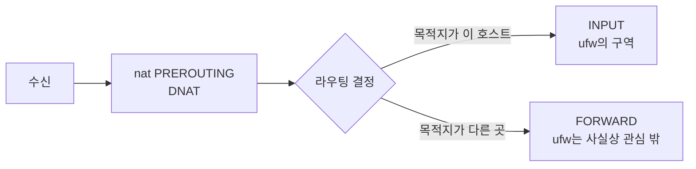
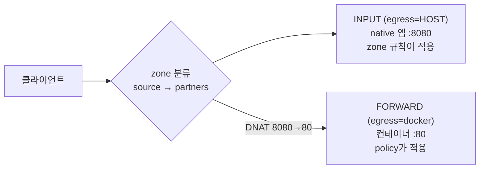
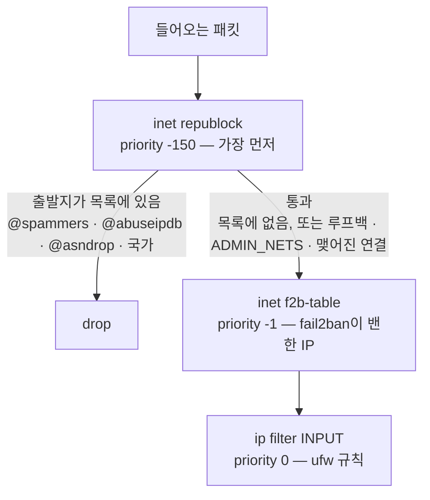
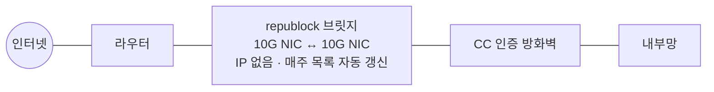
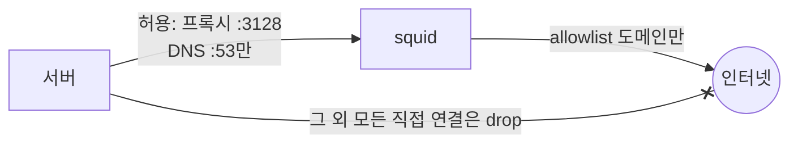

# Part 2. 방화벽 — 인바운드와 아웃바운드 {#part-2}

> 담당 랩 [③](labs/lab-03.md) [④](labs/lab-04.md) [⑤](labs/lab-05.md) [⑥](labs/lab-06.md). 이 파트는 두 가지를 중심으로 다룹니다. 방화벽을 켰는데도 포트가 열려 있는 이유(2.2)와, 나가는 방향도 막아야 하는 이유(2.7)입니다.

## 2.1 두 가지 설계 — ufw와 firewalld(zone) {#2-1-ufw-firewalld}

**멘탈모델(mental model, 동작을 이해하려고 머릿속에 그려 두는 모형).** 같은 커널 방화벽(netfilter/nftables)을 두 가지 방식으로 다룹니다.

- **ufw (데비안·우분투계):** "이 **포트**를 열어라/닫아라." 규칙 목록을 위에서 아래로 읽는 사고방식입니다.
- **firewalld (레드햇·Rocky계):** "이 **대역(또는 NIC)** 은 어느 **zone**(신뢰 등급)에 속하는가, 그 zone은 무엇을 허용하는가." 먼저 *분류*하고, 그다음 *규칙*을 겁니다.

**왜 중요한가.** 포트를 하나하나 관리하는 방식은 서버가 늘어날수록 감당하기 어려워집니다. "이 대역은 믿는다, 저 대역은 안 믿는다"로 생각하면 규칙 수가 줄고 의도가 읽힙니다. [실습④](labs/lab-04.md)에서 `trusted`에 내부망 대역을, `public`에는 `https`만 넣어 보면 이 차이를 직접 확인할 수 있습니다.

| | ufw | firewalld |
|---|---|---|
| 1차 질문 | 어느 포트? | 누가(어느 zone) 오나? |
| 단위 | 규칙 | zone(+ policy) |
| 계열 | Debian/Ubuntu | RHEL/Rocky/Fedora |
| 하부 | iptables-nft / nftables | nftables |

### iptables에서 nftables로 — 전환 시기와 지금의 `iptables` {#2-1-nftables}

커널 안의 방화벽 틀은 **netfilter**이고, 거기에 규칙을 넣는 방식은 두 세대가 있습니다. 이전 세대 리눅스는 **iptables**(커널의 x_tables), 최근 리눅스는 이를 개선한 **nftables**(커널의 nf_tables)입니다. nftables는 리눅스 커널 3.13(2014년)에 들어왔고, 배포판의 기본이 된 시점은 이렇습니다.

| 배포판 | nftables가 기본인 버전 | 그 전 |
| --- | --- | --- |
| Debian | **10 buster (2019년)** | 9까지 iptables(legacy) |
| RHEL · Rocky | **RHEL 8 (2019년)** · Rocky 8 (2021년) | RHEL·CentOS 7까지 iptables. RHEL 8에는 legacy iptables가 아예 들어 있지 않습니다. RHEL 9에서는 iptables 명령 자체가 지원 중단(deprecated) 예정으로 분류됐습니다 |
| Ubuntu (LTS 기준) | **22.04 (2022년)** | 20.04까지 legacy (중간 릴리스 20.10에서 전환이 시작됨) |

그런데 최근 배포판에도 `iptables` 명령은 그대로 있습니다. iptables 1.8 버전부터 같은 이름의 명령이 두 가지로 나뉘었기 때문입니다.

- `iptables-legacy` — 옛 방식. 규칙이 x_tables에 들어갑니다.
- `iptables-nft` — **iptables 문법을 받아서 nftables 규칙으로 번역해 넣습니다.** 위 표의 배포판에서는 `iptables`를 입력하면 이것이 실행됩니다.

ufw, Docker, fail2ban처럼 iptables 문법으로 규칙을 넣는 도구들도 모두 이 번역 경로를 거칩니다. 그래서 그 규칙들이 `nft list ruleset`에 함께 보이고, 다음 절(2.2)에서 Docker의 체인을 nftables로 추적할 수 있습니다.

```bash
# 어느 쪽인가: (nf_tables) 면 nftables로 번역되는 중, (legacy) 면 옛 방식
iptables -V
# 데비안·우분투: 'iptables'가 실제로 가리키는 명령
update-alternatives --display iptables
# iptables 문법이 nftables 문법으로 어떻게 바뀌는지 보기
iptables-translate -A INPUT -p tcp --dport 22 -j ACCEPT
```

출력 예 (Ubuntu 22.04):

```text
iptables v1.8.7 (nf_tables)
nft add rule ip filter INPUT tcp dport 22 counter accept
```

예전에 저장해 둔 iptables 규칙 파일은 `iptables-restore-translate -f ⟨rules.v4⟩`로 nftables 문법으로 바꿔 볼 수 있습니다.

⚠️ **한 머신에서 두 방식을 섞지 마세요.** legacy 규칙과 nft 규칙이 함께 있으면 패킷은 양쪽을 모두 거치지만, `nft list ruleset`에는 legacy 쪽 규칙이 보이지 않습니다. 규칙 목록에는 없는데 패킷이 막히는 현상은 여기서 생깁니다. `iptables-nft`가 `Warning: iptables-legacy tables present`라고 경고하면 이 상태입니다.

그런데 두 도구 모두에 똑같이 해당하는 함정이 있습니다. 다음 절에서 다룰 Docker입니다.

**확인 커맨드**

```bash
# ufw: 규칙 목록
sudo ufw status verbose
# firewalld: 어느 NIC/대역이 어느 zone인가
sudo firewall-cmd --get-active-zones
# 둘 다의 실체는 결국 이것
sudo nft list ruleset | less
```

**바깥 링크:** [ufw (Ubuntu 문서)](https://documentation.ubuntu.com/server/how-to/security/firewalls/) · [firewalld 공식 문서](https://firewalld.org/documentation/) · [nftables wiki](https://wiki.nftables.org/) · [Debian 10 릴리스 노트 — nftables 기본](https://www.debian.org/releases/buster/amd64/release-notes/ch-whats-new.html) · [Fedora: iptables-nft 기본 전환](https://www.fedoraproject.org/wiki/Changes/iptables-nft-default)

## 2.2 Docker가 방화벽을 건너뛰는 이유 — DNAT, FORWARD, nftables 체인 {#2-2-docker-bypass}

**멘탈모델 한 줄.** *ufw는 "이 호스트로 오는 패킷"만 지킨다. Docker는 ufw가 그 판단을 하기 전에 목적지를 바꾼다.*

[실습③](labs/lab-03.md)에서 본 상황입니다. `ufw deny 80/tcp`를 적용한 뒤 `docker run -p 80:80 nginx`를 실행하면 외부 요청에 200 응답이 옵니다. 이는 버그가 아니라 **패킷이 지나가는 경로가 다르기** 때문입니다.

### 패킷의 경로 — 훅(hook)과 체인 {#2-2-hooks}

규칙의 의미는 *어느 훅(hook, 커널 안에서 패킷이 규칙 검사를 받는 지점)에 걸려 있느냐*로 정해집니다. 외부에서 호스트 `203.0.113.10:80`으로 SYN(TCP 연결을 시작하는 패킷)이 들어오면 다음과 같이 처리됩니다.



1. Docker는 publish한 포트(`-p 80:80`, 컨테이너 포트를 호스트 포트에 연결해 외부에 공개한 포트)마다 **nat PREROUTING**에 DNAT(목적지 주소 변환) 규칙을 넣습니다. 목적지가 `203.0.113.10:80`에서 `172.17.0.2:80`(컨테이너)으로 **바뀝니다**.
2. 라우팅 결정은 **바뀐 목적지**를 보고 내려집니다. 이제 이 패킷은 "호스트 앞으로 온 것"이 아니라 "호스트가 *전달*할 것"입니다. 그래서 **INPUT이 아니라 FORWARD**로 갑니다.
3. ufw의 허용·차단은 거의 전부 INPUT 아래(`ufw-user-input`)에 들어 있습니다. FORWARD로 간 패킷은 ufw 규칙을 **아예 거치지 않습니다.**

> **그래서:** `ufw status`에 80이 없어도 80은 열려 있습니다. `ufw status`는 INPUT 기준의 규칙만 보여 줍니다.

### nftables 체인 세 단계로 추적하기 {#2-2-trace}

우분투 24.04(iptables-nft 백엔드), Docker 28 이상, `docker run -d -p 80:80 nginxdemos/hello` 기준입니다. 단계마다 `nft list ruleset`을 저장해 비교하면 차이가 잘 드러납니다.

**1단계 — ufw만 켠 상태.**

- `filter`(ip/ip6) 테이블뿐이고 nat·raw는 없습니다.
- INPUT은 policy drop. `ufw-before-input`에서 loopback·ESTABLISHED·ICMP를 통과시키고, 새 연결은 `ufw-user-input`에서 `:80` 규칙을 찾습니다. 규칙이 없으므로 **drop**됩니다.
- 결과: 외부 :80은 **차단**. ufw가 의도한 대로입니다.

**2단계 — `docker run -p 80:80` 추가.**

- `ip nat`(DNAT 담당)과 `ip raw` 테이블이 생기고, FORWARD 맨 앞에 `DOCKER-USER`, `DOCKER-FORWARD` 점프가 추가됩니다.
- 패킷: PREROUTING에서 DNAT → FORWARD → `DOCKER-USER`(비어 있어 RETURN) → `DOCKER-FORWARD` → `DOCKER`에서 "dport 80 ACCEPT".
- **같은 훅 안에서는 먼저 점프한 체인의 판정이 적용됩니다.** `DOCKER`에서 accept가 나면 뒤에 있는 `ufw-before-forward`는 평가되지 않습니다.
- 결과: 외부 :80은 **허용**. ufw 규칙은 처음부터 평가되지 않았습니다.

**3단계 — `ufw-docker` 적용.** (2.3에서 상세)

- `DOCKER-USER`가 비어 있지 않고 `ufw-user-forward`로 점프합니다. 허용 규칙이 없는 컨테이너 대역행 새 연결은 로그를 남기고 **drop**.
- 결과: 외부 :80은 **다시 차단**.

| | ① ufw 기본 | ② + Docker | ③ + ufw-docker |
|---|---|---|---|
| 생기는 테이블 | ip, ip6 filter | + ip nat, ip raw | 동일 |
| FORWARD 첫 점프 | `ufw-before-logging-forward` | `DOCKER-USER`(빈 체인) | `DOCKER-USER` → `ufw-user-forward` |
| 외부 → :80 | INPUT policy drop | DOCKER에서 accept | 로그 후 drop |
| 포트 여는 법 | `ufw allow 80` | ufw로는 닫을 수 없음 | `ufw-docker allow` |

### 확인 명령 {#2-2-verify}

```bash
# 단계마다 저장해서
sudo nft list ruleset > step1.nft
# 체인·점프 구조만 비교
diff <(grep -E 'chain|jump|goto' step1.nft) \
     <(grep -E 'chain|jump|goto' step2.nft)
# 점프 순서
sudo nft list chain ip filter FORWARD
sudo nft list chain ip filter DOCKER-USER
# 카운터가 읽기 쉽다
sudo iptables-nft -L FORWARD -v -n
# 다른 호스트에서 curl 한 번 → 어느 체인의 카운터가 올랐는지 본다
sudo iptables-nft -L DOCKER-USER -v -n
sudo journalctl -k | grep "UFW DOCKER BLOCK"
```

### 알아 둘 점 {#2-2-notes}

- **`-p`로 연 포트는 "호스트 포트"가 아니라 "컨테이너 포트"로 평가됩니다.** FORWARD에 도착한 시점에는 이미 `172.17.0.2:80`입니다. 이 사실이 2.4에서 다시 중요해집니다.
- **버전이 체인 구조를 바꿉니다.** `DOCKER-FORWARD` 등은 Docker 28부터이고, Docker 29의 실험적 nftables 백엔드를 켜면 Docker가 자기 전용 테이블을 쓰며 `DOCKER-USER`가 없어 ufw-docker 방식이 맞지 않습니다. 업그레이드 후에는 위 확인 커맨드로 구조부터 다시 봅니다.
- **가장 비용이 적은 1차 방어:** 노출할 필요 없는 컨테이너는 `-p 127.0.0.1:8080:80`처럼 바인드 IP를 좁힙니다. 방화벽으로 막기 전에 외부로 열린 문을 아예 만들지 않는 방법입니다.

**바깥 링크:** [Docker — Packet filtering and firewalls](https://docs.docker.com/engine/network/packet-filtering-firewalls/) · [Docker — Docker with ufw](https://docs.docker.com/engine/network/packet-filtering-firewalls/#docker-and-ufw) · [Netfilter 패킷 흐름 (nftables wiki)](https://wiki.nftables.org/wiki-nftables/index.php/Netfilter_hooks) · [Packet flow in Netfilter (wiki)](https://en.wikipedia.org/wiki/Netfilter#/media/File:Netfilter-packet-flow.svg)

## 2.3 ufw-docker와 DOCKER-USER 체인 {#2-3-ufw-docker}

**멘탈모델.** `DOCKER-USER`는 Docker가 사용자 규칙을 넣도록 비워 둔 체인입니다. FORWARD에서 Docker 규칙보다 **먼저** 평가되고, 데몬이 재시작해도 Docker가 이 체인을 비우지 않습니다. ufw-docker는 이 자리를 `/etc/ufw/after.rules`로 채워서 "컨테이너행 트래픽도 ufw 규칙을 먼저 보게" 만듭니다.

**왜 이 방식인가.** Docker 규칙을 직접 고치면 재시작 때 덮어씌워집니다. Docker가 허용한 자리(`DOCKER-USER`)에, ufw가 재로드할 때마다 다시 읽는 파일(`after.rules`)로 규칙을 넣으므로 Docker와 ufw 어느 쪽과도 충돌하지 않습니다.

도구는 공개 저장소 [chaifeng/ufw-docker](https://github.com/chaifeng/ufw-docker)입니다. [실습③](labs/lab-03.md)에서는 다음과 같이 사용합니다.

```bash
# after.rules에 블록 추가 후 ufw reload
sudo ufw-docker install
# 컨테이너 web의 80만 허용
sudo ufw-docker allow web 80/tcp
# 대역 한정
sudo ufw route allow proto tcp from 203.0.113.0/24 to any port 80
sudo ufw-docker list web
```

동작 요지: `DOCKER-USER` → `ufw-user-forward`(내가 허용한 것만 통과) → 나머지 컨테이너행 새 연결(SYN)은 `[UFW DOCKER BLOCK]` 로그를 남기고 drop.

### 주의할 점 두 가지 {#2-3-pitfalls}

1. **출발지가 사설 대역이면 별도 검사 없이 통과합니다.** 기본 블록에는 출발지가 `10.0.0.0/8`, `172.16.0.0/12`, `192.168.0.0/16`이면 곧바로 `RETURN`하는 줄이 있습니다. 클라이언트가 사설망(사내망·VPN)에 있다면 사실상 2단계와 같이 노출됩니다. 엄격히 하려면 `after.rules`의 그 줄을 좁히거나 지우고, 필요한 대역만 `ufw route allow`로 엽니다.
2. **허용 규칙이 컨테이너 IP에 묶입니다.** `ufw-docker allow`는 그 시점의 컨테이너 IP를 규칙에 고정합니다. 컨테이너를 재생성해 IP가 바뀌면 규칙을 다시 추가해야 하므로, 고정 IP를 주거나 배포 절차에 넣어 둡니다.

### 확인 명령 {#2-3-verify}

```bash
# 점프와 카운터
sudo iptables-nft -L DOCKER-USER -v -n
sudo nft list chain ip filter DOCKER-USER
# 막힌 시도
sudo journalctl -k | grep "UFW DOCKER BLOCK"
sudo grep -n "BEGIN UFW AND DOCKER" -A25 /etc/ufw/after.rules
```

**바깥 링크:** [chaifeng/ufw-docker](https://github.com/chaifeng/ufw-docker) · [Docker — DOCKER-USER 체인](https://docs.docker.com/engine/network/packet-filtering-firewalls/#add-iptables-policies-before-dockers-rules)

## 2.4 firewalld의 경우 — docker policy와 컨테이너 포트 기준 {#2-4-firewalld-docker}

**멘탈모델.** firewalld의 zone에 선언한 `port`/`service`/`rich-rule`은 사실 **"ingress = 그 zone, egress = HOST"인 policy**입니다(policy는 ingress zone에서 egress zone으로 가는 트래픽에 적용하는 규칙 묶음입니다). 목적지가 *호스트 자신*이기 때문에 INPUT 경로입니다. 그런데 Docker 컨테이너는 HOST가 아니라 **`docker` zone 너머**에 있습니다. 따라서 새 개념을 배울 필요 없이 **egress만 `docker`로 바꾼 규칙**을 쓰면 됩니다.

[실습④](labs/lab-04.md)의 마지막 문단에서 다룬 현상, 곧 zone 규칙이 Docker publish 포트에 적용되지 않는 이유가 여기에 있습니다.



### 문서가 혼란스러운 이유 {#2-4-docs-confusion}

- Docker 문서의 firewalld 절은 "Docker가 target ACCEPT인 `docker` zone을 만들고 브리지를 넣는다"고만 합니다. 이는 그 zone을 쓰라는 지시가 아니라, Docker 네트워크가 깨지지 않도록 통로를 열어 두었다는 안내입니다.
- 정작 중요한 결론(publish 포트는 nat에서 먼저 갈라져 INPUT을 거치지 않는다)은 ufw 절에만 적혀 있지만, **firewalld에도 똑같이 적용**됩니다. `public` zone에서 8080을 열지 않아도 `-p 8080:80`은 열립니다. Docker가 만들어 둔 `docker-forwarding` policy(ANY → docker, ACCEPT)가 FORWARD를 전부 허용하기 때문입니다.

### native 앱과 Docker publish {#2-4-native-vs-publish}

| | native 앱 | Docker publish |
|---|---|---|
| 경로 | INPUT | DNAT 후 FORWARD |
| source 분류 | zone | zone (그대로) |
| 규칙 위치 | zone | policy (문법은 같다) |
| 포트 | 서비스 포트 | 컨테이너 포트 (8080이 아니라 80) |
| 기본 상태 | 거부 — 허용만 쓰면 됨 | **전부 허용 — 막는 policy가 필요** |

policy도 `service`, `port`, `rich-rule`을 지원합니다. 쓸 수 없는 것은 `source`뿐입니다. source는 "누가 오나"를 *분류*하는 장치라 zone에만 있습니다.

### 템플릿 — native 방식 그대로 {#2-4-template}

zone 파일은 native 앱일 때와 똑같이 두고, 규칙만 policy 파일로 옮깁니다.

```xml
<!-- /etc/firewalld/zones/partners.xml -->
<?xml version="1.0" encoding="utf-8"?>
<zone>
  <short>partners</short>
  <source address="203.0.113.0/24"/>
</zone>
```

```xml
<!-- /etc/firewalld/policies/partners-docker.xml : 파트너 대역은 컨테이너로 허용 -->
<?xml version="1.0" encoding="utf-8"?>
<policy target="ACCEPT" priority="-200">
  <short>partners to docker</short>
  <ingress-zone name="partners"/>
  <egress-zone name="docker"/>
</policy>
```

```xml
<!-- /etc/firewalld/policies/public-docker.xml : 그 외 외부는 차단 -->
<?xml version="1.0" encoding="utf-8"?>
<policy target="DROP" priority="-200">
  <short>block public to docker</short>
  <ingress-zone name="public"/>
  <egress-zone name="docker"/>
</policy>
```

- `priority`는 `firewall-cmd --info-policy=docker-forwarding`로 확인한 값보다 **작게** 잡아야 먼저 평가됩니다.
- ingress를 `ANY`로 잡으면 Docker 네트워크끼리의 통신까지 막힐 수 있습니다. **외부 NIC가 속한 zone만** 지정합니다.

### 호스트 포트로는 구분할 수 없다 {#2-4-host-port}

FORWARD에 도착한 패킷은 이미 `컨테이너IP:80`이므로 policy는 8080을 볼 수 없습니다. 같은 이미지를 8081·8082·8083으로 publish해도 policy에는 셋 다 `:80`입니다. 꼭 구분해야 한다면 (a) compose(Docker Compose, 여러 컨테이너를 한 파일로 정의해 실행하는 도구)에서 `ipv4_address`로 IP를 고정해 rich-rule의 destination으로 구분하거나, (b) iptables 백엔드라면 `DOCKER-USER`에서 `-m conntrack --ctorigdstport`로 DNAT 전 원래 포트를 봅니다(후자는 firewalld 밖 관리). 대개는 **포트 조건을 빼는 것**이 현실적입니다. "이 대역은 publish된 포트 전부 허용"으로 쓰고, 노출하면 안 되는 관리 포트는 `127.0.0.1:`로 바인드해 규칙과 무관하게 만듭니다.

### 대역이 겹치지 않게 {#2-4-no-overlap}

- **컨테이너 대역을 어떤 zone의 source에도 넣지 마세요.** source 바인딩이 interface 바인딩보다 우선합니다. `trusted`나 `partners`에 컨테이너 대역을 포함하는 넓은 범위(`172.16.0.0/12`, `10.0.0.0/8` 등)를 넣으면 컨테이너발 패킷이 `docker` zone이 아니라 그 zone으로 분류되어 의도치 않은 허용·차단이 생깁니다.
- **대역은 `daemon.json` 한 곳에서.** compose는 `docker0`을 쓰지 않고 프로젝트마다 네트워크를 새로 만들며, 그 대역은 `bip`이 아니라 `default-address-pools`에서 나옵니다. 기관망·VPN 대역과 겹치지 않게 고정해 두면 compose마다 subnet을 지정할 필요가 없습니다.

```json
{
  "bip": "172.30.0.1/24",
  "default-address-pools": [
    { "base": "172.31.0.0/16", "size": 24 }
  ]
}
```

`--ip-range`는 subnet 안의 *할당 범위*일 뿐이고, 방화벽 기준은 `--subnet`입니다.

### native 모델을 유지하는 방법 {#2-4-keep-native}

- `network_mode: host`는 NAT도 FORWARD도 없어 방화벽 입장에서는 native 앱과 같지만, 격리와 포트 충돌 관리를 포기합니다.
- 더 현실적인 길: 컨테이너는 `127.0.0.1:8080:80`으로만 publish하고, 호스트의 native 리버스 프록시(외부 요청을 대신 받아 내부 서비스로 전달하는 서버)가 443을 받습니다. 외부에 보이는 것은 프록시 포트뿐이고, 이 포트는 **INPUT 경로**이므로 zone + source 방식이 그대로 적용됩니다. ufw든 firewalld든 같은 구조입니다.

이미지 빌드는 영향을 받지 않습니다. 빌드 중 `RUN apt-get`은 docker → 외부 방향이고 응답은 established로 먼저 허용됩니다. 새 policy가 다루는 것은 *외부 → docker 신규 연결*입니다.

### 확인 명령 {#2-4-verify}

```bash
# 브리지가 docker zone에 있는지
firewall-cmd --get-active-zones
firewall-cmd --info-policy=docker-forwarding
firewall-cmd --list-all-policies
# firewalld와 Docker 테이블이 함께 보임
sudo nft list ruleset | less
# 막힌 패킷 추적(끝나면 off)
firewall-cmd --set-log-denied=all
journalctl -kf
# 빌드 경로 점검
docker run --rm alpine wget -qO- https://deb.debian.org >/dev/null && echo OK
```

두 테이블이 맞물리는 구조이므로, 허용 대역과 그 외 대역 **두 곳에서 실제로 접속해 보는 것**이 최종 검증입니다.

> **한 줄 요약:** source 분류는 zone, 규칙은 egress=docker인 policy, 포트는 컨테이너 기준. 대역은 `daemon.json`, `docker` zone은 Docker 것, 노출 범위는 `ports:` 바인드 IP로 먼저 줄인다.

**바깥 링크:** [firewalld — Policies](https://firewalld.org/documentation/policy/) · [Docker — Docker and firewalld](https://docs.docker.com/engine/network/packet-filtering-firewalls/#docker-and-firewalld)

## 2.5 인바운드 선차단 — 평판 기반 nftables {#2-5-reputation}

**멘탈모델.** fail2ban은 공격 행위가 로그에 남은 뒤에 그 주소를 차단(ban)합니다. 평판 기반 선차단은 **들어오기 전에 버립니다(drop).** 이미 악성으로 알려진 주소 목록을 커널의 nftables set(여러 주소·대역을 한데 묶어 한 번에 조회하는 자료 구조)으로 올려 두고, 규칙 하나가 set을 조회해 수만 개의 대역을 한 번에 거릅니다.

이 책의 도구는 KREONET의 [republock](https://github.com/KREONET/republock)입니다(MIT 라이선스). 전용 nftables 테이블을 따로 만들고 **priority -150**(숫자가 작을수록 먼저 평가)에서 동작하므로, fail2ban(-1)이나 ufw(0)보다 먼저 패킷을 봅니다.



기본 훅은 `prerouting`이라 호스트 서비스뿐 아니라 **Docker publish 포트로 가는 트래픽도** 거릅니다. INPUT에만 적용하면 2.2의 함정(DNAT 뒤 FORWARD로 빠짐)에 그대로 빠집니다.

### 차단 목록의 출처와 운영 방식 {#2-5-sources}

평판 목록은 특정 주체가 지속적으로 관리하는 **공개 데이터**입니다. 누가, 어떤 기준으로 만드는지 알아야 오탐(정상 주소를 악성으로 잘못 판정하는 것)의 성격도 알 수 있습니다.

| 그룹 | 소스 | 누가 · 어떻게 만드나 | 오탐 성격 |
| --- | --- | --- | --- |
| `spammers` | [Spamhaus DROP](https://www.spamhaus.org/drop/) | 스팸·사이버범죄 조직이 탈취했거나 전체를 쓰는 대역을 Spamhaus 분석가가 직접 판정 | 매우 적음 |
| | [FireHOL level1](https://github.com/firehol/blocklist-ipsets) | 여러 공개 목록을 모아 "오탐 최소"를 기준으로 합친 목록 | 적음 (level2·3은 오탐이 많아 쓰지 않음) |
| | [blocklist.de](https://www.blocklist.de/) | 참여 서버들이 fail2ban 등으로 잡은 공격 IP를 자동 신고 | 침해된 정상 호스트가 섞임 |
| `abuseipdb` | [AbuseIPDB](https://www.abuseipdb.com/) | 전 세계 운영자가 공격 IP를 신고하면 신뢰도 점수를 매김. 그중 신뢰도 100%, 최근 7일치 | 침해된 정상 호스트가 섞임 |
| `asndrop` | [Spamhaus ASN-DROP](https://www.spamhaus.org/blocklists/do-not-route-or-peer/) | 네트워크(ASN) **전체가 악성**인 방탄호스팅(신고·차단 요청에 응하지 않는 호스팅) 사업자 목록. republock이 ASN 번호를 대역으로 펼침 | 매우 적음 (대형 클라우드·통신사 없음) |
| `cn`·`ru` 등 (선택) | [ipdeny.com](https://www.ipdeny.com/) | 아래의 주소 관리 기구 할당 기록을 국가별로 정리 | 그 나라의 정상 사용자까지 전부 |

기본 세 그룹(`spammers`·`abuseipdb`·`asndrop`)을 합치면 약 11만 5천 개 대역입니다(republock 실측, 2026-09-10). `systemd` 타이머가 **매주 자동으로** 목록을 갱신합니다.

### 국가별 차단 — 주소 관리 기구의 공개 할당 기록 {#2-5-geo-block}

IP 주소는 다섯 곳의 **지역 인터넷 주소 관리 기구(RIR)** 가 나누어 할당합니다.

| RIR | 담당 지역 |
| --- | --- |
| APNIC | 아시아·태평양 (한국은 그 아래 KISA가 국가 관리 기구 역할) |
| ARIN | 북미 |
| RIPE NCC | 유럽·중동·중앙아시아 |
| LACNIC | 중남미 |
| AFRINIC | 아프리카 |

이 기구들은 **어느 대역을 어느 나라의 누구에게 할당했는지를 매일 공개 파일로 내놓습니다.** 국가별 IP 목록은 비밀 정보가 아니라 이 공개 장부를 정리한 것입니다. 이 파일은 누구나 내려받을 수 있습니다.

```bash
curl -s https://ftp.apnic.net/stats/apnic/delegated-apnic-extended-latest -o apnic.txt
# 형식: 기구|국가|종류|시작주소|주소 개수|할당일|상태
grep '|KR|ipv4|' apnic.txt | head -3
# 한국에 할당된 IPv4 블록 수
grep -c '|KR|ipv4|' apnic.txt
```

출력 예 (2026-11-05):

```text
apnic|KR|ipv4|1.11.0.0|65536|20100616|allocated|A922C04D
apnic|KR|ipv4|1.16.0.0|16384|20100512|allocated|A9222B0E
apnic|KR|ipv4|1.16.64.0|16384|20100512|allocated|A92E438A
2422
```

그래서 국가 차단은 설정이 간단합니다. republock에서는 설정에 `COUNTRIES="cn ru"`를 넣고 `republock update`를 실행하면 됩니다(기본은 꺼져 있음). 다만 간단한 만큼 한계가 분명합니다.

- **장부의 국가는 "등록한 곳"이지 "실제로 쓰는 곳"이 아닙니다.** 공격자는 다른 나라의 클라우드·VPN을 빌려 씁니다. 악성 사업자 목록(ASN-DROP)도 국가로 보면 우크라이나·인도·미국·몰도바 순으로 많아서(republock 실측 2026-09-10), 몇 나라를 막는 것으로는 걸러지지 않습니다.
- **그 나라의 정상 사용자도 전부 막힙니다.** 해외 공동연구자, 학회 참석자가 대표적입니다.
- **차단한 나라로 출장 가면 내 서버에 접속할 수 없습니다.** 그 나라에서 받은 내 IP가 이미 막혀 있으므로 원격으로 풀 수도 없습니다. 출발 전에 `republock disable ⟨국가⟩`로 풀어 둡니다.

### 규칙 대신 set을 쓰는 이유 {#2-5-why-set}

규칙 11만 줄을 위에서부터 하나씩 비교하면 패킷마다 처리 시간이 길어집니다. nftables의 구간(interval) set은 대역 조회에 특화된 자료구조(pipapo)를 써서, 목록이 커져도 조회가 빠릅니다. 대신 메모리를 씁니다. republock 문서의 실측으로 원소 하나에 약 0.8 KB, 기본 11만 5천 개면 **약 90 MB**입니다. 목록 크기에 정비례하므로, 국가를 많이 넣으면 그만큼 늘어납니다. CPU 부하는 거의 없습니다(host 모드에서는 새 연결의 첫 패킷만 조회).

### 한계 — 앞단의 보조 수단 {#2-5-limits}

- 평판 목록은 **과거의 나쁨**입니다. 처음 보는 공격자는 못 거릅니다.
- 신고 기반 목록(`abuseipdb`, blocklist.de)에는 **침해되어 스캔을 수행하는 정상 서버**가 섞여 있습니다. 협력 기관 서버가 그 상태라면 우리도 그쪽과 통신이 끊깁니다.
- drop은 **아무 흔적을 남기지 않습니다.** 패킷은 로그도 응답도 없이 사라집니다. 접속이 되지 않으면 먼저 `sudo republock check ⟨IP⟩`로 그 주소가 목록에 있는지 확인합니다.
- 반드시 통과해야 하는 대역(관리망, 협력 기관)은 `ADMIN_NETS`에 넣습니다. 이 대역은 모든 drop 규칙보다 먼저 통과합니다. 설치할 때 최소 하나는 넣어 둡니다. 이미 맺어진 SSH 연결은 목록이 바뀌어도 끊기지 않습니다.

### 사례 — 오래된 CC 인증 방화벽 앞의 투명 브리지 {#2-5-case}

republock은 이런 현장에서 나왔습니다.

공공기관은 CC 인증(Common Criteria, 정보보호제품 평가를 위한 국제 공통평가기준 인증)을 받은 방화벽을 씁니다. 그런데 **유지보수 계약이 끝나면 장비가 노후화됩니다.** 방화벽이 표시하는 경고를 보고 사람이 규칙을 만들어 넣는데, 오탐 경고가 많고, 오래된 장비는 API도 제대로 갖추지 않아 규칙 갱신이 매우 번거롭습니다. 평판 목록처럼 매주 바뀌는 수만 개 대역을 수작업으로 넣는 것은 불가능에 가깝습니다.

그래서 **방화벽 앞단에 republock을 투명 브릿지로 배치합니다**(`MODE=bridge`). 회선 중간에서 패킷을 그대로 넘기다가 평판이 나쁜 것만 버리므로, 앞의 라우터도 뒤의 방화벽도 설정을 바꿀 필요가 없습니다. 기존 방화벽은 그대로 두고, 불필요한 트래픽을 미리 걸러 부담을 덜어 줍니다.



고성능 장비는 필요하지 않습니다. 강사의 경험으로는 **10년 된 서버에 10G NIC 두 장**, 또는 i5·i7급 PC에 10G NIC를 장착한 정도면 충분했고, 비용은 50만 원 안쪽입니다. nftables의 set 조회가 가벼워서, 일반적인 기관 트래픽 수준에서는 10G를 여유 있게 처리합니다.

브릿지 모드는 host 모드와 몇 가지가 다릅니다([republock 브릿지 문서](https://github.com/KREONET/republock/blob/main/docs/bridge.ko.md)).

- **브릿지와 멤버 포트에 IP를 주지 않습니다.** 관리는 별도 NIC로 합니다. IP를 할당하면 투명 브릿지가 아니라 라우팅 장비가 됩니다.
- **연결 추적(conntrack)을 쓰지 않습니다.** 지나가는 모든 연결을 기억하면 연결 추적 표가 가득 찼을 때 패킷이 버려지고, 공격자가 이 점을 악용할 수 있기 때문입니다. 대신 연결의 첫 패킷만이 아니라 **모든 패킷**을 조회합니다.
- **출발지든 목적지든** 목록에 있으면 막습니다. 그래서 브릿지 뒤의 서버도 목록에 오른 주소로는 나가지 못합니다.
- 같은 장비에서 Docker를 돌리면 브릿지 트래픽이 ufw·Docker 규칙을 거치게 되어 전부 막힐 수 있습니다(`bridge-nf-call-iptables` 함정). republock은 설치 과정에서 이 설정을 검사해 경고합니다.

⚠️ 회선 중간에 두는 장비는 **고장 나면 회선이 끊깁니다.** 설치하기 전에 다음을 정해 둡니다.

- **장애 대비:** 장애 시 우회 방법을 정합니다. 바이패스 기능이 있는 NIC를 쓰거나, 케이블을 직결하는 절차를 둡니다.
- **충분한 검증:** NIC 두 장짜리 VM에서 먼저 구성해 봅니다. 재부팅 후 설정이 모두 돌아오는지, 포트를 하나 뽑았을 때 기대대로 동작하는지 확인합니다.
- **처리량 측정:** 작은 패킷이 대량으로 들어오는 상황(DDoS)에서는 초당 패킷 수가 평소 트래픽과 전혀 다른 수준이 됩니다. 기관 회선의 최대치를 기준으로 미리 측정해 둡니다.
- **기관 보안 정책 확인:** 인증 방화벽 앞에 보조 장비를 두는 것이 정책에 맞는지 먼저 확인합니다.

**바깥 링크:** [republock](https://github.com/KREONET/republock) · [republock 동작 원리](https://github.com/KREONET/republock/blob/main/docs/how-it-works.ko.md) · [APNIC 할당 통계 파일](https://ftp.apnic.net/stats/apnic/) · [nftables wiki — Sets](https://wiki.nftables.org/wiki-nftables/index.php/Sets) · [nftables wiki — Netfilter hooks](https://wiki.nftables.org/wiki-nftables/index.php/Netfilter_hooks) · [fail2ban](https://github.com/fail2ban/fail2ban)

## 2.6 아웃바운드 화이트리스팅 — ufw default deny outgoing과 squid {#2-6-egress-allowlist}

**멘탈모델.** 인바운드는 "누가 들어오나", 아웃바운드는 **"뚫린 서버가 어디로 나가나"** 입니다. 서버가 침해되어도 공격자가 *외부의 명령·제어 서버(C2, Command and Control)에 연락하거나 데이터를 빼낼 길*이 없으면 피해는 크게 줄어듭니다. 이것이 "나가는 길(egress) 통제"의 시작입니다.

**방법: 기본 거부 + 프록시 한 점만 예외.**

- 직접 나가는 길은 전부 닫고, 허용하는 것은 **squid 프록시(와 DNS)** 뿐입니다. 프록시는 서버 대신 외부에 접속해 요청을 중계하는 서버입니다.
- squid가 **allowlist(허용 목록. apt·yum·docker·ghcr 등의 도메인)** 를 가집니다. IP가 아니라 *도메인 단위*로 허용하기 위해 프록시를 씁니다. 방화벽(L3/L4)만으로는 "ghcr.io만" 허용하기 어렵기 때문입니다(CDN, 곧 콘텐츠 전송 네트워크의 IP는 수시로 바뀝니다).



[실습⑥](labs/lab-06.md)의 핵심 명령은 다음과 같습니다(IP는 문서용 예시).

```bash
sudo ufw default deny outgoing
# squid만 예외
sudo ufw allow out to 192.0.2.9 port 3128
# DNS
sudo ufw allow out 53
echo 'Acquire::http::Proxy "http://192.0.2.9:3128";' | sudo tee /etc/apt/apt.conf.d/01proxy
# 된다 (allowlist)
sudo apt update
# 막힌다
curl -I https://example.com
```

**주의.**

- Docker 데몬도 프록시를 보게 해야 `docker pull`이 됩니다. `/etc/systemd/system/docker.service.d/http-proxy.conf`에 `HTTP_PROXY`·`HTTPS_PROXY`를 넣는 드롭인(drop-in, 본 설정 파일을 고치지 않고 `*.d/` 디렉터리에 조각 파일을 넣어 설정을 덧붙이는 방식)입니다. apt의 `apt.conf.d/01proxy`와 함께, Part 1 §1.3의 "고치기보다 얹기"가 그대로 적용됩니다.
- `ufw default deny outgoing`은 **호스트가 시작하는** 연결에만 적용됩니다. *컨테이너가 시작한* 연결은 FORWARD를 거치므로 이 규칙이 적용되지 않습니다. 이 구멍이 2.7의 두 번째 고도로 이어집니다.
- 프록시가 `CONNECT`로 임의 포트를 터널링하지 않게 squid의 `Safe_ports`/`SSL_ports`도 좁힙니다.

**확인 커맨드**

```bash
# Default: deny (outgoing)
sudo ufw status verbose
# (squid 서버에서) TCP_DENIED / TCP_TUNNEL 로 허용·거부 관찰
sudo tail -f /var/log/squid/access.log
# 직접 나가려던 시도 — 나가는 패킷은 'IN= OUT=장치' 로 찍힌다
sudo journalctl -k | grep "UFW BLOCK" | grep 'IN= OUT='
```

### 제한한 상태로 운영하기 — 로그, 토글, 자동 복귀 {#2-6-operate}

egress 화이트리스팅이 실패하는 이유는 대개 기술이 아니라 **운영**입니다. 너무 엄격하게 막으면 원인을 알 수 없는 장애가 생기고, 원인을 찾지 못하면 누군가 불편하다는 이유로 제한을 모두 풀어 버린 뒤 다시 잠그지 않습니다. 그래서 다음 세 가지 운영 방법을 함께 갖춥니다.

**1. 막힌 것은 로그로 찾는다.** `ufw logging low`를 켜 두면, 기본 차단에 걸린 나가는 패킷이 `[UFW BLOCK] IN= OUT=eth0 … DST=… DPT=…` 형태로 커널 로그에 남습니다. 목적지와 포트를 모으면 "무엇이 어디로 나가려 했나"가 보입니다. 단, ufw는 로그 폭주를 막으려고 **1분에 3건 정도만 표본으로** 남깁니다(실제 생성 규칙: `-m limit --limit 3/min --limit-burst 10 -j LOG`). 따라서 모든 시도를 세는 데가 아니라 목적지를 찾는 데 씁니다. 프록시가 거절한 도메인은 squid 쪽 `access.log`의 `TCP_DENIED`에서 찾습니다.

**2. 열 때는 좁게, 잠깐.** 전체를 여는 `ufw default allow outgoing`보다, 로그에서 찾은 목적지 하나만 여는 `ufw allow out to ⟨IP⟩ port ⟨포트⟩`가 낫습니다. 끝나면 같은 규칙을 `ufw delete`로 지웁니다. 자주 필요한 곳이라면 토글(열고 닫기를 전환하는 것)할 대상이 아니라 **squid allowlist에 추가할 대상**입니다. 토글이 잦다는 것 자체가 allowlist를 고치라는 신호입니다. [실습⑥](labs/lab-06.md)에서는 `egress-open`·`egress-close`·`egress-state` 셸 함수로 이 작업을 간단히 처리합니다.

**3. 잊어도 저절로 잠기게.** 가장 흔한 사고는 잠깐 풀었다가 다시 잠그는 것을 잊는 경우입니다. 사람의 기억에 맡기지 않으려면 **열 때 닫을 시각을 함께 예약**하면 됩니다. systemd 타이머로 "열면 30분 뒤 자동으로 다시 잠김"을 만들 수 있고, 열 때 누가·언제·왜 열었는지 journal에 남기면 Part 7의 **기록** 통제지점과도 이어집니다. 이 책은 아이디어만 제시합니다. 직접 만들어 보려면 [실습⑥](labs/lab-06.md) 끝의 프롬프트로 AI와 함께 설계해 봅니다.

같은 생각이 망 경계에서는 [실습⑧](labs/lab-08.md)의 "평소엔 잠그고 필요할 때만 여는" 방화벽 토글로 다시 나옵니다(2.7의 세 번째 고도).

**바깥 링크:** [Squid — Access Controls](https://wiki.squid-cache.org/SquidFaq/SquidAcl) · [Ubuntu — ufw](https://documentation.ubuntu.com/server/how-to/security/firewalls/) · [Docker 데몬 프록시 설정](https://docs.docker.com/engine/daemon/proxy/)

## 2.7 egress 통제의 네 고도 — 호스트·컨테이너·망 경계·AI {#2-7-four-levels}

이 절은 책 전체를 관통하는 축입니다. 나갈 수 있는 곳을 *허용 목록*으로 선언하고 나머지는 기본 거부한다는 **같은 원칙을 네 가지 고도(통제를 적용하는 층위)에서 반복합니다.** 고도가 달라지는 이유는 *누가 나가려 하는가*(주체)와 *어디서 막을 수 있는가*(통제점)가 달라지기 때문입니다.

| 고도 | 주체 | 허용 목록의 모양 | 통제점 | 실습 |
|---|---|---|---|---|
| ① 호스트 | 호스트의 프로세스 | 프록시 한 점 + allowlist 도메인 | `ufw default deny outgoing`, squid | [⑥](labs/lab-06.md) (이 Part, 2.6) |
| ② 컨테이너 | 컨테이너 안의 앱 | **네트워크 멤버십** (붙은 네트워크 = 갈 수 있는 곳) | compose의 `internal` 네트워크 | [⑨′](labs/lab-09p.md) ([Part 4](04-container.md)) |
| ③ 망 경계 | 격리망 전체 | 평소 잠금, **필요할 때만 토글** | 게이트웨이 방화벽 | [⑧](labs/lab-08.md) ([Part 3](03-network.md)) |
| ④ AI | 에이전트·AI 도구 | 시크릿은 손잡이로만, **나가는 곳은 화이트리스트** | 위 세 고도의 조합 | [⑭](labs/lab-14.md) ([Part 7](07-ai-governance.md)) |

### ① 호스트 — 방화벽 규칙 {#2-7-host}

2.6에서 다룬 내용입니다. 통제점은 호스트의 OUTPUT 훅이고, 허용 단위는 *프록시 + 도메인*입니다. 가장 익숙한 고도이지만 **컨테이너의 트래픽은 보지 못합니다**(FORWARD를 거치므로).

### ② 컨테이너 — 네트워크 멤버십 {#2-7-container}

호스트 방화벽이 닿지 않는 자리입니다. 여기서는 발상을 바꿉니다. **방화벽 규칙을 쓰지 않고, "어느 네트워크에 붙었는가"를 허용 목록으로 씁니다.** `internal: true` 네트워크는 바깥으로 가는 경로(게이트웨이/NAT) 자체가 없습니다. 앱을 `web`(caddy와)과 `data`(db와)에만 붙이면, 앱이 갈 수 있는 곳은 *그 둘뿐*이므로 따로 막는 규칙이 필요 없습니다. caddy는 이 구성에서 외부 요청을 받는 웹 서버(리버스 프록시)입니다.

```yaml
networks:
  # 외부로 나가는 네트워크
  edge: {}
  # caddy ↔ app
  web:  { internal: true }
  # app ↔ db
  data: { internal: true }
services:
  caddy: { networks: [edge, web] }
  # edge에 없으니 바깥이 없다
  app:   { networks: [web, data] }
  db:    { networks: [data] }
```

```bash
# 가두기 전 된다, 가둔 뒤 실패
docker compose exec app ping -c3 8.8.8.8
# true
docker network inspect <project>_web --format '{{.Internal}}'
```

> 이 고도가 위 2.2의 교훈과 짝입니다. Docker는 *들어오는 쪽*은 publish로 쉽게 열고, *나가는 쪽*은 기본으로 열어 둡니다. 둘 다 "기본 허용"이라는 점이 함정이고, 닫는 방법이 호스트 규칙이 아니라 **구성(topology)** 이라는 점이 해법입니다. 상세는 [Part 4](04-container.md).

### ③ 망 경계 — 평소에는 닫고 필요할 때만 열기 {#2-7-boundary}

격리망 전체의 egress를 게이트웨이에서 통제합니다. 새 개념은 **토글**입니다. 폐쇄망은 "영원히 막힘"이 아니라 "평소 잠금 + 패치·반입 시간에만 열기"로 운영해야 사람들이 우회로를 만들지 않습니다. 들어오는 쪽은 bastion(외부에서 격리망으로 들어가는 유일한 관문 서버) 한 곳으로 좁힙니다. [실습⑧](labs/lab-08.md), 상세는 [Part 3](03-network.md).

### ④ AI — 같은 원칙을 에이전트에 적용 {#2-7-ai}

AI 에이전트에게 서버 작업을 맡길 때 가장 걱정되는 것은 에이전트가 비밀 정보를 외부로 빼돌릴 가능성입니다. 대책은 에이전트를 신뢰하는 것이 아니라 **경계**를 두는 것입니다. 시크릿은 값이 아니라 *손잡이(참조)* 로만 건네고, 에이전트가 나갈 수 있는 곳은 ①②③에서 이미 마련해 둔 허용 목록을 그대로 씁니다. 따라서 네 번째 고도는 새 기술이 아니라, 앞의 세 고도를 AI라는 새 주체에 적용하는 것입니다. [실습⑭](labs/lab-14.md), 상세는 [Part 7](07-ai-governance.md).

### 네 고도에 공통된 원칙 {#2-7-common}

1. **기본 거부, 허용 목록.** 막을 것을 나열하지 않고 허용할 것을 나열합니다(막을 것은 끝이 없습니다).
2. **통제점은 주체와 같은 고도에.** 컨테이너 안의 앱을 호스트 OUTPUT으로는 못 막습니다(2.6 주의). 주체가 지나가는 *관문*에 통제를 겁니다.
3. **허용 목록은 사람이 읽을 수 있어야 한다.** squid의 도메인, compose의 네트워크 이름, 토글 상태는 모두 *문서이자 설정*입니다. 이것이 SADP의 "결정을 기록한다"와 이어집니다.
4. **구멍은 층 사이에 있다.** 2.2의 함정(INPUT만 보고 FORWARD를 놓침)과 2.6의 함정(호스트만 막고 컨테이너를 놓침)은 같은 실수에서 나옵니다. *내 규칙이 적용되는 경로가 전부라고 믿는 것*입니다.

**점검 질문.** 서버가 침해되었다고 가정하고 "이 프로세스가 `203.0.113.99`로 연결을 열 수 있는가?"를 묻습니다. 호스트에서, 컨테이너 안에서, 격리망 안에서, AI 에이전트의 도구 실행 환경에서 각각 확인합니다. 네 번 모두 "아니오"가 나와야 이 파트의 목표를 달성한 것입니다.

**바깥 링크:** [Docker — Networking overview (internal network)](https://docs.docker.com/engine/network/) · [Compose — networks.internal](https://docs.docker.com/reference/compose-file/networks/#internal) · [NIST SP 800-41 Rev.1 방화벽 가이드](https://csrc.nist.gov/pubs/sp/800/41/r1/final)
