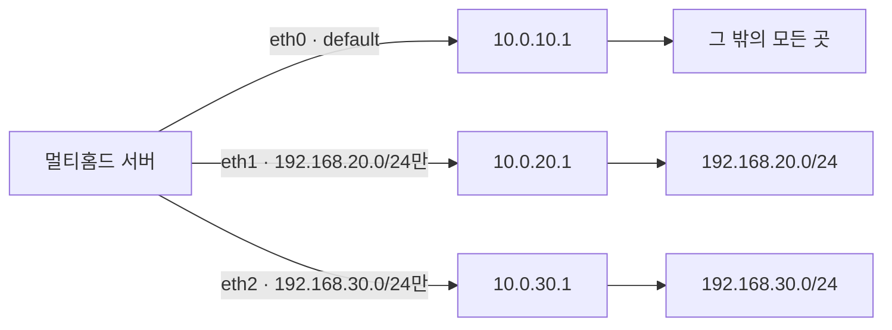
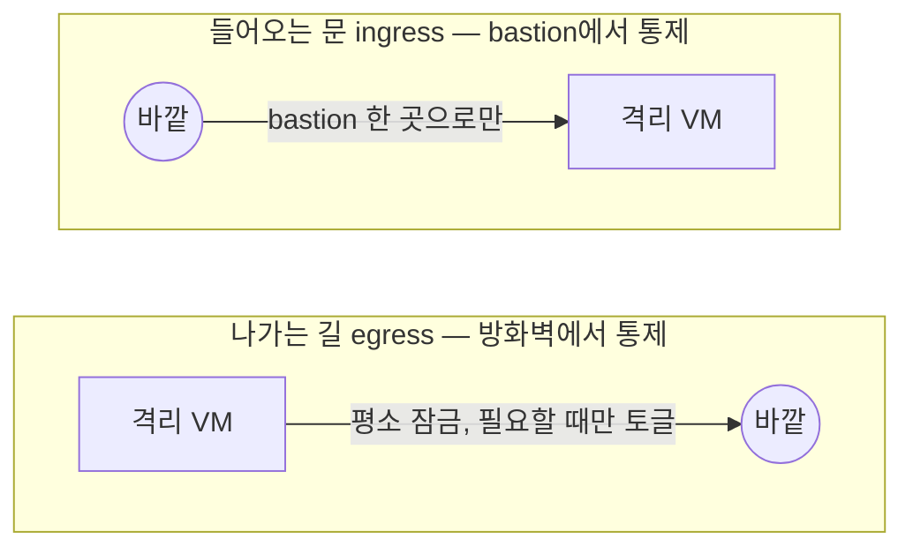

# Part 3. 네트워크와 격리

> 담당 랩 [실습⑦](labs/lab-07.md) · [실습⑧](labs/lab-08.md).

이 장의 한 줄: **내부망은 섬으로 만들고, 섬으로 들어가는 다리와 섬에서 나가는 길을 각각 한 곳에서 통제한다.** 아래 여섯 절은 그 한 줄을 층층이 푼 것입니다. 예시 주소는 모두 문서용(`203.0.113.0/24`)과 사설 대역(`10.10.1.0/24`)입니다.

## 3.1 격리망 설계 — vmbr0/vmbr1, 섬과 다리

**멘탈모델.** PVE의 리눅스 브리지는 *가상 스위치*입니다. 스위치에 **물리 NIC를 꽂으면** 그 스위치는 바깥 세계와 이어지고, **안 꽂으면** 그 스위치에 붙은 VM끼리만 통하는 *섬*이 됩니다.


- `vmbr0`: 물리 NIC(예: `eno1`)가 `bridge-ports`로 붙은 브리지. provider 네트워크, 곧 바깥과 통한다.
- `vmbr1`: `bridge-ports none`. 어느 물리 NIC에도 안 붙었으므로 **호스트 밖으로 패킷이 나갈 길 자체가 없다.**
- 내부 VM은 `vmbr1`에만 NIC를 둔다. 밖에서 직접 닿지도, 안에서 직접 나가지도 못한다.
- **유일한 다리**는 두 브리지에 모두 발을 걸친 VM이다. 방화벽(+VPN)이거나 bastion이다.

**왜 이렇게 하나.** 방화벽 규칙은 "열면 열리는" 설정이라 실수가 곧 노출입니다. 반면 **토폴로지로 막으면** 실수해도 길이 없습니다. 규칙에 기대는 보안보다, 구조로 보장하는 보안이 한 단계 아래에서 받쳐 줍니다. 그리고 다리가 한두 개뿐이니 **감사·로깅 지점이 곧 그 한두 곳**입니다.

**확인.**

```bash
# PVE 호스트에서 — vmbr1에 물리 포트가 없는지
cat /etc/network/interfaces | sed -n '/vmbr1/,/^$/p'
#   bridge-ports none        <- 이 줄이 '섬'의 정의

# 어떤 포트가 어느 브리지에 붙었나
bridge link show
ip -br link show type bridge
```

내부 VM 안에서 `ping 203.0.113.1`(바깥 주소)이 **나가지 않는 것**이 정상입니다. 안 나가는 게 설계입니다.

**더 읽기.**

- Proxmox VE 네트워크 설정: <https://pve.proxmox.com/wiki/Network_Configuration>
- Linux bridge 개념: <https://wiki.linuxfoundation.org/networking/bridge>

실습은 [실습⑦](labs/lab-07.md)의 (1) 단계입니다.

## 3.2 멀티홈드 호스트 — default route 하나 + 명시 라우트

**멘탈모델.** NIC가 둘인 호스트는 패킷을 보낼 때 "**어느 문으로 나가지?**"를 라우팅 테이블로 정합니다. 규칙은 단순합니다. 목적지와 가장 길게 맞는 경로(longest prefix match)가 이기고, 아무것도 안 맞으면 **default route**가 받습니다. 문제는 default route가 **둘**일 때입니다. 둘 다 "나머지 전부"라고 주장하니 커널은 metric이 낮은 쪽을 쓰거나 비대칭 경로를 만들고, 그 결과는 **간헐적 접속 불가**입니다. "어제는 됐는데"가 여기서 나옵니다.

**한 번 물어보겠습니다.** 서버 하나가 세 통신사의 회선을 모두 받아 IP가 셋입니다. 이 서버에서 `ping 8.8.8.8`을 하면 어느 IP로 나갈까요?

| 인터페이스 | IP | 회선 |
| --- | --- | --- |
| eth0 | 10.0.10.5 | 통신사 A |
| eth1 | 10.0.20.5 | 통신사 B |
| eth2 | 10.0.30.5 | 통신사 C |

답은 "설정하기 나름이고, 설정하지 않았다면 **아무도 모른다**"입니다. 세 NIC가 모두 게이트웨이를 가지면 default route가 셋 생기고, 커널은 metric으로 하나를 고르거나(재부팅·링크 순서에 따라 바뀜) 요청과 응답이 다른 길로 오가게 됩니다. 실제로 default route가 둘 등록된 서버에서 **전송 성능이 떨어지는** 증상이 이렇게 해서 생깁니다.

해결은 "어느 길로"를 사람이 정해 주는 것입니다. 예를 들어 "클라우드 X는 통신사 B로, 클라우드 Y는 통신사 C로, 나머지 전부는 통신사 A로"라면 이렇게 됩니다.

| 인터페이스 | IP | 회선 | 게이트웨이 | 이 NIC로 보낼 것 |
| --- | --- | --- | --- | --- |
| eth0 | 10.0.10.5 | 통신사 A | 10.0.10.1 | **default route** — 라우팅 표에 없는 모든 주소 |
| eth1 | 10.0.20.5 | 통신사 B | 10.0.20.1 | 클라우드 X의 대역만 |
| eth2 | 10.0.30.5 | 통신사 C | 10.0.30.1 | 클라우드 Y의 대역만 |

**원칙 하나.**

> **default route는 정확히 하나만. 나머지 대역은 "저 대역은 저 문으로"라고 명시한다.**

bastion과 방화벽 VM이 바로 이 구조입니다. 바깥 쪽(`vmbr0`)이 default를 갖고, 내부 대역(`10.10.1.0/24`)은 안쪽 NIC로 명시 라우트를 둡니다.

```
ens18 (vmbr0)  203.0.113.10/24   gw 203.0.113.1   <- default는 여기 하나
ens19 (vmbr1)  10.10.1.2/24      (gw 없음)         <- 10.10.1.0/24는 connected 경로로 충분
```

내부 대역이 NIC에 직접 붙어 있으면 connected 경로가 자동으로 생깁니다. 그 너머의 다른 사설 대역(예: `10.20.0.0/16`)이 내부 라우터 뒤에 있다면 그때 명시 라우트를 추가합니다.

**세 가지 도구 — 같은 의도, 다른 문법.**

```bash
# NetworkManager (Rocky/RHEL 계열)
nmcli con mod ens19 ipv4.method manual ipv4.addresses 10.10.1.2/24
# 이 NIC는 default를 갖지 않는다
nmcli con mod ens19 ipv4.never-default yes
nmcli con mod ens19 +ipv4.routes "10.20.0.0/16 10.10.1.254"
nmcli con up ens19
```

```yaml
# netplan (Ubuntu) — /etc/netplan/60-bastion.yaml
network:
  version: 2
  ethernets:
    ens18:
      addresses: [203.0.113.10/24]
      routes:
        - to: default
          via: 203.0.113.1
    ens19:
      addresses: [10.10.1.2/24]
      routes:
        - to: 10.20.0.0/16
          via: 10.10.1.254
```

```bash
# 구식 ifcfg (RHEL 계열 레거시) — /etc/sysconfig/network-scripts/
# ifcfg-ens18 : GATEWAY=203.0.113.1
# ifcfg-ens19 : (GATEWAY 지정 안 함)
# route-ens19 : 10.20.0.0/16 via 10.10.1.254
```

**확인.**

```bash
# default 줄이 정확히 한 개인가
ip route
# "이 목적지는 어느 NIC·게이트웨이로?" 커널의 실제 답
ip route get 10.10.1.5
# 바깥 주소는 default 쪽으로 나가는가
ip route get 198.51.100.7
nmcli -f ipv4.routes,ipv4.never-default con show ens19
```

`ip route get`이 이 절의 핵심 도구입니다. 설정 파일이 아니라 **커널이 지금 실제로 고르는 길**을 보여 줍니다. 두 NIC가 같은 대역에 걸리면 응답이 다른 NIC로 나가는 비대칭 문제가 생기니, 대역은 NIC마다 겹치지 않게 둡니다.

### OS별 전체 예시

앞의 짧은 예시를 설정 파일 전체로 펼친 것입니다. 네 가지 모두 **같은 의도**를 씁니다. 공통 예시 망은 이렇습니다(`/24` = 넷마스크 `255.255.255.0`).

| 인터페이스 | IP | 게이트웨이 | default route | 비고 |
| --- | --- | --- | --- | --- |
| eth0 | 10.0.10.5/24 | 10.0.10.1 | **예** | 주로 쓰는 인터페이스 |
| eth1 | 10.0.20.5/24 | 10.0.20.1 | 아니오 | |
| eth2 | 10.0.30.5/24 | 10.0.30.1 | 아니오 | |

| 목적지 | 게이트웨이 | 인터페이스 | 뜻 |
| --- | --- | --- | --- |
| default | 10.0.10.1 | eth0 | 아래에 없는 모든 주소는 eth0로 |
| 10.0.20.0/24 | (직접 연결) | eth1 | NIC에 붙은 대역 — 자동으로 생김 |
| 10.0.30.0/24 | (직접 연결) | eth2 | 〃 |
| 192.168.20.0/24 | 10.0.20.1 | eth1 | 192.168.20.1~255는 eth1로 |
| 192.168.30.0/24 | 10.0.30.1 | eth2 | 192.168.30.1~255는 eth2로 |



#### 어떤 도구가 이 서버의 네트워크를 쥐고 있나

설정 파일을 고치기 전에, 이 서버의 네트워크를 **누가** 관리하는지부터 확인합니다. 엉뚱한 파일을 고치면 재부팅 후 아무 일도 일어나지 않습니다.

| 계열 | 관리 도구 | 설정 파일 | 다시 읽히는 명령 |
| --- | --- | --- | --- |
| Ubuntu(17.10 이후)·cloud-init 이미지 | netplan | `/etc/netplan/*.yaml` | `netplan apply` |
| RHEL 7 | network 서비스(ifcfg) 또는 NetworkManager | `/etc/sysconfig/network-scripts/ifcfg-⟨NIC⟩` | `systemctl restart network` |
| RHEL 8 | NetworkManager (ifcfg 형식도 읽음) | ifcfg 또는 `/etc/NetworkManager/system-connections/⟨이름⟩.nmconnection` | `nmcli con reload` 후 `nmcli con up ⟨이름⟩` |
| RHEL 9 | NetworkManager (keyfile이 기본) | `.nmconnection`. 그 폴더에 파일이 없고 ifcfg만 있으면 ifcfg를 읽음(사용 중단 예정) | 〃 |

(교재 밖 내용: RHEL 8부터 `network` 서비스(network-scripts 패키지)는 사용 중단되어 기본 설치에 없고, RHEL 10에서는 NetworkManager의 ifcfg 지원도 빠졌습니다. 새 장비라면 keyfile/nmcli로 갑니다.)

```bash
# NetworkManager가 관리 중인가 — 장치마다 'connected' 와 연결 이름이 보이면 그렇다
nmcli device status
# netplan 설정이 있는가
ls /etc/netplan/
```

#### ① netplan (Ubuntu) — default route 두 개 → 한 개

**증상.** 두 NIC에 모두 게이트웨이를 줬더니 default가 둘 생겼습니다.

```
$ ip route
default via 172.16.0.1 dev eno1 proto static
default via 192.168.0.1 dev eno2 proto static
...
```

**해결.** 두 번째 NIC에서 default를 빼고, 그쪽으로 보내야 할 대역만 명시합니다.

```yaml
# /etc/netplan/00-installer-config.yaml
network:
  version: 2
  ethernets:
    # 망 A — default route
    eno1:
      dhcp4: false
      addresses:
        - 172.16.0.20/24
      routes:
        - to: default
          via: 172.16.0.1
      nameservers:
        addresses: [8.8.8.8, 8.8.4.4]
    # 망 B — default 없음. 이쪽으로 보낼 대역만 적는다
    eno2:
      dhcp4: false
      addresses:
        - 192.168.0.10/24
      routes:
        # 망 B 너머의 내부 대역(필요할 때만). 192.168.0.0/24 자체는 직접 연결이라 적을 필요 없음
        - to: 10.20.0.0/16
          via: 192.168.0.1
```

```bash
# 적용 전 시험: 120초 안에 Enter를 안 누르면 원래대로 돌아간다 (원격 작업 때 필수)
sudo netplan try
sudo netplan apply
```

```
$ ip route
default via 172.16.0.1 dev eno1 proto static
10.20.0.0/16 via 192.168.0.1 dev eno2 proto static
172.16.0.0/24 dev eno1 proto kernel scope link src 172.16.0.20
192.168.0.0/24 dev eno2 proto kernel scope link src 192.168.0.10
```

옛 netplan 예시에 흔한 `gateway4:` 키는 사용 중단(deprecated)되었습니다. 지금은 위처럼 `routes: - to: default`로 씁니다.

#### ② netplan (Debian/Ubuntu) — MTU가 다른 두 NIC

NIC마다 MTU가 다른 흔한 경우입니다. `enp1s0`은 MTU 1500으로 기관망·인터넷용 default를 갖고, `enp7s0`은 MTU 9000(점보프레임, [§3.6](#36-부록-점보프레임경로-mtu--왜-이-과정-범위-밖인가))으로 특정 대역과만 통신합니다.

```yaml
# /etc/netplan/50-cloud-init.yaml
network:
  version: 2
  ethernets:
    enp1s0:
      mtu: 1500
      addresses:
        - 203.0.113.9/24
      nameservers:
        addresses:
          - 8.8.8.8
      routes:
        - to: default
          via: 203.0.113.1
    enp7s0:
      mtu: 9000
      addresses:
        - 198.51.100.239/24
      routes:
        # 이 원격 대역만 점보 쪽으로
        - to: 192.0.2.0/24
          via: 198.51.100.1
```

```
# netplan apply

# ip addr
2: enp1s0: mtu 1500
    inet 203.0.113.9/24 brd 203.0.113.255 scope global enp1s0
3: enp7s0: mtu 9000
    inet 198.51.100.239/24 brd 198.51.100.255 scope global enp7s0

# ip route
default via 203.0.113.1 dev enp1s0 proto static
192.0.2.0/24 via 198.51.100.1 dev enp7s0 proto static
198.51.100.0/24 dev enp7s0 proto kernel scope link src 198.51.100.239
203.0.113.0/24 dev enp1s0 proto kernel scope link src 203.0.113.9
```

**정말 그 길로 나가는지 패킷으로 보기.** 터미널 두 개에 NIC마다 `tcpdump`를 띄워 두고 `ping`을 보냅니다.

```bash
# 터미널 1: default 쪽
sudo tcpdump -n -nn icmp -i enp1s0
# 터미널 2: 명시 라우트 쪽
sudo tcpdump -n -nn icmp -i enp7s0
# 터미널 3: 인터넷 주소 하나, 명시한 대역 하나
ping -c 3 8.8.8.8
ping -c 3 192.0.2.1
```

```
# 터미널 1 (enp1s0) — 8.8.8.8 은 default 쪽으로
IP 203.0.113.9 > 8.8.8.8: ICMP echo request, id 20, seq 1, length 64
IP 8.8.8.8 > 203.0.113.9: ICMP echo reply, id 20, seq 1, length 64

# 터미널 2 (enp7s0) — 192.0.2.1 은 명시한 길로, 출발 주소도 enp7s0 의 것
IP 198.51.100.239 > 192.0.2.1: ICMP echo request, id 24, seq 1, length 64
IP 192.0.2.1 > 198.51.100.239: ICMP echo reply, id 24, seq 1, length 64
```

`ip route get ⟨주소⟩`가 "커널이 고를 길"이라면, `tcpdump`는 "실제로 나간 길"입니다. 둘이 같으면 끝입니다.

#### ③ RHEL — ifcfg 파일

핵심은 **`DEFROUTE=yes`는 한 인터페이스에만**, 나머지는 `DEFROUTE=no`입니다. 특정 대역 라우트는 NIC마다 `route-⟨NIC⟩` 파일에 따로 씁니다.

```
# /etc/sysconfig/network-scripts/ifcfg-eth0
BOOTPROTO=none
DEFROUTE=yes
DEVICE=eth0
DNS1=8.8.8.8
GATEWAY=10.0.10.1
IPADDR=10.0.10.5
PREFIX=24
# PREFIX 대신 NETMASK 로도 쓸 수 있다
# NETMASK=255.255.255.0
ONBOOT=yes
TYPE=Ethernet
USERCTL=no
MTU=9000
```

```
# /etc/sysconfig/network-scripts/ifcfg-eth1
BOOTPROTO=none
DEFROUTE=no
DEVICE=eth1
GATEWAY=10.0.20.1
IPADDR=10.0.20.5
PREFIX=24
ONBOOT=yes
TYPE=Ethernet
USERCTL=no
MTU=9000
```

```
# /etc/sysconfig/network-scripts/ifcfg-eth2
BOOTPROTO=none
DEFROUTE=no
DEVICE=eth2
GATEWAY=10.0.30.1
IPADDR=10.0.30.5
PREFIX=24
ONBOOT=yes
TYPE=Ethernet
USERCTL=no
MTU=9000
```

```
# /etc/sysconfig/network-scripts/route-eth1
192.168.20.0/24 via 10.0.20.1 dev eth1
```

```
# /etc/sysconfig/network-scripts/route-eth2
192.168.30.0/24 via 10.0.30.1 dev eth2
```

⚠️ 파일을 복사해 만들 때 `DEVICE=` 줄을 고치는 것을 잊기 쉽습니다. `ifcfg-eth2` 안에 `DEVICE=eth1`이 남아 있으면 eth1 설정이 둘이 되어 엉킵니다.

#### ④ RHEL — NetworkManager (keyfile / nmcli)

NetworkManager에서는 ifcfg와 달리 **특정 대역 라우트를 그 연결 파일 안에** 적습니다. ifcfg의 `DEFROUTE=no`에 해당하는 것이 **`never-default=true`** 입니다.

```ini
# /etc/NetworkManager/system-connections/System eth0.nmconnection
[connection]
id=System eth0
type=ethernet
interface-name=eth0

[ethernet]

[ipv4]
address1=10.0.10.5/24,10.0.10.1
dns=8.8.8.8;
method=manual

[ipv6]
method=ignore

[proxy]
```

```ini
# /etc/NetworkManager/system-connections/System eth1.nmconnection
[connection]
id=System eth1
type=ethernet
interface-name=eth1

[ethernet]

[ipv4]
address1=10.0.20.5/24,10.0.20.1
method=manual
never-default=true
route1=192.168.20.0/24,10.0.20.1

[ipv6]
method=ignore

[proxy]
```

```ini
# /etc/NetworkManager/system-connections/System eth2.nmconnection
[connection]
id=System eth2
type=ethernet
interface-name=eth2

[ethernet]

[ipv4]
address1=10.0.30.5/24,10.0.30.1
method=manual
never-default=true
route1=192.168.30.0/24,10.0.30.1

[ipv6]
method=ignore

[proxy]
```

파일을 직접 고쳤다면 권한이 `600`(root만 읽기)이어야 NetworkManager가 읽습니다. 파일 대신 `nmcli`로 같은 값을 넣어도 결과 파일은 똑같습니다. (이 단락과 아래 nmcli 명령은 교재 밖 내용을 보탠 것입니다.)

```bash
sudo chmod 600 /etc/NetworkManager/system-connections/*.nmconnection
sudo nmcli con reload
# 같은 일을 nmcli로 — eth1 예
sudo nmcli con mod "System eth1" ipv4.never-default yes +ipv4.routes "192.168.20.0/24 10.0.20.1"
sudo nmcli con up "System eth1"
```

**ifcfg를 쓰던 RHEL 9를 NetworkManager keyfile로 옮기기.** RHEL 9 계열인데 아직 ifcfg 파일로 돌고 있다면 그대로 써도 되지만, 한 줄로 옮길 수 있습니다.

```
# ls -1 /etc/sysconfig/network-scripts
ifcfg-eth0
ifcfg-eth1
ifcfg-eth2
route-eth1
route-eth2

# nmcli conn migrate
Connection 'lo' (⟨UUID⟩) successfully migrated.
Connection 'System eth0' (⟨UUID⟩) successfully migrated.
Connection 'System eth1' (⟨UUID⟩) successfully migrated.
Connection 'System eth2' (⟨UUID⟩) successfully migrated.

# ls /etc/sysconfig/network-scripts
readme-ifcfg-rh.txt

# ls -1 /etc/NetworkManager/system-connections/
'System eth0.nmconnection'
'System eth1.nmconnection'
'System eth2.nmconnection'
```

#### 역방향 경로 필터(rp_filter) — RHEL ③·④ 공통

리눅스 커널은 "이 패킷이 들어온 NIC가, 내가 그 출발지로 답장을 보낼 때 쓸 NIC와 같은가"를 검사해 다르면 버릴 수 있습니다. 이것이 **역방향 경로 필터(reverse path filter)** 입니다. 스푸핑을 막는 장치지만, 멀티홈드 서버에서는 정상 패킷도 버리게 만듭니다. 예를 들어 default가 없는 eth1로 낯선 주소의 요청이 들어오면, 커널이 보기에 그 주소로 가는 길은 eth0(default)이므로 "엉뚱한 문으로 들어왔다"며 버립니다. 그래서 NIC마다 끕니다(`0`).

```
# /etc/sysctl.d/99-rp_filter.conf
net.ipv4.conf.eth0.rp_filter = 0
net.ipv4.conf.eth1.rp_filter = 0
net.ipv4.conf.eth2.rp_filter = 0
```

(교재 밖 내용: `0`은 검사를 끄고, `1`은 엄격 모드, `2`는 "어느 NIC로든 출발지에 갈 길이 있기만 하면 통과"하는 느슨한 모드입니다. 스푸핑 방어를 조금이라도 남기고 싶다면 `2`도 선택지입니다. 커널은 `net.ipv4.conf.all.rp_filter`와 NIC별 값 중 **큰 값**을 쓰므로, `all`이 `1`이면 NIC별로 `0`을 줘도 엄격 모드가 남습니다. `sysctl net.ipv4.conf.all.rp_filter`도 함께 봅니다.)

**적용.** 재부팅이 가장 확실합니다. 재부팅 없이 하려면 이렇게 합니다.

```bash
sudo sysctl -p /etc/sysctl.d/99-rp_filter.conf
# RHEL 7(ifcfg + network 서비스)
sudo systemctl restart network
# RHEL 8 이상(NetworkManager)
sudo systemctl restart NetworkManager
```

그다음 아래 "확인"을 따라 보고, 의도하지 않은 항목이 남아 있으면 손으로 지웁니다.

```bash
# 예: 의도하지 않은 라우트 지우기
sudo ip route del 192.168.20.0/24 dev eth1 proto kernel scope link src 10.0.20.50 metric 101
# 예: 의도하지 않은 주소 지우기 (옛 설정이 남긴 두 번째 주소 등)
sudo ip addr del 10.0.20.50/24 dev eth1
```

⚠️ 원격에서 네트워크를 재시작하는 것은 **내가 타고 들어온 길을 끊을 수 있는 작업**입니다. IPMI 콘솔([§1.6](01-image.md))이나 다른 경로를 열어 둔 뒤에 합니다.

**확인.**

```
# sysctl net.ipv4.conf.eth0.rp_filter net.ipv4.conf.eth1.rp_filter net.ipv4.conf.eth2.rp_filter
net.ipv4.conf.eth0.rp_filter = 0
net.ipv4.conf.eth1.rp_filter = 0
net.ipv4.conf.eth2.rp_filter = 0

# ip addr
2: eth0: <BROADCAST,MULTICAST,UP,LOWER_UP> mtu 9000 qdisc mq state UP group default qlen 1000
    inet 10.0.10.5/24 brd 10.0.10.255 scope global noprefixroute eth0
3: eth1: <BROADCAST,MULTICAST,UP,LOWER_UP> mtu 9000 qdisc mq state UP group default qlen 1000
    inet 10.0.20.5/24 brd 10.0.20.255 scope global noprefixroute eth1
4: eth2: <BROADCAST,MULTICAST,UP,LOWER_UP> mtu 9000 qdisc mq state UP group default qlen 1000
    inet 10.0.30.5/24 brd 10.0.30.255 scope global noprefixroute eth2

# ip route
default via 10.0.10.1 dev eth0 proto static metric 100
10.0.10.0/24 dev eth0 proto kernel scope link src 10.0.10.5 metric 100
10.0.20.0/24 dev eth1 proto kernel scope link src 10.0.20.5 metric 101
10.0.30.0/24 dev eth2 proto kernel scope link src 10.0.30.5 metric 101
192.168.20.0/24 via 10.0.20.1 dev eth1 proto static metric 101
192.168.30.0/24 via 10.0.30.1 dev eth2 proto static metric 101
```

`default` 줄이 정확히 하나이고, 명시한 두 대역이 각각 eth1·eth2로 가면 됩니다.

**경로 시험.** 명시한 대역의 주소로 `traceroute`를 보내 **첫 홉**을 봅니다.

```
# traceroute -q 1 -n 192.168.20.50
traceroute to 192.168.20.50 (192.168.20.50), 30 hops max, 60 byte packets
 1  10.0.20.1        0.303 ms
 2  * * *
 3  * * *
 4  192.168.20.1     2.568 ms
 5  192.168.20.50    2.765 ms
```

첫 홉이 eth1의 게이트웨이(`10.0.20.1`)이면 route 파일대로 나간 것입니다. 명시하지 않은 바깥 주소(예: `traceroute -q 1 -n 198.51.100.7`)를 보내면 첫 홉이 eth0의 게이트웨이(`10.0.10.1`)여야 합니다.

**더 읽기.**

- NetworkManager `nm-settings-nmcli`: <https://networkmanager.dev/docs/api/latest/nm-settings-nmcli.html>
- netplan 레퍼런스(routes): <https://netplan.readthedocs.io/en/stable/netplan-yaml/>
- `ip-route(8)`: <https://man7.org/linux/man-pages/man8/ip-route.8.html>
- 역방향 경로 필터(`rp_filter`) 값의 뜻: <https://docs.kernel.org/networking/ip-sysctl.html>

이 구조는 [실습⑧](labs/lab-08.md)의 (B) 단계에서 직접 만듭니다.

## 3.3 게이트웨이 방화벽 — pfSense/OPNsense, WAN/LAN

**멘탈모델.** 게이트웨이 방화벽은 **NIC 두 장 달린 라우터에 상태 추적(stateful) 필터를 얹은 것**입니다. 3.2의 멀티홈드 호스트에 "지나가는 패킷을 규칙으로 거른다"를 더했을 뿐입니다.

- **WAN**(`vmbr0`): 바깥. 기본은 **들어오는 것 전부 차단**.
- **LAN**(`vmbr1`): 섬 안쪽. 기본은 제품마다 "전부 허용"으로 시작하는 경우가 많다. **이 기본값이 함정**이다.
- **상태 추적**: 안에서 먼저 나간 연결의 *응답*은 자동으로 돌아오게 한다. 그래서 "인바운드 차단"과 "응답 수신"이 공존한다.

**왜 pfSense/OPNsense인가.** 웹 UI가 있고, 규칙·NAT·VPN·로그가 한곳에 있으며, 라이선스가 오픈소스(Apache/BSD 계열 기반)라 교육장에서 재현하기 좋습니다. 둘은 같은 뿌리(m0n0wall→pfSense→OPNsense)라 개념이 거의 같고 메뉴 위치만 다릅니다. 라이선스 세부는 직접 확인하고 쓰세요(이 책의 "라이선스를 읽는다" 원칙).

**설계 규칙 세 개.**

1. **규칙은 위에서 아래로, 처음 맞는 것이 이긴다.** 순서가 곧 의미다. 허용을 위에, 막판에 차단.
2. **LAN의 기본 `allow any`를 끄고 "기본 차단 + 필요한 것만 허용"으로 바꾼다.** 이것이 아웃바운드 통제의 시작이며 3.5로 이어진다.
3. **NAT**: LAN의 사설 주소가 WAN으로 나갈 때 방화벽 WAN 주소로 변환된다(outbound NAT). 안쪽 주소 체계가 바깥에 새지 않는다는 부수 이점이 있다.

**확인.**

```bash
# 격리 LAN VM에서 (방화벽이 게이트웨이)
# default via 10.10.1.1  <- 방화벽 LAN 주소
ip route
# 첫 홉이 방화벽인가
traceroute -n 198.51.100.7
curl -m 5 -sI https://example.com # 막혀 있으면 타임아웃 (REJECT면 즉시 실패)
```

방화벽 쪽은 웹 UI의 **Firewall > Log Files**(혹은 Live View)에서 어떤 규칙이 막았는지 봅니다. `block`과 `reject`의 차이도 여기서 체감합니다. block은 **조용히 버려서 타임아웃**, reject는 **즉시 거절 응답**입니다. 외부 쪽은 block이 낫고, 내부 디버깅은 reject가 편합니다.

**더 읽기.**

- OPNsense 문서: <https://docs.opnsense.org/>
- pfSense 문서: <https://docs.netgate.com/pfsense/en/latest/>

[실습⑦](labs/lab-07.md)의 방화벽 VM이 이 절의 주인공입니다.

## 3.4 VPN 두 길 — OpenVPN vs WireGuard

**멘탈모델.** VPN은 "공개망 위에 **암호화된 가상 케이블**을 놓는 것"입니다. 케이블 한쪽 끝이 방화벽이면, 케이블을 꽂은 클라이언트는 **섬 안에 있는 것처럼** 보입니다. 3.1의 "유일한 다리"를 실제로 구현하는 방법이 이것입니다. 두 구현은 철학이 다릅니다.

| | OpenVPN | WireGuard |
|---|---|---|
| 인증·암호 | **TLS**(인증서/PKI) 기반, 협상 항목 많음 | 고정 암호군, **공개키 쌍**만 있으면 됨 |
| 위치 | 사용자 공간 데몬 | **리눅스 커널 모듈**(5.6+ 메인라인) |
| 전송 | UDP 또는 TCP | **UDP만** |
| 설정 | 옵션 풍부, 길다 | 수십 줄, 간결 |
| 핸드셰이크 | 상대적으로 무겁고 느림 | 1-RTT, 재연결·로밍이 빠름 |
| 연륜 | 오래됨, 호환·레퍼런스 풍부 | 새로움, 코드베이스가 작아 감사가 쉬움 |

**언제 무엇을.**

- **WireGuard**: 새로 구축하는 기본값. 속도·단순함·로밍(노트북이 Wi-Fi를 바꿔도 유지)이 필요할 때. 설정이 적으니 **실수할 곳도 적다.**
- **OpenVPN**: **TCP 443으로 위장**해야 방화벽을 통과하는 환경, 기존 PKI·인증서 폐기(CRL) 체계·사용자별 정책, 또는 오래된 클라이언트 호환이 필요할 때.
- 고민되면 둘 다 올리고 비교하라. [실습⑦](labs/lab-07.md)이 바로 그렇게 합니다.

**WireGuard가 단순한 이유(핵심만).** 피어는 *공개키*로 식별되고, `AllowedIPs`가 **"이 피어에게 보낼 대역"이자 "이 피어로부터 받을 수 있는 출발지"** 라는 두 역할을 동시에 합니다. 라우팅 표와 접근제어가 한 줄에 겹친다는 점이 처음엔 낯선 포인트입니다.

```ini
# 클라이언트 wg0.conf (예시 값)
[Interface]
PrivateKey = ⟨client-private-key⟩
Address    = 10.99.0.2/32

[Peer]
PublicKey  = ⟨server-public-key⟩
Endpoint   = 203.0.113.10:⟨커스텀포트⟩
# 섬 대역만 터널로 (split tunnel)
AllowedIPs = 10.10.1.0/24
# NAT 뒤라면
PersistentKeepalive = 25
```

`AllowedIPs = 0.0.0.0/0`으로 두면 **모든 트래픽이 터널로** 갑니다(full tunnel). 섬에 들어가려는 목적이면 split tunnel(섬 대역만)이 낫습니다. 이것도 3.2의 "default route는 하나"와 같은 이야기입니다. `wg-quick`이 full tunnel일 때 default route를 바꿔치기하기 때문입니다.

**확인.**

```bash
# latest handshake: N seconds ago  <- 살아 있다는 증거
sudo wg show
# dev wg0 로 나가는가
ip route get 10.10.1.5
sudo wg-quick up wg0 && ping -c3 10.10.1.5

# "Initialization Sequence Completed"
sudo openvpn --config client.ovpn
ip -br addr show tun0
```

`latest handshake`가 없거나 오래됐으면 십중팔구 **방화벽 WAN에서 해당 UDP 포트가 안 열린 것**입니다. 먼저 규칙부터 봅니다.

**더 읽기(이론은 여기서).**

- WireGuard 공식 사이트·퀵스타트: <https://www.wireguard.com/quickstart/>
- WireGuard whitepaper(Noise 프로토콜 기반 설계): <https://www.wireguard.com/papers/wireguard.pdf>
- OpenVPN 문서: <https://openvpn.net/community-resources/>

## 3.5 망간접점 — egress 토글 + bastion(ProxyJump)

**멘탈모델.** 섬을 안전하게 *쓰려면* 문이 두 종류 필요합니다. 방향이 다르니 통제도 따로 합니다.



**나가는 길(egress): 평소 잠그고 필요할 때만 연다.** 침해된 서버가 가장 먼저 하는 일은 *바깥에 전화 걸기*(C2 연결, 데이터 반출, 악성 다운로드)입니다. 아웃바운드가 막혀 있으면 침해돼도 피해가 섬 안에 갇힙니다. 그래서 3.3의 "LAN 기본 차단"을 쓰고, 정말 필요한 목적지(업데이트 미러, 레지스트리)만 **허용 목록**에 둡니다. 그 밖의 임시 필요(패키지 하나 받기 등)는 **Disabled로 만들어 둔 "임시 허용" 규칙을 켰다 끄는 토글**로 처리합니다. 켜는 행위가 곧 기록·승인 지점이 됩니다. 이 책의 큰 그림("나가는 길을 어느 고도에서 통제하는가")이 가장 선명하게 보이는 곳입니다.

**들어오는 문(ingress): bastion 하나로 좁힌다.** 격리 VM마다 SSH를 바깥에 열면 공격면이 VM 수만큼 늘어납니다. 대신 3.2의 멀티홈드 VM(bastion) **하나**만 바깥에 SSH를 열고, 내부로는 그 VM을 **경유**해서만 들어갑니다. 감사 로그, 키 정책, 2FA를 한곳에 모을 수 있습니다.

```
# ~/.ssh/config
Host bastion
  HostName 203.0.113.10
  User jump
Host lanvm
  HostName 10.10.1.5
  ProxyJump bastion
```

`ProxyJump`(`-J`)는 bastion에 **셸을 주지 않고** TCP 포워딩만 하도록 쓸 수 있습니다. 내 키는 내 컴퓨터를 떠나지 않고, 최종 목적지와 종단 간 암호화가 유지됩니다. 옛 방식인 *에이전트 포워딩(`-A`)* 은 bastion 관리자에게 내 인증 능력을 빌려주는 셈이라 피하는 편이 좋습니다.

**점프는 bastion이 허락해야 됩니다.** `ProxyJump`는 bastion의 sshd에게 "목적지까지 TCP를 이어 달라"고 요청하는 것(sshd 입장에서는 TCP 포워딩)입니다. 그래서 bastion의 `sshd_config`에서 **`AllowTcpForwarding`이 허용**돼 있어야 합니다. 기본값은 `yes`지만, 보안 강화 가이드를 따라 `AllowTcpForwarding no`나 `DisableForwarding yes`를 넣은 서버에서는 `administratively prohibited`로 실패합니다. 이때 전체를 다시 열지 말고 `Match User jump`로 점프 전용 계정에만 열고, `PermitOpen *:22`로 이어 줄 목적지를 ssh 포트로 좁힙니다([실습⑧](labs/lab-08.md), [Part 6](06-access.md)). 반대로 셸은 막아도 점프는 됩니다. 점프는 셸 세션을 열지 않기 때문입니다.

**확인.**

```bash
# egress: 격리 VM에서
# 평소: 타임아웃. 토글 ON: 통과. OFF: 다시 막힘.
curl -m 5 -sI https://example.com

# ingress: 내 PC에서
# bastion 없이 직접 시도하면 경로 없음으로 실패해야 한다
ssh user@10.10.1.5
# 디버그 출력에 bastion 경유가 보인다
ssh -v lanvm hostname
# config 없이 한 줄로
ssh -J jump@203.0.113.10 user@10.10.1.5 hostname
```

bastion 자체가 단일 장애·단일 표적이 된다는 점은 비용입니다. 그래서 **키만 허용, 비밀번호 로그인 끔, 접속 로그 보존**이 짝으로 따라옵니다. 키·접근 정책은 [Part 6](06-access.md)에서 이어집니다.

**더 읽기.**

- OpenSSH `ssh_config(5)`의 `ProxyJump`: <https://man.openbsd.org/ssh_config#ProxyJump>
- OpenSSH 프로젝트: <https://www.openssh.com/manual.html>

두 통제 모두 [실습⑧](labs/lab-08.md)에서 (A)·(B)로 손에 익힙니다.

## 3.6 (부록) 점보프레임·경로 MTU — 왜 이 과정 범위 밖인가

**먼저 선 긋기.** 이 절은 **진단 팁**으로만 실었습니다. 점보프레임(MTU 9000)과 종단 간 경로 MTU 튜닝은 대용량 과학데이터 전송 환경에서 처음 중요해진, **네트워크 성능 측정·튜닝**의 영역입니다(perfSONAR, Science DMZ 계열의 일). 이 과정의 관심사는 **서버와 서비스를 안전하게 운영하는 것**이며 처리량을 최적화하는 것이 아닙니다. 그래서 설계·실습 대상에서 뺐습니다. 다만 "이상하게 큰 패킷만 안 간다"는 증상은 안전 운영 중에도 만나므로 알아 둘 만합니다.

**멘탈모델.** MTU는 한 번에 보낼 수 있는 **최대 프레임 크기**입니다. 표준은 1500, 점보는 약 9000입니다. 경로의 *모든 홉*이 같은 크기를 받아 줘야 하므로, **경로 전체의 MTU는 가장 작은 구간**이 결정합니다. 내부 구간은 9000인데 외부로 나가는 구간은 더 작다면(터널이 붙으면 헤더만큼 더 줄어듭니다), 큰 패킷은 어딘가에서 걸립니다.

증상은 독특합니다. `ping`과 SSH 접속은 되는데, **큰 파일 전송이나 TLS 핸드셰이크 일부에서 멈춥니다.** 작은 패킷은 통과하고 큰 패킷만 조용히 버려지기 때문입니다.

**확인 — DF 비트로 경로 MTU 재기.**

```bash
# -M do : Don't Fragment 비트를 켜고 보낸다. 크면 쪼개지 않고 오류로 돌려받는다.
# -s N  : ICMP 페이로드 크기. 전체 패킷 = N + 28 (IP 20 + ICMP 8)
# 8972 + 28 = 9000 : 점보 경로가 되는가
ping -c3 -M do -s 8972 ⟨host⟩
# 1472 + 28 = 1500 : 표준 경로가 되는가
ping -c3 -M do -s 1472 ⟨host⟩
```

해석은 간단합니다.

- 응답이 오면 **그 크기까지는 경로 전체가 통과**.
- `Message too long` / `Frag needed` 가 오면 **그 크기는 경로 어딘가에서 못 지나간다**. 오류 메시지에 그 구간의 MTU가 적혀 오기도 한다.
- 아무 응답이 없으면 중간에서 ICMP를 막아 **경로 MTU 탐지(PMTUD) 자체가 깨진** 경우이니, 방화벽에서 ICMP "fragmentation needed"를 통과시키는지 본다. 3.3의 방화벽이 원인일 수 있다.

**실제로 보이는 것.** 같은 서버에서 세 번 쏴 본 결과입니다.

```
# 1) 인터넷 주소로 1500: 통과
# ping -c 3 -M do -s 1472 ⟨인터넷 호스트⟩
PING ⟨인터넷 호스트⟩ (198.51.100.20) 1472(1500) bytes of data.
1480 bytes from 198.51.100.20: icmp_seq=1 ttl=118 time=49.1 ms
1480 bytes from 198.51.100.20: icmp_seq=2 ttl=118 time=49.2 ms
1480 bytes from 198.51.100.20: icmp_seq=3 ttl=118 time=49.1 ms
--- ping statistics ---
3 packets transmitted, 3 received, 0% packet loss, time 2003ms
```

```
# 2) 같은 인터넷 주소로 9000: 중간 라우터가 "쪼개야 하는데 DF가 켜져 있다"고 돌려보냄
# ping -c 3 -4 -M do -s 8972 ⟨인터넷 호스트⟩
PING ⟨인터넷 호스트⟩ (198.51.100.20) 8972(9000) bytes of data.
From 192.0.2.98 (192.0.2.98) icmp_seq=1 Frag needed and DF set (mtu = 1986)
ping: local error: message too long, mtu=1986
ping: local error: message too long, mtu=1986
--- ping statistics ---
3 packets transmitted, 0 received, +3 errors, 100% packet loss, time 2005ms
```

```
# 3) 점보를 지원하는 연구망 안의 측정 서버로 9000: 통과
# ping -c 3 -4 -M do -s 8972 ⟨ps.example.org⟩
PING ⟨ps.example.org⟩ (203.0.113.3) 8972(9000) bytes of data.
8980 bytes from 203.0.113.3: icmp_seq=1 ttl=62 time=0.262 ms
8980 bytes from 203.0.113.3: icmp_seq=2 ttl=62 time=0.283 ms
8980 bytes from 203.0.113.3: icmp_seq=3 ttl=62 time=0.272 ms
--- ping statistics ---
3 packets transmitted, 3 received, 0% packet loss, time 2005ms
```

읽는 법: 2)에서 `From 192.0.2.98 … (mtu = 1986)`은 **그 라우터 다음 구간이 1986바이트까지만 받는다**는 답장입니다. 첫 번째 답을 받은 뒤로는 내 커널이 그 값을 기억해서 아예 보내지도 않고 `local error`를 냅니다. 3)은 같은 서버·같은 NIC인데 목적지만 다릅니다. 9000은 NIC 설정이 아니라 **경로 전체**의 성질이라는 것이 이 세 줄에서 보입니다.

NIC의 MTU 자체를 9000으로 바꾸는 설정은 [§3.2 OS별 전체 예시](#os별-전체-예시)의 netplan `mtu: 9000`, ifcfg `MTU=9000`에 있습니다. NetworkManager라면 `nmcli con mod ⟨연결⟩ 802-3-ethernet.mtu 9000`입니다(교재 밖 내용). 한쪽 끝만 9000이고 스위치나 상대가 1500이면 큰 패킷만 사라지는 위 증상이 그대로 납니다.

이진 탐색하듯 `-s` 값을 줄여 가며 처음 통과하는 크기를 찾으면, 거기에 28을 더한 값이 경로 MTU입니다. 연구망 내부 구간은 9000을 지원하지만 외부 인터넷으로 나가면 1500 이하로 내려가는 식이니, **내부에서 되던 큰 패킷이 외부에서 안 되는 것은 고장이 아니라 경로의 성질**입니다.

VPN 안에서는 터널 헤더만큼 더 작아집니다. WireGuard 기본 MTU가 1420 안팎인 이유입니다. 터널 너머에서만 대용량이 멈춘다면 `ip link show wg0`의 `mtu`를 먼저 봅니다.

**더 읽기.**

- `ping(8)` (`-M`, `-s` 옵션): <https://man7.org/linux/man-pages/man8/ping.8.html>
- Path MTU Discovery, RFC 1191: <https://www.rfc-editor.org/rfc/rfc1191>
- 네트워크 성능 측정 쪽을 더 파고 싶다면 perfSONAR: <https://www.perfsonar.net/>

---

다음 장으로: 격리된 섬에서 도는 컨테이너 쪽 격리는 이어지는 파트에서 다룹니다. 접근 통제의 열쇠 이야기는 [Part 6](06-access.md)으로 이어집니다.
