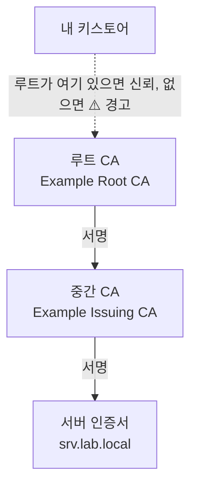
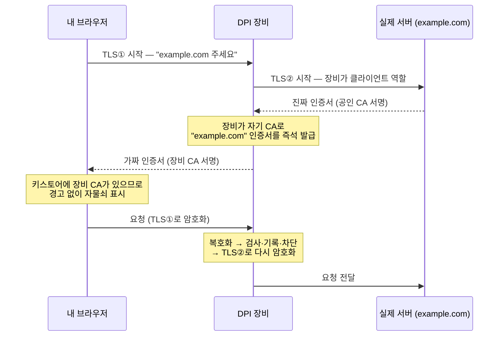
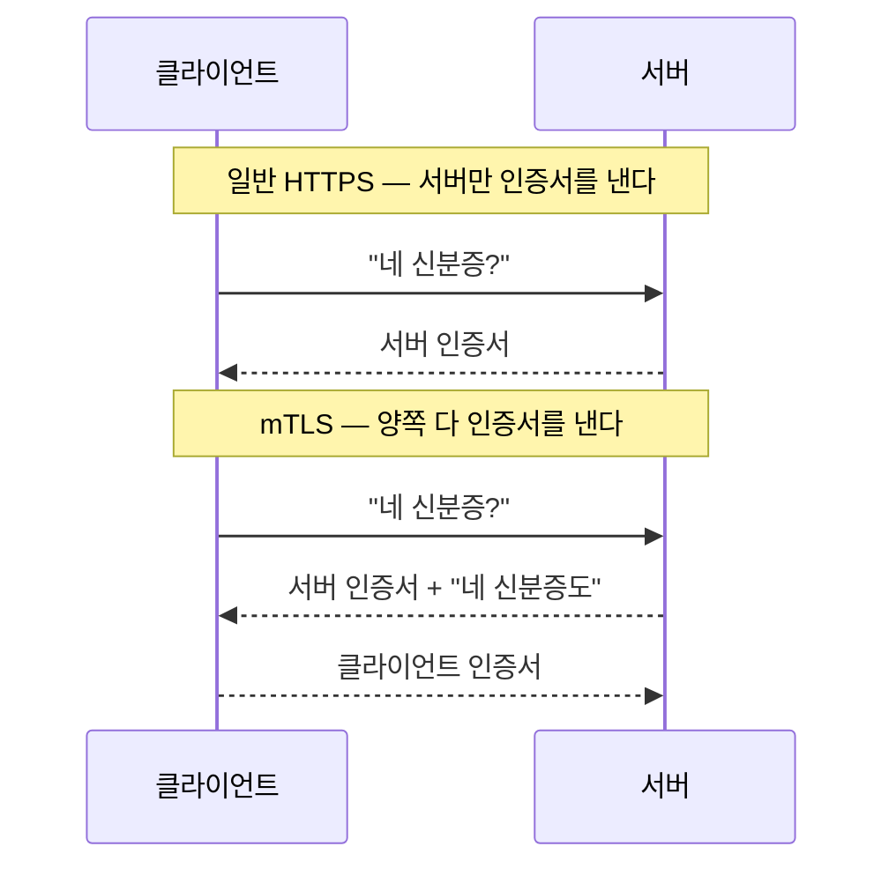
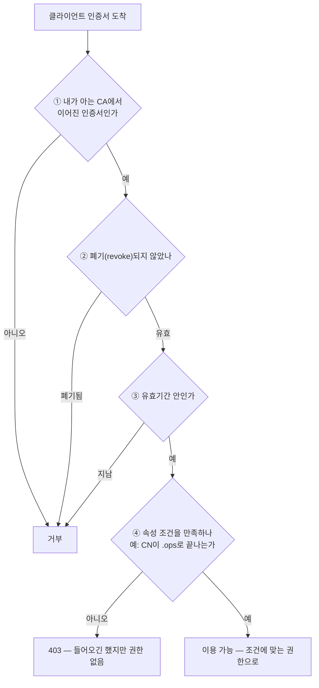

# Part 5. 신뢰와 인증서

> 담당 랩: [실습⑩](labs/lab-10.md) · [실습⑪](labs/lab-11.md)

이 장의 한 줄 요약은 이렇습니다. **TLS의 "신뢰"는 누가 내 키체인에 뿌리로 들어 있느냐의 문제**입니다. 이걸 알고 나면 Let's Encrypt, 사설 CA, 회사 보안 장비, mTLS가 모두 같은 원리의 다른 얼굴로 보입니다.

---

## 5.1 TLS가 믿는 것 — CA·체인·키체인

### 멘탈모델

브라우저가 `https://srv.lab.local`에 접속하면 서버는 인증서를 내밉니다. 브라우저는 세 가지만 확인합니다.

1. 이 인증서가 **내가 아는 뿌리(루트 CA)** 까지 서명으로 이어지는가
2. 인증서 이름(SAN)이 **내가 접속한 주소**와 맞는가
3. **유효기간**이 지나지 않았는가

여기서 1번의 "내가 아는 뿌리"가 곧 **키스토어(트러스트 스토어)** 입니다. OS나 브라우저가 미리 들고 있는 루트 인증서 목록입니다.



### 왜 이게 전부인가

- 신뢰는 **전이**된다. 루트는 자기 서명이라 밖에서 심어 줘야 하므로 "키스토어에 있느냐"가 전부다. 공인 CA가 믿어지는 건 OS·브라우저가 그 루트를 기본 탑재해서다.
- 서버는 서버 인증서+중간 CA를 함께 보낸다. 중간 CA를 빼먹으면 "어떤 클라이언트만 실패"하는 간헐 오류가 난다.

### 뿌리는 누가 정하나 — 루트 프로그램과 설치 미디어

내 키스토어의 루트 인증서들은 내가 고른 게 아닙니다. **OS 설치 미디어에 들어 있다가** 설치할 때 깔리고, 이후 **OS 업데이트로 갱신**됩니다. 어떤 CA를 넣고 뺄지는 OS·브라우저 회사가 운영하는 **루트 프로그램**이 정합니다. CA는 정기 감사를 통과하고 규칙을 지켜야 목록에 들어가며, 사고를 치면 빠집니다(2011년 해킹당한 네덜란드 CA DigiNotar는 모든 목록에서 제거되고 파산했습니다).

| 루트 프로그램 | 운영 | 쓰는 곳 |
| --- | --- | --- |
| [Mozilla CA Certificate Program](https://wiki.mozilla.org/CA) | Mozilla 재단 | Firefox, 그리고 **대부분의 리눅스 배포판** |
| [Microsoft Trusted Root Program](https://learn.microsoft.com/en-us/security/trusted-root/program-requirements) | 마이크로소프트 | Windows (Windows Update로 자동 갱신) |
| [Apple Root Certificate Program](https://www.apple.com/certificateauthority/ca_program.html) | 애플 | macOS · iOS (OS 업데이트로 갱신) |
| [Chrome Root Program](https://www.chromium.org/Home/chromium-security/root-ca-policy/) | 구글 | Chrome (자체 목록) |

리눅스는 자체 프로그램 대신 Mozilla의 목록을 가져다 씁니다. 직접 확인할 수 있습니다.

```bash
# Debian·Ubuntu — ca-certificates 패키지의 출처 디렉터리 이름이 mozilla
ls /usr/share/ca-certificates/
ls /usr/share/ca-certificates/mozilla | wc -l
# RHEL·Rocky — 패키지 설명
rpm -qi ca-certificates | grep Summary
```

```text
mozilla
120
Summary     : The Mozilla CA root certificate bundle
```

(Ubuntu 24.04·Rocky 9 컨테이너, 2026-11 기준. 개수는 업데이트마다 달라집니다.)

**그래서 오래 잠들었던 컴퓨터는 웹을 못 믿습니다.** 10년 된 맥을 백업에서 복원해 오랜만에 켜면, 많은 웹사이트가 "신뢰할 수 없음"으로 안 열립니다. 키스토어가 **10년 전 설치 미디어 시점에 멈춰 있기** 때문입니다. 그사이 새로 생긴 루트는 없고, 그때 있던 루트는 만료됐습니다. 실제 예가 Let's Encrypt입니다. 그 루트(ISRG Root X1)를 macOS가 기본으로 믿는 건 10.12.1(2016) 이후이고, 그보다 오래된 맥은 다른 CA가 대신 서명해 주던 교차 서명(DST Root CA X3)에 기대고 있었는데 그 루트가 2021년 9월 30일에 만료됐습니다. 그 뒤로 오래된 맥에서는 Let's Encrypt 인증서를 쓰는 수많은 사이트가 경고를 띄웁니다.

- 고치는 순서: **① 시계부터 확인**(배터리가 방전돼 날짜가 틀리면 모든 인증서가 "기간 아님"이 됩니다) → **② OS 업데이트**(키스토어도 같이 갱신) → ③ 더는 업데이트가 안 되는 OS라면 필요한 루트를 공식 배포처에서 받아 직접 심거나([5.4](#54-키스토어에-뿌리-심기--윈도ios안드)), 자체 루트 목록을 들고 다니는 최신 Firefox를 씁니다.
- 서버도 같습니다. 몇 년 전에 구운 골든 이미지나 업데이트를 멈춘 서버는 `ca-certificates`가 낡아, 어느 날 외부 API·저장소 접속이 인증서 오류로 실패합니다. **OS 업데이트는 보안 패치일 뿐 아니라 "누구를 믿을지"의 갱신**이기도 합니다([Part 1](01-image.md)의 이미지 패치 때 같이 올려 두세요).


### "인증서"라는 말이 불편하다면 — 공인인증서의 기억

우리나라에서 "인증서"라고 하면 많은 사람이 **공인인증서와 액티브X**를 떠올립니다. 은행·관공서 사이트마다 보안 프로그램을 몇 개씩 깔아야 했고, 인증서 파일을 USB에 담아 들고 다녔고, 브라우저를 바꾸면 안 됐습니다. 감정이 좋을 리 없습니다. 그런데 그 불편함은 **인증서라는 기술** 때문이 아니라, 브라우저와 OS에 이미 있는 기능을 두고 **따로 만든 플러그인과 따로 둔 저장소**를 쓰게 했기 때문입니다(공인인증서 제도는 2020년 12월 전자서명법 개정으로 폐지되어 지금은 '공동인증서'라고 부릅니다).

실제로는 이렇습니다.

- **키스토어(키체인)는 OS의 기본 기능입니다.** 윈도우의 인증서 저장소, macOS·iOS의 키체인, 안드로이드의 자격 증명 저장소, 리눅스의 `ca-certificates`가 모두 처음부터 들어 있습니다. 따로 깔 것이 없습니다.
- **같은 표준입니다.** 공인(공동)인증서, 웹사이트의 HTTPS 인증서, 아래 5.6의 mTLS 클라이언트 인증서는 모두 **X.509** 형식의 인증서입니다. 쓰임새(누가, 무엇을 증명하나)만 다릅니다.
- **브라우저에 이미 들어 있습니다.** 서버 인증서 검증은 물론, 클라이언트 인증서를 골라 내미는 기능도 모든 주요 브라우저에 기본으로 있습니다. 플러그인이 필요 없습니다.

이 장에서 다루는 것은 이 **표준 기능을 표준대로 쓰는 법**입니다.

### 확인 커맨드

```bash
# 서버가 보내는 체인을 그대로 본다
openssl s_client -connect srv.lab.local:443 -servername srv.lab.local -showcerts </dev/null

# 인증서 한 장을 사람이 읽을 수 있게
openssl x509 -in srv.crt -noout -text | less
openssl x509 -in srv.crt -noout -subject -issuer -dates -ext subjectAltName

# 이 OS의 신뢰 뿌리 목록 (Debian/Ubuntu)
ls /etc/ssl/certs | head
```

- 핵심은 `issuer`(누가 서명했나)와 `subject`(누구 것인가)가 체인을 따라 이어진다는 점입니다.

### 바깥 링크

- [RFC 5280 — X.509 PKI 인증서 프로파일](https://www.rfc-editor.org/rfc/rfc5280)
- [Let's Encrypt 인증서 호환성](https://letsencrypt.org/docs/certificate-compatibility/) — 플랫폼별로 언제부터 그 루트를 믿는지
- [RFC 8446 — TLS 1.3](https://www.rfc-editor.org/rfc/rfc8446) (핸드셰이크 내부는 여기서)

---

## 5.2 ACME 두 챌린지 — HTTP-01 vs DNS-01

### 멘탈모델

공인 CA(예: Let's Encrypt)는 사람을 만나 신분을 확인하지 않습니다. 대신 **"이 도메인을 실제로 통제하는 자만 할 수 있는 일"** 을 시킵니다. 이 자동화 프로토콜이 **ACME**([RFC 8555](https://www.rfc-editor.org/rfc/rfc8555))이고, 그 "시키는 일"이 챌린지입니다.

| | HTTP-01 | DNS-01 |
|---|---|---|
| 증명 방법 | `http://도메인/.well-known/acme-challenge/<토큰>` 에 지정한 내용을 **되돌려줌** | `_acme-challenge.도메인` 에 **TXT 레코드**를 게시 |
| 비유 | 문을 열어 보여주기 | 등기부로 증명하기 |
| 80포트 | **필요** (CA가 인터넷에서 들어옴) | 불필요 |
| 공개 서버 | **필요** | 불필요 (내부망 서버도 가능) |
| 와일드카드(`*.lab.example`) | 불가 | **가능** |
| 필요한 권한 | 웹서버 설정 | DNS 수정 권한 |

### Let's Encrypt — 인증서를 공짜로, 자동으로

예전에는 인증서를 돈 주고 사서, 1~2년마다 사람이 손으로 갱신했습니다. 그래서 작은 기관·개인 사이트는 HTTPS를 안 했고, 갱신을 잊어 사이트가 멈추는 일도 흔했습니다. 이걸 바꾼 것이 **Let's Encrypt**입니다.

- **누가:** 비영리 단체 **ISRG**(Internet Security Research Group, 미국 501(c)(3) 비영리)가 운영합니다. 2013년 5월에 세워졌고, 창립 후원·협력 기관은 **Mozilla, EFF(전자프런티어재단), 미시간 대학교, Cisco, Akamai**입니다. 2015년 12월 일반에 인증서 발급을 시작했고, 지금은 7억 개가 넘는 웹사이트에 인증서를 줍니다.
- **돈은 어디서:** 인증서는 무료이고, 운영비는 후원으로 충당합니다. 2026년 11월 기준 최상위 후원 등급에 **Google, AWS, Microsoft**, 그다음 등급에 **Mozilla, EFF, Meta, OVH, Internet Society**, 그 아래에 **Cisco, IBM, Shopify, SAP** 등이 있습니다. 경쟁하는 글로벌 대기업들과 인터넷 자유를 위한 재단들이 **같은 CA 하나를 함께 떠받치고** 있는 셈입니다. "모든 웹이 암호화되는 것"이 모두에게 이익이기 때문입니다.
- **어떻게:** 사람이 신청서를 쓰는 대신 위의 **ACME** 프로토콜로 기계가 자동으로 발급·갱신합니다. 인증서 수명이 90일로 짧은 것도 일부러입니다. 짧으면 키가 새어도 피해 기간이 짧고, 사람이 손으로 갱신하는 걸 포기하고 **자동화하게** 만듭니다.

### Caddy — HTTPS가 기본값인 웹 서버

이 책의 실습([⑩](labs/lab-10.md)·[⑪](labs/lab-11.md)·[⑨′](labs/lab-09p.md))에서 웹 서버·리버스 프록시로 쓰는 **[Caddy](https://caddyserver.com/)** 는 Go로 만든 오픈소스(Apache 2.0) 웹 서버입니다. 다른 웹 서버와 가장 다른 점은 **HTTPS가 기본값**이라는 것입니다. 도메인 이름만 적으면 나머지를 알아서 합니다.

```
# Caddyfile — 이 세 줄이 전부다
example.org {
    reverse_proxy 127.0.0.1:8080
}
```

이 설정으로 Caddy는 다음을 **자동으로** 합니다.

- Let's Encrypt에서 `example.org` 인증서를 받는다 (실패하면 ZeroSSL로 다시 시도)
- 만료 전에 알아서 갱신한다
- `http://`로 온 요청을 `https://`로 돌려보낸다
- `localhost`·IP 주소·내부 이름처럼 공인 인증서를 받을 수 없는 이름에는 **자기만의 로컬 CA**를 만들어 서명한다 — [5.3 프라이빗 CA](#53-프라이빗-ca--내가-신뢰의-뿌리)와 같은 원리

nginx·Apache로 같은 일을 하려면 웹 서버 설정, certbot 설치, 갱신 타이머, 리다이렉트 설정을 따로 해야 합니다. 설정이 짧을수록 실수가 줄고, 실수가 줄수록 안전합니다.

### 최소권한 — `_acme-challenge`만 위임

DNS-01의 약점은 "DNS를 고칠 권한"이 곧 **존 전체의 권한**이라는 점입니다. API 토큰이 새면 `www`, `mail`, MX까지 바꿀 수 있습니다. 해법은 챌린지만 따로 위임하는 것입니다.

- **CNAME 위임:** `_acme-challenge.eNN.lab.example` 을 별도 DNS(예: acme-dns 같은 전용 서버)로 `CNAME` 해 둡니다. 그러면 챌린지용 TXT만 그쪽에서 쓰고, **본 존에는 쓰기 권한을 주지 않습니다.**

```text
; 본 존에는 CNAME 한 줄만 있으면 된다
_acme-challenge.e01.lab.example.  CNAME  e01.auth.acme-dns.example.
```

이것이 [실습⑩](labs/lab-10.md)의 "각자 `eNN`만 위임받아 발급"의 원리입니다. **발급에 필요한 최소한의 권한만 건네는 것**, 이 책 전체에 흐르는 최소권한 원칙의 인증서 버전입니다.

### 확인 커맨드

```bash
# 챌린지 레코드가 위임되어 있는지
dig +short TXT _acme-challenge.e01.lab.example
dig +short CNAME _acme-challenge.e01.lab.example

# 발급된 인증서의 이름·발급자·만료일
echo | openssl s_client -connect svc.demo.example:443 -servername svc.demo.example 2>/dev/null \
  | openssl x509 -noout -subject -issuer -dates -ext subjectAltName
```

- 와일드카드 인증서는 SAN에 `DNS:*.lab.example` 로 나타납니다.

### 바깥 링크

- [RFC 8555 — ACME](https://www.rfc-editor.org/rfc/rfc8555)
- [Let's Encrypt — Challenge Types](https://letsencrypt.org/docs/challenge-types/)
- [ISRG 소개](https://www.abetterinternet.org/about/) · [후원 기관 목록](https://www.abetterinternet.org/sponsors/) — Let's Encrypt를 운영하는 비영리 단체와 그 후원자
- [Caddy — Automatic HTTPS](https://caddyserver.com/docs/automatic-https) — 자동으로 하는 일의 전체 목록
- [acme-dns 프로젝트](https://github.com/joohoi/acme-dns)
- [Caddy — Automatic HTTPS](https://caddyserver.com/docs/automatic-https)

---

## 5.3 프라이빗 CA — 내가 신뢰의 뿌리

### 멘탈모델

공인 CA는 **공인 도메인**과 **인터넷에서 닿는 경로**를 전제로 합니다. 다음 경우에는 그 전제가 깨집니다.

- 폐쇄망(인터넷 없음), 연구 장비 망
- `srv.lab.local`, `10.0.0.5` 같은 **공인되지 않은 이름**
- 장비 수백 대에 각각 인증서를 찍어 줘야 하는 내부 서비스

이때의 답이 **프라이빗 CA**입니다. 내가 루트 키 한 쌍을 만들고, 그 키로 서버 인증서에 서명합니다. 공인 CA가 하는 일을 똑같이 하되, **신뢰의 뿌리가 내가 됩니다.**

### 만드는 법

[실습⑪](labs/lab-11.md)에서 직접 한다. `openssl genrsa`/`req -x509`로 루트를 만들고, CSR을 `openssl x509 -req -CA`로 서명하며, **SAN을 반드시 넣는다**(현대 브라우저는 CN만 보지 않는다). 자동화는 [mkcert](https://github.com/FiloSottile/mkcert)(개발용), [step-ca](https://smallstep.com/docs/step-ca/)(ACME 지원 사내 CA)가 있다.

### 비용

- **배포:** 이 CA를 쓰는 모든 기기에 뿌리를 직접 심어야 한다(5.4).
- **보관:** `ca.key` 유출 = 어떤 도메인이든 위조 가능. 루트는 오프라인, 일상 발급은 중간 CA, 가능하면 `nameConstraints`로 범위 제한.

### 확인 커맨드

```bash
# 이 서버 인증서가 내 CA로 검증되는가
openssl verify -CAfile ca.crt srv.crt

# CA를 명시해 접속 (키스토어를 건드리지 않고 시험)
curl --cacert ca.crt https://srv.lab.local/

# CA 인증서 자체 확인: CA:TRUE, 유효기간, 용도
openssl x509 -in ca.crt -noout -text | grep -A1 -E "Basic Constraints|Not After"
```

`curl --cacert` 는 "이 프로세스 하나만 이 뿌리를 믿어라"입니다. 시스템 전체에 심기 전에 안전하게 시험해 볼 수 있습니다.

### 바깥 링크

- [mkcert](https://github.com/FiloSottile/mkcert)
- [Smallstep — step-ca 문서](https://smallstep.com/docs/step-ca/)
- [OpenSSL x509 / req 매뉴얼](https://docs.openssl.org/master/man1/openssl-x509/)

---

## 5.4 키스토어에 뿌리 심기 — 윈도·iOS·안드

### 멘탈모델

사설 CA의 `ca.crt`는 **공개 인증서**입니다(개인키가 아님). 이걸 각 기기의 신뢰 목록에 올리면, 그 기기는 이 CA가 서명한 모든 것을 믿습니다.

**심기 전:** 접속하면 ⚠️ 경고(`NET::ERR_CERT_AUTHORITY_INVALID`). 아무도 이 CA를 모르니까요.
**심은 후:** 같은 서버가 🔒 자물쇠. 서버는 한 글자도 바꾸지 않았습니다. 바뀐 것은 **내 기기의 키스토어**뿐입니다.

### 플랫폼별 위치

| 플랫폼 | 경로 | 주의 |
|---|---|---|
| 윈도 | `ca.crt` 더블클릭 → 인증서 설치 → **로컬 컴퓨터** → **신뢰할 수 있는 루트 인증 기관** | "자동으로 선택"하면 중간 CA 저장소로 갈 수 있음. 반드시 위 저장소를 직접 지정 |
| iOS | 파일 전송 → 설정 > 프로파일 설치 → **설정 > 일반 > 정보 > 인증서 신뢰 설정**에서 "전체 신뢰" ON | 설치만으로는 **신뢰되지 않음.** 마지막 토글이 진짜 신뢰 |
| 안드로이드 | 설정 > 보안 > 암호화 및 자격 증명 > CA 인증서 설치 | 앱이 사용자 CA를 무시하도록 만들어진 경우가 많음(앱별 정책) |
| 리눅스 | `/usr/local/share/ca-certificates/` 에 `.crt` 복사 후 `sudo update-ca-certificates` | Firefox·Java는 **자기 저장소**를 따로 가짐 |

관리 기기가 많다면 윈도는 GPO, Apple은 MDM 프로파일로 일괄 배포한다(5.5와 같은 길이다).

### 확인 커맨드

```powershell
# 윈도: 신뢰할 수 있는 루트 목록에서 내 CA 찾기
Get-ChildItem Cert:\LocalMachine\Root | Where-Object Subject -like "*MyLab*"
certutil -verifystore Root
```

```bash
# 리눅스: 심은 뒤 시스템 신뢰로 검증
# -CAfile 없이도 통과해야 함
openssl verify srv.crt
# --cacert 없이 통과해야 함
curl https://srv.lab.local/
```

- 브라우저 자물쇠 → 인증서 → 발급자가 "MyLab Root CA"인지 확인합니다.
- 심기 전에 꼭 한 번 경고 화면을 눈으로 확인하세요. **대조**가 있어야 키스토어가 원인이라는 것이 체감됩니다.

### 바깥 링크

- [Apple — 신뢰할 수 있는 인증서 설정](https://support.apple.com/en-us/102390)
- [Android — 사용자 CA 인증서](https://developer.android.com/privacy-and-security/security-config)
- [Microsoft — 신뢰할 수 있는 루트 인증서 배포](https://learn.microsoft.com/en-us/windows-server/identity/ad-cs/)

---

## 5.5 같은 칼, 감시의 얼굴 — DPI

### 멘탈모델

5.4에서 한 일을 다시 떠올려 보세요. "누군가의 CA 인증서를 내 키스토어에 심으면, 그 누군가가 서명한 **어떤 도메인의 인증서든** 내 기기는 믿는다." 이것은 편리한 기능이자, 동시에 **열쇠를 넘기는 행위**입니다.

회사의 **TLS 복호화(DPI, Deep Packet Inspection) 장비**는 정확히 이 원리로 동작합니다. 한마디로 **회사가 합법적으로 하는 중간자 공격(MITM, Man-in-the-Middle)** 입니다. 공격자가 몰래 하면 범죄인 바로 그 기술을, 기관이 자기 업무망·업무 기기에 대해 내부 규정과 사용자 고지를 근거로 공개적으로 하는 것입니다.



1. 내 브라우저가 `https://example.com` 으로 나갑니다.
2. 장비가 중간에서 가로채고, 진짜 서버와는 자신이 따로 TLS를 맺습니다.
3. 내 쪽에는 **`example.com` 이름으로 자기 CA가 서명한 가짜 인증서**를 내밉니다.
4. 내 기기 키스토어에 **그 회사 CA가 이미 심겨 있으므로** 브라우저는 경고 없이 🔒 를 보여 줍니다.
5. 장비는 평문을 보고(검사·로깅·차단), 다시 암호화해 전달합니다.

DPI 장비는 **허가받은 중간자**, 곧 조직이 공지하고 운영하는 합법적 도청 장치입니다. 같은 장비를 *SSL Inspection*, *HTTPS Inspection*, *TLS 복호화*라고도 부릅니다.

| | DPI 장비가 없을 때 | DPI 장비가 있을 때 |
| --- | --- | --- |
| 브라우저가 받는 인증서의 발급자 | 공인 CA (예: Let's Encrypt, DigiCert) | **조직(장비)의 CA** |
| 그 CA가 키스토어에 들어온 경로 | OS 설치 미디어에 들어 있어 **기본으로** 신뢰 | 사용자(또는 관리 도구)가 **내려받아 추가** |
| 브라우저 화면 | 자물쇠 | 똑같은 자물쇠 — 화면만으로는 구별되지 않음 |
| 평문을 볼 수 있는 곳 | 나와 서버 | 나, 서버, **그리고 장비** |

### 왜 "같은 칼"인가

| | 5.4에서 내가 한 일 | 5.5의 DPI |
|---|---|---|
| 하는 동작 | 사설 CA를 내 키스토어에 신뢰 등록 | 회사 CA를 업무 기기 키스토어에 신뢰 등록 |
| 효과 | 내 서버가 🔒 로 보임 | **모든 사이트가** 🔒 로 보이되 중간자 개입 |
| 누가 이득 | 나 | CA 주인 |

기술적으로 **완전히 같은 동작의 뒤집기**입니다. 그래서 핵심 문장은 이것입니다.

> **CA를 신뢰한다는 것은, 그 주체에게 내 트래픽의 열람권을 준 것이다.**

신뢰 등록은 "이 서버를 믿는다"가 아니라 "이 CA가 보증하는 **모든 것**을 믿는다"입니다. 범위를 제한하는 장치(`nameConstraints` 등)가 없는 한 그 CA는 어떤 이름의 인증서든 찍을 수 있습니다.

### 이것이 나쁜 것인가

업무 기기에서 악성코드 차단·유출 방지(DLP)용으로 쓰는 것은 흔한 관행이지만 **공지와 정책**이 전제다. 개인 기기에 출처 불명 CA를 심는 것은 위험하다. 운영하는 쪽이라면 복호화한 평문과 CA 개인키가 최고 가치의 공격 표적이다. 내 조직이 TLS 복호화를 하는지, 어떤 CA를 심게 하는지, 어떤 사이트(금융·의료 등)는 복호화에서 빼는지는 조직의 보안 정책에 적혀 있어야 하고, 사용자에게 공지되어야 합니다. 아래 "확인 커맨드"로 직접 확인할 수도 있습니다.

### 확인 커맨드 — 내 트래픽이 풀리고 있는가

같은 사이트의 **발급자(issuer)** 를 사내망 안과 밖(예: 휴대폰 핫스팟)에서 비교하면 됩니다.

```bash
echo | openssl s_client -connect example.com:443 -servername example.com 2>/dev/null \
  | openssl x509 -noout -issuer -subject -dates -fingerprint -sha256
```

- 밖: `issuer` 가 공인 CA(예: Let's Encrypt, DigiCert 등).
- 안: `issuer` 가 **회사 이름이 든 CA**로 바뀌어 있다면 복호화 중입니다. 지문(fingerprint)도 다릅니다.
- 브라우저 자물쇠 → 인증서 → 발급자만 보아도 됩니다.
- 내 키스토어에 어떤 CA가 심겨 있는지는 주기적으로 훑어볼 가치가 있습니다.

### 바깥 링크

- [NIST SP 800-52r2 — TLS 구현 가이드](https://csrc.nist.gov/pubs/sp/800/52/r2/final)
- [CISA — HTTPS Interception Weakens TLS Security](https://www.cisa.gov/news-events/alerts/2017/03/16/https-interception-weakens-tls-security)
- [RFC 6962 — Certificate Transparency](https://www.rfc-editor.org/rfc/rfc6962)

감시와 접근통제를 어떻게 한 장에서 함께 다루는지는 [Part 6](06-access.md)에서 이어집니다.

---

## 5.6 mTLS — 양쪽이 신분증을

### 멘탈모델

평소 HTTPS는 **서버만** 신분증을 보입니다. 보통 "HTTPS 인증서"라고 하면 이 **서버 인증서**를 말하고, 브라우저 주소창의 🔒 자물쇠가 그것을 확인했다는 표시입니다. 자물쇠가 해 주는 일은 둘입니다.

1. **이 서버가 진짜다.** 내가 접속한 주소(예: `bank.example`)의 주인이 맞고, 똑같이 꾸며 놓은 **피싱 사이트가 아니라는 것**을 CA가 보증합니다([5.1](#51-tls가-믿는-것--ca체인키체인)의 세 가지 확인).
2. **오가는 내용을 암호화한다.** 인증서의 공개키를 이용해 양쪽이 둘만 아는 비밀 키를 정하고, 그 뒤의 모든 내용을 암호화합니다. 중간의 공유기·통신사·공용 와이파이 운영자는 내용을 엿보거나 몰래 고칠 수 없습니다.

두 가지를 기억해 둡니다. 첫째, 자물쇠는 "이 **주소**의 주인"을 보증할 뿐 그 주인이 선량하다는 뜻은 아닙니다. 피싱 사이트도 자기 도메인(`bank-example-login.example`)으로 무료 인증서를 받을 수 있으니, 자물쇠보다 **주소**를 봅니다. 둘째, 암호화의 "끝"은 **인증서를 가진 쪽**입니다. 중간에 리버스 프록시·CDN이나 [5.5의 DPI 장비](#55-같은-칼-감시의-얼굴--dpi)가 TLS를 풀면 거기서 한 번 끝나고 다시 암호화됩니다.

반면 클라이언트는 익명입니다. 누구인지는 로그인(비밀번호, 토큰)으로 따로 증명합니다.

**mTLS(mutual TLS)** 는 이걸 대칭으로 만듭니다.



서버는 "**내가 신뢰하는 CA가 발급한 클라이언트 인증서를 가진 기기만**" 연결을 허락합니다. 인증서가 없으면 **TLS 핸드셰이크 단계에서** 끊깁니다. 애플리케이션까지 요청이 닿지도 못합니다.

### 왜 강력한가

- **비밀번호가 없습니다.** 피싱, 무차별 대입, 유출된 자격증명이 통하지 않습니다. 훔칠 것은 개인키 파일뿐입니다.
- **5.3의 사설 CA를 그대로 씁니다.** 서버 인증서를 찍던 같은 CA가 클라이언트 인증서도 찍습니다. 신뢰의 뿌리를 하나 두고 양방향에 쓰는 것입니다.
어울리는 곳은 **관리망(관리 콘솔, 대시보드), 서비스 간 API, 사람이 아닌 기기 인증**입니다. 사용자가 많고 기기가 제각각인 공개 서비스에는 인증서 배포가 부담이라 어울리지 않습니다.

### mTLS = 제로 트러스트

**제로 트러스트**(Zero Trust)는 "내부망에 있으니 믿는다"를 버리고, **연결할 때마다 그 주체가 누구인지 확인하고 필요한 만큼만 허락하는** 보안 방식입니다(미국 NIST SP 800-207). mTLS는 이것을 가장 직접적으로 구현하는 수단입니다. 어디서 접속했느냐(IP·망)가 아니라 **무엇을 들고 왔느냐(인증서)**로 판단하기 때문입니다.

서버가 클라이언트 인증서를 받으면 이런 순서로 확인합니다.



①~③은 [5.1](#51-tls가-믿는-것--ca체인키체인)에서 브라우저가 서버 인증서에 하던 확인과 같습니다(②의 폐기 확인은 CRL·OCSP로 하며, 서버 소프트웨어마다 지원이 다르니 문서를 확인합니다. 지원이 없으면 유효기간을 짧게 잡아 "폐기" 대신 "만료"에 기대는 방법을 씁니다). 강력한 건 ④입니다. 인증서의 **CN**(Common Name)·OU 같은 속성에 정규식 조건을 걸어 **분기**하고, 분기마다 다른 권한을 줄 수 있습니다. 같은 CA가 찍어 준 인증서라도 "운영팀(`*.ops`)은 관리 화면, 개발팀(`*.dev`)은 읽기 전용"처럼 접근을 잘게 나눌 수 있습니다.

```text
srv.lab.local {
	tls srv.crt srv.key {
		client_auth {
			mode require_and_verify
			trust_pool file ca.crt
		}
	}
	# 인증서 주체(Subject)의 CN이 .ops 로 끝나면 관리 화면으로
	@ops vars_regexp {tls_client_subject} "CN=[^,]+\.ops(,|$)"
	handle @ops {
		reverse_proxy 127.0.0.1:9000
	}
	# 같은 CA의 인증서라도 그 밖은 거절
	handle {
		respond "403 forbidden: {tls_client_subject}" 403
	}
}
```

Caddy 2.11에서 시험한 결과입니다. 같은 CA로 `CN=alice.ops`와 `CN=bob.dev` 두 인증서를 만들어 접속했습니다.

```text
alice.ops -> 200  (관리 화면)
bob.dev   -> 403 forbidden: CN=bob.dev,OU=lab,O=Example
인증서 없음 -> TLS 핸드셰이크 단계에서 끊김 (curl 종료 코드 55)
```

> ⚠️ Caddyfile의 따옴표 안에서 정규식의 점(`.` 문자 그대로)은 `\.`처럼 백슬래시 **하나**로 씁니다. 다른 언어 습관대로 두 개(`\\.`)를 쓰면 아무 인증서도 조건에 맞지 않아 모두 403이 됩니다. 시험하다 실제로 겪은 실수입니다.


### 만드는 법 (요약)

```bash
# 클라이언트 인증서를 같은 CA로 발급
openssl genrsa -out cli.key 2048
openssl req -new -key cli.key -subj "/CN=alice" -out cli.csr
openssl x509 -req -in cli.csr -CA ca.crt -CAkey ca.key -CAcreateserial \
  -days 365 -out cli.crt \
  -extfile <(printf "extendedKeyUsage=clientAuth")
```

서버(Caddy 예시)는 "클라이언트 인증서를 요구하고 이 CA로 검증"을 선언합니다.

```text
srv.lab.local {
    tls srv.crt srv.key {
        client_auth {
            mode require_and_verify
            trust_pool file ca.crt
        }
    }
    respond "hello, {tls_client_subject}"
}
```

- `extendedKeyUsage=clientAuth` 가 있어야 클라이언트 용도로 인정됩니다.
### 확인 커맨드

```bash
# 인증서 없이: 거부
curl --cacert ca.crt https://srv.lab.local/
#   → TLS 핸드셰이크 실패 또는 403

# 클라이언트 인증서와 함께: 통과
curl --cacert ca.crt --cert cli.crt --key cli.key https://srv.lab.local/

# 서버가 어떤 CA를 요구하는지 확인 ("Acceptable client certificate CA names")
openssl s_client -connect srv.lab.local:443 -servername srv.lab.local </dev/null 2>/dev/null \
  | grep -A3 "Acceptable client"
```

[실습⑪](labs/lab-11.md)의 (3)에서 두 `curl`의 결과를 나란히 확인합니다. mTLS를 관리망 접근에 쓰는 구도는 [Part 6](06-access.md)의 접근 설계와 이어집니다.

### 바깥 링크

- [RFC 8446 §4.3.2 — CertificateRequest (클라이언트 인증)](https://www.rfc-editor.org/rfc/rfc8446#section-4.3.2)
- [Caddy — tls 지시자 client_auth](https://caddyserver.com/docs/caddyfile/directives/tls#client_auth)
- [Caddy — vars_regexp 매처](https://caddyserver.com/docs/caddyfile/matchers#vars-regexp) · [플레이스홀더 목록](https://caddyserver.com/docs/caddyfile/concepts#placeholders) (`{tls_client_subject}` 등)
- [NIST SP 800-207 — Zero Trust Architecture](https://csrc.nist.gov/pubs/sp/800/207/final)
- [Cloudflare — mTLS 설명](https://www.cloudflare.com/learning/access-management/what-is-mutual-tls/)
