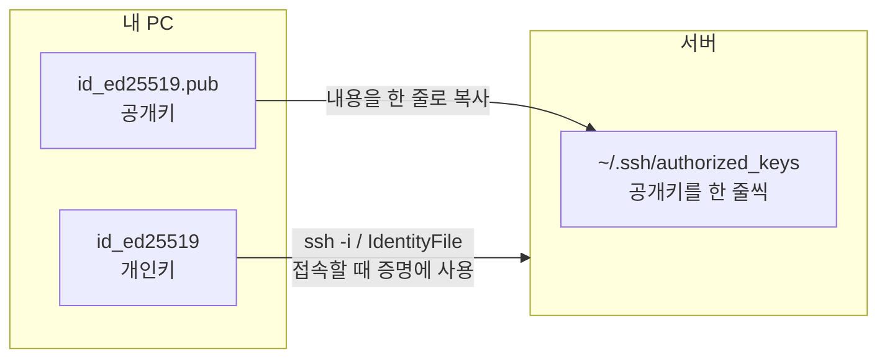
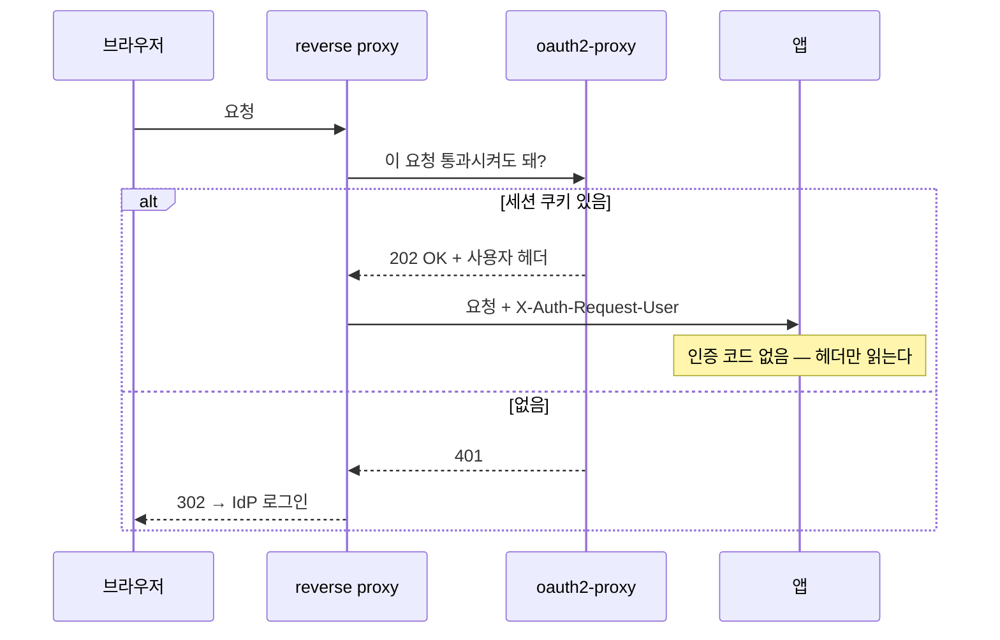
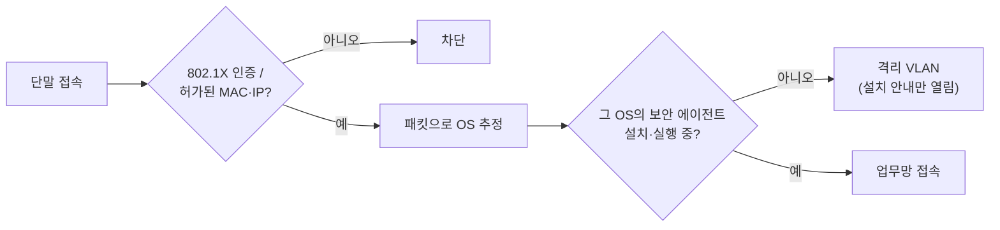

# Part 6. 접근과 인증 {#part-6}

> 담당 랩 [실습⑧](labs/lab-08.md)(준비) · [실습⑫](labs/lab-12.md).

서버에 누가 들어오는지는 두 갈래로 나뉩니다. 사람이 셸로 들어오는 길(SSH)과 웹 앱으로 들어오는 길(OIDC, OpenID Connect: 웹 로그인을 외부 인증 서버에 맡기는 표준)입니다. 그리고 그 앞에 **네트워크가 먼저 장비를 거르는** 층(NAC)이 있습니다. 이 장은 세 층을 안쪽에서 바깥쪽 순서로 살펴봅니다.

세 층에 공통된 멘탈모델(mental model, 동작 원리를 머릿속에 그려 두는 틀)은 하나입니다. **"비밀을 서버에 두지 말고, 검증 가능한 공개 정보만 두자."** 공개키, 토큰 서명, 인증서가 모두 이 원리를 따릅니다.

---

## 6.1 SSH 키 — ed25519와 rsa, 키 타입과 지문 해시(SHA256) {#6-1-ssh-keys}

### 멘탈모델 {#6-1-mental-model}

SSH 키는 **자물쇠(공개키)와 열쇠(개인키)** 한 쌍입니다. 자물쇠는 누구에게 나눠 주어도 되고, 열쇠는 내 장비 밖으로 나가지 않습니다. 서버는 "이 자물쇠로 잠근 수수께끼를 풀 수 있는가"만 확인하므로 **비밀번호가 네트워크를 지나가지 않습니다.**

### ed25519를 쓰는 이유 {#6-1-why-ed25519}

| | ed25519 | rsa 4096 |
|---|---|---|
| 공개키 길이 | 짧음 (한 줄 약 80자) | 김 (약 700자) |
| 속도 | 빠름 | 느림 (서명·생성) |
| 안전성 | 현대 곡선 기반, 구현 실수 여지 적음 | 키가 충분히 길면 안전, 다만 무거움 |
| 호환성 | OpenSSH 6.5(2014)+ | 거의 모든 구형 장비 |

기본값은 **ed25519**, 오래된 장비·솔루션과 맞물려야 할 때만 **rsa 4096**입니다. (rsa 2048 미만, dsa는 쓰지 않습니다.)

### 키 타입과 지문 해시는 다르다 {#6-1-fingerprint}

초심자가 가장 많이 혼동하는 부분입니다. 둘은 **서로 다른 층**에 속합니다.

- **키 타입**: 이 키가 *어떤 수학*에 기반하는가. 예: `ed25519`, `rsa`.
- **지문(fingerprint)**: 그 공개키를 *해시로 요약*한 짧은 식별자. 예: `SHA256:AbCd…`.

따라서 "ed25519 키의 지문은 SHA256이다"라는 말에는 모순이 없습니다. **서로 다른 층의 정보**를 한 문장에 담았을 뿐입니다. 지문은 사람이 두 키가 같은지 눈으로 대조하도록 만든 요약이며, 인증에 쓰이는 값은 아닙니다. 옛 `MD5` 16진 지문(`ab:cd:ef:…`)은 폐기되었고, OpenSSH 6.8 이후 기본이 `SHA256`입니다.

### 확인 명령 {#6-1-verify}

```bash
# 생성 (-C는 식별용 주석일 뿐 보안 요소가 아님)
ssh-keygen -t ed25519 -C "me@example.org"

# 레거시 호환이 꼭 필요할 때만
ssh-keygen -t rsa -b 4096 -C "me@example.org"

# 지문 확인: 비트수  해시:값  주석  (타입)
ssh-keygen -lf ~/.ssh/id_ed25519.pub
# 256 SHA256:AbCd…  me@example.org (ED25519)
```

출력 맨 끝 `(ED25519)`가 키 타입, 가운데 `SHA256:…`가 지문입니다. 한 줄에 두 층이 함께 나타납니다.

개인키에는 반드시 **패스프레이즈**(passphrase, 개인키 파일을 암호화하는 긴 암호)를 겁니다. 노트북을 잃어버렸을 때 개인키 파일만으로는 서버에 들어갈 수 없게 하는 마지막 방어선입니다. 매번 입력하기 번거로우면 `ssh-agent`가 키를 메모리에 잠시 보관하게 합니다.

### 개인키와 공개키 파일의 위치 {#6-1-key-files}

`ssh-keygen`은 파일 두 개를 만듭니다. 헷갈리기 쉬운 것은 **어느 파일을 어디에 두느냐**입니다.

| 파일 | 무엇 | 어디에 | 권한 |
| --- | --- | --- | --- |
| `~/.ssh/id_ed25519` | **개인키** (열쇠) | **내 PC에만.** `ssh -i`와 `IdentityFile`이 가리키는 것 | `600` |
| `~/.ssh/id_ed25519.pub` | **공개키** (자물쇠) | 접속할 서버의 `~/.ssh/authorized_keys`에 한 줄로. GitHub·Launchpad 계정에 등록하는 것도 이것 | `644` |



**서버 쪽 — 공개키를 `authorized_keys`에.** 한 줄에 키 하나씩, 여러 사람·여러 PC의 키를 차례로 넣을 수 있습니다.

```bash
# 내 PC에서: 공개키를 서버의 authorized_keys에 덧붙여 준다 (권한까지 알아서)
ssh-copy-id -i ~/.ssh/id_ed25519.pub ⟨user⟩@⟨server⟩
# 손으로 할 때 (서버에서): 디렉터리 700, 파일 600이 아니면 sshd가 무시한다
mkdir -p ~/.ssh && chmod 700 ~/.ssh
echo '⟨공개키 한 줄⟩' >> ~/.ssh/authorized_keys
chmod 600 ~/.ssh/authorized_keys
```

권한이 너무 열려 있으면(남이 쓸 수 있으면) sshd는 그 파일을 믿지 않고 조용히 무시합니다(`StrictModes`). "키를 넣었는데 비밀번호를 묻는다"의 흔한 원인입니다.

**내 쪽 — `ssh -i`와 `IdentityFile`에는 개인키.** 접속할 때 "나는 이 자물쇠의 열쇠를 갖고 있다"를 증명하는 쪽이므로 **`.pub`이 없는 파일**을 가리킵니다.

```bash
# 한 번만
ssh -i ~/.ssh/id_ed25519 ⟨user⟩@⟨server⟩
```

```bash
# ~/.ssh/config — 매번 쓰려면
Host ⟨server⟩
  User ⟨user⟩
  IdentityFile ~/.ssh/id_ed25519
  # 위 키만 시도한다
  IdentitiesOnly yes
```

키가 여러 개면 ssh는 가진 키를 차례로 모두 제시하다가 서버의 시도 횟수 제한에 걸려 `Too many authentication failures`와 함께 접속이 끊깁니다. `IdentitiesOnly yes`는 "`IdentityFile`에 적은 키만 써라"는 뜻입니다.

**`.pub`은 언제든 다시 만들 수 있습니다.** 공개키는 개인키에서 계산되는 값이라, 개인키만 있으면 됩니다(패스프레이즈를 걸었다면 물어봅니다).

```bash
ssh-keygen -y -f ~/.ssh/id_ed25519 > ~/.ssh/id_ed25519.pub
```

```text
ssh-ed25519 AAAAC3NzaC1lZDI1NTE5AAAAIFhgGG0e3NdlEjxGqLAJps71j0QO8e4AeUvbgronRDRb me@example.org
```

반대 방향은 불가능합니다. 이 방식의 안전성은 공개키에서 개인키를 계산할 수 없다는 데서 나옵니다. 그래서 **지켜야 할 것은 개인키 하나**이고, 백업할 것도 개인키 하나입니다. 개인키를 잃으면 새로 만들고 공개키를 다시 등록하는 수밖에 없습니다.

### 바깥 링크 {#6-1-links}

- [ssh-keygen(1)](https://man.openbsd.org/ssh-keygen) — 옵션 전체 (`-y`: 개인키에서 공개키 출력)
- [sshd(8) AUTHORIZED_KEYS FILE FORMAT](https://man.openbsd.org/sshd#AUTHORIZED_KEYS_FILE_FORMAT) — `authorized_keys` 한 줄의 형식과 옵션
- [OpenSSH 릴리스 노트](https://www.openssh.com/releasenotes.html) — 지문 기본값 변경, 알고리즘 폐기 이력

---

## 6.2 공개키 배포 — 공개 URL과 ssh-import-id, 신뢰 사슬 {#6-2-key-distribution}

### 멘탈모델 {#6-2-mental-model}

공개키는 공개해도 되는 정보이므로, 서버마다 복사해 넣는 대신 **한 곳에 게시해 두고 필요한 곳에서 가져옵니다.** GitHub·Launchpad가 이미 그 게시판 역할을 합니다.

```
github.com/<id>.keys
launchpad.net/~<id>/+sshkeys
```

두 URL 모두 로그인 없이 공개키 목록을 평문으로 돌려줍니다.

### 서버 쪽 설정 {#6-2-server}

```bash
# 먼저 눈으로 확인
curl -s https://github.com/<id>.keys
# GitHub 계정에서
ssh-import-id gh:<id>
# Launchpad 계정에서
ssh-import-id lp:<id>

# 끝에 '# ssh-import-id gh:<id>' 표식과 함께 추가됨
cat ~/.ssh/authorized_keys
```

`ssh-import-id`는 위 URL에서 키를 받아 **`~/.ssh/authorized_keys`에 출처 표식과 함께 추가**하는 도구입니다. 표식 덕분에 "이 줄이 어디서 왔는지"를 나중에 추적할 수 있습니다.

### 편의 뒤에 숨은 신뢰 사슬 {#6-2-trust-chain}

공개 URL에서 키를 가져온다는 것은 다음을 **모두 믿는다**는 뜻입니다.

1. **그 계정의 주인** — GitHub 계정이 탈취되어 공격자가 자기 키를 추가하면, 다음 `ssh-import-id` 때 **그 키가 서버에 들어옵니다.** 계정 2단계 인증이 곧 서버 접근 통제의 일부가 됩니다.
2. **TLS와 CA** — URL이 `https`라는 사실이 "중간에서 바뀌지 않았다"를 보증합니다. 이 믿음은 [Part 5](05-trust.md)의 인증서 신뢰 사슬(CA, 루트 저장소)에 그대로 기대고 있습니다.
3. **가져오는 시점** — 한 번 가져온 키는 계정에서 지워도 `authorized_keys`에 **남아 있습니다.** 가져오기는 한 번의 복제일 뿐 실시간 연동이 아닙니다.

### 이미지에 넣을 때 — 운영 편의와 감사 대상 {#6-2-in-image}

[Part 1](01-image.md)에서 만든 이미지의 **firstboot**(첫 부팅 때 한 번 실행되는 초기 설정 단계)에 `ssh-import-id`를 넣어 두면, 장비를 새로 만들 때마다 별도 작업 없이 같은 접근 권한이 생깁니다. 편리하지만, 같은 이유로 다음 점을 챙겨야 합니다.

- **모든 장비가 같은 사람들에게 열려 있다** — 퇴사·권한 회수 시 이미지와 이미 실행 중인 장비 *양쪽*을 챙겨야 합니다.
- 부팅 시 **네트워크가 필요**합니다(ohmyzsh 같은 firstboot 설치와 같은 제약).
- 어떤 계정이 들어 있는지를 **문서와 감사 목록**에 올려야 합니다.

"편한 것"과 "감사받아야 하는 것"이 같은 한 줄이라는 점을 기억해 둡니다.

### 확인 명령 {#6-2-verify}

```bash
# 서버에 어떤 키가 어디서 왔는지
grep -n 'ssh-import-id' ~/.ssh/authorized_keys

# 각 줄의 지문 목록
ssh-keygen -lf ~/.ssh/authorized_keys
```

### 바깥 링크 {#6-2-links}

- [ssh-import-id (Ubuntu manpage)](https://manpages.ubuntu.com/manpages/noble/man1/ssh-import-id.1.html)
- [GitHub Docs — SSH 키 추가](https://docs.github.com/en/authentication/connecting-to-github-with-ssh)
- 손으로 해보기: [실습⑧](labs/lab-08.md)

---

## 6.3 sshd 강화 — 공개키 인증만 허용, conf.d 세밀 제어 {#6-3-sshd-hardening}

### 멘탈모델 {#6-3-mental-model}

키 로그인을 만들어도 **비밀번호 로그인이 열려 있으면 가장 약한 문이 기준**입니다. 인터넷에 열린 22번 포트는 하루 종일 비밀번호 대입 시도를 받습니다. 설정 강화의 첫 단계는 접속을 "키가 있는 사람만"으로 좁히는 것입니다.

### 설정 — 본 파일 대신 조각 파일 추가 {#6-3-drop-in}

```bash
# /etc/ssh/sshd_config.d/01-hardening.conf
PasswordAuthentication no
KbdInteractiveAuthentication no
PubkeyAuthentication yes
PermitRootLogin no
```

`sshd_config` 본문을 직접 수정하지 않고 **`/etc/ssh/sshd_config.d/*.conf` 조각**(드롭인 파일, drop-in)으로 추가하는 이유는 세 가지입니다.

- 패키지 업데이트가 본문을 덮어써도 내 설정이 **살아남습니다.**
- 변경 하나가 파일 하나이므로 **무엇을 왜 바꿨는지** 기록하기 쉽습니다 (결정 기록, [Part 1](01-image.md)과 같은 정신).
- **파일명 순서가 중요합니다.** sshd는 같은 지시어가 여러 번 나오면 **먼저 읽은 값을 적용합니다(first match wins).** 그래서 내 조각은 `01-` 처럼 앞 번호를 붙여, `50-cloud-init.conf` 같은 배포판 조각이 `PasswordAuthentication yes`를 되살리지 못하게 합니다.

### 사용자·주소별 세밀 제어 {#6-3-match}

```bash
# /etc/ssh/sshd_config.d/02-match.conf
Match Address 192.0.2.0/24
    PasswordAuthentication no
# 점프 전용 계정: ProxyJump는 bastion의 TCP 포워딩으로 동작한다
Match User jump
    AllowTcpForwarding yes
    # 이어 줄 수 있는 목적지는 ssh 포트로만
    PermitOpen *:22
    X11Forwarding no
```

`Match` 블록은 조건(주소, 사용자, 그룹)에 맞는 접속에만 다른 규칙을 적용합니다. bastion(외부에서 내부 서버로 들어갈 때 거치는 중계 서버, [실습⑧](labs/lab-08.md))에서는 "점프 전용 계정은 포워딩만 허용" 같은 식으로 씁니다. `ProxyJump`는 bastion 입장에서 TCP 포워딩이므로, 전역에 `AllowTcpForwarding no`(보안 강화 가이드의 흔한 항목)가 있으면 점프가 `administratively prohibited`로 막힙니다. 이럴 때 `Match` 블록으로 해당 계정에만 포워딩을 다시 허용합니다. `Match`가 적용된 최종 값은 `sudo sshd -T -C user=jump,host=x,addr=⟨IP⟩`로 확인합니다.

### 확인 명령 — 세션을 끊기 전에 검증 {#6-3-verify}

```bash
# 문법 검사 (아무 출력 없으면 정상)
sudo sshd -t
sudo sshd -T | grep -Ei 'passwordauthentication|permitrootlogin'
                                  # '실제로 적용되는 최종 값' 확인 — 파일이 아니라 결과를 본다
# (RHEL 계열은 sshd)
sudo systemctl reload ssh

# 다른 터미널에서 새 접속이 되는지 확인한 뒤에만 기존 세션을 닫는다
# → Permission denied 여야 함
ssh -o PreferredAuthentications=password -o PubkeyAuthentication=no host
```

> **원칙:** 원격에서 sshd를 고칠 때는 **기존 세션을 끊지 말고** 새 세션으로 먼저 검증합니다. 기존 세션을 먼저 닫는 것이 스스로 접속을 잃는 가장 흔한 원인입니다.

### 바깥 링크 {#6-3-links}

- [sshd_config(5)](https://man.openbsd.org/sshd_config) — 지시어 전체, `Match` 규칙
- [sshd(8)](https://man.openbsd.org/sshd) — `-t`, `-T` 옵션

---

## 6.4 OIDC 게이트 — oauth2-proxy forward_auth {#6-4-oidc}

### 멘탈모델 {#6-4-mental-model}

**로그인은 앱이 받지 않고, 문지기가 받습니다.** 건물마다 경비실을 짓는 대신 출입문에 경비 하나를 세우는 구조입니다. 앱은 "누가 들어왔는지"만 헤더로 전달받습니다.



이 구조의 중심은 `forward_auth`(nginx는 `auth_request`)입니다. 리버스 프록시(reverse proxy, 클라이언트 요청을 받아 뒤쪽 앱에 대신 전달하는 서버)가 요청을 앱에 넘기기 **전에** 통과시켜도 되는지를 oauth2-proxy에 묻고, 허용되지 않으면 로그인 페이지로 돌려보냅니다. 보호된 경로는 프록시가 가로채 로그인을 요구하므로 앱은 수정할 필요가 없습니다.

### 이 구조를 쓰는 이유 {#6-4-why}

- **앱마다 로그인을 따로 만들지 않습니다.** 섀도우 IT(기관의 승인·관리 밖에서 운영되는 시스템) 앱처럼 인증이 없는 앱도 앞에 문지기만 세우면 로그인이 생깁니다.
- **계정 관리가 한곳**(IdP, Identity Provider: 사용자 인증을 맡는 계정 서버)에 모입니다. 퇴사자 비활성화가 한 번에 끝납니다.
- 대가: **문지기를 우회하는 길이 있으면 의미가 없습니다.** 앱 포트를 `0.0.0.0`에 열어두지 말고 프록시만 접근하게 묶어야 합니다([Part 3](03-network.md)의 격리와 이어집니다).

### 설정 형태 (Caddy 예) {#6-4-config}

```
app.example.org {
    forward_auth oauth2-proxy:4180 {
        uri /oauth2/auth
        copy_headers X-Auth-Request-User X-Auth-Request-Email
    }
    reverse_proxy app:8080
}
```

### 공급자(IdP) 비교 {#6-4-idp}

OIDC를 지원하는 IdP라면 oauth2-proxy는 어느 것과도 연동됩니다. 선택 기준은 **누가 운영하느냐**입니다.

| | 운영 | 특징 | 어울리는 곳 |
|---|---|---|---|
| Keycloak | 자체 호스팅 | 기능 풍부(연합·LDAP·SAML), 무겁고 운영 부담 | 기관 계정을 직접 쥐어야 할 때 |
| Auth0 | 매니지드 | 설치 없음, 빠른 시작, 사용량 과금·외부 의존 | 짧은 기간·소규모 PoC |
| authentik | 자체 호스팅 | UI 친화, outpost가 프록시 역할을 직접 수행 | 작은 팀이 가볍게 자체 운영 |

authentik의 outpost는 oauth2-proxy가 하던 "문지기" 일을 IdP 쪽 구성 요소가 대신 맡는 방식입니다. 구성 요소가 하나 줄어드는 대신 IdP에 대한 의존이 커집니다.

### 확인 명령 {#6-4-verify}

```bash
# 보호 안 된 경로 → 200
curl -I https://app.example.org/
# 보호된 경로 → 302 (IdP 로그인으로 리다이렉트)
curl -I https://app.example.org/private
# IdP가 공개한 OIDC 메타데이터
curl -s https://idp.example.org/.well-known/openid-configuration | head
```

`.well-known/openid-configuration`은 IdP가 "내 인증 주소·서명 키 위치는 여기"라고 공개하는 명세서입니다. 토큰 서명 검증에 쓰는 공개키(JWKS)도 여기서 이어지며, 신뢰의 뿌리가 TLS라는 점에서 역시 [Part 5](05-trust.md)와 연결됩니다.

OIDC 흐름(authorization code, 토큰 종류) 자체는 교과서 영역이므로 표준 문서에 맡깁니다.

### 바깥 링크 {#6-4-links}

- [OpenID Connect Core 1.0](https://openid.net/specs/openid-connect-core-1_0.html)
- [oauth2-proxy 문서](https://oauth2-proxy.github.io/oauth2-proxy/)
- [Keycloak](https://www.keycloak.org/documentation) · [Auth0](https://auth0.com/docs) · [authentik](https://docs.goauthentik.io/)
- 손으로 해보기: [실습⑫](labs/lab-12.md)

---

## 6.5 NAC와 포스처 — 802.1X {#6-5-nac}

### 멘탈모델 {#6-5-mental-model}

6.1~6.4는 **서버가 사람을 가려내는** 방법이었습니다. NAC(Network Access Control)는 한 층 앞, **네트워크가 장비를 가려내는** 방법입니다. 사무실 건물 로비의 출입 게이트처럼, 계정 로그인 이전에 "이 장비가 네트워크에 들어올 자격이 있는가"를 묻습니다.

### 두 가지 검사 {#6-5-two-checks}

- **인가된 장비인가 (802.1X 인증):** 스위치·AP 포트가 장비에게 먼저 자격을 요구하고(보통 네트워크 접속 인증을 중앙에서 처리하는 RADIUS 서버가 판정), 통과하기 전에는 포트를 열지 않습니다. 허가 목록에 없는 MAC/IP는 **연결 자체가 막힙니다.** MAC 주소는 위조가 쉬우므로, 실무에서는 MAC 단독보다 **인증서·계정 기반 802.1X**와 함께 씁니다.
- **건강한 장비인가 (포스처, posture):** 인증을 통과해도, 호스트에 **필요한 보안 프로그램이 설치·실행 중인지**(백신, 기관 지정 에이전트, 패치 수준)를 점검합니다. 없으면 차단하거나 **격리 VLAN**(수리 전용망)으로 보냅니다.

### 이 책에서 다루는 이유 {#6-5-why}

이 책의 모든 통제는 "내가 만든 서버"를 지키는 것입니다. 그런데 **접속하는 쪽 노트북이 오염**되어 있으면 SSH 키와 OIDC를 아무리 엄격하게 설정해도 소용이 없습니다. 키는 서버가 아니라 단말에서 탈취됩니다. NAC·포스처는 "단말의 최소 위생"을 네트워크 입구에서 강제하는 층이며, 섀도우 IT를 공식 관리 체계 안으로 끌어올릴 때 "어떤 장비든 꽂기만 하면 된다"는 가정을 깨는 장치이기도 합니다.

**포스처 검사는 어떻게 동작하나.** 흔한 흐름은 이렇습니다. 어떤 IP의 단말이 네트워크에 연결되면, NAC는 그 단말이 보내는 패킷의 특징을 보고 **OS를 추정**합니다. 그 OS에 맞는 **기관 지정 보안 에이전트**가 설치·실행 중인지 확인하고, 없으면 접속을 막거나 격리 VLAN으로 보냅니다. 에이전트는 보통 PC 쪽에서 이런 일을 합니다.

- PC의 보안 상태(백신·패치·화면 잠금·공유 폴더 등)를 점수로 매기고, **업데이트를 강제**합니다.
- 허가되지 않은 **USB 저장장치**를 막습니다(데이터 반출 차단).
- 허가되지 않은 **USB 랜카드**를 막습니다. USB 랜카드 하나면 PC가 NAC를 거치지 않는 두 번째 네트워크 입구, 곧 **멀티홈드 다리**([§3.2](03-network.md))가 되기 때문입니다.



기관마다 쓰는 장비·에이전트와 절차는 다르므로 구체적인 것은 소속 기관의 보안 정책을 따릅니다. 이 책은 그 구조와 이유만 짚습니다. 리눅스 서버나 연구용 장비처럼 **에이전트를 설치할 수 없는 단말**은 포스처 검사를 통과하지 못하는 경우가 많아, 보통 MAC·IP 예외 등록으로 처리합니다. 예외 목록은 그대로 NAC의 빈틈이 되므로, 등록한 장비는 이 책의 다른 통제(방화벽·키 인증·bastion)로 따로 지켜야 합니다.

### 확인 명령 (단말에서 보이는 것) {#6-5-verify}

```bash
# 내 인터페이스·MAC — 허가 목록에 등록된 값인가
ip -br link
# 받은 주소 — 격리 VLAN 대역으로 떨어졌는가
ip -br addr
# 802.1X 지원자(supplicant) 동작 여부 (Linux 단말)
systemctl status wpa_supplicant
# EAP 인증 상태: 'Authenticated' 인지
wpa_cli status
```

"연결은 되는데 내부망이 안 열린다"면 인증은 됐으나 **포스처 미달로 격리 대역**에 있을 가능성을 먼저 의심합니다. 이때 가장 먼저 점검할 항목은 호스트 보안 프로그램의 설치 여부입니다.

### 바깥 링크 {#6-5-links}

- [IEEE 802.1X 개요](https://1.ieee802.org/security/802-1x/)
- [RFC 3748 — EAP](https://datatracker.ietf.org/doc/html/rfc3748) · [RFC 2865 — RADIUS](https://datatracker.ietf.org/doc/html/rfc2865)
- [FreeRADIUS 문서](https://www.freeradius.org/documentation/) — 오픈소스 RADIUS 서버

---

## 한 장 요약 {#6-summary}

| 층 | 무엇을 거르나 | 믿음의 근거 |
|---|---|---|
| NAC / 포스처 (6.5) | 장비 | 802.1X 인증 + 단말 위생 |
| SSH 키 (6.1~6.3) | 셸로 오는 사람 | 공개키 서명, 키 배포 경로(계정+TLS) |
| OIDC 게이트 (6.4) | 웹으로 오는 사람 | IdP 토큰 서명, TLS |

세 층 모두 **무엇을 믿고 있는지** 설명할 수 있어야 감사가 가능합니다. 믿음의 뿌리가 계정이든 CA든, 그것이 침해되면 어디까지 열리는지를 한 줄로 답할 수 있으면 충분합니다.
