# 부록 H. Proxmox VE 설치·구성·활용 {#appendix-h}

**멘탈모델(mental model, 머릿속에 그려 두는 동작 원리):** Proxmox VE(PVE)는 *데비안 위에 얹은 하이퍼바이저 관리 계층*이다. 웹 UI에서 누르는 모든 것은 결국 `/etc/pve` 아래의 **평문 파일 한 줄**이 되고, 그 파일이 클러스터 전체에 동기화된다.

이 책의 실습은 대부분 PVE 위에서 진행합니다. 이 부록은 그 PVE를 직접 설치하고, 네트워크를 구성하고, 방화벽·스토리지를 설정하고, 템플릿으로 VM을 만들어 내는 과정을 한곳에 모은 것입니다. 이미지·클론·디스크 키우기처럼 본문이 이미 "왜"를 설명한 내용은 해당 절로 연결하고, 여기서는 PVE에서 **어디를 누르고 어떤 파일이 바뀌는지**에 집중합니다.

예시 주소는 모두 문서용 대역(`192.0.2.0/24`, `198.51.100.0/24`, `203.0.113.0/24`)과 사설 대역(`10.10.0.0/24`)이고, 호스트 이름(`pve01`~`pve03`, `nas01`)도 예시입니다. 화면 캡처는 PVE 8.4 기준입니다. 2026년 현재 주 버전은 데비안 13(trixie) 기반의 **PVE 9**(9.0은 2025년 8월 출시)이고, PVE 8은 2026년 8월에 지원이 끝났습니다([Proxmox VE FAQ](https://pve.proxmox.com/wiki/FAQ)). 이 부록의 메뉴 경로와 설정 파일은 PVE 9에서도 같지만, 화면 모양은 조금 다를 수 있습니다.

## H.1 개요 {#h-1-overview}

Proxmox Virtual Environment는 가상화 환경을 편리하게 구축할 수 있는 오픈소스 소프트웨어입니다. KVM 가상머신과 LXC 컨테이너(호스트 커널을 공유하는 리눅스 컨테이너)를 웹 UI 하나로 다루고, 여러 대를 묶어 클러스터로 운영할 수 있습니다. 이 부록의 흐름은 다음과 같습니다.


## H.2 설치 {#h-2-install}

### H.2.1 PVE 설치 {#h-2-1-pve}

다음 방법 중 하나로 설치합니다.

**ISO 설치.** 공식 사이트에서 ISO를 내려받아 설치합니다.

- <https://www.proxmox.com/en/downloads/>

**데비안 13에 설치.** Debian 13(trixie) 리눅스가 이미 설치되어 있다면 다음 공식 문서를 따라 그 위에 PVE 9를 설치합니다. (Debian 12 bookworm 위에는 PVE 8을 설치할 수 있지만, PVE 8은 지원이 끝났습니다.)

- <https://pve.proxmox.com/wiki/Install_Proxmox_VE_on_Debian_13_Trixie>

**V2P 설치.** PVE가 설치된 가상머신 이미지를 물리 머신의 디스크에 그대로 기록합니다. 원리는 [Part 1 §1.5](01-image.md)의 V2P와 같고, 손으로 해 보는 과정은 [실습②](labs/lab-02.md)에 있습니다. PVE 이미지를 기록할 때는 기록을 마친 뒤 **부팅 전에** 호스트 이름과 네트워크를 그 장비에 맞게 고쳐야 합니다.

```bash
wget http://.../proxmox8.qcow2
qemu-img convert -p proxmox8.qcow2 -O raw /dev/sdb

mount /dev/sdb1 /mnt
vi /mnt/etc/hosts
vi /mnt/etc/hostname
vi /mnt/etc/network/interfaces
```

⚠️ `/dev/sdb`는 예시입니다. `convert` 전에 `lsblk`로 대상이 실제로 빈 디스크인지 확인합니다([Part 1 §1.5](01-image.md)). 이미 부팅해 쓰던 PVE의 이름을 바꾸는 경우는 [H.7.2](#h-7-2-hostname)를 봅니다.

### H.2.2 구독(Subscription) 안내창 끄기 {#h-2-2-subscription}

유료 구독 없이 쓰면 웹 UI에 로그인할 때마다 "No valid subscription" 안내창이 표시됩니다. 안내창을 표시하는 자바스크립트 파일을 백업한 뒤 고칩니다.

```bash
JS=/usr/share/javascript/proxmox-widget-toolkit/proxmoxlib.js
cp $JS $JS.bak
# "No valid subscription" 안내창을 띄우는 Ext.Msg.show 호출 하나만 무력화
sed -Ezi "s/(Ext\.Msg\.show\(\{\s+title: gettext\('No valid sub)/void\(\{ \/\/\1/g" $JS
# 바뀐 줄 확인: void({ //Ext.Msg.show({ 가 한 줄 보여야 함
grep -n "void({ //Ext.Msg.show" $JS
```

예전 판에서 널리 쓰이던 `sed -i "s/\tExt.Msg.show/void/g"`는 이 파일이 탭으로 들여쓰기되어 있던 시절의 방법입니다. PVE 9의 `proxmox-widget-toolkit`(5.x)은 공백으로 들여쓰기하므로 그 명령은 아무것도 바꾸지 못합니다. 위 명령은 들여쓰기와 상관없이 구독 안내창 호출 하나만 고칩니다.

고친 뒤에는 브라우저 캐시를 비우고 다시 로그인합니다. 이 파일은 패키지(`proxmox-widget-toolkit`)가 업데이트되면 원래 내용으로 덮어쓰이므로, 업데이트 뒤 안내창이 다시 보이면 같은 명령을 다시 실행합니다.

### H.2.3 추가 패키지 설치 {#h-2-3-packages}

**먼저 패키지 저장소를 확인합니다.** 설치 직후의 PVE는 유료 구독용 enterprise 저장소만 켜져 있어서, 구독 없이 `apt update`를 하면 401 오류가 나고 패키지를 받을 수 없습니다. 구독 없이 쓴다면 enterprise 저장소를 끄고 no-subscription 저장소를 켭니다. 웹 UI의 **노드 → Updates → Repositories**에서 *Disable*·*Add*로 해도 되고, 파일로는 다음과 같습니다. PVE 9부터 저장소 파일은 deb822 형식(`키: 값` 줄로 항목을 적는 새 저장소 파일 형식, `.sources`)입니다([Package Repositories](https://pve.proxmox.com/wiki/Package_Repositories)).

```text
# /etc/apt/sources.list.d/proxmox.sources
Types: deb
URIs: http://download.proxmox.com/debian/pve
Suites: trixie
Components: pve-no-subscription
Signed-By: /usr/share/keyrings/proxmox-archive-keyring.gpg
```

enterprise 저장소는 `/etc/apt/sources.list.d/pve-enterprise.sources`에 `Enabled: no` 줄을 추가해 끕니다. Ceph(분산 스토리지 시스템)를 쓰면 `ceph.sources`도 같은 방식으로 바꿉니다. no-subscription 저장소는 공식 문서도 운영 서버에는 권하지 않는 저장소라는 점을 알아 둡니다.

```bash
apt -y install ifupdown2 openvswitch-switch libguestfs-tools
```

| 패키지 | 쓰임 |
| --- | --- |
| `ifupdown2` | 네트워크 설정을 재부팅 없이 웹 UI에서 적용. PVE 7.0부터 새로 설치하면 기본으로 설치되므로, 이전 버전에서 업그레이드한 호스트가 아니면 이미 설치된 상태 |
| `openvswitch-switch` | H.3의 OVS(Open vSwitch, 소프트웨어 가상 스위치) Bridge 구성에 필요 |
| `libguestfs-tools` | H.6.1에서 VM이 꺼진 상태로 이미지를 고치는 `virt-customize`·`virt-sysprep` 등([Part 1 §1.3](01-image.md)) |

### H.2.4 방화벽 설정 {#h-2-4-firewall}

공인 IP에 설치했다면, 웹 UI(8006/tcp)와 SSH가 인터넷 전체에 열려 있는 상태입니다. 설치가 끝나면 바로 접근을 제한합니다. 방법은 [H.4](#h-4-firewall)에 있습니다.

## H.3 구성 {#h-3-layout}

하드웨어와 네트워크를 어떻게 연결할지 세 가지 구성을 소개합니다. 먼저 두 용어를 정의합니다.

- **cnet**(Controller Network): 호스트 제어, 클러스터링, 스토리지에 쓰는 네트워크.
- **pnet**(Provider Network): VM에 제공하는 네트워크.

⚠️ **본문 Part 3과 브리지 이름이 같지만 뜻이 다릅니다.** [Part 3 §3.1](03-network.md)의 `vmbr1`은 물리 NIC가 없어 외부와 연결되지 않은 *섬*(리눅스 브리지)이고, 이 절의 `vmbr1`은 물리 NIC에 연결된 **OVS 브리지**입니다. 브리지 번호는 이름일 뿐이므로, 어떤 브리지가 무엇인지는 항상 `bridge-ports`(또는 OVS 포트)를 보고 판단합니다.

### H.3.1 제어·서비스 네트워크 분리 구성 {#h-3-1-separate}

NIC 두 장을 각각 cnet과 pnet에 연결해 호스트 관리 트래픽과 VM 트래픽을 물리적으로 나눕니다.

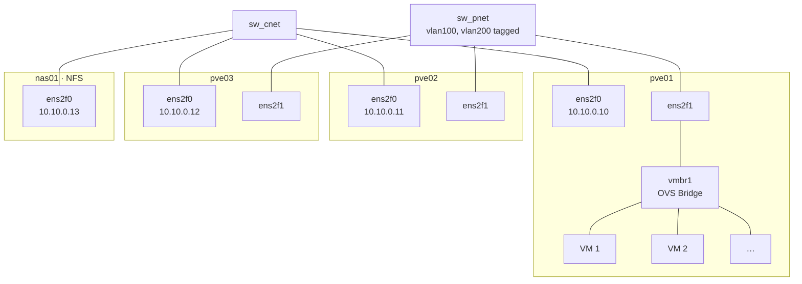

**네트워크**

| 네트워크 | 대역 | 용도 |
| --- | --- | --- |
| cnet | `10.10.0.0/24` | Controller Network. 호스트 제어, 클러스터링, 스토리지 |
| pnet | vlan100, vlan200 | Provider Network. VM에 제공하는 네트워크 |
| vlan100 | `203.0.113.0/24` | |
| vlan200 | `198.51.100.0/24` | |

**스위치**

| 장비 | 구성 |
| --- | --- |
| sw_cnet | |
| sw_pnet | vlan 100, 200 tagged |

**서버.** PVE 설치 대상입니다. NIC1은 cnet, NIC2는 pnet에 연결합니다. NIC2에는 여러 VLAN이 tagged(802.1Q VLAN 태그가 붙은 상태)로 들어옵니다. 호스트에서 `vmbr1`을 **OVS Bridge** 타입으로 선언하고 NIC2와 연결합니다.

| 호스트 | NIC1 | NIC2 | 비고 |
| --- | --- | --- | --- |
| pve01 | (ens2f0) `10.10.0.10` | (ens2f1) | PVE 설치 |
| pve02 | (ens2f0) `10.10.0.11` | (ens2f1) | PVE 설치 |
| pve03 | (ens2f0) `10.10.0.12` | (ens2f1) | PVE 설치 |
| nas01 | (ens2f0) `10.10.0.13` | | NFS 설치, PVE에 shared 스토리지 제공 |

OVS Bridge는 웹 UI의 **노드 → System → Network → Create → OVS Bridge**에서 만들고, *Bridge ports*에 NIC2(`ens2f1`)를 넣습니다.

**가상머신.** VM은 `vmbr1`에 연결되어 외부 네트워크와 이어집니다. 이때 VM의 네트워크 장치에 원하는 **VLAN Tag**(예: `100`)를 적으면 해당 VLAN에 연결됩니다.

### H.3.2 제어·서비스 네트워크 통합 구성 {#h-3-2-combined}

NIC가 하나뿐이거나 공인 IP 하나로 호스트를 관리할 때의 구성입니다. 호스트 관리 트래픽도 VM과 같은 브리지를 지나갑니다.

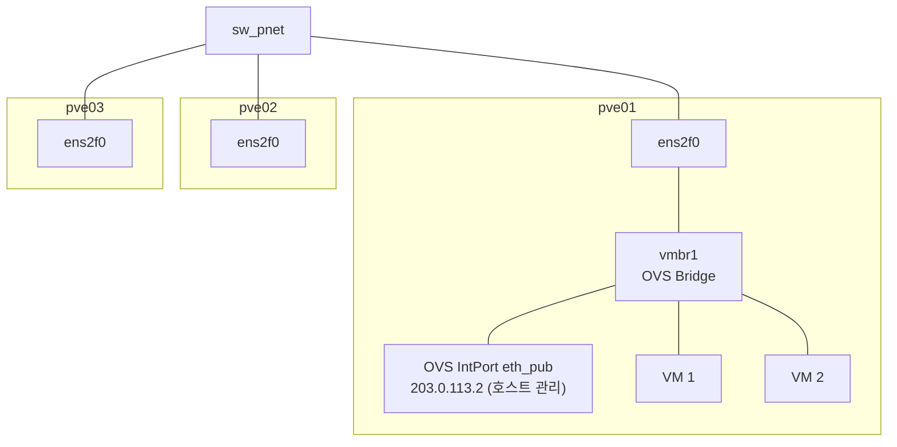

**네트워크**

| 네트워크 | 대역 | 용도 |
| --- | --- | --- |
| pnet | `203.0.113.0/24` | |

**스위치**

| 장비 | 구성 |
| --- | --- |
| sw_pnet | |

**서버.** PVE 설치 대상입니다. NIC1을 pnet 스위치에 연결합니다. 호스트에서 `vmbr1`을 OVS Bridge 타입으로 선언하고 NIC1과 연결합니다. 그리고 `vmbr1`에 붙은 **OVS Port**(웹 UI의 *OVS IntPort*)를 하나 선언해 공인 IP를 할당합니다. 이 IP로 PVE 호스트를 제어합니다.

| 호스트 | NIC1 | 비고 |
| --- | --- | --- |
| pve01 | (ens2f0) `203.0.113.2` | PVE 설치 |
| pve02 | (ens2f0) `203.0.113.3` | PVE 설치 |
| pve03 | (ens2f0) `203.0.113.4` | PVE 설치 |

**가상머신.** VM은 `vmbr1`에 연결되어 외부 네트워크와 이어집니다.

이 구성에서는 호스트 관리 주소가 VM과 같은 망에 있으므로 [H.4](#h-4-firewall)의 Datacenter·Host 방화벽이 사실상 필수입니다.

### H.3.3 제어·서비스 네트워크 통합 구성 (SR-IOV) {#h-3-3-sriov}

H.3.2와 같은 통합 구성이지만, 소프트웨어 브리지 대신 NIC의 **SR-IOV**(Single Root I/O Virtualization)를 씁니다. SR-IOV를 켜면 물리 NIC 하나(PF, Physical Function)가 여러 개의 가상 NIC(VF, Virtual Function)로 나뉘어 PCI 장치처럼 보입니다. VF 하나를 호스트 관리용으로 쓰고, 나머지 VF는 PCI pass-through(호스트의 PCI 장치를 VM에 직접 넘겨주는 방식)로 VM에 연결합니다. 패킷이 호스트의 브리지를 거치지 않으므로 VM이 고속 NIC의 성능을 거의 그대로 활용합니다.

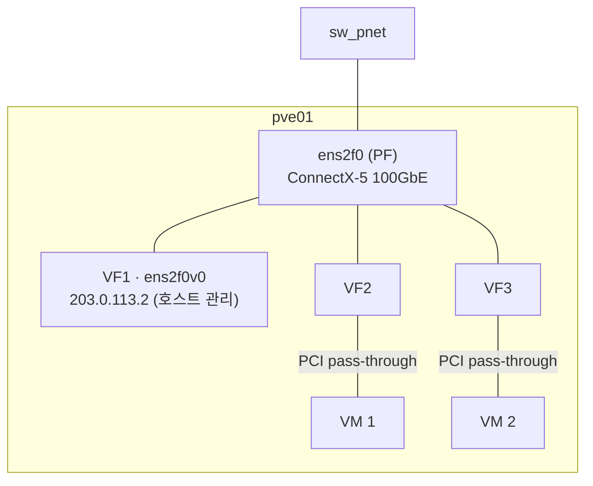

**네트워크**

| 네트워크 | 대역 | 용도 |
| --- | --- | --- |
| pnet | `203.0.113.0/24` | |

**스위치**

| 장비 | 구성 |
| --- | --- |
| sw_pnet | |

**서버.** PVE 설치 대상입니다. NIC1을 pnet 스위치에 연결합니다. NIC1에 SR-IOV를 적용해 여러 개의 VF를 선언합니다. VF1에는 PVE 제어를 위한 공인 IP를 할당합니다.

| 호스트 | NIC1 | 비고 |
| --- | --- | --- |
| pve01 | (ens2f0)<br/>(ens2f0v0) `203.0.113.2` | PVE 설치<br/>ens2f0: Mellanox ConnectX-5 100GbE |

**가상머신.** VM은 호스트의 VF를 PCI pass-through로 연결해 네트워크에 연결됩니다. SR-IOV를 켜고 VF를 VM에 할당하는 실제 절차는 [H.7.1](#h-7-1-sriov)에 있습니다.

## H.4 방화벽 {#h-4-firewall}

**멘탈모델:** PVE 방화벽은 *한 겹이 아니라 네 겹*이다. 어느 겹에 규칙을 넣느냐가 "누구를 지키느냐"를 정한다.

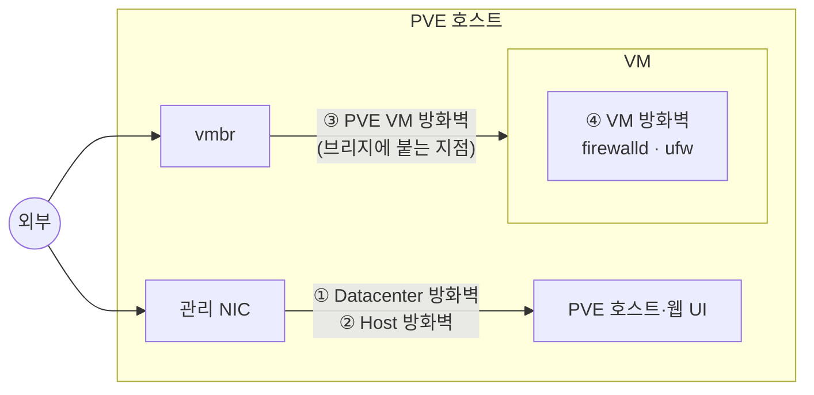

| 종류 | 설명 |
| --- | --- |
| PVE Datacenter 방화벽 | 클러스터 안의 PVE 호스트에 공통으로 적용 (VM에 적용되는 것은 아님) |
| PVE Host 방화벽 | 특정 PVE 호스트에 적용 |
| PVE VM 방화벽 | 특정 VM이 PVE 호스트의 bridge에 붙을 때 적용. VM 안에 방화벽이 없어도 적용됨.<br/>Stateful Firewall(연결 상태를 추적해 응답 패킷을 허용하는 방화벽). 기본 설정: Out-bound ACCEPT, In-bound DROP (패키지 다운로드는 되고, 외부에서 접속은 안 됨) |
| VM 방화벽 | firewalld, ufw 등으로 VM 안에서 설정 ([Part 2 §2.1](02-firewall.md)) |

③과 ④는 역할이 겹칩니다. ③은 VM 바깥(호스트)에서 걸리므로 VM 안의 관리자가 끌 수 없고, ④는 VM 안에서 서비스별로 세밀하게 다룹니다. 둘 다 설정해 두면 한쪽의 실수를 다른 쪽이 보완합니다.

### IP Set {#h-4-ipset}

IP Set은 미리 만들어 둔 **IP 주소 묶음**입니다. 방화벽 규칙 안에서 주소 대신 이름으로 씁니다.

웹 UI: **Datacenter → Firewall → IPSet**

파일을 직접 고쳐도 됩니다.

```text
# /etc/pve/firewall/cluster.fw
...
[IPSET management]

# Office 1
192.0.2.0/24
...
```

PVE가 웹 UI에서 저장할 때는 *Comment* 칸의 내용을 `192.0.2.0/24 # Office 1`처럼 **같은 줄 끝**에 씁니다. 이 파일은 PVE 자신의 파서가 그 형식을 읽도록 만들어져 있어서 문제가 없지만, 손으로 쓸 때는 이 책의 관례대로 주석을 윗줄에 두어도 됩니다. 다만 그러면 웹 UI의 *Comment* 칸에는 보이지 않습니다.

### Security Group {#h-4-security-group}

Security Group은 미리 만들어 둔 **방화벽 규칙 묶음**입니다. 나중에 VM에 방화벽을 걸 때 묶음 단위로 넣을 수 있어 편리합니다.

웹 UI: **Datacenter → Firewall → Security Group**

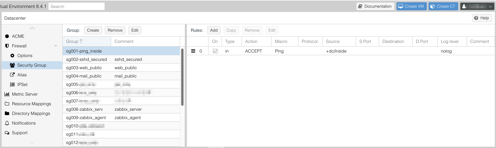

```text
# /etc/pve/firewall/cluster.fw
...
[group sg001-ping_inside]

IN Ping(ACCEPT) -source +dc/inside -log nolog
...
```

`+dc/inside`는 Datacenter 범위(`dc`)에 정의한 `inside`라는 IP Set을 가리킵니다. 그룹 이름에 `sg001-`처럼 번호를 붙여 두면 목록이 정렬되고, VM 규칙에서 어떤 묶음이 들어갔는지 쉽게 알아볼 수 있습니다.

### PVE Datacenter 방화벽 {#h-4-datacenter}

클러스터 안의 PVE 호스트와 웹 UI에 접속할 수 있는 IP 범위를 제한합니다.

1. **Datacenter → Firewall → Options → Firewall = Yes**
2. **Datacenter → Firewall → IPSet → `management` 추가 → IP/CIDR 추가**

`management`라는 이름의 IP Set은 특별합니다. 방화벽을 켜면 웹 UI(8006)·SSH(22)·VNC/SPICE 콘솔 같은 관리 접속은 이 묶음에서 오는 것만 허용됩니다. 이 묶음은 **호스트 방화벽에만** 쓰이고(VM 방화벽에는 쓰이지 않음), 클러스터 자신의 로컬 네트워크는 자동으로 들어갑니다([PVE Firewall](https://pve.proxmox.com/pve-docs/chapter-pve-firewall.html)).

파일을 직접 고쳐도 됩니다.

```text
# /etc/pve/firewall/cluster.fw
[OPTIONS]

enable: 1

[IPSET management]

# Office 1
192.0.2.0/24
...
```

⚠️ **켜기 전에 내 주소부터 넣습니다.** `management`에 지금 접속 중인 내 PC의 주소가 없는 채로 Firewall = Yes를 누르면 곧바로 웹 UI와 SSH 접속이 모두 끊길 수 있습니다. 항상 IP Set을 먼저 등록하고 방화벽은 나중에 켭니다.

### PVE Host 방화벽 {#h-4-host}

특정 PVE 호스트와 웹 UI에 접속할 수 있는 IP 범위를 제한합니다.

1. **특정 PVE 호스트 선택 → Firewall → Options → Firewall = Yes**
2. **특정 PVE 호스트 선택 → Firewall → Add**로 규칙 추가

```text
# /etc/pve/nodes/<prox-hostname>/host.fw
[OPTIONS]

enable: 1
nftables: 1
tcpflags: 1

[RULES]

# ceph
IN ACCEPT -p tcp -dport 3300,6789,6800:7568 -log nolog
```

위 예는 Ceph 모니터·OSD(데이터를 저장하는 Ceph 데몬) 포트(3300, 6789, 6800–7568)를 여는 규칙입니다. `nftables: 1`은 iptables 대신 nftables 기반 방화벽(`proxmox-firewall`)을 쓰겠다는 옵션입니다(iptables와 nftables의 관계는 [Part 2 §2.1](02-firewall.md)). 기본값은 `0`이고, PVE 9에서도 공식 문서는 이것을 **기술 미리보기(tech preview)** 로 분류해 운영용으로는 아직 권하지 않습니다([PVE Firewall](https://pve.proxmox.com/pve-docs/chapter-pve-firewall.html)). 운영 호스트라면 이 줄을 빼 두는 편이 안전합니다. `tcpflags: 1`은 비정상적인 TCP 플래그 조합의 패킷을 걸러 냅니다.

### PVE VM 방화벽 {#h-4-vm}

특정 VM에 접속할 수 있는 IP 범위를 제한합니다. VM이 PVE 호스트의 bridge에 연결되는 지점에서 적용되므로, VM 안에 ufw·firewalld가 없어도 동작합니다. 앞의 Datacenter 방화벽(`cluster.fw`의 `enable: 1`)이 클러스터 전체의 주 스위치이므로 이것이 켜져 있어야 하고, 그 위에서 VM 쪽 세 군데를 모두 켜야 합니다.

1. **특정 VM 선택 → Firewall → Options**
   - Firewall = Yes
   - IP filter = No (Yes로 두면 VM이 `ipfilter-net⟨n⟩` IP Set에 적힌 출발지 주소로만 패킷을 내보낼 수 있습니다. 그 IP Set을 만들지 않았으면 MAC 주소에서 만들어진 IPv6 링크 로컬 주소 말고는 모두 막혀, VM 통신이 끊긴 것처럼 보입니다)
2. **특정 VM 선택 → Firewall**에서 규칙 추가. *Insert: Security Group*으로 묶음을 넣습니다.
3. **특정 VM 선택 → Hardware → Network Device → Firewall 체크**

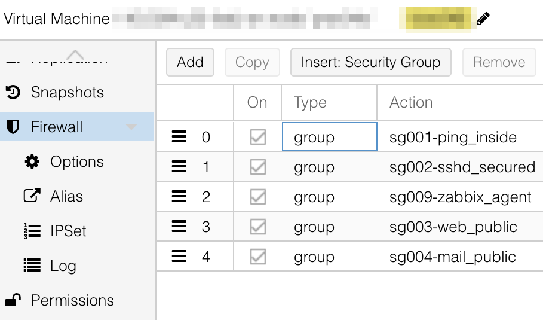

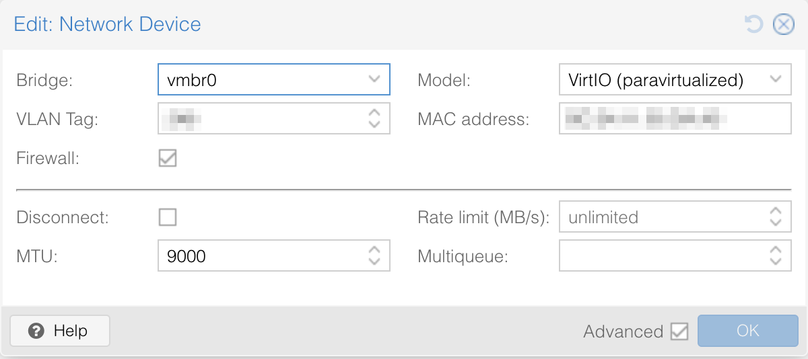

```text
# /etc/pve/nodes/<prox-hostname>/qemu-server/<vm-id>.conf
...
net0: virtio=...,bridge=vmbr0,firewall=1,mtu=9000,tag=...
...
```

```text
# /etc/pve/firewall/<vm-id>.fw
[OPTIONS]

log_level_in: nolog
policy_out: ACCEPT
log_level_out: nolog
ipfilter: 0
enable: 1
dhcp: 0

[RULES]

GROUP sg001-ping_inside
GROUP sg002-sshd_secured
GROUP sg009-zabbix_agent
GROUP sg003-web_public
GROUP sg004-mail_public
```

VM 쪽 `.fw` 파일에는 **묶음 이름만** 남습니다. 규칙을 바꿔야 할 때는 Security Group 한 곳만 고치면 그 그룹을 쓰는 모든 VM에 반영됩니다. 가장 흔한 실수는 3번(Network Device의 `firewall=1`)을 빠뜨리는 것입니다. 이 경우 1·2번을 모두 해도 규칙이 적용되지 않습니다.

## H.5 스토리지 {#h-5-storage}

PVE는 여러 종류의 스토리지(디렉터리, NFS, LVM-thin, ZFS, Ceph RBD 등)를 지원합니다. 종류별 특징은 공식 설명서에 정리되어 있습니다.

- <https://pve.proxmox.com/pve-docs/chapter-pvesm.html>
- <https://pve.proxmox.com/wiki/Storage>

### 스토리지 설정 예시 {#h-5-config}

웹 UI의 **Datacenter → Storage**에 다음 네 개가 있다고 가정합니다.

| ID | 종류 | 경로/대상 | Shared |
| --- | --- | --- | --- |
| local | Directory | `/var/lib/vz` | No |
| local2 | Directory | `/var/lib/vz2` | No |
| nfs1 | NFS | `/mnt/pve/nfs1` | Yes |
| vmstore1 | RBD (PVE) | | Yes |

이때 설정 파일은 다음과 같습니다.

```text
# /etc/pve/storage.cfg
dir: local
	path /var/lib/vz
	content images,iso,backup,snippets,vztmpl,rootdir
	format qcow2
	preallocation off
	prune-backups keep-all=1
	shared 0

dir: local2
	path /var/lib/vz2
	content images,iso,backup,snippets,vztmpl,rootdir
	format qcow2
	preallocation off
	prune-backups keep-all=1
	shared 0

nfs: nfs1
	export /data/proxmox
	path /mnt/pve/nfs1
	server 10.10.0.13
	content import,images,iso,backup,snippets,vztmpl,rootdir
	format qcow2
	options vers=4.2
	preallocation off
	prune-backups keep-all=1

rbd: vmstore1
	content images,rootdir
	krbd 0
	pool vmstore1
```

*Shared*가 Yes인 스토리지(NFS, Ceph)는 모든 호스트가 같은 데이터를 보므로 VM을 다른 호스트로 바로 옮길(migrate) 수 있습니다. `/etc/pve/storage.cfg`는 클러스터 전체에 동기화되는 파일이라([H.7.3](#h-7-3-files)), 여기 적은 정의는 모든 호스트에 똑같이 보입니다.

### 로컬 스토리지 구성 예시 {#h-5-local}

Directory 타입(`local`)은 **모든 PVE 호스트에서 같은 경로**(`/var/lib/vz`)를 가리킵니다. 다만 Shared가 아니므로 내용은 호스트마다 다릅니다. 로컬에 대용량 NVMe가 여러 장 있다면 소프트웨어 RAID로 묶어 이 경로에 마운트합니다.

```text
# nvme list
Node          Model
------------- ------------------------
/dev/nvme0n1  Samsung SSD 970 EVO Plus
/dev/nvme1n1  INTEL SSDPE2KE016T8
/dev/nvme2n1  INTEL SSDPE2KE016T8
/dev/nvme3n1  INTEL SSDPE2KE016T8
/dev/nvme5n1  INTEL SSDPE2KE016T8

# lsblk
NAME        MAJ:MIN RM   SIZE RO TYPE  MOUNTPOINTS
nvme0n1     259:0    0 465.8G  0 disk
├─nvme0n1p1 259:1    0   953M  0 part
├─nvme0n1p2 259:2    0   954M  0 part
├─nvme0n1p3 259:3    0 186.3G  0 part  /
nvme1n1     259:6    0   1.5T  0 disk
└─nvme1n1p1 259:15   0   1.5T  0 part
  └─md126     9:126  0   4.4T  0 raid5 /var/lib/vz
nvme2n1     259:12   0   1.5T  0 disk
└─nvme2n1p1 259:16   0   1.5T  0 part
  └─md126     9:126  0   4.4T  0 raid5 /var/lib/vz
nvme3n1     259:13   0   1.5T  0 disk
└─nvme4n1p1 259:18   0   1.5T  0 part
  └─md126     9:126  0   4.4T  0 raid5 /var/lib/vz
nvme4n1     259:14   0   1.5T  0 disk
└─nvme5n1p1 259:17   0   1.5T  0 part
  └─md126     9:126  0   4.4T  0 raid5 /var/lib/vz
```

OS는 작은 NVMe(`nvme0n1`) 한 장에 두고, 1.5 TB NVMe 네 장을 RAID5(`md126`, 4.4 TB)로 묶어 VM 디스크가 놓이는 `/var/lib/vz`에 마운트한 구성입니다.

### Preallocation = off {#h-5-preallocation}

QCOW2 이미지를 쓰는 경우 스토리지의 **Preallocation**을 Off로 두면, 템플릿에서 VM을 만들 때 **thin provisioning**되어 빠릅니다(디스크 공간을 미리 0으로 채우지 않고 쓴 만큼만 차지).

웹 UI: **Datacenter → Storage → 스토리지 선택 → Edit → Preallocation = Off** (*Advanced* 체크 시 보임)

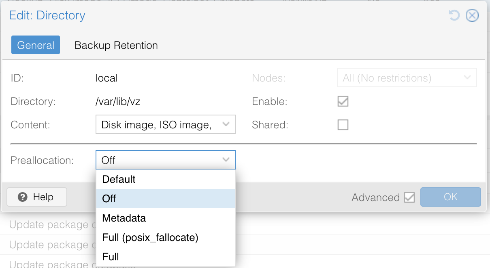

thin이 왜 빠르고 무엇을 조심해야 하는지(초과 약정, discard와의 짝)는 [Part 1 §1.2](01-image.md)에 있습니다. 이 설정은 그 내용 가운데 PVE 스토리지 쪽에 해당하는 스위치입니다.

## H.6 활용 {#h-6-usage}

### H.6.1 VM 템플릿 만들기 {#h-6-1-template}

리눅스 배포판의 **공식 클라우드 이미지**로 VM 템플릿을 만듭니다. 왜 ISO 설치 대신 클라우드 이미지를 쓰는지는 [Part 1 §1.1](01-image.md)에, 클라우드 이미지 저장소 목록은 [실습①](labs/lab-01.md)에 있습니다.

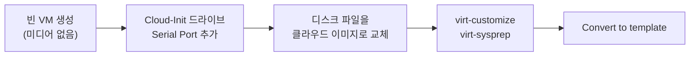

#### VM 생성 {#h-6-1-create-vm}

노드를 우클릭해 **Create VM**을 누르고 다음 값으로 만듭니다.

| 탭 | 항목 | 값 |
| --- | --- | --- |
| General | VM ID | `100` |
| | Name | `ubuntu24-tpl` |
| OS | 미디어 | Do not use any media |
| | Guest OS | Linux / 6.x Kernel |
| Disks | Format | QEMU image format (qcow2) |
| | Discard | 체크 |
| | Disk size (GiB) | `10` |
| CPU | Cores | `4` |
| | Total Cores | `4` |
| | Type | `x86-64-v2-AES` 혹은 `host` |
| Memory | Memory (MiB) | `4096` |
| | Ballooning Device | 체크 해제 |
| Network | Bridge | `vmbr0` |
| | Model | VirtIO |

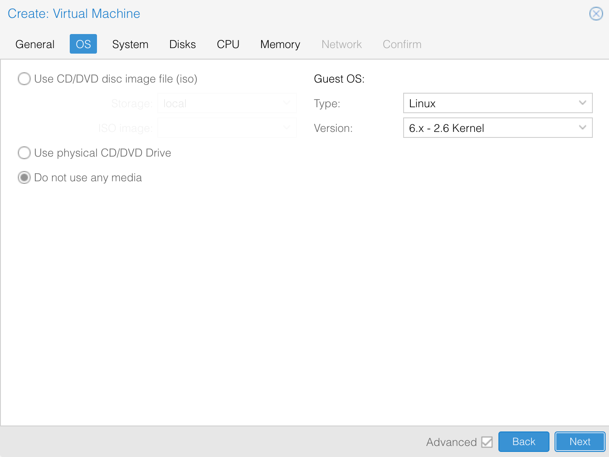

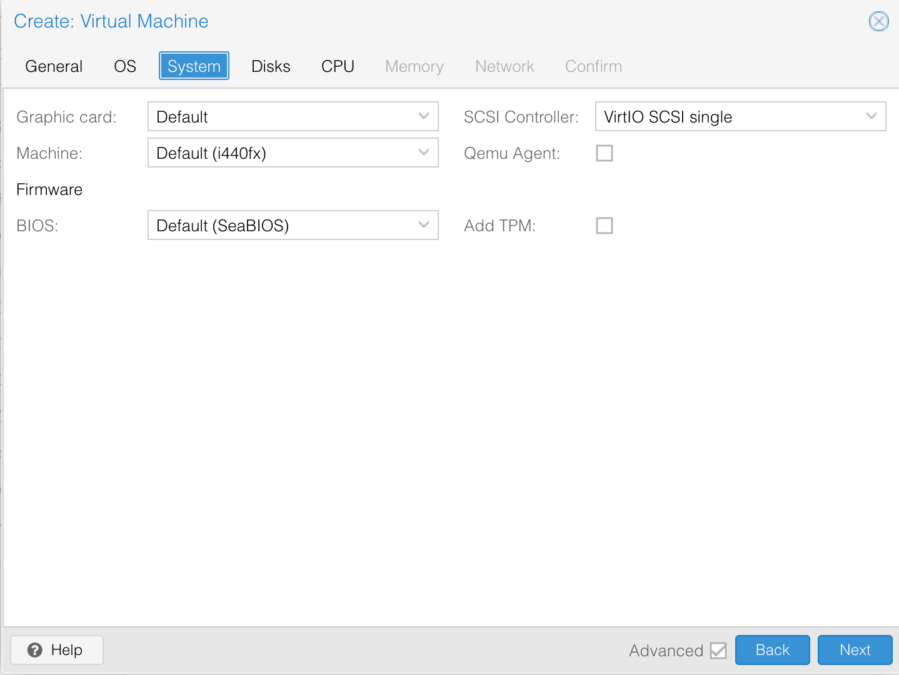

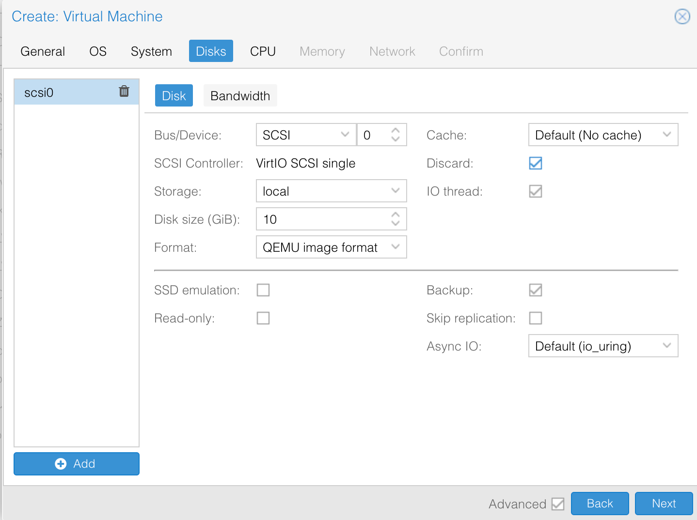

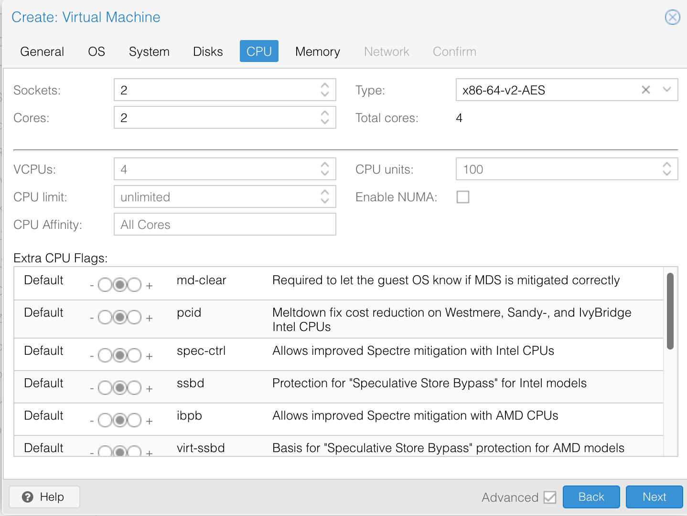

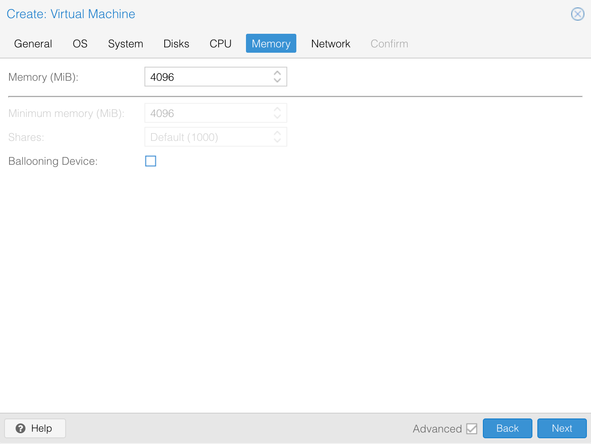

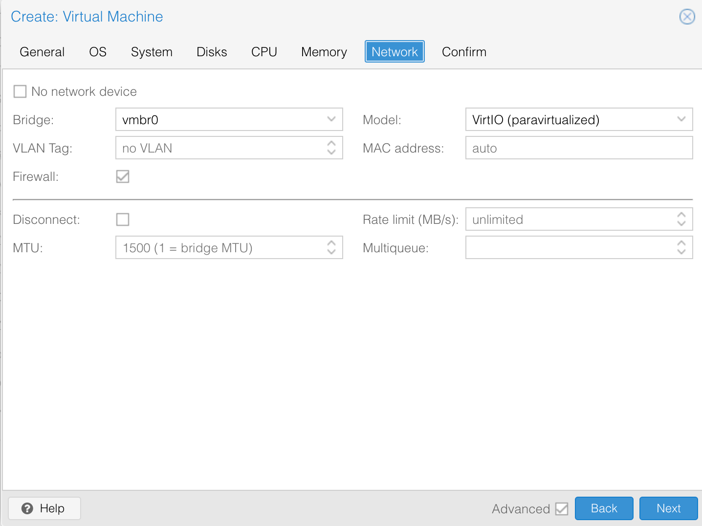

OS 탭에서 미디어를 고르지 않는 이유는, 설치할 OS가 ISO가 아니라 잠시 뒤 교체할 **디스크 파일 자체**이기 때문입니다. Disks 탭의 *Discard*는 thin 디스크에서 지운 공간을 반환하게 하는 설정입니다([Part 1 §1.2](01-image.md)).

CPU *Type*은 VM을 다른 호스트로 옮길 일이 있으면 `x86-64-v2-AES`처럼 **공통 기준**을 고르고, 한 호스트에서만 실행하며 성능이 중요하면 `host`(호스트 CPU 기능을 그대로 노출)를 고릅니다. CPU가 다른 호스트 사이에서 `host` 타입 VM을 옮기면 부팅이나 실행이 실패할 수 있습니다.

#### Cloud-Init 드라이브 추가 {#h-6-1-cloud-init-drive}

Cloud-init은 클라우드 인스턴스 초기화 도구로, 운영체제가 부팅할 때 사용자 데이터와 설정(계정, SSH 키, IP 등)을 자동으로 적용합니다. 이 기능을 쓰려면 VM의 **Hardware → Add → CloudInit Drive**로 드라이브를 추가합니다. 값은 템플릿이 아니라 템플릿에서 만든 VM마다 넣습니다([H.6.2](#h-6-2-create)).

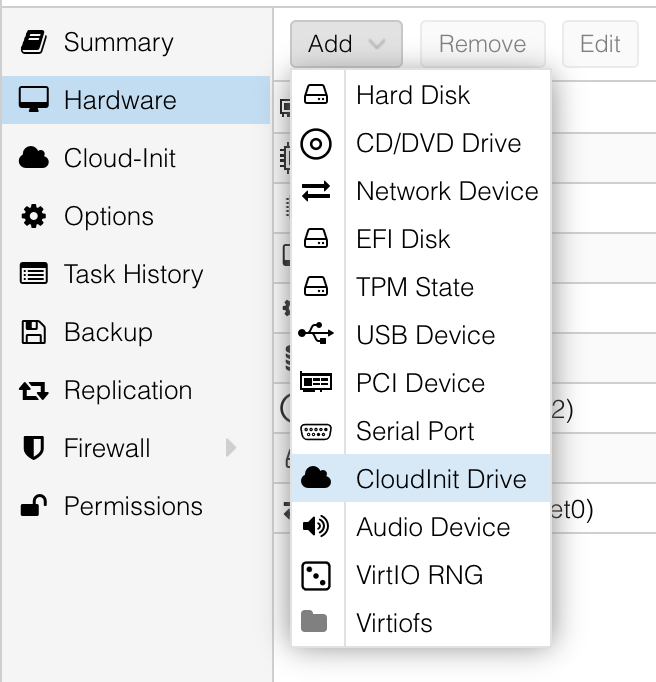

#### Serial Port 추가 (선택) {#h-6-1-serial}

**Hardware → Add → Serial Port**를 추가하면, VM 콘솔에서 텍스트 콘솔(xterm.js)도 쓸 수 있습니다.

- **noVNC:** VM의 화면(RGB 비디오)을 그대로 렌더링. 복사·붙여넣기가 안 됨.
- **xterm.js:** 텍스트 기반 콘솔. 웹 브라우저에서 문자열 선택, 복사·붙여넣기가 됨.

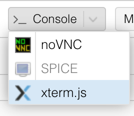

#### 공식 클라우드 이미지로 교체 {#h-6-1-cloud-image}

배포판 사이트에서 공식 클라우드 이미지를 내려받아, 방금 만든 VM의 빈 디스크 파일과 교체합니다.

- <https://cloud-images.ubuntu.com>
- <https://dl.rockylinux.org/pub/rocky/9/images/x86_64/>
- <https://cdimage.debian.org/images/cloud/trixie/> (데비안 13; 12는 `bookworm/`)

```text
# cd /var/lib/vz/images/100

# ls -alh
-rw-r----- 1 root root 193K vm-100-disk-0.qcow2

# IMG=vm-100-disk-0.qcow2
# qemu-img info $IMG
image: vm-100-disk-0.qcow2
file format: qcow2
virtual size: 10 GiB (10737418240 bytes)
disk size: 196 KiB

# wget https://cloud-images.ubuntu.com/noble/current/noble-server-cloudimg-amd64.img

# IMG=noble-server-cloudimg-amd64.img
# qemu-img info $IMG
image: noble-server-cloudimg-amd64.img
file format: qcow2
virtual size: 3.5 GiB (3758096384 bytes)

# qemu-img resize $IMG 10G
Image resized.

# virt-customize -a $IMG --run-command "growpart /dev/sda 1; resize2fs /dev/sda1;"

# mv noble-server-cloudimg-amd64.img vm-100-disk-0.qcow2
```

단계별로 설명하면 다음과 같습니다.

1. PVE가 만든 빈 디스크(`vm-100-disk-0.qcow2`)는 가상 크기 10 GiB, 실제 크기 196 KiB인 thin 파일입니다.
2. 받은 우분투 이미지는 가상 크기 3.5 GiB입니다. 확장자는 `.img`지만 형식은 qcow2입니다.
3. `qemu-img resize`로 디스크 겹을 PVE에 설정한 크기(10 GiB)에 맞추고, `virt-customize`로 이미지 안의 파티션(`growpart`)과 파일시스템(`resize2fs`)까지 키웁니다. 디스크·파티션·파일시스템 세 겹과 Rocky(루트 p4, XFS)일 때의 차이는 [Part 1 §1.2 "디스크를 키울 때"](01-image.md)를 봅니다.
4. 받은 이미지를 PVE가 기대하는 파일 이름으로 바꿔 빈 디스크를 덮어씁니다.

#### 이미지 고치기 {#h-6-1-customize}

`libguestfs-tools`로 VM 디스크 이미지를 **꺼진 상태에서** 고칩니다. 원리와 안전 규칙은 [Part 1 §1.3](01-image.md), 손으로 해 보는 과정은 [실습①](labs/lab-01.md)에 있습니다.

| 도구 | 하는 일 |
| --- | --- |
| `virt-customize` | 패키지 설치, 명령 실행 |
| `virt-copy-in` | 파일 복사 |
| `virt-edit` | 텍스트 파일 수정 |

```bash
cd /var/lib/vz/images/100
IMG=vm-100-disk-0.qcow2
virt-customize -a $IMG --install qemu-guest-agent,net-tools,curl,tree,vim,wget,zsh,...
virt-copy-in -a $IMG <some_file_in_host> <directory_path_in_image>
```

`qemu-guest-agent`를 넣어 두면 PVE가 VM 안의 IP를 읽고, 종료·TRIM 같은 명령을 게스트에 직접 전달할 수 있습니다([실습②ⓑ](labs/lab-02.md)의 *Run guest-trim*).

필요하면 VM을 한 번 켜서 패키지를 설치합니다. 그런 다음 **반드시** sysprep으로 시스템 고유 정보(machine-id, SSH 호스트 키, 로그)를 지웁니다. 한 번 켠 이미지는 이미 "그 한 대"의 정체성을 갖게 되었기 때문입니다. 왜 지워야 하는지는 [Part 1 §1.4](01-image.md)에 있습니다.

```bash
IMG=vm-100-disk-0.qcow2
virt-sysprep -a $IMG
```

#### 템플릿으로 변환 {#h-6-1-convert}

VM을 우클릭해 **Convert to template**을 누릅니다.

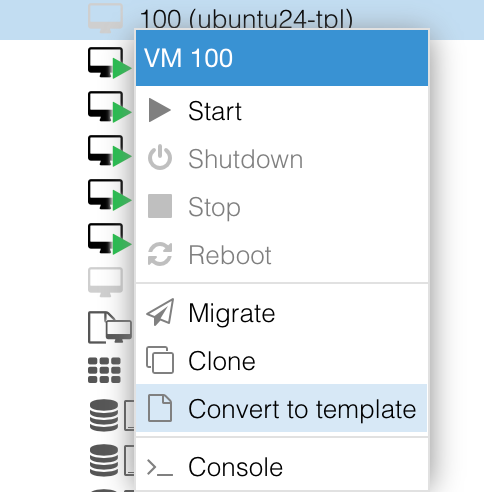

```text
# ls /var/lib/vz/images/100
base-100-disk-0.qcow2
```

파일 이름이 `vm-`에서 `base-`로 바뀝니다. 템플릿은 켤 수 없고, 복제의 **원본**으로만 쓰입니다. PVE는 이렇게 sysprep 뒤에 켜지 말라는 [§1.4](01-image.md)의 규칙을 구조적으로 강제합니다.

### H.6.2 VM 생성 {#h-6-2-create}

#### 템플릿으로 VM 만들기 {#h-6-2-from-template}

템플릿을 우클릭해 **Clone**을 누릅니다. Mode는 **Full Clone**으로 합니다.

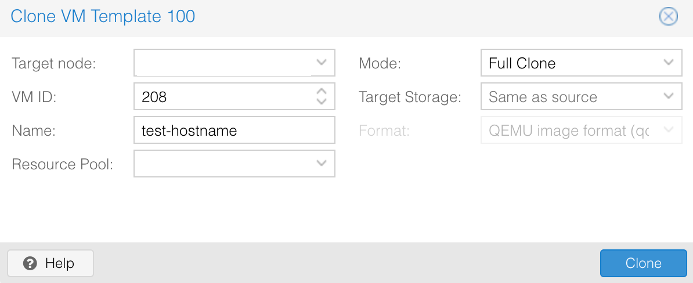

*Linked Clone*은 템플릿 디스크를 공유하고 바뀐 부분만 따로 저장해 빠르고 작지만, 템플릿에 의존하므로 템플릿을 지우거나 옮길 수 없습니다. *Full Clone*은 디스크 전체를 복사해 템플릿과 독립된 VM이 됩니다. H.5에서 Preallocation을 Off로 두었다면 Full Clone도 thin으로 만들어져 빠릅니다. Clone이 배포·복구에서 어떤 자리인지는 [Part 1 §1.5](01-image.md)와 [실습②ⓑ](labs/lab-02.md)를 봅니다.

#### Cloud-Init 설정 {#h-6-2-cloud-init}

새 VM의 **Cloud-Init** 탭에서 계정과 IP 등을 넣고 **Regenerate Image**를 누릅니다. 첫 부팅 때 VM 안의 cloud-init이 이 값을 읽어 적용합니다.

| 항목 | 예시 |
| --- | --- |
| User | `root` |
| Password | `**********` |
| DNS domain | use host settings |
| DNS servers | `8.8.8.8 1.1.1.1` |
| SSH public key | `my-pubkey-1`<br/>`my-pubkey-2` |
| Upgrade packages | Yes |
| IP Config (net0) | `ip=203.0.113.100/24,gw=203.0.113.1` |

SSH 공개키를 넣어 두면 비밀번호 없이 키로 로그인할 수 있습니다. 키를 만들고 배포하는 방법은 [Part 6 §6.1·§6.2](06-access.md)에 있습니다. 비밀번호는 쓰지 않거나, 쓰더라도 첫 로그인 뒤 바꿉니다.

#### 디스크 크기 늘리기 {#h-6-2-resize}

템플릿 디스크는 10 GiB이므로 필요한 만큼 늘립니다. **Hardware → Hard Disk 선택 → Disk Action → Resize**에서 **늘릴 양**을 적습니다.

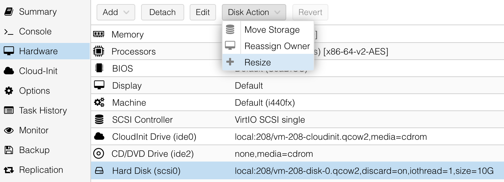

PVE의 Resize가 키우는 것은 **디스크 겹**뿐입니다. 클라우드 이미지는 부팅할 때 cloud-init이 파티션과 파일시스템을 디스크 끝까지 늘리므로, 대개는 Resize 뒤 재부팅만 하면 됩니다. 켜진 채로 안쪽까지 키우는 방법과 cloud-init이 동작하지 않을 때의 세 단계는 [Part 1 §1.2 "디스크를 키울 때"](01-image.md)와 [실습②](labs/lab-02.md)의 📏 상자에 있습니다.

## H.7 참고 {#h-7-reference}

### H.7.1 SR-IOV (ConnectX-5) {#h-7-1-sriov}

PVE 설치 뒤 Mellanox ConnectX-5의 SR-IOV를 켜고, VF를 VM에 할당하는 방법입니다. [H.3.3](#h-3-3-sriov) 구성의 실제 절차입니다. 아래 예에서는 ConnectX-5의 인터페이스 이름이 `ens6np0`입니다.

#### SR-IOV 켜기 {#h-7-1-enable}

```text
# apt install -y infiniband-diags ibutils rdma-core rdmacm-utils mstflint

# lshw -short -c net
H/W path         Device      Class          Description
=======================================================
/0/100/1/0       ens1f0      network        82599ES 10-Gigabit SFI/SFP+ Network Connection
/0/100/1/0.1     ens1f1      network        82599ES 10-Gigabit SFI/SFP+ Network Connection
/0/100/3.2/0     eno1        network        I350 Gigabit Network Connection
/0/100/3.2/0.1   enp4s0f1    network        I350 Gigabit Network Connection
/0/2/0           ens6np0     network        MT27800 Family [ConnectX-5]

# lspci | grep -i mellanox
81:00.0 Ethernet controller: Mellanox Technologies MT27800 Family [ConnectX-5]

# mstconfig -d 81:00.0 query
Device #1:
----------
Device type:    ConnectX5
Name:           MCX555A-ECA_Ax_Bx
Description:    ConnectX-5 VPI adapter card; EDR IB (100Gb/s) and 100GbE;...
Device:         81:00.0
Configurations:                              Next Boot
         NUM_OF_VFS                          0
         NUM_OF_PF                           1
         SRIOV_EN                            False(0)

# mstconfig -d 81:00.0 set SRIOV_EN=1 NUM_OF_VFS=4

# reboot
```

`mstconfig`(`mstflint` 패키지)는 NIC **펌웨어**의 설정을 바꿉니다. `SRIOV_EN=1 NUM_OF_VFS=4`는 "이 카드가 VF를 최대 4개까지 만들 수 있게 하라"는 뜻이고, 펌웨어 설정이므로 재부팅해야 반영됩니다(`Next Boot` 열). 실제로 VF를 만드는 것은 다음 단계입니다.

#### VF 생성 서비스 등록 {#h-7-1-vf-service}

VF는 부팅할 때마다 커널에 "VF를 몇 개 만들라"고 알려야 생성됩니다. 네트워크가 시작되기 **전에** 이를 수행하는 systemd 서비스를 만듭니다.

```ini
# /etc/systemd/system/sriov-vf.service
[Unit]
Description=Script to enable SR-IOV on boot
Before=networking.service

[Service]
Type=oneshot
ExecStart=/usr/bin/bash -c 'echo 4 > /sys/class/net/ens6np0/device/sriov_numvfs'

[Install]
WantedBy=multi-user.target
RequiredBy=networking.service
```

```bash
systemctl enable --now sriov-vf.service
```

#### VF 할당 {#h-7-1-vf-assign}

VF의 PCI 주소를 확인하고 VM에 할당합니다.

```text
# lshw -short -c net
H/W path         Device      Class          Description
=======================================================
/0/2/0           ens6np0     network        MT27800 Family [ConnectX-5]
/0/2/0.1         ens6v0      network        MT27800 Family [ConnectX-5 Virtual Function]
/0/2/0.2         ens6v1      network        MT27800 Family [ConnectX-5 Virtual Function]
/0/2/0.3         ens6v2      network        MT27800 Family [ConnectX-5 Virtual Function]
/0/2/0.4         ens6v3      network        MT27800 Family [ConnectX-5 Virtual Function]
...

# ls -al /sys/class/net
ens6np0  -> ../../devices/pci0000:80/0000:80:02.0/0000:81:00.0/net/ens6np0
ens6v0   -> ../../devices/pci0000:80/0000:80:02.0/0000:81:00.1/net/ens6v0
ens6v1   -> ../../devices/pci0000:80/0000:80:02.0/0000:81:00.2/net/ens6v1
ens6v2   -> ../../devices/pci0000:80/0000:80:02.0/0000:81:00.3/net/ens6v2
ens6v3   -> ../../devices/pci0000:80/0000:80:02.0/0000:81:00.4/net/ens6v3
...
```

예를 들어 `ens6v1`의 PCI 주소는 `0000:81:00.2`입니다. 이 PCI 장치를 골라 pass-through로 연결합니다.

웹 UI: **특정 VM 선택 → Hardware → Add → PCI Device → Raw Device → 장치 선택**

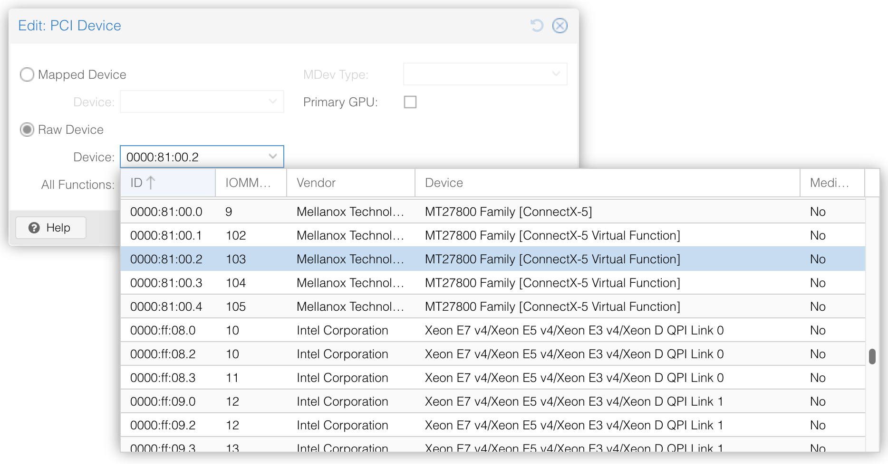

파일을 직접 고쳐도 됩니다.

```text
# /etc/pve/nodes/<prox-hostname>/qemu-server/<vm-id>.conf
...
hostpci0: 0000:81:00.2,rombar=0
...
```

VF 하나는 한 번에 한 VM에만 연결할 수 있습니다. 호스트 관리용으로 쓰는 VF(H.3.3의 VF1)는 VM에 넘기지 않습니다.

### H.7.2 호스트 이름 변경 {#h-7-2-hostname}

`/etc/hostname`과 `/etc/hosts`를 모두 같은 이름으로 바꾼 뒤 재부팅합니다. 이 예에서는 `pvehost` → `pve01`로 바꿉니다.

```text
# vi /etc/hostname
pve01

# vi /etc/hosts
...
203.0.113.100    pve01
...

# reboot
```

재부팅하면 `/etc/pve` 안의 심볼릭 링크(`local`, `qemu-server` 등)가 새 이름을 따라 바뀝니다. 그런데 웹 UI에서는 **VM이 사라진 것처럼 보입니다.** VM 설정 파일은 옛 이름의 디렉터리에 남아 있기 때문입니다.

```text
# tree -a /etc/pve
/etc/pve
...
├── local -> nodes/pve01
├── lxc -> nodes/pve01/lxc
├── nodes
│   ├── pve01
│   │   ├── host.fw
│   │   ├── lrm_status
│   │   ├── lxc
│   │   ├── openvz
│   │   ├── priv
│   │   ├── pve-ssl.key
│   │   ├── pve-ssl.pem
│   │   ├── qemu-server/
│   │   └── ssh_known_hosts
│   ├── pvehost
│   │   ├── host.fw
│   │   ├── lrm_status
│   │   ├── lxc
│   │   ├── openvz
│   │   ├── priv
│   │   ├── pve-ssl.key
│   │   ├── pve-ssl.pem
│   │   ├── qemu-server
│   │   │   ├── 101.conf
│   │   │   ├── 102.conf
│   │   │   ├── 103.conf
│   │   │   ...
│   │   └── ssh_known_hosts
├── openvz -> nodes/pve01/openvz
├── qemu-server -> nodes/pve01/qemu-server
...
```

`qemu-server` 설정을 새 호스트 이름 아래로 옮기면 VM이 다시 보입니다.

```bash
mv /etc/pve/nodes/<old-hostname>/qemu-server/*.conf /etc/pve/nodes/<new-hostname>/qemu-server/
```

PVE에서 노드 이름은 **설정 파일의 주소**이기도 하다는 것을 보여 주는 사례입니다. 이름 규칙은 처음 설치할 때 정해 두는 편이 낫습니다([Part 1 §1.7](01-image.md)). 이 절차는 클러스터에 묶이지 않은 단독 호스트 기준입니다.

### H.7.3 주요 디렉터리와 파일 {#h-7-3-files}

#### `/var/lib/vz` {#h-7-3-var-lib-vz}

PVE의 기본 저장소(`local`)입니다. 백업과 디스크 이미지가 여기 저장됩니다.

```text
# tree /var/lib/vz
/var/lib/vz
├── dump
│   ├── vzdump-qemu-102-2025_07_09-16_18_05.log
│   ├── vzdump-qemu-102-2025_07_09-16_25_55.log
│   ├── vzdump-qemu-102-2025_07_09-16_25_55.vma.zst
│   ├── vzdump-qemu-102-2025_07_09-16_25_55.vma.zst.notes
│   ├── vzdump-qemu-103-2025_07_10-17_42_51.log
│   ├── vzdump-qemu-103-2025_07_10-17_42_51.vma.zst
│   └── vzdump-qemu-103-2025_07_10-17_42_51.vma.zst.notes
├── images
│   ├── 101
│   │   └── vm-101-cloudinit.qcow2
│   ├── 102
│   │   ├── vm-102-cloudinit.qcow2
│   │   └── vm-102-disk-0.qcow2
│   └── 103
│       ├── vm-103-cloudinit.qcow2
│       └── vm-103-disk-0.qcow2
├── private
├── snippets
└── template
    ├── cache
    └── iso
```

| 하위 디렉터리 | 내용 |
| --- | --- |
| `dump/` | 백업(`vzdump`). `.vma.zst`가 백업 본체, `.log`·`.notes`가 기록 |
| `images/⟨VMID⟩/` | VM 디스크(`vm-…-disk-N.qcow2`), Cloud-Init 드라이브(`vm-…-cloudinit.qcow2`), 템플릿 디스크(`base-…`) |
| `snippets/` | cloud-init 사용자 설정 조각 등 |
| `template/iso/` | 업로드한 ISO |
| `template/cache/` | LXC 컨테이너 템플릿 |

#### `/etc/pve` {#h-7-3-etc-pve}

이 디렉터리는 SQLite3 파일인 `/var/lib/pve-cluster/config.db`를 FUSE(Filesystem in Userspace, 사용자 공간에서 동작하는 파일시스템)로 마운트한 것입니다(`pmxcfs`). 클러스터 안의 모든 호스트에 동기화됩니다. 그래서 여기 있는 파일은 평범한 파일처럼 보이지만, 한 호스트에서 고치면 **모든 호스트에서 동시에 바뀝니다.**

```text
# mount | grep /etc/pve
/dev/fuse on /etc/pve type fuse (rw,nosuid,nodev,relatime,user_id=0,group_id=0,default_permissions,allow_other)

# tree -a /etc/pve
/etc/pve
├── .clusterlog
├── .debug
├── .members
├── .version
├── .vmlist
├── authkey.pub
├── authkey.pub.old
├── ceph
│   └── ceph.client.crash.keyring
├── ceph.conf
├── corosync.conf
├── firewall
│   ├── 100.fw
│   ├── 101.fw
│   ├── 102.fw
│   │   ...
│   └── cluster.fw
├── ha
├── local -> nodes/pve01
├── lxc -> nodes/pve01/lxc
├── mapping
├── nodes
│   ├── pve01
│   │   ├── host.fw
│   │   ├── lrm_status
│   │   ├── lxc
│   │   ├── openvz
│   │   ├── priv
│   │   ├── pve-ssl.key
│   │   ├── pve-ssl.pem
│   │   ├── qemu-server
│   │   │   ├── 100.conf
│   │   │   ...
│   │   └── ssh_known_hosts
│   ├── pve02
│   │   ├── host.fw
│   │   ├── lrm_status
│   │   ├── lxc
│   │   ├── openvz
│   │   ├── priv
│   │   ├── pve-ssl.key
│   │   ├── pve-ssl.pem
│   │   ├── qemu-server
│   │   │   ├── 101.conf
│   │   │   ...
│   │   └── ssh_known_hosts
│   ├── pve03
│   │   ├── host.fw
│   │   ├── lrm_status
│   │   ├── lxc
│   │   ├── openvz
│   │   ├── priv
│   │   ├── pve-ssl.key
│   │   ├── pve-ssl.pem
│   │   ├── qemu-server
│   │   │   ├── 102.conf
│   │   │   ...
│   │   └── ssh_known_hosts
├── openvz -> nodes/pve01/openvz
├── priv
│   ├── acme
│   ├── authkey.key
│   ├── authorized_keys
│   ├── ceph
│   │   └── vmstore1.keyring
│   ├── ceph.client.admin.keyring
│   ├── ceph.mon.keyring
│   ├── known_hosts
│   ├── lock
│   │   └── storage-vmstore1
│   ├── pve-root-ca.key
│   ├── pve-root-ca.srl
│   └── token.cfg
├── pve-root-ca.pem
├── pve-www.key
├── qemu-server -> nodes/pve01/qemu-server
├── replication.cfg
├── sdn
│   ├── .running-config
│   ├── fabrics
│   ├── vnets.cfg
│   └── zones.cfg
├── storage.cfg
├── user.cfg
├── virtual-guest
└── vzdump.cron
```

이 부록에 나온 파일들이 모두 여기 있습니다.

| 파일 | 다룬 곳 |
| --- | --- |
| `firewall/cluster.fw`, `firewall/⟨VMID⟩.fw`, `nodes/⟨호스트⟩/host.fw` | [H.4](#h-4-firewall) |
| `storage.cfg` | [H.5](#h-5-storage) |
| `nodes/⟨호스트⟩/qemu-server/⟨VMID⟩.conf` | VM 설정. [H.4](#h-4-firewall), [H.7.1](#h-7-1-sriov), [H.7.2](#h-7-2-hostname) |
| `corosync.conf` | 클러스터 구성. [H.7.4](#h-7-4-cluster-reset) |
| `priv/` | 키·토큰 등 비밀. root만 읽을 수 있음 |

`local`, `qemu-server`, `lxc`, `openvz`는 **지금 이 호스트**의 `nodes/⟨호스트 이름⟩/` 아래를 가리키는 링크입니다. 호스트 이름을 바꾸면 이 링크가 따라 바뀌는 것도 이 때문입니다([H.7.2](#h-7-2-hostname)).

#### `/etc/corosync` {#h-7-3-etc-corosync}

클러스터 정보가 기록되어 있습니다.

```text
# tree /etc/corosync
/etc/corosync
├── authkey
├── corosync.conf
└── uidgid.d
```

#### `/root/.ssh` {#h-7-3-root-ssh}

`authorized_keys`가 심볼릭 링크로 `/etc/pve` 안의 파일을 가리킵니다. 그래서 클러스터의 모든 호스트가 같은 `authorized_keys`를 공유합니다. 한 호스트에 키를 등록하면 모든 호스트에 root로 들어갈 수 있게 된다는 뜻이기도 합니다.

```text
# ls -al /root/.ssh
authorized_keys -> /etc/pve/priv/authorized_keys
config
id_rsa
id_rsa.pub
known_hosts
```

#### `/var/lib/rrdcached/db` {#h-7-3-rrdcached}

클러스터와 VM의 각종 사용량 정보(웹 UI의 그래프)가 RRD(Round Robin Database, 정해진 크기 안에서 시계열 값을 순환하며 저장하는 형식)로 저장되어 있습니다.

```text
# tree /var/lib/rrdcached/db
/var/lib/rrdcached/db
├── pve2-node
│   ├── pve01
│   ├── pve02
│   └── pve03
├── pve2-storage
│   ├── pve01
│   │   ├── local
│   │   ├── local2
│   │   ├── nfs1
│   │   └── ceph1
│   ├── pve02
│   │   ├── local
│   │   ├── local2
│   │   ├── nfs1
│   │   └── ceph1
│   └── pve03
│       ├── local
│       ├── local2
│       ├── nfs1
│       └── ceph1
└── pve2-vm
    ├── 100
    ├── 101
    ├── 102
    ...
```

### H.7.4 클러스터 초기화 {#h-7-4-cluster-reset}

클러스터 구성을 지우고 호스트를 단독 상태로 되돌리는 방법입니다.

⚠️ **아래 스크립트는 `/etc/pve/nodes/*`를 모두 지웁니다.** 그 안에는 이 호스트의 VM 설정(`qemu-server/*.conf`)과 방화벽 설정이 들어 있습니다. 반드시 먼저 백업하고, 초기화 뒤 필요한 설정을 백업에서 되살립니다. 운영 중인 클러스터에서 실습하지 않습니다.

먼저 설정을 백업합니다.

```bash
mkdir ~/backup
cp -arp /etc/pve ~/backup
cp /var/lib/pve-cluster/config.db ~/backup
```

다음 스크립트를 실행합니다.

```bash
#!/bin/bash -xe

systemctl stop pvestatd.service
systemctl stop pvedaemon.service
systemctl stop pve-cluster.service
systemctl stop corosync
systemctl stop pve-cluster
systemctl stop pveproxy

sqlite3 /var/lib/pve-cluster/config.db "delete from tree where name = 'corosync.conf';"

pmxcfs -l
rm /etc/pve/corosync.conf
rm /etc/corosync/*
rm /var/lib/corosync/*
rm -rf /etc/pve/nodes/*

systemctl start pve-cluster
systemctl start corosync
systemctl start pve-cluster.service
systemctl start pvedaemon.service
systemctl start pvestatd.service
systemctl start corosync
systemctl start corosync
systemctl start pveproxy
```

스크립트의 흐름은 다음과 같습니다. PVE 서비스를 모두 멈추고, `config.db`에서 `corosync.conf` 항목을 지운 다음, `pmxcfs -l`(클러스터 없이 `/etc/pve`를 마운트하는 로컬 모드)로 `/etc/pve`를 열어 클러스터 흔적을 지우고, 서비스를 다시 시작합니다.

참고: <https://gist.github.com/wheelcomplex/06657992c80af6adbf775930ce4cf3ef>

### H.7.5 sysctl 튜닝 {#h-7-5-sysctl}

호스트의 커널 파라미터(`/etc/sysctl.d/`)를 가상화 호스트에 맞게 조정하는 방법은 아직 정리 중입니다. 참고할 자료는 다음과 같습니다. 적용한다면 원본 설정 파일을 고치지 말고 `/etc/sysctl.d/`에 조각 파일을 하나 추가합니다([Part 1 §1.3](01-image.md)).

- Proxmox 포럼, "Proxmox sysctl tuneup": <https://forum.proxmox.com/threads/proxmox-sysctl-tuneup.63767/>
- `sysctl-proxmox-tune.conf` 예시: <https://gist.github.com/sergey-dryabzhinsky/bcc1a15cb7d06f3d4606823fcc834824>
- Proxmox 포럼 tuning 태그: <https://forum.proxmox.com/tags/tuning/>
- oVirt VDSM의 sysctl 설정(다른 KVM 관리 도구의 예): <https://github.com/oVirt/vdsm/blob/master/static/etc/sysctl.d/vdsm.conf>

### H.7.6 VM이 종료되지 않는 문제 {#h-7-6-vm-stop}

#### 증상 {#h-7-6-symptom}

VM 안에서는 종료되었는데(콘솔에 `Power down`), 호스트의 KVM 프로세스는 계속 실행 중인 상태입니다.

```text
[883802.170500] reboot: Power down
```

이 상태에서 웹 UI로 종료하거나 재시작하려 하면, 작업 목록(Tasks)에 `VM ⟨VMID⟩ - Stop`이 `Error: can't lock file '/var/lock/qemu-server/lock-⟨VMID⟩.conf' - got timeout`으로 실패한 기록이 남습니다. 명령줄에서도 같습니다.

```text
# qm list
      VMID NAME    STATUS   MEM(MB)  BOOTDISK(GB) PID
       114 test01  running  32768          200.00 1115387
       115 test02  running  32768          200.00 1115588

# qm stop 114
trying to acquire lock...
can't lock file '/var/lock/qemu-server/lock-114.conf' - got timeout
```

#### 해결 — 프로세스 강제 종료 {#h-7-6-fix}

호스트 셸에서 `qm list`의 PID 열에 나온 프로세스를 강제로 종료하면 VM 상태가 `stopped`로 바뀝니다. 그다음 원하는 작업을 실행합니다.

```text
# kill 1115387
# kill 1115588

# qm list
      VMID NAME    STATUS   MEM(MB)  BOOTDISK(GB) PID
       114 test01  stopped  32768          200.00 1115387
       115 test02  stopped  32768          200.00 1115588

# qm start 114
# qm start 115
```

⚠️ PID를 잘못 고르면 다른 VM이 꺼집니다. `kill` 전에 `qm list`에서 VMID와 PID의 짝을 두 번 확인합니다.
