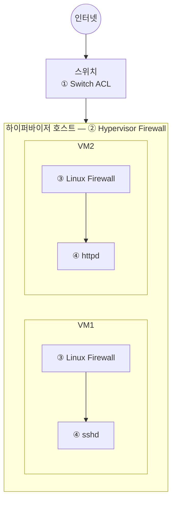
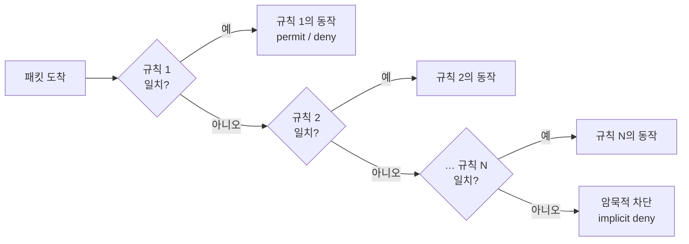
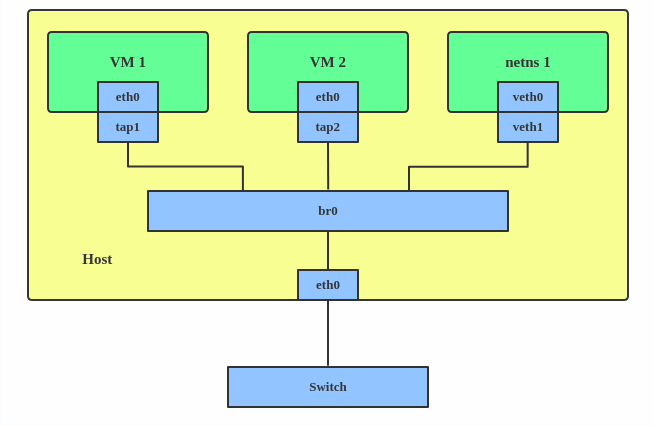
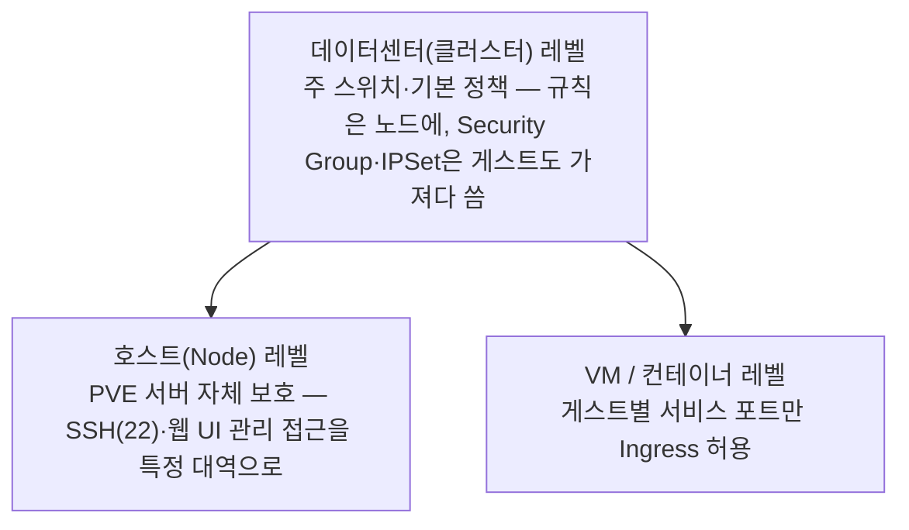
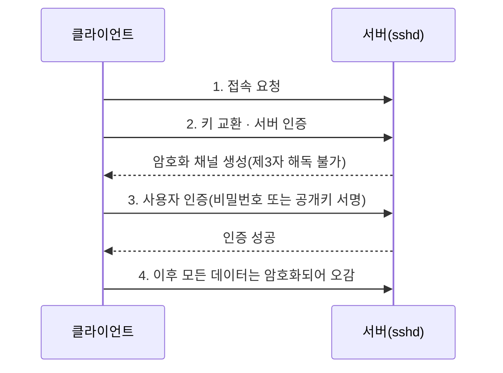
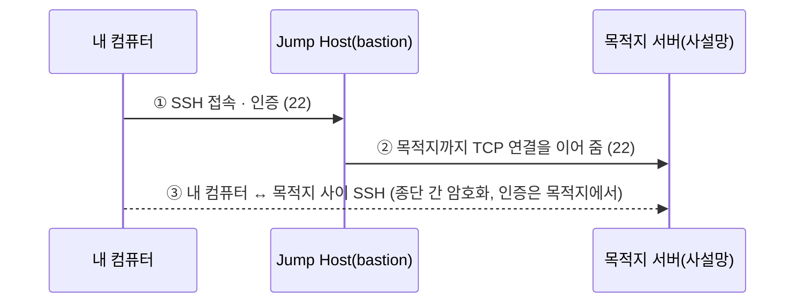

# 부록 I. 네트워크·시스템 접근제어 — 층별로 막기

**멘탈모델:** 접근제어는 문 하나가 아니라 **겹겹의 문**입니다. 패킷은 스위치 ACL → 하이퍼바이저 방화벽 → 호스트(리눅스) 방화벽 → 애플리케이션 설정을 차례로 지나야 서비스에 닿습니다. 바깥 층은 거칠고 빠르게, 안쪽 층은 세밀하고 똑똑하게 거릅니다. 한 층이 뚫리거나 실수로 열려도 다음 층이 받칩니다.

이 부록은 네트워크 장비와 서버 시스템에서 접근을 제한하는 방법을 층별로 정리합니다. 본문 Part들이 이미 깊게 다룬 부분(ufw·firewalld·nftables, Docker 우회, sshd 조각 설정, bastion)은 해당 절로 연결하고, 본문에 없는 층(스위치 ACL, 하이퍼바이저 방화벽, 웹 서버 접근제어, 포트 포워딩, CAM/TCAM)은 여기서 빠짐없이 다룹니다.

> **표기.** 예시 주소는 문서용 대역(`192.0.2.0/24`, `198.51.100.0/24`, `203.0.113.0/24`)과 사설 대역(`10.0.0.0/8`, `172.16.0.0/12`, `192.168.0.0/16`)만 씁니다. 원 가이드에 없던 설명을 덧붙인 곳은 **〔보충〕** 으로 표시합니다.

## I.1 개요 — 네 개의 층

한 대의 하이퍼바이저 위에 VM 두 대가 있고, 한 VM은 SSH(sshd)를, 다른 VM은 웹(httpd)을 제공한다고 합시다. 인터넷에서 들어오는 패킷이 서비스에 닿기까지의 길은 이렇습니다.



| 층 | 무엇인가 |
|---|---|
| ① Switch ACL | 특정 조건을 기준으로 네트워크 트래픽을 허용하거나 차단해 데이터의 흐름을 통제하는 규칙들의 집합입니다. |
| ② Hypervisor Firewall | 가상화 환경에서 가상 머신들 사이(그리고 VM과 바깥 사이)의 네트워크 트래픽을 감시하고 제어하는 보안 기능입니다. |
| ③ Linux Firewall | 리눅스 커널에 내장된 기능(netfilter)으로 시스템에 들어오고 나가는 패킷을 규칙에 따라 거르는 방화벽입니다. |
| ④ sshd | 원격에서 안전하게 접속해 명령을 실행하거나 파일을 전송할 수 있도록 암호화된 통신 채널을 제공하는 서버 프로그램입니다. |
| ④ httpd | 웹사이트 접속 요청을 받아 처리하는 웹 서버 프로그램입니다(원 가이드는 Apache를 가리키며, 이 부록은 Nginx도 함께 다룹니다). |

층이 안쪽으로 갈수록 볼 수 있는 정보가 많아집니다. 스위치는 주소·프로토콜·포트까지만 보지만, sshd는 **어느 사용자가** 들어오는지, 웹 서버는 **어느 도메인·경로에** 오는지, **클라이언트 인증서가** 있는지까지 봅니다. 그래서 "누구를 막을지"는 바깥에서, "무엇을 허락할지"는 안쪽에서 정하는 것이 자연스럽습니다.

### 용어

- **화이트리스트(allowlist):** 미리 허가한 사용자·IP 주소·애플리케이션만 접근을 허용하고, 그 밖의 접근은 모두 차단하는 방식입니다. 이 부록의 기본 자세입니다.
- **블랙리스트(denylist):** 미리 지정한 차단 대상만 막고, 그 밖의 접근은 모두 허용하는 방식입니다. 평판 기반 선차단([Part 2 §2.5](02-firewall.md))이 대표적입니다.
- **Stateful(상태 기반):** 연결의 상태 정보를 추적하면서 패킷을 검사해 허용·차단하는 방화벽입니다. 한 번 허용한 연결의 응답은 따로 규칙을 쓰지 않아도 통과합니다.
- **Transparent Firewall(투명 방화벽):** 네트워크의 IP 주소 체계나 구성을 바꾸지 않고, 브리지처럼 선 위에 끼어 트래픽을 검사하고 정책을 적용하는 방화벽입니다. 실제 예는 [Part 2 §2.5의 투명 브릿지](02-firewall.md)입니다.
- **Null Routing(블랙홀 라우팅):** 특정 IP 주소나 대역으로 가는 트래픽을 실제 목적지로 보내지 않고 가상의 Null 인터페이스로 보내 버리는 라우팅 기법입니다.

〔보충〕 리눅스에서 null routing은 `blackhole` 경로 한 줄입니다. 공격 대역으로 가는 **응답**을 버리므로 TCP 연결이 성립하지 않습니다.

```bash
# 203.0.113.0/24 로 가는 패킷을 모두 버린다
sudo ip route add blackhole 203.0.113.0/24
# 확인
ip route show type blackhole
```

## I.2 스위치 ACL — 맨 바깥의 거친 체

### ACL이란

**ACL(Access Control List)** 은 특정 네트워크 트래픽을 허용하거나 차단하는 규칙들의 집합으로, 네트워크 장비에서 트래픽을 제어하는 데 씁니다. 여기서 *트래픽*은 네트워크를 경유하는 데이터(패킷)를 말합니다.

### 작동 과정 — 첫 번째 일치가 이긴다

ACL은 패킷 필터링 방식으로 작동합니다. 통과하는 모든 패킷을 미리 정의한 규칙과 비교해 허용할지 차단할지 정합니다.

1. **패킷 도착:** 네트워크 장비에 패킷이 도달합니다.
2. **규칙 검사:** ACL의 첫 번째 규칙부터 순서대로 패킷 정보와 비교합니다.
3. **첫 번째 일치 우선:** 처음으로 일치하는 규칙을 찾으면 그 규칙의 동작(허용/차단)을 즉시 실행하고, 뒤의 규칙은 보지 않습니다.
4. **기본 차단:** 어떤 규칙과도 일치하지 않은 패킷은 자동으로 차단됩니다(implicit deny).



그래서 **순서가 곧 의미입니다.** 넓은 `permit`을 앞에 두면 뒤의 `deny`는 영영 평가되지 않습니다. 좁은 규칙을 앞에, 넓은 규칙을 뒤에 둡니다.

### 검사 기준

ACL은 다음 패킷 정보를 기준으로 판단합니다.

- IP 주소(출발지·목적지)
- 프로토콜(TCP, UDP, ICMP 등)
- 포트 번호(80 HTTP, 443 HTTPS, 22 SSH 등)
- TCP 플래그
- DSCP 마킹 등

### 스위치에서 ACL을 쓰는 이유

서버마다 방화벽이 있는데도 스위치에 ACL을 더 거는 이유는 세 가지입니다.

- **보안 강화(다층 방어):** 방화벽 정책을 우회하는 트래픽에 대비해 한 겹 더 장벽을 둡니다. L4/L7 스위치에 ACL을 설정하는 것이 이에 해당합니다.
- **원격 접속 보안:** 네트워크 장비 자체에 원격 접속할 때의 안전장치입니다. 예를 들어 특정 IP 주소에서만 장비의 SSH·텔넷 접속을 허용하도록 설정할 수 있습니다.
- **무차별 공격 방지:** 장비나 서버를 처음 설치해 공인 IP에 연결한 직후, 아직 호스트 방화벽이 갖춰지지 않은 사이에 들어오는 무차별 대입(brute force) 같은 공격을 앞단에서 차단합니다.

〔보충〕 스위치 ACL은 하드웨어(TCAM, [I.7](#i7-비고--cam과-tcam))에서 처리되므로 회선 속도로 걸러도 서버 CPU를 쓰지 않습니다. 대신 상태를 추적하지 않는(stateless) 거친 체라서, 세밀한 판단은 안쪽 층에 맡깁니다.

### ACL의 두 유형

| | Standard ACL | Extended ACL |
|---|---|---|
| 정의 | 출발지 IP 주소만으로 허용·차단을 정하는 ACL | 출발지·목적지 IP, 프로토콜, 포트 번호 등 정밀한 조건으로 허용·차단을 정하는 ACL |
| 기준 | 출발지 IP | 출발지/목적지 IP, 프로토콜, 포트 |
| 특징 | 설정이 간단하지만 제어 범위가 좁습니다 | 세밀한 트래픽 제어가 가능합니다 |
| 사용 예 | 특정 네트워크에서 오는 모든 트래픽을 제어 | 특정 서비스(SSH, HTTP)에 대한 접근 제어 |

### 방향 — Inbound와 Outbound

ACL은 트래픽이 인터페이스를 **들어오는지 나가는지**에 따라 적용합니다.

- **Inbound 규칙:** 라우터나 스위치 인터페이스로 **들어오는** 트래픽에 적용합니다.
- **Outbound 규칙:** 라우터나 스위치 인터페이스에서 **나가는** 트래픽에 적용합니다.

같은 규칙이라도 어느 인터페이스의 어느 방향에 붙였는지에 따라 "출발지"와 "목적지"의 뜻이 달라집니다. 붙이기 전에 패킷이 그 인터페이스를 어느 쪽으로 지나가는지 먼저 그려 봅니다.

### 하드웨어 제한 — 규칙은 무한하지 않다

스위치 ACL은 쓸 수 있는 개수에 상한이 있습니다. 다음은 한 벤더 제품군(Dell EMC Networking N 시리즈, 펌웨어 6.3.1.8 기준)의 공개 사양으로, 숫자의 *규모감*을 보기 위한 예입니다. 실제 장비는 그 장비의 문서를 확인합니다.

| 항목 | N1500 | N2000 | N3000 | N4000 |
|---|---|---|---|---|
| 최대 ACL 수(모든 유형) | 100 | 100 | 100 | 100 |
| 목록당 최대 규칙 수 | 1023 | 1023 | 1023 | 1023 |
| 인터페이스·방향당 최대 규칙(IPv4/L2) | 수신 1023 / 송신 1023 | 수신 1023 / 송신 1023 | 수신 2048 / 송신 1023 | 수신 1023 / 송신 1023 |
| 인터페이스·방향당 최대 규칙(IPv6) | 수신 255 / 송신 125 | 수신 1023 / 송신 509 | 수신 1659 / 송신 509 | 수신 635 / 송신 509 |
| 시스템 전체 최대 규칙 | 3030 | 3914 | 3914 | 3060 |
| ACL을 적용할 수 있는 최대 VLAN 인터페이스 | 24 | 24 | 24 | 24 |
| 시스템 전체 최대 ACL 로깅 규칙 | 128 | 128 | 128 | 128 |

IPv6 규칙 한도가 IPv4보다 훨씬 작은 것에 주목합니다. 주소가 길어 하드웨어 표(TCAM)의 칸을 더 많이 차지하기 때문입니다(〔보충〕, [I.7](#i7-비고--cam과-tcam)). 수천 개 대역을 막아야 하는 평판 목록은 스위치 ACL이 아니라 호스트의 nftables set([Part 2 §2.5](02-firewall.md))이 맡는 이유이기도 합니다.

### 예제 — Cisco IOS 계열 문법

아래 예제는 Cisco IOS 계열의 확장 ACL 문법입니다. 다른 벤더도 개념(이름 붙인 목록, 순차 평가, 인터페이스에 방향과 함께 적용)은 같지만 키워드가 조금씩 다릅니다. 설정 안의 주석은 IOS의 주석 기호 `!`로 별도 줄에 적었습니다.

예제의 주소는 다음 역할입니다. `203.0.113.0/24`는 공격 대역, `198.51.100.30`은 바깥의 협력 기관 호스트, `10.10.0.0/16`은 우리 내부망, `10.10.10.10`은 내부 서버입니다. ACL은 서브넷 마스크 대신 **와일드카드 마스크**(`0.0.0.255` = /24, `0.0.255.255` = /16)를 씁니다.

**예제 01 — DDoS 공격 대역 차단 + 특정 SSH 트래픽만 허용**

```text
!
ip access-list extended DDOS-BLOCK-IN
 ! DDoS 공격 대역 203.0.113.0/24 의 모든 IP 트래픽 차단
 deny ip 203.0.113.0 0.0.0.255 any
 ! 나머지 모든 IP 트래픽 허용
 ! (주의: deny 뒤의 permit any any 는 위에 걸리지 않은 모든 트래픽을 통과시킴)
 permit ip any any
!
ip access-list extended MYNET-FW-OUT
 ! 내부 서버 10.10.10.10 에서 198.51.100.30 으로의 SSH 허용
 permit tcp host 10.10.10.10 host 198.51.100.30 eq 22
 ! 내부망 10.10.0.0/16 에서 바깥으로의 SSH 허용
 permit tcp 10.10.0.0 0.0.255.255 any eq 22
 ! 그 밖의 모든 SSH 차단
 deny tcp any any eq 22
 ! 나머지 모든 IP 트래픽 허용 (위의 SSH 차단 외에는 모두 통과)
 permit ip any any
!
interface GigabitEthernet0/0
 ip address 10.10.10.1 255.255.0.0
 ! DDOS-BLOCK-IN 을 이 인터페이스의 Inbound 방향에 적용
 ip access-group DDOS-BLOCK-IN in
 ! MYNET-FW-OUT 을 이 인터페이스의 Outbound 방향에 적용
 ip access-group MYNET-FW-OUT out
!
```

`permit ip any any`는 그 앞의 `deny`에 걸리지 않은 모든 트래픽을 허용합니다. 즉 예제 01은 **블랙리스트형** ACL입니다. 의도한 보안 정책에 맞는지 신중하게 판단한 뒤 씁니다.

**예제 02 — DDoS 대역 차단 + 특정 SSH 허용 + 확립된 연결만 허용**

```text
!
ip access-list extended DDOS-BLOCK-IN
 ! DDoS 공격 대역 203.0.113.0/24 의 모든 IP 트래픽 차단
 deny ip 203.0.113.0 0.0.0.255 any
 ! 198.51.100.30 에서 내부 서버 10.10.10.10 으로의 SSH 허용
 permit tcp host 198.51.100.30 host 10.10.10.10 eq 22
 ! 이미 확립된(established) TCP 연결의 트래픽 허용
 permit tcp any any established
 ! 모든 UDP 트래픽 허용
 permit udp any any
 ! 모든 ICMP 트래픽 허용
 permit icmp any any
 ! 여기까지 명시적으로 허용되지 않은 나머지 Inbound 트래픽은 암묵적으로 차단됨
!
ip access-list extended MYNET-FW-OUT
 ! 내부망 10.10.0.0/16 에서 시작된 모든 트래픽을 바깥으로 허용
 permit ip 10.10.0.0 0.0.255.255 any
 ! 나머지 Outbound 트래픽은 암묵적으로 차단됨
!
! 인터페이스 적용은 예제 01 과 같습니다
!
```

예제 02는 끝에 `permit ip any any`가 없으므로 **화이트리스트형**입니다. 명시하지 않은 것은 마지막의 암묵적 차단(implicit deny)에 걸립니다. `established` 키워드 덕분에 내부에서 시작한 TCP 연결의 응답은 들어오고, 바깥에서 새로 시작하는 TCP 연결은 허용한 SSH 하나만 들어옵니다.

〔보충〕 예제 02의 `permit udp any any`, `permit icmp any any`는 DNS 응답·ping 등을 살리려는 편의 규칙이지만, 그만큼 UDP·ICMP는 화이트리스트가 아닙니다. 운영에서는 `permit udp any eq 53 10.10.0.0 0.0.255.255`(DNS 응답)처럼 필요한 것으로 좁힙니다.

### 추가 개념 — established는 진짜 상태 추적이 아니다

ACL의 `established` 키워드는 세션 상태를 보는 것처럼 보이지만, 방식에 따라 차이가 큽니다.

- **stateless:** TCP 헤더에 ACK나 RST 플래그가 **있는지만** 봅니다. 공격자가 ACK 플래그를 켠 패킷을 만들어 보내면(flag spoofing) 통과합니다. IOS 확장 ACL의 `established`가 이 방식입니다.
- **stateful:** TCP 세션을 실제로 추적해(연결 표) 내가 시작한 연결의 응답인지 확인합니다. 리눅스의 conntrack, 하이퍼바이저 방화벽, 게이트웨이 방화벽([Part 3 §3.3](03-network.md))이 이 방식입니다.

그래서 스위치 ACL의 `established`는 "대부분의 잡음을 걸러 주는 체"로 쓰고, 진짜 상태 검사는 안쪽 층에 맡깁니다.

## I.3 하이퍼바이저 방화벽 — VM의 바로 바깥

### 가상화 플랫폼에 내장된 방화벽

원 가이드는 이 층을 *온프레미스 클라우드 방화벽(On-premise Cloud Firewall)* 이라고 부릅니다. 장비는 기관 내부(전산실)에 직접 두지만, 클라우드처럼 **관리 화면이나 API로 규칙을 정의하면 플랫폼이 각 VM 앞에 알아서 심어 주는** 방화벽입니다. 대표적인 예가 **OpenStack Security Group**과 **Proxmox VE Firewall**입니다.

- **방화벽:** 허가되지 않은 외부의 위험한 접근(해킹, 악성코드)을 막고, 허가된 통신만 허용하는 네트워크 보안 장치입니다.
- **온프레미스(On-premise):** 서버나 소프트웨어를 외부 클라우드가 아닌 기관 소유의 공간(전산실)에 직접 설치하고 운영하는 방식입니다.
- **클라우드(Cloud):** 인터넷을 통해 소프트웨어나 저장 공간 같은 자원을 빌려 쓰는 서비스입니다. *클라우드 방화벽*은 방화벽 기능 자체를 서비스 형태로 제공해, 별도 장비 없이 설정만으로 쓰는 방식입니다.

이 층의 장점은 **VM 안의 운영체제를 믿지 않아도 된다는 것**입니다. VM 사용자가 자기 방화벽을 꺼도, 루트 권한을 빼앗겨도, 하이퍼바이저 쪽 규칙은 VM 밖에 있으므로 건드릴 수 없습니다.

### OpenStack Security Group

OpenStack 환경에서 가상 머신 인스턴스에 대한 네트워크 접근을 제어하는 **상태 기반(stateful) 가상 방화벽**입니다.

**핵심 원리 — 화이트리스트.** 기본적으로 모든 인바운드 트래픽을 차단하는 **Deny-All** 정책을 쓰고, 미리 명시적으로 허용한 트래픽만 통과시킵니다.

**규칙의 구성 요소.** Security Group은 Security Rule의 묶음이며, 각 규칙은 다음 요소로 이루어집니다.

- **트래픽 방향:** *Ingress*는 바깥에서 인스턴스로 들어오는 트래픽, *Egress*는 인스턴스에서 바깥으로 나가는 트래픽을 제어합니다.
- **프로토콜과 포트 범위:** TCP, UDP, ICMP 등의 프로토콜을 지정하고, 웹(80, 443), 원격 관리(22) 같은 특정 포트나 포트 범위를 명시해 그 서비스만 선택적으로 허용합니다.
- **원격지(Remote):** 특정 IP 주소, CIDR 대역, 또는 **다른 Security Group**을 상대로 지정할 수 있습니다. "웹 그룹에 속한 VM만 DB 그룹의 3306에 접근"처럼 주소가 아니라 *역할*로 규칙을 쓸 수 있다는 것이 큰 장점입니다.

〔보충〕 CLI로는 이렇게 씁니다.

```bash
# 그룹 생성
openstack security group create web
# 관리 대역에서만 SSH 허용
openstack security group rule create --ingress --protocol tcp --dst-port 22 --remote-ip 198.51.100.0/24 web
# HTTPS는 어디서나
openstack security group rule create --ingress --protocol tcp --dst-port 443 --remote-ip 0.0.0.0/0 web
# 인스턴스에 그룹 붙이기
openstack server add security group ⟨인스턴스⟩ web
```

### 규칙은 실제로 어디에 걸리나

하이퍼바이저 호스트 안에서 VM과 네트워크 네임스페이스는 이렇게 연결됩니다.



호스트 안의 VM 1, VM 2와 네트워크 네임스페이스(netns 1)는 각자의 인터페이스(eth0, veth0)가 호스트 쪽 탭 인터페이스(tap1, tap2)나 veth 짝(veth1)으로 이어져 `br0`이라는 브리지에 붙습니다. 이 브리지는 호스트의 물리 `eth0`을 통해 바깥 스위치와 통신합니다.

- **tap1 같은 VM 쪽 인터페이스:** 여기에 iptables·ebtables·nftables 규칙이 걸립니다. VM마다 따로 걸 수 있는 자리입니다.
- **br0:** OpenStack이 ML2 플러그인으로 Open vSwitch(OVS)를 쓰면, 브리지 수준의 OVS 규칙(OpenFlow)이 걸립니다.

〔보충〕 OpenStack Neutron의 OVS 드라이버는 두 방식 중 하나로 Security Group을 구현합니다. *iptables_hybrid*는 VM마다 작은 리눅스 브리지를 하나 더 끼워 그곳의 iptables로, *openvswitch(native)* 는 OVS의 conntrack 연동 OpenFlow 규칙으로 처리합니다. 최근 배포에서 흔한 ML2/OVN은 Security Group을 OVN ACL로 정의하고, 그것이 다시 OVS의 conntrack 연동 흐름 규칙으로 내려갑니다. 어느 쪽이든 "VM의 탭 인터페이스 바로 앞"이라는 위치는 같습니다. 이 구조는 Part 3의 PVE 브리지([Part 3 §3.1](03-network.md))와 같은 그림입니다.

### Proxmox VE 방화벽

Proxmox VE의 방화벽도 nftables/iptables 위에서 동작하며, 여러 층으로 정책을 나눠 겁니다.

**기본 정책**

| 방향 | 기본 동작 | 뜻 |
|---|---|---|
| Input | DROP | 들어오는 트래픽은 기본 차단합니다. 응답 없이 패킷을 버리므로 포트 스캐닝 같은 정찰 시도에 아무 정보도 주지 않습니다. |
| Output | ACCEPT | 나가는 트래픽은 기본 허용합니다. conntrack(상태 추적) 덕분에 내부에서 시작한 연결의 응답은 자동으로 들어옵니다. |
| Forward | ACCEPT | 호스트를 거쳐 전달되는 트래픽은 기본 허용합니다. |

**계층별 적용.** 상위 계층의 정책이 하위 계층에 영향을 줍니다.



- **데이터센터 레벨:** 클러스터 전체의 최상위 설정입니다. 여기의 `enable`이 클러스터 전체 방화벽의 주 스위치이고, 여기 `[RULES]`에 적은 규칙은 **모든 노드(호스트)** 에 적용됩니다. VM에는 직접 적용되지 않으며, 대신 여기 정의한 Security Group·IPSet을 VM 규칙이 가져다 써서 일관된 기준이 됩니다([PVE Firewall](https://pve.proxmox.com/pve-docs/chapter-pve-firewall.html)).
- **호스트(Node) 레벨:** Proxmox VE가 설치된 물리 서버 자체를 보호합니다. 주로 SSH(22)와 웹 UI 같은 관리 접근을 특정 IP 대역으로 제한합니다.
- **VM/컨테이너 레벨:** 개별 게스트에 맞춘 정책입니다. 각 VM이 제공하는 서비스에 필요한 포트만 골라 허용하는 Ingress 규칙을 쓰는 것이 일반적입니다.

**Stateful과 Security Group**

- **상태 기반:** 한 번 허용된 연결의 응답 트래픽은 자동으로 허용됩니다.
- **Security Group:** OpenStack처럼 Proxmox도 재사용 가능한 규칙 묶음을 미리 정의해 여러 VM에 한꺼번에 적용할 수 있습니다.
- **초기 상태:** 방화벽은 기본 *비활성* 상태로 시작합니다. 데이터센터 레벨에서 켜는 순간 Input 기본 정책 DROP이 적용되어 인바운드가 막힙니다. 〔보충〕 이때 `management` IPSet(클러스터의 로컬 네트워크는 자동으로 여기에 들어감)에서 오는 웹 UI(8006)·SSH(22)·콘솔(VNC 5900–5999, SPICE 3128) 접근은 자동 허용 규칙으로 살아 있지만, **다른 대역에서 원격으로 관리 중이라면 켜는 순간 스스로를 잠글 수 있습니다.** 켜기 전에 `management` IPSet에 내 관리 대역을 먼저 넣습니다.

〔보충〕 Proxmox의 규칙은 웹 UI에서 만들어도 결국 텍스트 파일로 저장됩니다. 구조를 보면 계층이 바로 보입니다.

```ini
# /etc/pve/firewall/cluster.fw  (데이터센터 레벨)
[OPTIONS]
enable: 1
policy_in: DROP
policy_out: ACCEPT

# 관리 접근을 허용할 대역
[IPSET management]
198.51.100.0/24

# 재사용할 규칙 묶음(Security Group)
[group web]
IN HTTPS(ACCEPT)
IN SSH(ACCEPT) -source +management
```

```ini
# /etc/pve/firewall/⟨VMID⟩.fw  (VM 레벨)
[OPTIONS]
enable: 1

[RULES]
GROUP web
```

VM 레벨 규칙이 실제로 걸리려면 VM 네트워크 장치 설정에서 **Firewall 체크박스**(`firewall=1`)도 켜져 있어야 합니다. 데이터센터·VM·NIC 세 곳이 모두 켜져야 동작한다는 점이 처음에 가장 많이 헷갈리는 부분입니다.

## I.4 리눅스 방화벽 — 호스트의 마지막 네트워크 관문

리눅스 방화벽의 구조(netfilter, iptables에서 nftables로의 전환, `iptables-nft`)는 [Part 2 §2.1](02-firewall.md)에 자세히 있습니다. 여기서는 도구들의 지도만 그립니다.

### 커널 쪽 도구

- **iptables:** 리눅스의 전통적인 방화벽 관리 도구입니다.
- **ebtables:** 이더넷 브리지(L2) 수준의 테이블을 관리합니다. 하이퍼바이저의 브리지 필터링([I.3](#i3-하이퍼바이저-방화벽--vm의-바로-바깥))에 쓰입니다.
- **nftables:** iptables를 대체하도록 설계된 netfilter의 최신 서브시스템입니다. 지금 배포판들의 기본입니다.
- **eBPF(extended Berkeley Packet Filter):** 커널 모듈을 올리지 않고도 커널 기능을 확장하게 해 줍니다. 〔보충〕 XDP처럼 NIC 드라이버 단계에서 패킷을 버리는 초고속 필터나, Cilium 같은 컨테이너 네트워크 방화벽이 이 위에서 동작합니다.
- **conntrack(stateful):** iptables와 nftables 모두 conntrack으로 상태 기반 방화벽을 제공합니다.

### 배포판별 관리 도구

두 도구의 사고방식 차이(포트 중심 vs zone 중심)는 [Part 2 §2.1](02-firewall.md)에서 비교합니다.

**firewalld** — Fedora·RHEL 계열(Rocky Linux 등)의 기본 방화벽입니다. zone별로 정책을 적용합니다. 다음은 `/etc/firewalld/zones/trusted.xml`의 예입니다.

```xml
<?xml version="1.0" encoding="utf-8"?>
<zone target="ACCEPT">
  <source address="10.0.0.0/8"/>
  <source address="172.16.0.0/12"/>
  <source address="192.168.0.0/16"/>
  <service name="ssh"/>
</zone>
```

`target="ACCEPT"`인 trusted zone에 사설 대역 세 개를 소스로 넣었습니다. 이 대역에서 오는 트래픽은 trusted zone으로 분류되어 허용됩니다. 〔보충〕 `target="ACCEPT"`이면 zone에 들어온 트래픽을 포트와 무관하게 **모두** 허용하므로, `<service name="ssh"/>` 줄은 사실상 아무 효과가 없습니다. "사설 대역에서는 SSH만"이 의도라면 target을 기본값(`default`)으로 두거나 `internal` 같은 다른 zone을 써야 합니다. 같은 구성을 명령으로 해 보는 것이 [실습④](labs/lab-04.md)입니다.

**UFW(Uncomplicated Firewall)** — Debian·Ubuntu 계열의 기본 방화벽입니다. 위에서부터 차례로 읽는 규칙 목록이라는 점에서 스위치 ACL과 비슷하게 동작합니다.

```bash
# 사설 대역 세 곳에서만 22번 허용 (〔보충〕 아래 출력을 만드는 명령)
sudo ufw allow from 10.0.0.0/8 to any port 22
sudo ufw allow from 172.16.0.0/12 to any port 22
sudo ufw allow from 192.168.0.0/16 to any port 22
sudo ufw status numbered
```

```text
Status: active

     To                         Action      From
     --                         ------      ----
[ 1] 22                         ALLOW IN    10.0.0.0/8
[ 2] 22                         ALLOW IN    172.16.0.0/12
[ 3] 22                         ALLOW IN    192.168.0.0/16
```

상태가 `active`이고, 세 사설 대역에서 들어오는 22번(SSH) 트래픽을 허용하는 규칙이 번호와 함께 보입니다. 나머지는 ufw의 기본 정책(`deny incoming`)에 걸립니다.

⚠️ **Docker 컨테이너가 publish한 포트에는 ufw 규칙이 먹지 않습니다.** 이유와 해결은 [I.6.3](#i63-docker-ufw-iptables)과 [Part 2 §2.2–2.3](02-firewall.md), [실습③](labs/lab-03.md)에 있습니다. firewalld에서의 같은 문제는 [Part 2 §2.4](02-firewall.md)를 봅니다.

## I.5 애플리케이션 설정 — 누가, 어디서, 무엇으로

네트워크 층은 "어느 주소의 어느 포트"까지만 봅니다. 애플리케이션 층에서는 **조건부 접근 제어(Conditional Access Control)** 가 가능합니다. IP 주소와 *사용자*, *도메인*, *인증 수단*을 함께 조건으로 묶어, 조건마다 다른 보안 정책을 적용합니다. 이 절은 OpenSSH, Nginx, Apache HTTP에서의 예를 다룹니다.

### I.5.1 SSH 서버 접근제어

**OpenSSH**는 암호화된 통신 채널로 원격 컴퓨터에 안전하게 접속하고 관리하게 해 주는 보안 셸입니다.

**주요 기능**

- **원격 명령 실행(ssh):** 다른 컴퓨터에 로그인해 그 앞에 앉아 있는 것처럼 명령을 내립니다.

```bash
ssh me@server.example.org
```

- **파일 전송(scp, sftp):** 암호화된 채널로 컴퓨터 사이에 파일을 복사합니다.

```bash
# SFTP 세션 열기
sftp me@server.example.org
```

```text
# 원격 서버의 파일 목록 보기
sftp> ls
# 내 컴퓨터(로컬)의 파일 목록 보기
sftp> lls
# 내 컴퓨터의 파일을 원격 서버로 업로드
sftp> put report.docx
# 원격 서버의 파일을 내 컴퓨터로 다운로드
sftp> get data.zip
# SFTP 세션 종료
sftp> exit
```

```bash
# 원격 파일을 현재 디렉터리로 가져오기
scp me@server.example.org:/var/log/syslog .
```

- **터널링:** 암호화되지 않은 서비스를 SSH가 만든 암호화 터널로 감싸 안전하게 씁니다([I.6.2](#i62-port-forwarding)).
- **강력한 인증:** 비밀번호뿐 아니라 공개키-개인키 방식 인증을 지원해 보안 수준을 크게 높입니다.

**키 인증 준비.** 키 타입 선택(ed25519 기본, rsa 4096은 레거시 호환용)과 공개키 배포는 [Part 6 §6.1–6.2](06-access.md)와 [실습⑧ 준비](labs/lab-08.md)에 자세히 있습니다. 공개키를 서버 한 대에 손으로 넣을 때는 `ssh-copy-id`가 가장 간단합니다.

```bash
# 키 생성 (원 가이드는 rsa 4096 예시였으나 이 책의 기본은 ed25519)
ssh-keygen -t ed25519
# 원격 서버에 내 공개키 복사
ssh-copy-id me@server.example.org
# 비밀번호를 묻지 않고 바로 접속되면 성공
ssh me@server.example.org
```

**작동 원리**



1. **접속 요청:** 클라이언트가 서버에 접속을 요청합니다.
2. **키 교환과 암호화 채널 생성:** 클라이언트와 서버가 서로(먼저 서버의 호스트 키)를 확인하고, 제3자가 해독할 수 없는 암호화 채널을 만듭니다.
3. **사용자 인증:** 채널이 생기면 서버는 비밀번호를 묻거나, 미리 등록된 공개키와 사용자가 가진 개인키를 대조해 접속을 허가합니다.
4. **보안 통신:** 인증이 끝나면 모든 데이터가 암호화되어 오갑니다.

**조건부 설정 — Match**

OpenSSH는 `Match` 지시어로 조건(주소, 사용자, 그룹 등)에 따라 설정을 다르게 적용합니다. 적용 전에 반드시 동작을 확인합니다. 원 가이드는 Ubuntu 22, Rocky 8 이상에서 동작을 확인했으며, 설정 문법 오류나 파일 로딩 순서에 따라 의도와 다르게 동작할 수 있다고 경고합니다.

```bash
# /etc/ssh/sshd_config.d/01-custom-acl.conf
# 기본: 비밀번호 인증 끔
PasswordAuthentication no

# 10.0.0.0/8 대역에서 들어오는 alice 는 비밀번호 인증 허용
Match Address 10.0.0.0/8 User alice
    PasswordAuthentication yes

# 172.16.0.0/12 대역에서 들어오는 alice 는 비밀번호 인증 허용
Match Address 172.16.0.0/12 User alice
    PasswordAuthentication yes

# 위 조건에 해당하지 않는 모든 연결 — 여기서 Match 블록을 닫는다
Match all
```

기본적으로 비밀번호 인증을 끄고, 특정 내부 대역에서 `alice` 사용자가 접속할 때만 예외로 비밀번호를 허용합니다. `Match all`은 위의 어떤 `Match`에도 해당하지 않는 접속의 기본 동작을 정하는 자리입니다. 예시에는 그 아래 지시어가 없으므로 맨 위의 `PasswordAuthentication no`가 그대로 적용됩니다.

〔보충〕 `Match all`에는 두 번째 역할이 있습니다. `Match` 블록은 다음 `Match`나 파일 끝까지 이어지므로, 조각 파일 끝에 `Match all`을 두면 그 뒤에 읽히는 설정이 앞의 `Match` 조건에 갇히지 않게 **블록을 명시적으로 닫는** 효과가 있습니다. 또 두 블록은 `Match User alice Address 10.0.0.0/8,172.16.0.0/12` 한 줄로 합칠 수 있습니다.

⚠️ **파일 이름의 번호가 중요합니다.** sshd는 같은 지시어에 대해 **먼저 읽은 값이 이깁니다.** 원 가이드의 예시 파일명은 `98-custom-acl.conf`였는데, 클라우드 이미지에 흔한 `50-cloud-init.conf`가 `PasswordAuthentication yes`를 갖고 있으면 그쪽이 먼저 읽혀 맨 위의 `no`가 무시됩니다. 그래서 여기서는 [Part 6 §6.3](06-access.md)의 관례대로 `01-`로 바꿨습니다. 적용 후에는 파일이 아니라 결과를 확인합니다.

```bash
# 문법 검사
sudo sshd -t
# 조건별 최종 값: 내부 대역의 alice / 바깥 대역의 alice
sudo sshd -T -C user=alice,host=x,addr=10.1.2.3 | grep -i passwordauthentication
sudo sshd -T -C user=alice,host=x,addr=198.51.100.7 | grep -i passwordauthentication
```

첫 줄은 `passwordauthentication yes`, 둘째 줄은 `passwordauthentication no`가 나와야 합니다. 원격에서 sshd를 고칠 때는 기존 세션을 끊지 말고 새 세션으로 먼저 검증합니다([Part 6 §6.3](06-access.md)).

### I.5.2 웹 서버 접근제어

**Nginx**는 적은 자원으로 많은 동시 접속을 빠르고 효율적으로 처리하는 고성능 웹 서버입니다.

- **Web Server:** 이미지, CSS, HTML 같은 정적 콘텐츠를 빠르게 제공합니다.
- **Reverse Proxy:** 클라이언트 요청을 대신 받아 내부 서버에 전달하고, 결과를 클라이언트에 돌려줍니다.
- **Load Balancer:** 여러 서버로 들어오는 트래픽을 고르게 나눕니다.
- **Caching:** 자주 쓰는 응답을 미리 저장해 두었다가 바로 내줍니다.
- **특징:** 요청 하나에 프로세스 하나를 할당하는 방식과 달리, **이벤트 기반 구조**로 한 프로세스가 여러 요청을 비동기로 처리합니다. 그래서 빠르고, 자원을 적게 쓰고, 안정적이며 확장하기 쉽습니다.

**Apache HTTP Server**는 풍부한 기능과 높은 안정성으로 오랫동안 웹 서버의 표준 자리를 지켜 온 오픈소스 소프트웨어입니다.

- **높은 호환성:** Windows, Linux, macOS 등 거의 모든 운영체제에서 안정적으로 동작합니다.
- **풍부한 기능:** 수많은 공식·비공식 모듈로 인증, 보안, URL 재작성, 여러 프로그래밍 언어 연동 등을 손쉽게 더합니다.
- **방대한 커뮤니티:** 오래 쓰인 만큼 문서와 문제 해결 사례가 많습니다.
- **작동 방식:** *프로세스 기반*(요청마다 독립 자원을 할당해 안정적이지만 동시 접속이 많으면 메모리가 급증)과 *스레드 기반*(한 프로세스 안의 여러 스레드가 요청을 처리) 방식을 MPM 모듈로 고릅니다.

웹 서버에서도 조건에 따라 클라이언트 접근을 막거나 다른 보안 정책을 적용할 수 있습니다.

**Nginx — IP 대역별 접근 허용**

`location` 블록 안의 `allow`와 `deny` 지시어로 특정 IP 주소나 대역의 접근을 제어합니다. 규칙은 위에서부터 차례로 검사하고 처음 일치한 것이 적용됩니다(스위치 ACL과 같은 원리).

```nginx
server {
    listen 80;
    # 이 도메인으로 오는 요청에 대한 설정
    server_name inside.example.org;

    location / {
        # 192.168.0.0/24 대역에서의 접근 허용
        allow 192.168.0.0/24;
        # 10.0.10.0/24 대역에서의 접근 허용
        allow 10.0.10.0/24;
        # 위에 없는 모든 대역은 거부 (403)
        deny all;
    }
}
```

`inside.example.org`로 들어오는 HTTP(80) 요청 가운데 두 내부 대역만 허용하고 나머지는 모두 거부합니다. 내부 네트워크나 특정 협력 기관에만 서비스를 열 때 유용합니다.

〔보충〕 Nginx가 리버스 프록시나 로드밸런서 뒤에 있으면 `allow`가 보는 주소는 *프록시의 주소*입니다. 이때는 `real_ip` 모듈(`set_real_ip_from`, `real_ip_header`)로 신뢰할 프록시를 지정해 원래 클라이언트 주소를 복원한 뒤에 검사합니다. 신뢰하지 않는 출처의 `X-Forwarded-For`를 그대로 믿으면 주소를 위조당합니다.

**Apache HTTP — IP 대역별 조건부 mTLS**

Apache는 `<If>`, `<ElseIf>`, `<Else>` 조건으로 클라이언트 IP에 따라 **mTLS(클라이언트 인증서) 요구 여부**를 바꿀 수 있습니다. mTLS 자체의 원리와 사설 CA로 클라이언트 인증서를 만드는 법은 [Part 5 §5.6](05-trust.md)과 [실습⑪](labs/lab-11.md)에 있습니다.

```apache
# 기본: 클라이언트 인증서를 요구하지 않음
SSLVerifyClient none

# 192.168.0.0/24 대역의 클라이언트: 그대로 통과
<If "-R '192.168.0.0/24'">
</If>
# 10.0.10.0/24 대역의 클라이언트: 그대로 통과
<ElseIf "-R '10.0.10.0/24'">
</ElseIf>
# 위 대역에 해당하지 않는 모든 클라이언트
<Else>
    # 클라이언트 인증서를 필수로 요구
    SSLVerifyClient require
    # 클라이언트 인증서 체인 검증 깊이
    SSLVerifyDepth 1
</Else>
```

기본은 클라이언트 인증서를 요구하지 않지만(`SSLVerifyClient none`), 두 신뢰 대역에 속하지 않는 모든 클라이언트에게는 인증서를 필수로 요구합니다. 정리하면 **내부·신뢰 대역에서는 mTLS 없이, 그 밖의 외부 클라이언트에게만 mTLS를 강제**하는 전략입니다. 클라이언트 인증서를 검증하려면 같은 가상 호스트에 `SSLCACertificateFile ⟨클라이언트 CA 인증서⟩`도 있어야 합니다.

⚠️ 원 가이드의 예시는 `<If>` 두 개 뒤에 `<Else>`를 두었는데, Apache의 `<Else>`는 **바로 앞의 `<If>`/`<ElseIf>` 하나에만** 짝지어집니다. 그 형태로는 `192.168.0.0/24` 클라이언트도 두 번째 `<If>`에 맞지 않아 `<Else>`로 떨어져 인증서를 요구받습니다. 그래서 위처럼 두 번째를 `<ElseIf>`로 고쳤습니다. 또 Apache 설정은 지시어 줄 끝에 주석을 달 수 없으므로 주석은 모두 별도 줄에 둡니다.

〔보충〕 `<If>` 안의 `SSLVerifyClient`는 디렉터리 수준 설정이라, TLS 연결이 맺어진 **뒤에** 클라이언트 인증서를 다시 요청해야 합니다(TLS 1.2의 재협상, TLS 1.3의 post-handshake authentication). 주요 브라우저는 TLS 1.3의 이 기능을 지원하지 않아 외부 접속이 실패할 수 있습니다. 확실하게 하려면 핸드셰이크 때 인증서를 *요청만* 하고, 판정은 접근 규칙으로 합니다.

```apache
# 핸드셰이크 때 인증서를 요청하되, 없어도 연결은 맺는다
SSLVerifyClient optional
SSLVerifyDepth 1
SSLCACertificateFile ⟨클라이언트 CA 인증서⟩

<Location "/">
    # 신뢰 대역이거나, 인증서 검증에 성공한 클라이언트만 허용
    Require expr "-R '192.168.0.0/24' || -R '10.0.10.0/24' || %{SSL_CLIENT_VERIFY} == 'SUCCESS'"
</Location>
```

## I.6 기타

### I.6.1 SSH Jump Host

**SSH**(Secure Shell)는 인터넷을 통해 다른 컴퓨터에 안전하게 접속하게 해 주는 보안 프로토콜입니다. 모든 데이터가 암호화되어 오가므로 원격 서버 작업에 일반적으로 씁니다.

**SSH Jump Host**는 최종 목적지 서버에 가기 위해 **중간에 거쳐 가는 서버**입니다. 이 책의 bastion이 바로 이것입니다. 다음과 같은 경우에 필요합니다.

- **보안상 제약:** 목적지 서버가 바깥에서 직접 접속할 수 없도록 설정되어 있을 때
- **네트워크 구조:** 목적지가 방화벽 뒤나 사설 네트워크 안에 있어 직접 닿지 않을 때
- **접근 권한 제한:** 특정 서버를 거쳐서만 접근하도록 권한이 정해져 있을 때



원래는 Jump Host에 먼저 접속한 뒤 거기서 다시 목적지로 접속하는 두 번의 연결이 필요했지만, 지금은 `-J` 옵션(`ProxyJump`)으로 한 번에 됩니다.

```bash
# 형식
ssh -J ⟨jump_user⟩@⟨jump_server⟩ ⟨target_user⟩@⟨target_server⟩
# 예
ssh -J jump@bastion.example.org user@10.10.1.5
```

`-J`는 Jump Host에서 셸을 열어 다시 ssh를 치는 것과 달리, 내 개인키가 내 컴퓨터를 떠나지 않고 목적지와 **종단 간** 암호화가 유지됩니다. `~/.ssh/config`에 `ProxyJump`로 적어 두는 법, Jump Host 쪽 sshd에서 `AllowTcpForwarding`·`PermitOpen`으로 점프 전용 계정만 허락하는 법은 [Part 3 §3.5](03-network.md), [Part 6 §6.3](06-access.md), [실습⑧](labs/lab-08.md)에 있습니다.

### I.6.2 Port Forwarding

**포트(port)** 는 한 컴퓨터 안에서 특정 프로그램이나 서비스를 구별하는 번호입니다. **포트 포워딩**은 한 지점의 포트로 들어온 연결을 다른 컴퓨터의 포트로 이어 주는 기술입니다. 흔히 두 가지 뜻으로 씁니다.

**① 공유기·라우터의 포트 포워딩(NAT).** 바깥에서 내부 네트워크의 특정 컴퓨터나 서비스에 접속할 수 있도록, 공유기에서 외부 포트와 내부 IP·포트를 연결합니다.

1. 공유기 관리자 페이지의 포트 포워딩 메뉴에서 외부 포트, 내부 IP, 내부 포트, 프로토콜(TCP/UDP)을 설정합니다.
2. 그러면 바깥에서 공유기의 공인 IP와 그 외부 포트로 접속할 때 내부 서비스에 연결됩니다.

리눅스에서 같은 일을 하는 것이 DNAT 규칙이며, 그 예가 [I.6.3](#i63-docker-ufw-iptables)입니다.

**② SSH 포트 포워딩(터널).** SSH 연결 안에 다른 TCP 연결을 실어 나릅니다. 세 가지 유형이 있습니다.

| 유형 | 동작 |
|---|---|
| Local Port Forwarding | 내 컴퓨터의 포트를 원격 쪽 포트로 연결합니다. |
| Remote Port Forwarding | 원격 서버의 포트를 내 컴퓨터(쪽)의 포트로 연결합니다. |
| Dynamic Port Forwarding | SOCKS 프록시를 만들어 여러 연결을 SSH 터널로 전달합니다. |

〔보충〕 각 유형의 명령은 이렇습니다.

```bash
# Local: 내 PC의 127.0.0.1:8080 → (bastion 경유) → 10.10.1.5:80
ssh -L 8080:10.10.1.5:80 jump@bastion.example.org
# Remote: 서버의 127.0.0.1:9000 → (터널) → 내 PC의 localhost:3000
ssh -R 9000:localhost:3000 me@server.example.org
# Dynamic: 내 PC의 127.0.0.1:1080 에 SOCKS 프록시
ssh -D 1080 jump@bastion.example.org
```

〔보충〕 **SSH 포워딩은 접근제어의 층들을 가로지르는 통로**라는 점을 기억합니다. 22번 하나만 열어 둔 서버라도 포워딩이 허용되면, 그 서버가 닿는 모든 곳으로 가는 길이 SSH 안에 생깁니다. 그래서 서버 쪽에서 범위를 정합니다.

```bash
# /etc/ssh/sshd_config.d/03-forwarding.conf
# 기본: 포워딩 금지
AllowTcpForwarding no
# 원격 포워딩 포트를 바깥 주소에 열지 않음 (기본값)
GatewayPorts no

# 점프 전용 계정만, ssh 포트로만
Match User jump
    AllowTcpForwarding yes
    PermitOpen *:22

Match all
```

이 형태가 [Part 6 §6.3](06-access.md)과 [실습⑧](labs/lab-08.md)의 bastion 설정입니다.

### I.6.3 Docker, UFW, iptables

Docker와 UFW는 iptables를 서로 다른 방식으로 다룹니다. 그래서 둘을 함께 쓰면 **Docker가 UFW 규칙을 우회해 컨테이너 포트를 바깥에 그대로 노출**하는 심각한 문제가 생깁니다.

- **UFW와 iptables:** UFW는 iptables를 쉽게 다루게 해 주는 인터페이스입니다. `ufw allow 80` 같은 명령을 iptables 규칙으로 바꿔 주로 INPUT·FORWARD·OUTPUT 기본 체인에 붙입니다.
- **Docker와 iptables:** Docker는 컨테이너끼리의 통신과 외부 연결을 위해 자체 가상 네트워크를 만들고, publish한 포트마다 nat 테이블의 PREROUTING 체인에 DNAT 규칙을 직접 넣습니다. 그리고 FORWARD 체인에서도 Docker의 체인이 UFW 체인보다 **먼저** 평가됩니다.

왜 그런지, 그리고 `ufw-docker`·`DOCKER-USER`로 어떻게 바로잡는지는 [Part 2 §2.2–2.3](02-firewall.md)에서 nftables 체인을 따라가며 설명하고, [실습③](labs/lab-03.md)에서 직접 재현합니다.

**iptables로 수동 포트 포워딩하기.** 원 가이드는 다른 길도 소개합니다. 컨테이너를 `-p` 없이 띄우고(그래서 Docker가 DNAT 규칙을 만들지 않게 하고), 포워딩 규칙을 관리자가 직접 넣는 방법입니다. 바깥에서 호스트의 8080으로 온 요청을 컨테이너의 80으로 보내는 예입니다.

```bash
# 1. DNAT: 호스트 8080 으로 온 요청의 목적지를 컨테이너 80 으로 바꾼다
sudo iptables -t nat -A PREROUTING -p tcp --dport 8080 -j DNAT --to-destination ⟨컨테이너 IP⟩:80
# 2. FORWARD: 바뀐 목적지로 패킷이 실제로 전달되도록 허용한다
sudo iptables -A FORWARD -p tcp -d ⟨컨테이너 IP⟩ --dport 80 -j ACCEPT
# 3. MASQUERADE: 컨테이너에서 나가는 패킷의 출발지를 호스트 주소로 바꾼다
sudo iptables -t nat -A POSTROUTING -s ⟨컨테이너 IP⟩ -j MASQUERADE
```

이 방법을 쓸 때 알아 둘 점입니다(〔보충〕).

- **접근제어 지점은 2번 FORWARD 규칙입니다.** DNAT된 패킷은 INPUT이 아니라 FORWARD를 지나므로, 이 경우에도 `ufw allow`/`deny`는 관여하지 않습니다. 출발지를 좁히려면 2번 규칙에 `-s 198.51.100.0/24`처럼 조건을 직접 넣습니다.
- **3번은 응답에는 필요 없습니다.** 바깥에서 들어온 연결의 응답은 conntrack이 DNAT를 자동으로 되돌려 줍니다. 3번은 컨테이너가 *먼저* 바깥으로 나가는 연결용이며, Docker 기본 브리지는 이미 같은 일을 하는 규칙을 갖고 있습니다.
- **컨테이너 IP는 재생성하면 바뀝니다.** 사용자 정의 네트워크에서 `--ip`로 고정하거나 배포 절차에 규칙 갱신을 넣습니다.
- **이 규칙들은 재부팅하면 사라집니다.** 유지하려면 `/etc/ufw/before.rules`나 `iptables-persistent`(`netfilter-persistent`) 같은 저장 수단에 넣습니다. 또 Docker가 재시작하며 체인을 다시 만들 때 순서가 바뀌지 않는지 확인합니다.
- 바깥에 노출할 필요가 없는 컨테이너라면 이 모든 것보다 `-p 127.0.0.1:8080:80`처럼 **바인드 주소를 좁히는 것**이 가장 싼 방어입니다([Part 2 §2.2](02-firewall.md)).

## I.7 비고 — CAM과 TCAM

스위치 ACL이 회선 속도로 동작하고, 그러면서도 규칙 개수에 하드웨어 상한([I.2](#i2-스위치-acl--맨-바깥의-거친-체))이 있는 이유가 이 특수 메모리에 있습니다.

### CAM(Content Addressable Memory)

*내용 주소 지정 메모리*라고도 하며, 메모리 **주소가 아니라 내용(검색어)** 으로 데이터를 찾는 특수 메모리입니다.

- **검색어 기반 접근:** RAM은 "이 주소에 무엇이 있나"를 묻습니다. CAM은 "이 값이 어디에 있나"를 묻습니다. 검색어를 넣으면 메모리 전체를 뒤져 일치하는 데이터의 위치나 관련 결과를 돌려줍니다.
- **연관 메모리:** 데이터를 *어디에* 저장했는지가 아니라 *무엇을* 저장했는지를 기준으로 접근합니다.
- **병렬 검색:** 검색어를 저장된 모든 항목과 **동시에** 비교하므로 매우 빠릅니다. 〔보충〕 스위치가 목적지 MAC 주소로 출력 포트를 찾는 MAC 주소 표가 CAM의 대표적인 쓰임입니다.

### TCAM(Ternary CAM)

데이터를 0, 1, 그리고 **X(Don't Care)** 의 세 가지 상태로 저장하는 CAM입니다. 검색할 때 일부 비트를 무시할 수 있어, 내용 기반의 빠른 **패턴 매칭**이 가능합니다.

- **3값 저장:** 이진 CAM이 0과 1만 저장하는 것과 달리, TCAM은 X를 더해 세 상태를 표현합니다.
- **와일드카드 검색:** 패턴의 X 자리는 어떤 값이 와도 일치로 인정합니다.
- **유연성과 병렬 처리:** 수많은 패턴을 한 번의 검색으로 처리하므로 데이터 필터링과 네트워크 트래픽 관리에 강합니다.

예를 들어 TCAM에 패턴 `10XX0`이 저장되어 있으면, 다음 입력은 모두 이 패턴과 일치합니다.

| 입력 | `10XX0`과 일치? |
|---|---|
| `10000` | 예 |
| `10010` | 예 |
| `10100` | 예 |
| `10110` | 예 |
| `11000` | 아니오(둘째 비트가 다름) |
| `10001` | 아니오(마지막 비트가 다름) |

〔보충〕 이것이 ACL과 만나는 지점입니다. ACL의 `10.10.0.0 0.0.255.255`(와일드카드 마스크)는 "앞 16비트는 정확히, 뒤 16비트는 X"라는 TCAM 패턴 그대로입니다. 스위치는 ACL 규칙을 순서대로 TCAM 칸에 써 넣고, 패킷이 오면 모든 칸을 한 번에 비교해 **가장 앞 칸의 일치**(= 첫 번째 일치 우선)를 고릅니다. 그래서 규칙이 수천 개여도 지연이 늘지 않지만, TCAM은 비싸고 전력을 많이 써서 칸 수가 적습니다. IPv6 규칙은 한 규칙이 더 많은 칸을 쓰므로 한도가 더 작습니다. 라우팅 표의 최장 접두사 일치(longest prefix match)도 같은 원리로 TCAM에서 처리됩니다.

## 한 장 요약

| 층 | 무엇으로 | 강점 | 약점 | 이 책에서 더 |
|---|---|---|---|---|
| ① 스위치 ACL | 주소·프로토콜·포트, 순차 평가 | 회선 속도, 서버 앞단에서 차단 | stateless, 규칙 수 한정(TCAM) | I.2, I.7 |
| ② 하이퍼바이저 방화벽 | Security Group, 데이터센터·노드·VM 계층 | VM 안이 털려도 유지, 역할 기반 규칙 | 플랫폼마다 설정 방식이 다름 | I.3, [Part 3](03-network.md) |
| ③ 리눅스 방화벽 | nftables/iptables, ufw·firewalld | 상태 추적, set으로 대량 차단 | Docker FORWARD 우회 | I.4, [Part 2](02-firewall.md) |
| ④ 애플리케이션 | sshd `Match`, nginx `allow`, Apache mTLS | 사용자·도메인·인증서까지 조건 | 서비스마다 따로 설정 | I.5, [Part 6](06-access.md), [Part 5](05-trust.md) |
| 통로 | Jump Host, 포트 포워딩 | 진입점을 한 곳으로 모음 | 허용 범위가 넓으면 층을 가로지름 | I.6, [Part 3 §3.5](03-network.md) |
