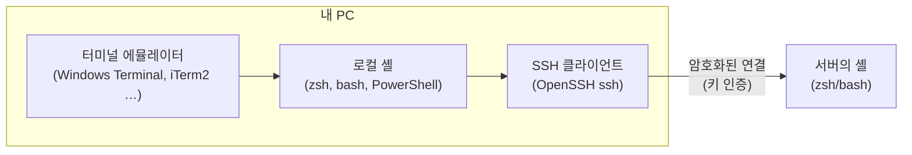
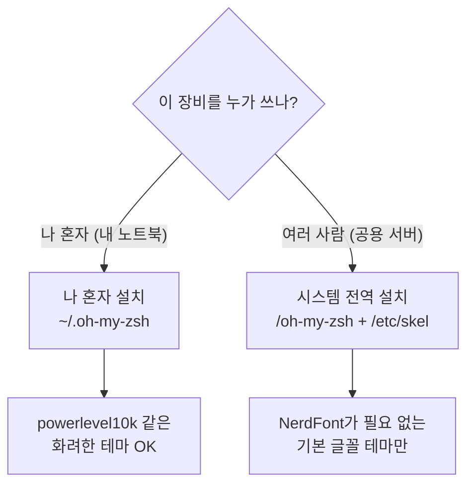

# 부록 J. 내 PC 작업 환경 — 터미널·SSH 클라이언트·셸

**멘탈모델:** 서버 작업은 **내 PC의 터미널 창 → 그 안의 셸 → ssh → 서버의 셸**로 이어지는 사슬입니다. 사슬의 앞쪽 세 고리(터미널·셸·SSH 클라이언트)는 내 PC에 있고, 사람마다 OS가 달라서 가장 많이 어긋나는 곳도 여기입니다.

과학자·연구자·학생과 함께 일하다 보면 모두가 다른 환경을 씁니다. 윈도우·맥·리눅스가 섞이고, 같은 윈도우라도 어떤 사람은 PowerShell, 어떤 사람은 WSL2를 씁니다. 무언가를 설명하려면 먼저 "지금 어디서 무엇을 치고 있는지"부터 맞춰야 합니다. 이 부록은 가장 널리 쓰이는 세 OS(윈도우·맥·리눅스)에서 이 사슬을 맞추는 기본 설정을 모았습니다. 도구를 *설치*하는 방법(Homebrew·WinGet·conda)은 [부록 G](G-packages.md)에 있으니, 여기서는 그 도구로 **무엇을** 깔지만 다룹니다.



## J.1 셸 — 명령을 받아 주는 프로그램

셸은 내가 친 명령을 해석해 실행하는 프로그램입니다. OS마다 기본으로 들어 있는 셸이 다릅니다.

| 셸 | 맥 | 리눅스 | 윈도우 | 윈도우 WSL2 |
| --- | --- | --- | --- | --- |
| bash (배시) | O | O | △ | 리눅스와 같음 |
| zsh (Z 셸) | O | O | △ | 리눅스와 같음 |
| cmd (명령 프롬프트) | | | O | |
| PowerShell (파워셸) | | | O | |

△: Cygwin·MSYS2용 바이너리로 실행합니다(J.3).

이 책의 명령은 모두 bash/zsh 문법입니다. 그래서 셸을 다음처럼 맞추기를 권합니다.

- **윈도우:** WSL2(Windows Subsystem for Linux)를 설치하고, 우분투 최신 버전을 고른 뒤 그 안에 zsh를 설치합니다.
- **리눅스:** 쓰는 배포판에서 zsh를 설치합니다.
- **맥:** 최신 macOS는 기본 셸이 이미 zsh입니다.

```bash
# 윈도우: 관리자 PowerShell에서 WSL2 + 기본 배포판(우분투) 설치, 끝나면 재부팅
wsl --install
# WSL 우분투 또는 데비안·우분투 리눅스 안에서
sudo apt install -y zsh
# Rocky/RHEL 계열이면
sudo dnf install -y zsh
# 확인: 지금 쓰는 셸
echo $SHELL
```

(교재 밖 내용: `wsl --install` 한 줄 설치는 윈도우 10 2004 이상·윈도우 11에서 됩니다. macOS의 기본 셸은 10.15 Catalina부터 zsh입니다.)

## J.2 터미널 에뮬레이터 — 셸을 띄우는 창

터미널 에뮬레이터는 GUI 창 안에서 셸 같은 CLI 프로그램을 실행해 주는 프로그램입니다. 셸과는 다른 층입니다. OS와 함께 깔리는 기본 터미널을 써도 되고, 취향에 따라 다른 것을 골라도 됩니다.

| 이름 | 윈도우 | 리눅스 | macOS |
| --- | --- | --- | --- |
| Windows Terminal (기본) | O | | |
| Cmder (ConEmu 기반) | O | | |
| GNOME Terminal | | O | |
| Konsole | | O | |
| Terminator | | O | |
| Tilix | | O | |
| Terminal.app (기본) | | | O |
| iTerm2 | | | O |
| Hyper (개발 중단 — GitHub 저장소 보관(archived), 마지막 릴리스 2023년) | O | O | O |
| Kitty | | O | O |
| Alacritty | O | O | O |
| Tabby (옛 이름 Terminus) | O | O | O |

고르는 기준은 단순합니다. 처음이라면 OS 기본(Windows Terminal·Terminal.app·GNOME Terminal)으로 시작하고, 창 분할·검색·글꼴이 아쉬워지면 바꿉니다. 터미널을 바꿔도 셸과 그 설정 파일(`~/.zshrc`)은 그대로 따라옵니다.

## J.3 윈도우에서 유닉스 셸을 쓰는 여러 길

WSL2가 나오기 전부터 윈도우에서 bash를 쓰려는 시도는 여럿 있었습니다. 지금도 다른 프로그램에 딸려 깔리는 경우가 많아서, 내 PC에 "bash가 여러 개" 있는 일이 흔합니다. 어느 bash가 어디서 왔는지 알아 두면 경로·패키지가 꼬였을 때 덜 헤맵니다.

| 항목 | 처음 나온 해 | 설명 | 기본 셸 | 패키지 관리자 |
| --- | --- | --- | --- | --- |
| Cygwin | 1995 | 윈도우용 유닉스 비슷한 환경. POSIX 호환 API와 여러 유닉스 도구를 제공 | bash | apt-cyg |
| MinGW | 1998 | Minimalist GNU for Windows. 윈도우용 GNU 개발 환경(GCC, GNU Binutils), 윈도우 API 사용 가능 | 없음 | |
| MinGW-w64 | 2007 | MinGW를 64비트용으로 갈라 나온 것(fork) | 없음 | |
| MSYS2 | 2013 | MinGW 계열에서 갈라 나온 환경 | bash | pacman |
| MobaXterm | | 터미널 에뮬레이터. Cygwin 기반 bash가 함께 깔림 | bash | MobApt (apt-get) |
| Git for Windows | | MinGW-w64 기반 도구가 함께 깔림(흔히 "Git Bash") | bash | |

Cygwin이나 MSYS2 위에 zsh와 oh-my-zsh(J.6)를 올려 쓸 수도 있습니다. 다만 새로 시작한다면 진짜 리눅스 커널 위에서 도는 **WSL2**가 이 책의 명령과 가장 잘 맞습니다.

## J.4 SSH 키 만들기

키를 만드는 명령과 그 의미(ed25519 vs rsa, 키 타입과 지문 해시의 구분, 패스프레이즈)는 [Part 6 §6.1](06-access.md)에, 만든 공개키를 서버에 뿌리는 방법은 [실습⑧ 준비](labs/lab-08.md)와 [§6.2](06-access.md)에 있습니다. 여기서는 OS마다 다른 부분만 짚습니다. (이 절의 OS별 세부는 교재 밖 내용을 보탠 것입니다.)

```bash
# 세 OS 모두 같은 명령 — 윈도우는 PowerShell에서도 그대로 된다 (OpenSSH 클라이언트 내장)
ssh-keygen -t ed25519 -C "⟨me@example.org⟩"
# 지문 확인
ssh-keygen -lf ~/.ssh/id_ed25519.pub
```

| | 키가 저장되는 곳 | 패스프레이즈를 매번 안 치려면 |
| --- | --- | --- |
| 리눅스·WSL2 | `~/.ssh/` | `ssh-agent` + `ssh-add` |
| 맥 | `~/.ssh/` | `ssh-add --apple-use-keychain ~/.ssh/id_ed25519` (키체인에 기억) |
| 윈도우(PowerShell) | `C:\Users\⟨사용자⟩\.ssh\` | `ssh-agent` 서비스를 켜고 `ssh-add` |

```powershell
# 윈도우: 관리자 PowerShell에서 ssh-agent 서비스를 자동 시작으로 켠다 (처음 한 번)
Get-Service ssh-agent | Set-Service -StartupType Automatic
Start-Service ssh-agent
# 그다음 일반 PowerShell에서 키를 등록
ssh-add $env:USERPROFILE\.ssh\id_ed25519
```

```bash
# 리눅스·맥: 개인키 권한이 넓으면 ssh가 키 사용을 거부한다
chmod 700 ~/.ssh
chmod 600 ~/.ssh/id_ed25519
```

⚠️ **WSL2와 윈도우는 홈 디렉터리가 다릅니다.** WSL2 안의 `~/.ssh`와 윈도우의 `C:\Users\⟨사용자⟩\.ssh`는 서로 다른 폴더입니다. 같은 키를 두 곳에 복사해 두기보다, 한쪽에서만 ssh를 쓰는 습관이 사고(키 사본이 여기저기 남는 일)를 줄입니다.

## J.5 SSH 클라이언트 — 무엇으로 접속하나

기본은 **OpenSSH 클라이언트**, 곧 터미널에서 `ssh`라고 치는 그 명령입니다. 세 OS 모두에 들어 있고, 이 책의 `~/.ssh/config`·`ProxyJump`·`Include`([§1.3](01-image.md), [§3.5](03-network.md))가 그대로 통합니다. 그 위에 GUI 클라이언트를 고를 수도 있습니다.

| 클라이언트 | 라이선스 | 맥 | 윈도우 | 리눅스 | 스마트폰 | 비고 |
| --- | --- | --- | --- | --- | --- | --- |
| OpenSSH Client | BSD | O | O | O | | 터미널의 `ssh` 명령 |
| iTerm2 | GPL v2 | O | | | | 맥 터미널 에뮬레이터 |
| Termius | 상용(무료 등급 있음) | O | O | O | O | GitHub Student Developer Pack에 포함(작성 시점) |
| PortX | 상용(무료 등급 있음) | O | O | O | O | |
| PuTTY | MIT | O | O | O | | |
| MobaXterm | 상용(Home Edition 무료) | | O | | | |
| mRemoteNG | GPL v2 | | O | | | SSH, 윈도우 RDP, VNC, Telnet, PowerShell을 한 창에서 |
| SecureCRT | 상용(유료) | O | O | O | | |
| Xshell | 개인 무료·기업 유료 | | O | | | |

라이선스 칸이 왜 중요한지는 [부록 B](B-licenses.md)와 [§1.8](01-image.md)의 Anaconda 이야기와 같습니다. "개인 무료"인 도구를 기관 PC에 깔면 그 자체로 라이선스 위반이 될 수 있습니다.

설치는 [부록 G](G-packages.md)의 패키지 관리자로 합니다.

```bash
# Termius — 맥
brew install --cask termius
# Termius — 리눅스
snap install termius-app
# PortX — 맥
brew install --cask portx
# PortX — 리눅스
snap install portx --classic
```

```powershell
# Termius — 윈도우
winget install --id=Termius.Termius -e
# PortX — 윈도우 (정확한 ID는 winget search portx 로 확인)
winget install portx
# mRemoteNG — 윈도우
winget install -e --id mRemoteNG.mRemoteNG
```

스마트폰용 Termius·PortX는 구글 플레이·앱스토어에서 받습니다.

⚠️ **GUI 클라이언트에 키와 비밀번호를 "저장"하는 기능**은 편하지만, 그 앱(과 동기화 기능이 있다면 그 회사의 클라우드)이 내 열쇠를 들고 있게 됩니다. 저장 위치와 암호화 방식을 확인하고, 비밀번호 저장은 끄고 키 인증만 쓰는 쪽을 권합니다([Part 6](06-access.md)).

## J.6 셸 꾸미기 — oh-my-zsh

[oh-my-zsh](https://ohmyz.sh)는 zsh 설정을 관리해 주는 도우미입니다. 명령 자동 추천(지난 기록에서), 문법 강조, git 브랜치 표시 같은 기능을 테마와 플러그인으로 제공합니다. 테마 목록은 [ohmyzsh 위키의 Themes](https://github.com/ohmyzsh/ohmyzsh/wiki/Themes)에서 고릅니다. 설치 방법은 두 가지입니다.



### 나 혼자 설치 — `$HOME/.oh-my-zsh`

```bash
sh -c "$(curl -fsSL https://raw.githubusercontent.com/ohmyzsh/ohmyzsh/master/tools/install.sh)"
```

⚠️ 인터넷에서 받은 스크립트를 바로 셸에 넘기는 형태입니다. 공식 저장소 주소인지 한 번 더 보고, 불안하면 먼저 파일로 받아(`curl -fsSL ⟨URL⟩ -o install.sh`) 읽어 본 뒤 실행합니다.

**맥에서 나 혼자 쓴다면 powerlevel10k.** [powerlevel10k](https://github.com/romkatv/powerlevel10k)는 zsh용 테마로, 매우 빠르고 정보가 풍부합니다. 다만 저장소 첫머리에 밝혀 둔 대로 지금은 **지원이 매우 제한된** 상태입니다(새 기능 없음, 대부분의 버그는 고치지 않음, 도움 요청에 답하지 않음). 지금 그대로 잘 동작하지만, 문제가 생기면 스스로 해결하거나 다른 테마로 옮겨야 한다는 뜻입니다.

```bash
# 내 oh-my-zsh의 custom 테마 폴더에 받는다
git clone --depth=1 https://github.com/romkatv/powerlevel10k.git ${ZSH_CUSTOM:-$HOME/.oh-my-zsh/custom}/themes/powerlevel10k
# 테마 지정 (~/.zshrc 의 ZSH_THEME 을 바꿔 준다)
omz theme set powerlevel10k/powerlevel10k
```

⚠️ **powerlevel10k는 여러 사람이 쓰는 서버에 설치하지 않습니다.** 아이콘·특수문자를 표시하려고 NerdFont라는 글꼴을 쓰는데, 서버의 프롬프트는 *접속한 사람의 PC 글꼴*로 그려지므로 이 글꼴이 없는 PC에서는 프롬프트가 깨져 보입니다. 그래서 위 갈림길에서 "나 혼자"일 때만 권합니다.

### 시스템 전역 설치 — `/oh-my-zsh`

공용 서버에서는 사용자마다 따로 깔지 않고 한 곳(`/oh-my-zsh`)에 한 번 깔아 모두가 같이 씁니다. 새로 만드는 계정이 처음부터 zsh와 같은 설정을 갖게 하는 것이 목표입니다. [§1.3](01-image.md)에서 말한 **조직 공용 점 파일**의 가장 단순한 형태입니다. 아래 절차를 스크립트로 묶은 것이 [실습①](labs/lab-01.md)에서 심는 [KREONET/ohmyzsh](https://github.com/KREONET/ohmyzsh)이고, 그쪽은 여기에 [§1.7](01-image.md)의 자산 태그 표시까지 얹었습니다. 손으로 따라 하면 무엇이 어디에 놓이는지 보입니다.

```bash
# 이하 모두 root로 실행
sudo -s

# 필요한 패키지 — Rocky/RHEL 계열
dnf -y install vim git zsh tmux sqlite
# 필요한 패키지 — 데비안/우분투 계열
apt -y install vim git zsh tmux tree sqlite3

# 본체를 /oh-my-zsh 에
ZSH=/oh-my-zsh
git clone --depth=1 https://github.com/ohmyzsh/ohmyzsh $ZSH

# 플러그인 두 개: 지난 기록에서 명령 추천, 문법 강조
ZSH_CUSTOM=$ZSH/custom
git clone --depth=1 https://github.com/zsh-users/zsh-autosuggestions $ZSH_CUSTOM/plugins/zsh-autosuggestions
git clone --depth=1 https://github.com/zsh-users/zsh-syntax-highlighting $ZSH_CUSTOM/plugins/zsh-syntax-highlighting
```

이제 사용자에게 나눠 줄 `.zshrc` 원본(템플릿)을 고칩니다. 본체 위치를 `/oh-my-zsh`로, 테마를 `dallas`로, 플러그인을 위의 둘로 바꾸고, 자동 업데이트는 끕니다(공용 본체를 사용자 셸이 제멋대로 갱신하지 않게).

```bash
ZSHRC=$ZSH/templates/zshrc.zsh-template
sed -i $ZSHRC -e 's#^export ZSH=$HOME/.oh-my-zsh#export ZSH=/oh-my-zsh#g'
sed -i $ZSHRC -e 's/^ZSH_THEME="robbyrussell"/ZSH_THEME="dallas"/g'
sed -i $ZSHRC -e 's/^plugins=.git.$/plugins=(git zsh-autosuggestions zsh-syntax-highlighting)/g'
sed -i $ZSHRC -e 's/^# DISABLE_AUTO_UPDATE="true"/DISABLE_AUTO_UPDATE="true"/g'

# 공통 alias와 언어 설정을 템플릿 끝에 덧붙인다
cat << 'EOL' >> $ZSHRC
alias ls='ls --color=tty --time-style="+%Y-%m-%d %a %H:%M:%S"'
alias vi='vim'

export LANG=en_US.UTF-8
export LC_ALL=en_US.UTF-8
EOL
```

`ls`의 `--time-style`은 날짜를 `2025-01-31 Fri 13:05:09`처럼 연-월-일·요일·초까지 보여 줍니다. 로그와 파일 시각을 맞춰 볼 때 편합니다.

**새 계정이 자동으로 받게 하기.** 리눅스는 계정을 만들 때 `/etc/skel` 안의 파일을 새 홈 디렉터리로 복사합니다. 여기에 템플릿을 넣고, 새 계정의 기본 셸을 zsh로 바꿉니다.

```bash
cp /oh-my-zsh/templates/zshrc.zsh-template /etc/skel/.zshrc
# useradd 의 기본 셸을 zsh로 (zsh가 있을 때만)
[ -x /bin/zsh ] && sed -i 's#^SHELL=.*#SHELL=/bin/zsh#' /etc/default/useradd
```

**이미 있는 계정(root 포함)은 직접.**

```
# cp /oh-my-zsh/templates/zshrc.zsh-template ~/.zshrc

# chsh
Changing shell for root.
New shell [/bin/bash]
/bin/zsh
Shell changed.
```

**bash 기록 이어받기(필요하면).** zsh-autosuggestions는 `~/.zsh_history`에서 명령을 추천합니다. bash를 쓰던 계정이라면 기록을 복사해 두면 첫날부터 추천을 받습니다.

```bash
# 원본은 남겨 두고 복사한다
cp ~/.bash_history ~/.zsh_history
```

⚠️ **공용 본체는 root만 고칩니다.** `/oh-my-zsh`는 모든 사용자의 셸이 읽어 들이는 코드입니다. 일반 사용자가 쓸 수 있는 권한이면 한 사람이 모두의 셸에 코드를 심을 수 있습니다. `ls -ld /oh-my-zsh`로 소유자가 root이고 그룹·기타에 쓰기 권한이 없는지 확인합니다.

## J.7 한 장 요약

| 고리 | 윈도우 | 맥 | 리눅스 |
| --- | --- | --- | --- |
| 터미널 | Windows Terminal | Terminal.app / iTerm2 | GNOME Terminal 등 |
| 셸 | WSL2 우분투 + zsh | zsh (기본) | zsh 설치 |
| SSH 클라이언트 | OpenSSH (내장) | OpenSSH (내장) | OpenSSH |
| 키 | `ssh-keygen -t ed25519` ([§6.1](06-access.md)) | 같음 + 키체인 | 같음 |
| 셸 꾸미기 | oh-my-zsh (WSL2 안) | oh-my-zsh + powerlevel10k | 공용 서버면 전역 설치, powerlevel10k 금지 |
| 설치 도구 | WinGet ([부록 G](G-packages.md)) | Homebrew | apt/dnf |
