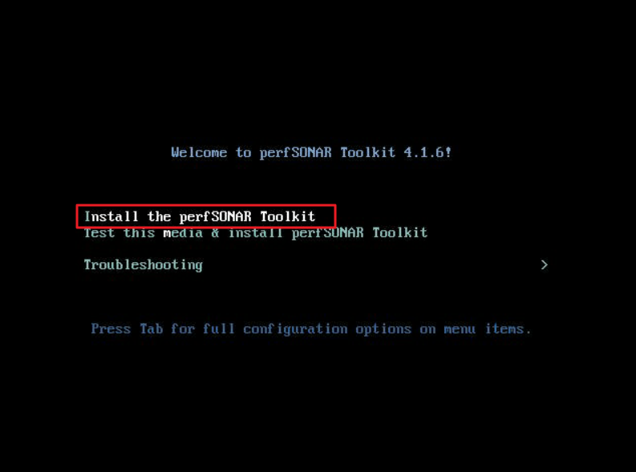
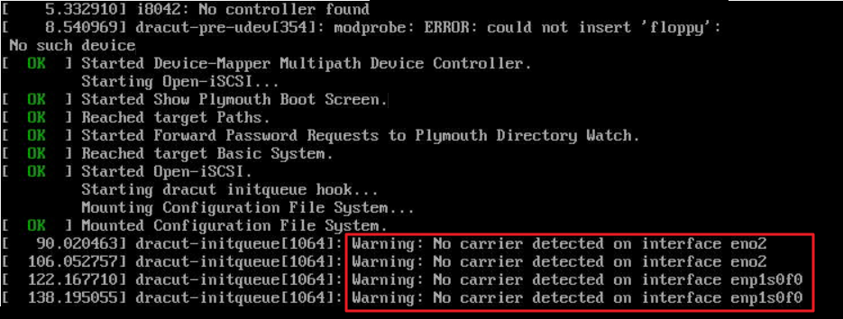
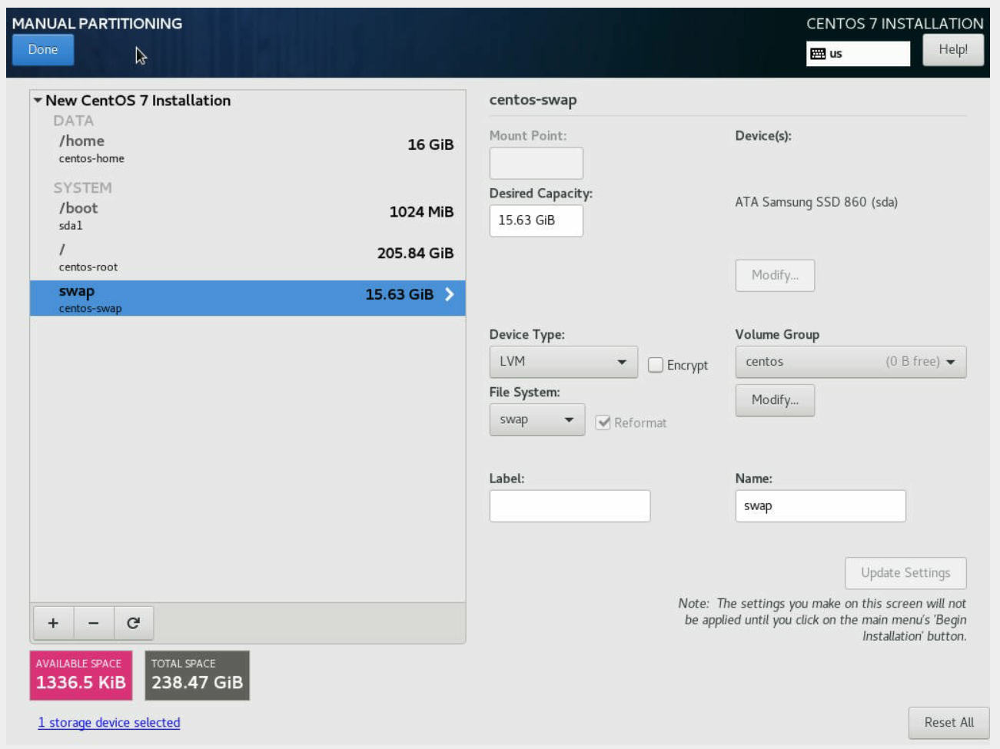
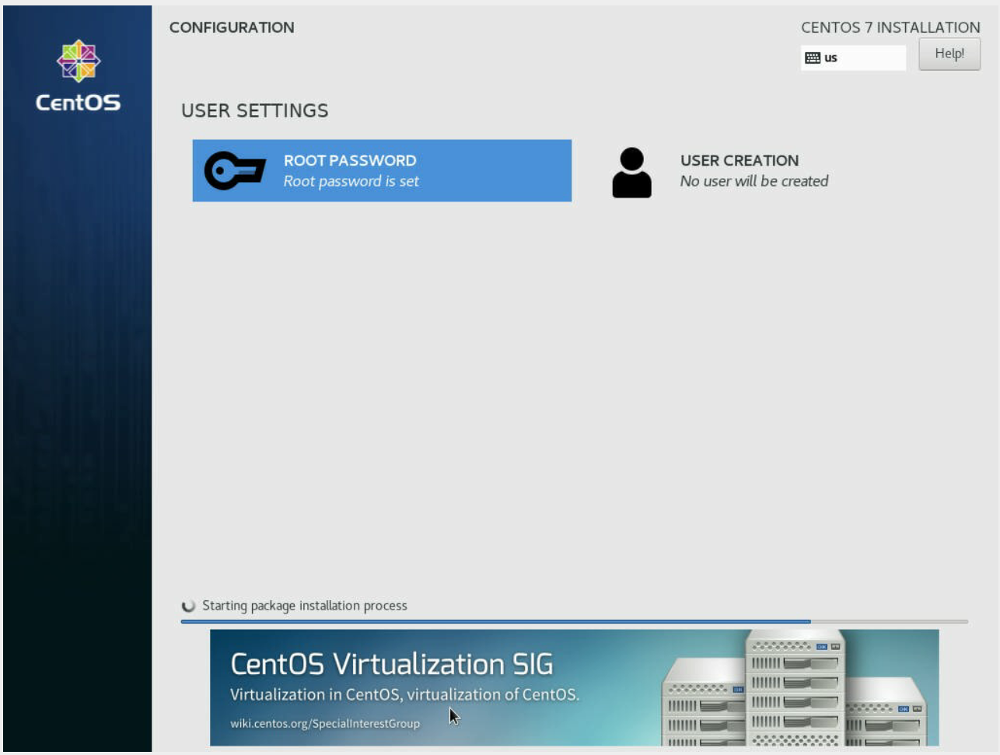

# 부록 K. 서버 납품·인수 — 받는 날 확인할 것

**멘탈모델:** 납품받는 날은 서버의 **신원 기록이 처음이자 가장 싸게 만들어지는 날**입니다. 박스를 뜯고 랙에 넣고 나면 시리얼 한 줄을 확인하는 데도 랙 뒤로 들어가야 합니다.

[Part 1 §1.7](01-image.md)에서 "장비는 여러 층의 이름표를 가져야 하고, 그 이름표들이 서로 일치하는지 확인하는 것이 인수 절차"라고 했습니다. 이 부록은 그 인수 절차를 **납품 업체에게 무엇을 요청하고, 받는 날 무엇을 대조하는가**의 순서로 정리한 것입니다. 기관이 납품 업체에 주는 "납품 가이드"로 그대로 써도 되도록 썼습니다.


## K.1 납품 전에 받을 것 ① — 개요 표

납품 전에 서버별로 다음 표를 스프레드시트로 받습니다. 한 줄이 서버 한 대입니다.

| 납품처 | 납품처 태그 번호 | 제조사 | 모델명 | 시리얼 번호 | IPMI MAC | 비고 |
| --- | --- | --- | --- | --- | --- | --- |
| 총판·납품 업체 정보 | K.4 참고 | | | K.4 참고 | K.4 참고 | |

- **납품처:** 계약 업체만이 아니라 **실제로 물건을 가져오고 AS를 할 업체**(1차 리셀러·총판)까지 적게 합니다. 이유는 [§1.7 「고장 났을 때 누구에게 전화하나」](01-image.md)에.
- **시리얼 번호:** 서버에 붙은 서비스 태그와 리눅스 명령으로 읽은 값이 **같은지 확인한 뒤** 적게 합니다(K.4).
- **IPMI MAC:** 관리 포트(BMC)의 MAC입니다. 본체 NIC의 MAC과 다른 값입니다. 관리망 DHCP 예약의 키가 됩니다.

⚠️ **계정·비밀번호는 표와 메일 본문에 적지 않습니다.** 업체가 설정한 IPMI 계정·비밀번호와 root 비밀번호는 납품 직후 기관이 바꿀 *임시값*이고, 표와 다른 경로(전화·대면, 또는 기관이 정한 비밀 전달 수단)로 받습니다. 받은 즉시 바꾸고(K.5), 바꾼 값은 어디에도 평문으로 남기지 않습니다. 비밀번호를 파일로 다룰 때의 요령은 [실습①](labs/lab-01.md)의 `file:pass.txt` → `shred -u` 방식을 따릅니다.

## K.2 납품 전에 받을 것 ② — 서버마다 inxi 결과 파일

서버마다 `inxi -F` 결과를 `inxi-⟨제조사⟩-⟨모델⟩-⟨시리얼⟩.txt` 이름의 파일로 받습니다. 파일 이름만 보고도 어느 장비인지 알 수 있고, 표의 시리얼과 파일 이름·파일 내용이 서로 대조됩니다.

```bash
# 파일 이름 예: inxi-Supermicro-SYS-2029U-TN24R4T-⟨시리얼⟩.txt
sudo inxi -F > inxi-⟨제조사⟩-⟨모델⟩-⟨시리얼⟩.txt
```

받은 파일에서 볼 곳은 이렇습니다(아래는 출력의 일부, 값은 예시로 바꿨습니다).

```
System:
  Host: localhost Kernel: 4.18.0-372.9.1.el8.x86_64 arch: x86_64 bits: 64
    Distro: Rocky Linux release 8.6 (Green Obsidian)
Machine:
  Type: Kvm System: Supermicro product: SYS-2029U-TN24R4T v: 0123456789 serial: ⟨SYSTEM-SERIAL⟩
  Mobo: Supermicro model: X11DPU v: 1.10 serial: ⟨BOARD-SERIAL⟩ UEFI: American Megatrends v: 3.4
CPU:
  Info: 2x 12-core model: Intel Xeon Gold 6246 bits: 64 type: MT MCP SMP
Network:
  Device-1: Intel Ethernet 10G X550T driver: ixgbe
  IF: eno1 state: down mac: 02:00:00:00:00:01
  Device-5: Mellanox MT27800 Family [ConnectX-5] driver: mlx5_core
  IF: ens1 state: up speed: 100000 Mbps duplex: full mac: 02:00:00:00:00:05
RAID:
  Device-1: md125 type: mdraid level: raid-5 status: active size: 6.91 TiB report: 9/9 UUUUUUUUU
Drives:
  ID-1: /dev/nvme0n1 vendor: Samsung model: SSD 970 PRO 512GB size: 476.94 GiB
  ID-2: /dev/nvme1n1 vendor: Intel model: SSDPE2KX010T8 size: 931.51 GiB
Sensors:
  Src: ipmi System Temperatures: cpu-1: 51 C cpu-2: 53 C mobo: 28 C
  Fan Speeds (RPM): fan-1: 3400 fan-2: 3400 fan-7: 3900 fan-8: 3900
Info:
  Memory: 187.32 GiB
```

- **Machine:** 제조사·모델·**시스템 시리얼**(`System … serial`)과 메인보드 시리얼(`Mobo … serial`). 표에는 시스템 시리얼을 적습니다.
- **CPU·Info(Memory)·Drives:** 발주한 사양과 같은지. CPU 개수·코어 수, 메모리 총량, 디스크 개수·용량을 견적서와 대조합니다.
- **Network:** NIC 종류와 MAC. 고속 NIC(예: 100G)가 `state: up`이고 속도가 맞는지.
- **RAID:** 구성한 RAID 수준과 상태(`status: active`, 모든 디스크 `U`).
- **Sensors:** 온도·팬이 읽히는지. 처음부터 안 읽히는 센서는 BMC 설정·펌웨어 문제일 수 있습니다.

## K.3 납품하는 날 — 자산 태그 부착과 사진

- 서버 **전면**에 기관의 자산 태그를 붙입니다. 전면에 붙일 자리가 없으면 손잡이 등에 **네임 태그(매다는 꼬리표)** 를 달고 거기에 자산 태그를 붙입니다.
- 붙인 뒤 **사진을 찍어 회신**받습니다. 사진 한 장에 자산 태그와 장비 전면(가능하면 서비스 태그까지)이 함께 보이게 하면, 나중에 "이 자산 번호가 어느 장비냐"를 사진으로 대조할 수 있습니다.

자산 태그를 *서버 안에도* 기록해 접속한 순간 보이게 하는 방법은 [§1.7](01-image.md)의 `/etc/tag1`·`/etc/tag2`를 봅니다.

## K.4 받는 날 대조할 이름표들

### 총판·납품처 태그 (KC 라벨)

국내 유통 서버에는 보통 수입·판매 업체가 붙인 **KC 인증 라벨**이 있습니다. 대개 다음 항목이 적혀 있습니다.

| 항목 | 무엇 |
| --- | --- |
| 모델명 | 국내 인증을 받은 모델명(제조사 모델명과 다를 수 있음) |
| 상호명 | 인증을 받은 국내 업체 — **AS 창구 후보** |
| 제조사 | 원 제조사 |
| QR / 관리 번호 | 업체의 관리 번호 — 표의 "납품처 태그 번호" |
| 인증번호 | KC 인증번호 |
| 제조년월 | 보증 기간을 가늠하는 단서 |
| 고객지원센터 | AS 접수 전화 |

여기서 "상호명"과 "고객지원센터"가 [§1.7](01-image.md)에서 말한 **실제 AS 업체**를 찾는 가장 빠른 단서입니다. 인벤토리에 함께 옮겨 적습니다.

### 제조사 시리얼(서비스 태그)

서버 앞이나 옆의 당겨 빼는 라벨 판(pull-out tag)이나 섀시 스티커에 바코드와 함께 제조사 시리얼이 적혀 있습니다. 이 값과 **리눅스에서 읽은 값이 같아야** 표에 적습니다. 다르면 메인보드가 교체됐거나 다른 장비의 라벨이 붙은 것이니 그 자리에서 업체에 묻습니다.

```bash
# inxi 출력에서 시리얼만
sudo inxi -F | grep serial
# 같은 값을 SMBIOS에서 직접 (교재 밖 내용: dmidecode는 대부분 배포판에 기본 포함)
sudo dmidecode -s system-serial-number
sudo dmidecode -s baseboard-serial-number
```

```
  Type: Kvm System: Supermicro product: SYS-2029U-TN24R4T v: 0123456789 serial: ⟨SYSTEM-SERIAL⟩
  Mobo: Supermicro model: X11DPU v: 1.10 serial: ⟨BOARD-SERIAL⟩ UEFI: American Megatrends v: 3.4
```

### IPMI MAC

두 가지로 확인합니다.

1. 제조사가 서버에 붙인 스티커나 서비스 태그에 적혀 있는 경우가 있습니다.
2. 리눅스 명령으로 읽습니다.

```
# ipmitool lan print 1
IP Address Source       : DHCP Address
IP Address              : 192.168.0.29
MAC Address             : 02:00:00:00:00:a1
...
```

## K.5 IPMI 설정

| 항목 | 값 | 명령 |
| --- | --- | --- |
| IPMI 주소 | DHCP | `sudo ipmitool lan set 1 ipsrc dhcp` |
| 계정 ID | 납품 업체가 임의로 정함 → 인수 후 기관이 변경 | |
| 비밀번호 | 납품 업체가 임의로 정함 → 인수 후 기관이 변경 | |

IPMI 주소를 DHCP로 두면, 기관은 K.1 표의 **IPMI MAC으로 관리망 DHCP 예약**을 걸어 주소를 정합니다. 장비마다 콘솔에 붙어 고정 IP를 넣는 일이 사라집니다.

인수 직후 업체가 정한 IPMI 비밀번호를 바꿉니다. (교재 밖 내용: 아래는 ipmitool의 일반적 사용법입니다. 사용자 번호는 벤더마다 다르니 먼저 목록을 봅니다.)

```bash
# 채널 1의 사용자 목록 — 관리자 계정의 ID 번호를 확인
sudo ipmitool user list 1
# 비밀번호를 명령줄에 적지 않는다 — 값을 생략하면 프롬프트로 묻는다
sudo ipmitool user set password ⟨ID번호⟩
```

⚠️ **IPMI는 원격 콘솔이고, 콘솔은 곧 루트입니다**([§1.6](01-image.md)). 기본 계정·약한 비밀번호를 그대로 두지 않고, IPMI 포트는 업무망이 아니라 **관리망**에만 연결합니다.

## K.6 OS 설치 — Rocky Linux 8 (납품용)

> ⚠️ 이 절은 납품 가이드를 처음 만든 시점(Rocky Linux 8.7)의 값입니다. Rocky 8은 아직 유지보수 기간이지만 새로 들이는 장비라면 Rocky 9 이상을 권합니다. 9에서 달라지는 점은 각 단계 아래에 적었습니다.

### 설치 화면에서 고를 것

| 항목 | 값 |
| --- | --- |
| OS | Rocky Linux 8.7 |
| 언어(Localization) | English, US |
| 시간대(Timezone) | Asia/Seoul |
| 소프트웨어(Environment) | **Server** (GUI 없음) + 아래 그룹 추가 |
| 파티션 | `/home` 파티션을 없애고 `/`(root)를 최대로 |
| 네트워크 | 첫 번째 랜 인터페이스 켜기(on), DHCP |
| 계정 | root 계정만 (일반 사용자는 만들지 않음) |

**추가할 패키지 그룹:**

```
@headless-management
@legacy-unix
@network-file-system-client
@performance
@system-tools
```

**가상화 호스트로 쓸 경우 추가로:**

```
@development
@container-management
@guest-agents
@virtualization-client
@virtualization-hypervisor
@virtualization-tools
```

**파티션.** 설치 화면의 자동 파티션은 디스크를 `/`와 `/home`으로 나눕니다. 서버는 `/home`을 거의 쓰지 않으므로 `/home`을 지우고(`-` 버튼) `/`의 크기 칸에 `9999GB`처럼 큰 값을 넣으면 할당 가능한 최대 용량으로 바뀝니다.

**계정.** 납품 단계에서는 root만 만들고, 일반 계정과 SSH 키는 인수 후 기관이 만듭니다. 인수 후에는 root 비밀번호 로그인을 막고 키 인증으로 바꿉니다([Part 6 §6.3](06-access.md)).

### 기본 소프트웨어

먼저 패키지 저장소를 가까운 **국내 미러**로 바꿉니다(설치 속도 차이가 큽니다). (교재 밖 내용: Rocky 8의 저장소 파일은 `/etc/yum.repos.d/Rocky-*.repo`이고, 9 이상은 `rocky*.repo`입니다. `mirrorlist`를 끄고 `baseurl`을 미러 주소로 바꾸는 방식입니다. 미러 목록은 <https://mirrors.rockylinux.org/>에서 고릅니다.)

```bash
# 원본은 .bak 으로 남긴다. ⟨mirror.example.org/rocky⟩ 자리에 고른 미러 주소
sed -e 's|^mirrorlist=|#mirrorlist=|g' \
    -e 's|^#baseurl=http://dl.rockylinux.org/$contentdir|baseurl=https://⟨mirror.example.org/rocky⟩|g' \
    -i.bak /etc/yum.repos.d/Rocky-*.repo
dnf clean all
dnf makecache
```

그다음 기본 도구를 깝니다.

```bash
dnf -y install epel-release
# Rocky 8: PowerTools 저장소 켜기
dnf config-manager --set-enabled powertools
dnf -y install tmux tree git zsh sqlite net-tools ipmitool lshw inxi htop hwloc-gui
```

Rocky 9 이상에서는 `powertools` 저장소의 이름이 **`crb`**(CodeReady Builder)로 바뀌었습니다.

```bash
# Rocky 9 이상
dnf config-manager --set-enabled crb
```

`inxi`·`htop`은 EPEL에 있고, EPEL 패키지 중 일부는 PowerTools/CRB의 패키지에 기대므로 EPEL을 쓸 때는 둘을 함께 켜는 것이 관례입니다. 셸 환경(zsh + oh-my-zsh 전역 설치)은 [부록 J §J.6](J-workstation.md)이나 [실습①](labs/lab-01.md)의 KREONET/ohmyzsh로 이어서 얹습니다.

### 고속 NIC 드라이버

100G급 NIC(예: Mellanox ConnectX 계열)는 배포판 기본 드라이버로 인식되더라도, 기능·성능을 위해 제조사 드라이버나 포트 모드(InfiniBand ↔ Ethernet) 변경이 필요한 경우가 있습니다. 이는 NIC 제조사의 설치 문서를 따르고, 설치 후 K.2의 `inxi -F` Network 항목에서 속도와 `state: up`을 다시 확인합니다.

## K.7 perfSONAR 장비 (납품용)

> ⚠️ 이 절은 perfSONAR Toolkit 4.1(CentOS 7 기반 ISO) 시절의 절차와 화면입니다. CentOS 7은 수명이 끝났고, perfSONAR 5.0(2023년)부터는 Toolkit ISO를 더 내지 않고, 지원되는 배포판(EL 계열·Ubuntu·Debian) 위에 `dnf`/`apt` 패키지 묶음(bundle)으로 설치하는 방식으로 바뀌었습니다(이 글을 쓰는 시점의 최신은 5.2.x). 새로 설치한다면 [perfSONAR 설치 문서](https://docs.perfsonar.net/install_getting.html)를 먼저 확인하세요. 여기 남긴 것은 **이미 그 방식으로 납품된 장비를 인수·점검할 때** 무엇을 봐야 하는지 알기 위해서입니다.

perfSONAR는 iperf 같은 네트워크 성능 측정 도구를 묶어 배포하는 도구 모음입니다. 왜 이 책의 범위 밖인지는 [§3.6](03-network.md)에 적었습니다.

### 설치 미디어 부팅

부팅 메뉴에서 **첫 번째 항목(Install the perfSONAR Toolkit)** 을 고릅니다. 두 번째(Test this media & install)는 미디어 무결성을 검사하느라 오래 걸립니다.



부팅 중 `Warning: No carrier detected on interface …`가 뜨고 한참 멈춰 있어도 당황하지 않습니다. 해당 랜 포트에 케이블이 연결되지 않았다는 알림이고, 기다리는 시간(timeout)이 길게 잡혀 있어서 **인터페이스 하나당 1~2분**씩 걸립니다.



### 설치 설정

설치 화면은 CentOS 7과 같습니다. 시간대는 서울, 키보드는 영어로 둡니다.

**파티션.** 디스크를 고른 뒤 *I will configure partitioning*을 누릅니다. 같은 용량의 디스크가 두 개라면 RAID1(복제)로 묶습니다(Volume Group의 *Modify*에서 바꿀 수 있습니다). `/home`은 거의 쓰지 않으므로 `-` 버튼으로 지우고, `/`의 크기에 `999GB`를 넣으면 할당 가능한 최대 용량으로 바뀝니다.



**네트워크·호스트명.** 측정에 쓸 인터페이스를 켜고(*ON*), 고정 주소·게이트웨이·DNS와 호스트명을 넣습니다.

| 항목 | 값 |
| --- | --- |
| DNS | `⟨기관 DNS⟩`, `8.8.8.8` |

**root 비밀번호.** root 비밀번호만 설정하고 사용자는 만들지 않습니다.



### 첫 부팅 후 초기 설정 — 웹 관리자 계정

설치가 끝나고 재부팅하면 root로 로그인해 설정합니다. 첫 로그인 때 환영 메시지가 웹 관리자 계정을 만들라고 안내합니다. 직접 실행하려면 다음 스크립트입니다.

```
# sudo /usr/lib/perfsonar/scripts/nptoolkit-configure.py
perfSONAR Toolkit customization script
1. Change Timezone
2. Manage Web Users
0. exit
Make a selection: 2
...
1. Add a new user
2. Delete a user
3. Change a user's password
0. exit
Make a selection: 1
Enter the user whose account you'd like to add. Just hit enter to exit: ⟨새 관리자 ID⟩
New password:
Re-type new password:
```

이어서 스크립트가 *sudo 사용자를 만들고 root SSH 로그인을 끌지* 묻습니다. `yes`를 고르면 root로는 더 이상 SSH 접속이 안 되므로, 만든 sudo 계정의 ID와 비밀번호를 **확실히 기억한 뒤** 진행합니다. 지금 root로 SSH 접속 중이라면 그 세션은 로그아웃할 때까지 유지됩니다.

### SSH 포트·방화벽 바꾸기

SSH 포트를 22에서 `⟨9999⟩`로 바꾸는 예입니다. 네 가지를 함께 바꿔야 합니다. 설정, SELinux 라벨, 방화벽, 서비스 재시작입니다.

```
# vi /etc/ssh/sshd_config
수정 전:  #Port 22
수정 후:  Port 9999
(맨 앞의 # 을 지워야 적용된다)
```

```bash
# SELinux가 켜진 RHEL 계열은 새 포트에 ssh 라벨을 붙여야 sshd가 그 포트를 연다 (§1.4)
sudo semanage port -a -t ssh_port_t -p tcp 9999
# 방화벽: 지금 바로(런타임) + 재부팅 후에도(영구)
sudo firewall-cmd --add-port=9999/tcp
sudo firewall-cmd --add-port=9999/tcp --permanent
# 문법 검사 후 재시작
sudo sshd -t
sudo systemctl restart sshd.service
```

⚠️ 재시작한 뒤 **지금 세션을 닫지 말고** 다른 터미널에서 `ssh -p 9999 ⟨계정⟩@⟨장비⟩`로 새 접속이 되는지 먼저 확인합니다([§6.3](06-access.md)). 새 배포판(OpenSSH 8.2 이상, `Include /etc/ssh/sshd_config.d/*.conf`가 있는 설정)이라면 본문을 고치지 말고 `/etc/ssh/sshd_config.d/` 아래 조각 파일에 `Port 9999` 한 줄을 두는 쪽이 낫습니다([§1.3](01-image.md)).

### 고속 NIC 드라이버

K.6의 「고속 NIC 드라이버」와 같습니다.

## K.8 인수 체크리스트

받는 날, 한 대씩 이 표를 채웁니다.

| # | 확인 | 어떻게 | 됨 |
| --- | --- | --- | --- |
| 1 | 개요 표에 이 장비 줄이 있다 | K.1 | ☐ |
| 2 | 서비스 태그 시리얼 = `inxi -F`/`dmidecode` 시리얼 = 표의 시리얼 | K.4 | ☐ |
| 3 | `inxi -F` 사양(CPU·메모리·디스크·NIC)이 견적과 같다 | K.2 | ☐ |
| 4 | RAID가 의도한 수준이고 모든 디스크가 정상 | K.2 | ☐ |
| 5 | IPMI MAC = 스티커 = `ipmitool lan print 1` | K.4 | ☐ |
| 6 | IPMI가 DHCP이고, 관리망 DHCP 예약을 걸었다 | K.5 | ☐ |
| 7 | IPMI·root 임시 비밀번호를 바꿨다 (평문 기록 없음) | K.1, K.5 | ☐ |
| 8 | 자산 태그가 전면에 붙어 있고 사진을 받았다 | K.3 | ☐ |
| 9 | KC 라벨의 상호명·고객지원센터를 **AS 창구**로 인벤토리에 적었다 | K.4, [§1.7](01-image.md) | ☐ |
| 10 | (선택) `/etc/tag1`·`/etc/tag2`에 모델·자산 번호를 넣었다 | [§1.7](01-image.md) | ☐ |
