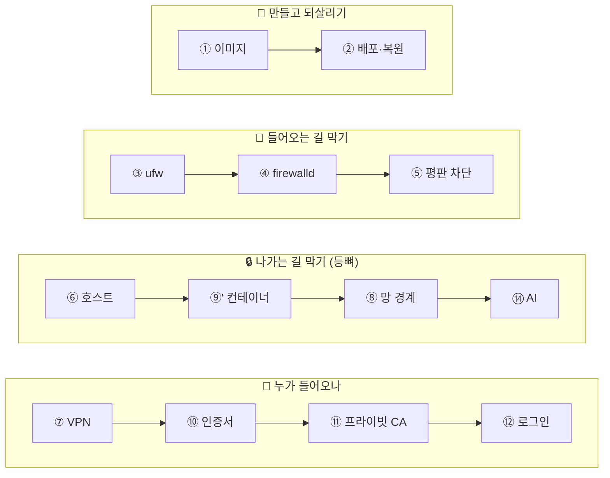

# 지도 — 시작점 고르기 {#map}

이 책은 **1쪽부터 차례로 읽지 않아도 됩니다.** 지금 내 상황에 가장 가까운 질문을 골라 거기서 들어가세요. 모든 실습 끝에는 **🔀 갈림길**이 있어서, 궁금한 쪽을 골라 다음 장으로 넘어가면 됩니다. 게임북과 같은 방식입니다. 길을 잃으면 언제든 이 지도로 돌아오세요.

## 상황별 시작점 {#by-situation}

| 이런 게 궁금하거나 급하다면 | 여기서 시작 | 더 깊이 |
| --- | --- | --- |
| 똑같은 서버를 여러 대, 매번 같게 만들고 싶다 | [① 클라우드 이미지](labs/lab-01.md) | [Part 1](01-image.md) |
| 팀원마다 접속 방법·도구 설정이 제각각이다 | [⑧의 ssh `conf.d`](labs/lab-08.md) | [Part 1 §1.3 점 파일](01-image.md) |
| 설정을 `sed`로 고치다 꼬였다 | [①의 드롭인 얹기](labs/lab-01.md) | [Part 1 §1.3](01-image.md) |
| 디스크가 죽었다 / 랜섬웨어가 걱정된다 / 되돌리고 싶다 | [② 배포·복원](labs/lab-02.md) | [Part 1 §1.5](01-image.md) |
| 루트 비번을 잃어버렸다 | [②ⓕ 루트 비번 복구](labs/lab-02.md) | [Part 1 §1.6](01-image.md) |
| RHEL에서 설정은 맞는데 서비스가 시작되지 않는다 | [①의 SELinux 경고](labs/lab-01.md) | [Part 1 §1.4](01-image.md) |
| 컨테이너가 뭔지, 프로세스·환경변수·`PATH`부터 감을 잡고 싶다 | [⑨ compose로 띄우고 써보기](labs/lab-09.md) | [Part 4 §4.0](04-container.md) |
| ufw를 켰는데 도커 포트가 밖에서 열려 있다 | [③ ufw가 왜 뚫리지](labs/lab-03.md) | [Part 2](02-firewall.md) |
| firewalld의 zone이 헷갈린다 | [④ firewalld trusted zone](labs/lab-04.md) | [Part 2](02-firewall.md) |
| 로그에 모르는 IP의 접속 시도가 계속 찍힌다 | [⑤ 인바운드 선차단](labs/lab-05.md) | [Part 2 §2.5](02-firewall.md) |
| 특정 국가에서 오는 접속을 막고 싶다 | [⑤의 국가별 IP 장부](labs/lab-05.md) | [Part 2 §2.5](02-firewall.md) |
| 오래된 방화벽에 규칙 넣기가 너무 번거롭다 | [⑤의 현장 활용](labs/lab-05.md) | [Part 2 §2.5 투명 브릿지](02-firewall.md) |
| 서버가 밖으로 무엇을 보내는지 모른다 / 유출이 걱정된다 | [⑥ egress 화이트리스팅](labs/lab-06.md) | [Part 2](02-firewall.md) |
| 나가는 연결을 막았더니 무언가 동작하지 않는다 / 잠깐 풀어야 한다 | [⑥의 로그·토글](labs/lab-06.md) | [Part 2 §2.6](02-firewall.md) |
| 격리망 안의 VM을 밖에서 안전하게 쓰고 싶다 | [⑦ 방화벽·VPN](labs/lab-07.md) | [Part 3](03-network.md) |
| ssh 키를 어떻게 배포하고, 접속 경로를 한 곳으로 모으나 | [⑧ 키 배포·bastion](labs/lab-08.md) | [Part 6](06-access.md) |
| 오픈소스 서비스를 하나 도입해 보고 싶다 | [⑨ compose로 띄우고 써보기](labs/lab-09.md) | [Part 4](04-container.md) · [부록 C ADR](C-adr.md) |
| 컨테이너가 인터넷 어디로든 나갈 수 있어 불안하다 | [⑨′ 컨테이너 egress 가두기](labs/lab-09p.md) | [Part 4](04-container.md) |
| 브라우저에 인증서 경고가 나타난다 / https를 붙이고 싶다 | [⑩ 진짜 인증서](labs/lab-10.md) | [Part 5](05-trust.md) |
| 내부망이라 공인 인증서가 닿지 않는다 | [⑪ 프라이빗 CA·mTLS](labs/lab-11.md) | [Part 5](05-trust.md) |
| 앱마다 로그인 기능을 따로 만들고 싶지 않다 / SSO를 붙이고 싶다 | [⑫ OIDC forward-auth](labs/lab-12.md) | [Part 6](06-access.md) |
| AI에게 서버 상태를 조사시키고 싶다 | [⑬ AI에게 서버 조사시키기](labs/lab-13.md) | [Part 7](07-ai-governance.md) |
| 연구원이 AI로 만든 앱을 서비스하고 싶어 한다 | [⑭ AI 배포 캡스톤](labs/lab-14.md) | [Part 7](07-ai-governance.md) |
| 이것을 써도 되나? (Anaconda·VirtualBox 라이선스) | [부록 B 라이선스](B-licenses.md) | [Part 1 §1.8](01-image.md) |
| 새 컴퓨터를 쓰던 컴퓨터와 같은 환경으로 빨리 설정하고 싶다 (Homebrew·WinGet·apt) | [부록 G 패키지 관리자](G-packages.md) | [Part 1 §1.3 점 파일](01-image.md) |
| 명령어만 빨리 찾고 싶다 | [부록 D 치트시트](D-cheatsheet.md) | — |

## 네 갈래 흐름 — 실습 사이의 연결 {#threads}

실습은 서로 독립적이지만, 함께 보면 더 잘 보이는 줄기가 있습니다. 상자를 누르면 그 실습으로 갑니다. 🔒 줄기는 이 책의 등뼈인 "나가는 길(egress)을 어느 고도에서 막는가"를 다룹니다.

## 추천 코스 {#courses}

| 코스 | 경로 | 이런 분께 |
| --- | --- | --- |
| **2일 전체** | ①→⑭ 순서대로 | 교육장 정규 과정 |
| **하루에 핵심만 (예시)** | ① → ② → ③ → ⑥ → ⑨ → ⑨′ → ⑧ → ⑭ | 눈앞에서 깨지고 막히는 장면 위주 |
| **유출이 걱정된다** | ⑥ → ⑨′ → ⑧ → ⑭ → [Part 7](07-ai-governance.md) | 보안 담당 |
| **망가져도 되살리기** | ① → ② → [Part 1](01-image.md) | 서버 혼자 맡은 연구실무자 |
| **인증서·로그인** | ⑩ → ⑪ → ⑫ → [Part 5](05-trust.md)·[Part 6](06-access.md) | 서비스 공개 담당 |
| **읽기만 (결정권자)** | [들어가며](00-intro.md) → [Part 7](07-ai-governance.md) → [부록 B](B-licenses.md) → [부록 C](C-adr.md) | 도입 여부를 판단하는 분 |
| **내가 짜기** | [AI로 내 교재 만들기](ai/index.md) | 위 코스가 모두 맞지 않는 분 |

## 실습마다 필요한 환경 {#lab-requirements}

혼자 해 볼 때는 환경부터 확인하세요. 교육장에서는 모두 미리 준비되어 있습니다.

| 필요 환경 | 실습 |
| --- | --- |
| 리눅스 VM 1대 | ① ③ ④ ⑤ ⑥ ⑨ ⑨′ |
| VM 1대 + 추가 준비 | ⑩(도메인 위임) · ⑪(폰·윈도 브라우저) · ⑫(IdP) · ⑬(Claude Code 등 + 조사할 VM) · ⑭(⑥의 squid) |
| 하이퍼바이저(PVE 등)에서 VM 여러 대·디스크 조작 | ② ⑦ ⑧ |

## 이 지도를 쓰는 방법 {#how-to-use-map}

이 책의 실습은 네 가지 모드가 순환하는 고리로 짜여 있습니다. 김창준의 [『야생 학습』](https://www.aladin.co.kr/shop/wproduct.aspx?ItemId=404995378)(2026)에서 빌려 온 틀입니다.

- **지도:** 지금 어디에 있고 어디로 갈지 고른다. ← 이 페이지
- **옵션:** 갈 수 있는 길을 여럿 펼쳐 본다. ← 각 실습 끝의 🔀 갈림길
- **가설:** 해 보기 전에 "이러면 어떻게 될까?"를 먼저 말해 본다. ← ⌨️ 명령을 입력하기 전에 결과를 예측해 보기
- **액관해(액션·관찰·해석):** 해 보고(⌨️), 보고(👀), 왜 그런지 내 말로 설명한다(💡)

💡를 읽기 전에 **내 해석을 먼저 말해 보세요.** 틀려도 괜찮습니다. 틀린 예측에서 가장 많이 배웁니다.
